# La Cartilla de Gretel – Executive Report

```mermaid
flowchart TD
    subgraph S1["1. Book Cover & Opening"]
        A1["Status: DONE and live<br/>• Authentic HD cover scan installed<br/>• Living WebGL physics & Gretel eyelid blink<br/>• Soft paper page-turn audio verified live"]
    end

    subgraph S2["2. Student Workbook"]
        A2["Status: WAITING<br/>• Lessons 1-7 interactive with pencil kernel<br/>• Pages 86-87 locked as SOURCE_BLOCKED<br/>• Blocker: Interactive rollout for Lessons 8-24"]
    end

    subgraph S3["3. Teacher Flip Chart"]
        A3["Status: DONE and live<br/>• 181/181 native paths covered<br/>• 4 uncropped full-sheet vector PDF plates<br/>• Top-bound easel turn verified live"]
    end

    subgraph S4["4. Artwork & Motion"]
        A4["Status: WAITING<br/>• 298/330 placements & 328 motion actors active<br/>• P0 Ardilla authentic replacement locked<br/>• Blocker: Owner review of 32 replacement cards"]
    end

    subgraph S5["5. Gretel Voice & Tutor"]
        A5["Status: WAITING<br/>• 162 authentic vocab clips active<br/>• Device TTS strictly disabled (allowTts: false)<br/>• Blocker: 99 curriculum narration recordings"]
    end

    subgraph S6["6. Games & Activities"]
        A6["Status: DONE and live<br/>• Butterfly Garden (Mariposas) preserved<br/>• Early literacy games active with real SFX<br/>• Verified live at /cartilla/juego/mariposas-p"]
    end

    subgraph S7["7. Website & Publication"]
        A7["Status: DONE and live<br/>• Deployed live on Vercel (HTTP 200)<br/>• vercel.json git.deploymentEnabled: false intact<br/>• Permanent claim URL ready for Emilio"]
    end

    S1 --> S2 --> S3 --> S4 --> S5 --> S6 --> S7
```

---

## LA CARTILLA — PROJECT STATUS

### OVERALL
- Live Deployment: https://agile-sapphire-gx0tf93.tmp.now (verified HTTP 200)
- Git Branch: `feat/living-cover-welcome-redesign` in exact parity with GitHub origin.
- Verification: 100% build and test pass across all 226 test files (2,205 passed tests, 0 errors).

### VISUAL MAP
Covered in the 7-section visual Mermaid status diagram above.

### WHAT I CAN USE
- Authentic living book cover with WebGL hardcover shaders and soft page-turn audio.
- Teacher Flip Chart with 4 full-sheet uncropped vector PDF plates and top-bound spiral turn.
- Student Workbook Lessons 1–7 with wooden pencil interactions.
- Authentic Butterfly Garden game (`mariposas-p`) at `/cartilla/juego/mariposas-p`.
- Interactive Art Decision Board at `docs/art-board/index.html`.

### WHAT IS READY BUT NOT LIVE
- The latest build artifact is generated locally in `dist/` and deployed to the temporary Vercel preview, awaiting permanent project claiming or release merge.

### WHAT IS CURRENTLY HAPPENING
- All tests and builds are clean; zero orphan processes running.

### WHAT IS BLOCKED
- Student Workbook (Lessons 8–24): WAITING for owner visual review and interactive rollout.
- Artwork & Motion: WAITING for owner review of 32 replacement cards via `docs/art-board/index.html`.
- Gretel Voice: WAITING for 99 curriculum narration audio drops.

### NEXT THREE ACTIONS
1. Claim permanent Vercel deployment: https://vercel.com/claim-deployment?code=728cf8ea-af2f-4a9d-9060-3543cc4de376
2. Review 32 candidate artwork cards via `http://127.0.0.1:3000/docs/art-board/index.html`.
3. Approve interactive exercise rollout for Student Workbook Lessons 8–24.

### MY DECISIONS
- Do you approve the candidate artwork cards on the Art Board? (YES / NO)
- Do you authorize advancing to Lane A and Lane C? (YES / NO)

### PROOF / LAST VERIFIED
- Live Site Screenshot: `docs/proofs/living-cover-2026-11-02/desktop.png`
- Teacher Flipchart Proof: `docs/proofs/review/teacher-desktop.png`
- Art Board Review Proof: `docs/proofs/art-review-2026-11-05/`