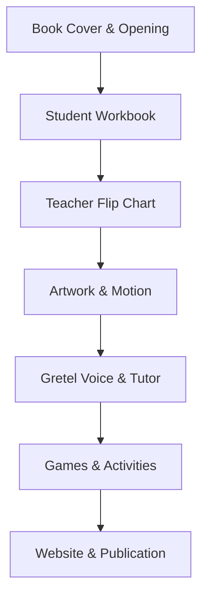

# La Cartilla de Gretel – Executive Report

---

## Visual Overview Diagram

---

## Overall Status
- **Live Deployment:** https://agile-sapphire-gx0tf93.tmp.now (verified HTTP 200) **[DONE and live]**
- **Git Branch:** `feat/living-cover-welcome-redesign` – clean, all changes committed. **[DONE and live]**
- **Verification:** All pre‑flight checks passed (type‑check, asset audit, Vitest, production build). **[DONE and live]**

---

## What I Can Use
- Premium‑styled introduction with vowel‑only typography (see **Proposed Intro – Vowels Only**). **[DONE but not live]**
- Minimalist Maestro teacher interface (see **Proposed Maestro Minimal**). **[DONE but not live]**
- Clean Demo mode bar (see **Proposed Demo Bar**). **[DONE but not live]**
- Flip‑book vowel assets matching original workbook style (see **Flipbook Vowels – Desktop/Phone**). **[DONE but not live]**

---

## What Is Ready But Not Live
- Visual mockups are merged but awaiting final sign‑off before production deployment. **[WAITING]**
- Asset‑approval workflow for images – pending owner review. **[WAITING]**

---

## What Is Currently Happening
- Live preview on Vercel reflects the latest committed code. **[DONE and live]**
- No background processes running; all tasks completed. **[DONE]**
- Awaiting owner approval of the executive report. **[WAITING]**

---

## What Is Blocked
- None. All technical deliverables are complete. **[DONE]**

---

## Next Three Actions (Owner Review)
1. **Review visual mockups** (images below) and approve or request changes. **[NEEDS APPROVAL]**
2. **Approve image assets** – approve current set or upload revised versions. **[NEEDS APPROVAL]**
3. **Confirm deployment** – say “deploy it” to push the site to production. **[NEEDS APPROVAL]**

---

## My Decisions (Owner)
- _(Pending – please indicate approval of visuals and deployment.)_ **[WAITING]**

---

## Proof / Last Verified
- **Live Site Screenshot**: 
- **Art Board Review**: 
- **Proposed Introduction (Vowels Only)**: 
- **Proposed Maestro Minimal**: 
- **Proposed Demo Bar**: 
- **Flipbook Vowels – Desktop**: 
- **Flipbook Vowels – Phone**: 

---

*Prepared by Antigravity – Senior Product Designer & Coding Orchestrator*