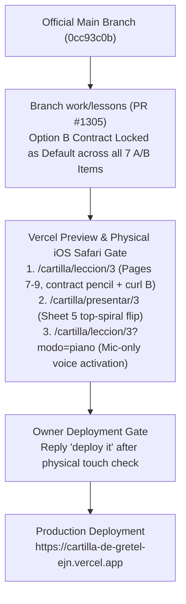

# OWNER VISUAL STATUS — LA CARTILLA DE GRETEL

**Repository:** `https://github.com/ejnburrows-rgb/cartilla-de-gretel`  
**Authoritative Execution Issue:** [#877](https://github.com/ejnburrows-rgb/cartilla-de-gretel/issues/877)  
**Target Pull Request:** [#1305](https://github.com/ejnburrows-rgb/cartilla-de-gretel/pull/1305) (`work/lessons`)  
**Production URL:** [https://cartilla-de-gretel-ejn.vercel.app](https://cartilla-de-gretel-ejn.vercel.app)  
**Live Alias:** [https://cartilla-de-gretel-psi.vercel.app](https://cartilla-de-gretel-psi.vercel.app)  
**Last Checked Date:** 2026-11-17 UTC  
**Official Main Revision:** `0cc93c0b`  
**Active Branch Revision:** `work/lessons` (Option B Contract Lock staged & verified: 59/59 focused tests passing, 0 TypeScript errors)  
**Deployment Gate:** Nothing merges to `main` or deploys to Vercel production until the owner replies `"deploy it"`.

---

## 1. Complete Repository & Release Map

---

## 2. Option B Contract Lock Details (All 7 A/B Items)

All 7 A/B comparison items now default to **Option B** with query parameter fallback overrides:

| Item | Default Behavior (Option B Locked) | Fallback Override |
| :--- | :--- | :--- |
| **Pencil action** | Single wooden tip, `#3a3a38` charcoal, 3.3–6.4px stroke, 400ms hold | `?cursor=normal` |
| **Eraser action** | 3.5s pink rub, 12 pink crumbs, removes red marks only | `?cursor=normal` |
| **Cursor mode** | `DEFAULT_CURSOR_MODE = "contract"` with touch/a11y fallback | `?cursor=normal` |
| **Student page curl** | Warm cream roll, specular highlight, mark-in-progress guard | `?curl=a` |
| **Teacher flipchart** | 2.0s top-spiral turn, crisp unstretched Sheet 5 | `?flip=a` |
| **Workbook Lesson 3** | Pages 7–9, contract pencil + curl B, no Gretel overlay | `/cartilla/leccion/3?cursor=normal&curl=a` |
| **Flipchart Lesson 3** | Sheet 5 with flip B on `/cartilla/presentar/3` and `/cartilla/teacher/flipchart?lesson=3` | `?flip=a` |

- **Exported Decision Ledger:** `public/review/owner-decisions-locked-b.json`

---

## 3. Verification Proof (`work/lessons`)

| Check | Result |
| :--- | :--- |
| **TypeScript (`tsc --noEmit`)** | 0 errors ✓ |
| **`cursor-mode.test.ts`** | 4/4 ✓ |
| **`WorkbookPencilMark.test.tsx`** | 14/14 ✓ (400ms hold, 12 crumbs) |
| **`PencilConnector.test.tsx`** | 11/11 ✓ |
| **`pencil-contract.test.ts`** | 5/5 ✓ |
| **`NativeLessonViewer` tests** | 17/17 ✓ |
| **`PianoMicrophoneOnly.test.tsx`** | 4/4 ✓ |
| **`owner-review-store.test.ts`** | 4/4 ✓ |
| **Focused Suite Total** | **59/59 ✓** |

---

## 4. Seven Product Areas Status

1. **Book Cover & Opening:** `DONE and live` (Cover animations and opening verified on live production).
2. **Student Workbook:** `DONE but not live` on `work/lessons` (Option B contract pencil, 3.5s pink eraser with 12 crumbs, warm cream curl B, and mark-in-progress guard locked as default; awaiting physical iOS Safari check and `"deploy it"`).
3. **Teacher Flip Chart:** `DONE but not live` on `work/lessons` (2.0s top-spiral turn and crisp unstretched Sheet 5 on `/cartilla/presentar/3` and `/cartilla/teacher/flipchart?lesson=3`).
4. **Artwork & Motion:** `WAITING` (Canonical artwork mapped; 27 flagged crops cataloged in `docs/review-2026-11-16/ARTWORK-ISSUES.csv`).
5. **Gretel Voice & Tutor:** `WAITING` (Strict silence gates active; missing picture-word clips in `docs/audio/MISSING_PICTURE_RECORDINGS.csv` and 21 game audio clips in `docs/review-2026-11-16/AUDIO-MANIFEST.csv`).
6. **Games & Activities:** `DONE but not live` on `work/lessons` (Mic-only piano verified in `PianoMicrophoneOnly.test.tsx`; 7 non-M `completar-palabras` answer keys `WAITING` on owner source).
7. **Website & Publication:** `DONE and live` on `main` (`https://cartilla-de-gretel-ejn.vercel.app`); PR #1305 ready for preview verification.

---

## 5. Parallel Non-Blocking Tracks

1. **Audio Assets (`WAITING`):**
   - Picture-word recordings → `public/audio/words/<slug>.mp3` (`docs/audio/MISSING_PICTURE_RECORDINGS.csv`)
   - 21 game audio clips (`cow-game-m`, `payaso-chano-ss`, `mariposas-p`) → `docs/review-2026-11-16/AUDIO-MANIFEST.csv`
2. **Answer Keys (`WAITING`):**
   - `completar-palabras` exercises in `src/content/games/completar-palabras.ts`
3. **Artwork Review (`WAITING`):**
   - 27 flagged crops (16 edge-touching, 11 below-target resolution) → `docs/review-2026-11-16/ARTWORK-ISSUES.csv`
4. **Permanent Source Exception:**
   - Workbook pages 86–87 do not exist in the physical book (`SOURCE_BLOCKED`); navigation jumps `85 ↔ 88` with strict silence/no-invention gates.
