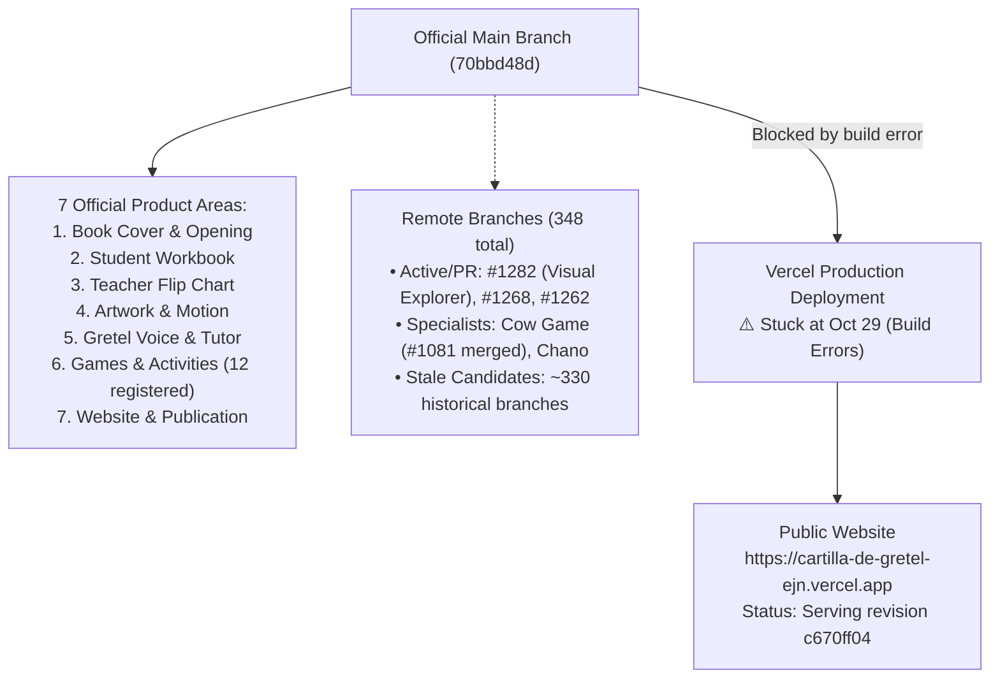
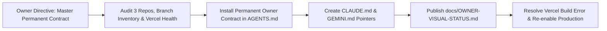

# OWNER VISUAL STATUS — LA CARTILLA DE GRETEL

**Repository:** `https://github.com/ejnburrows-rgb/cartilla-de-gretel`  
**Authoritative Execution Issue:** [#877](https://github.com/ejnburrows-rgb/cartilla-de-gretel/issues/877)  
**Production URL:** [https://cartilla-de-gretel-ejn.vercel.app](https://cartilla-de-gretel-ejn.vercel.app)  
**Last Checked Date:** 2026-11-07  
**Official Main Revision:** `70bbd48d` (feat: add Gretel pedagogical assistant exclusively to teacher platform)  
**Active Production Revision:** `c670ff04` (October 29, 2026)  
**Production Staleness Alert:** 🔴 **Production is 370 commits behind official main.** (Vercel builds on Nov 2 and Nov 4 failed; website serves Oct 29 deployment).

---

## 1. Complete Repository & Release Map

---

## 2. Current Session Work Map

---

## 3. Branch and Merge Status
- **Official Source:** `main` (`70bbd48d`)
- **Open Pull Requests (Sample):**
  - PR #1282: `docs: owner-approved in-chat visual repository explorer`
  - PR #1268: `🧹 [code health] Reduce deeply nested conditional ref logic in PencilConnector`
  - PR #1262: `⚡ Optimize O(N*M) loop in OrderedExercises to O(N) using Sets`
  - PR #1261: `⚡ Optimize LessonCompleteModal sticker lookup`
- **Total Remote Branches:** 348 branches.

---

## 4. Current Approved Work & Seven Section Overview
1. **Book Cover & Opening:** `DONE but not live` (Cover animations and opening verified on main).
2. **Student Workbook:** `DONE but not live` (Workbook layout and pencil kernel active on main).
3. **Teacher Flip Chart:** `DONE but not live` (Top binding flip animation verified).
4. **Artwork & Motion:** `DONE but not live` (Canonical artwork in `docs/artwork-reconciliation/mapping/MASTER-MAPPING.csv`).
5. **Gretel Voice & Tutor:** `DONE but not live` (Tutor files isolated; authentic audio locked).
6. **Games & Activities:** `DONE but not live` (12 games registered: `payaso-chano-ss`, `silabas-o`, `silabas-m`, `silabas-p`, `mariposas-p`, `vocal-a`, `fonetica-p`, `rima-p`, `palabras-minuto-p`, `dibujos-o`, `completar-palabras`, `cow-game-m`).
7. **Website & Publication:** `WAITING` (Vercel production build failure must be fixed).

---

## 5. Outstanding Blockers
- **Critical Blocker:** Vercel production deployment failed on Nov 2 and Nov 4 (`dpl_7HnGHAZmj43Vvyahz4avGyHeetiq`). Public domain remains frozen on Oct 29 commit `c670ff04`.
