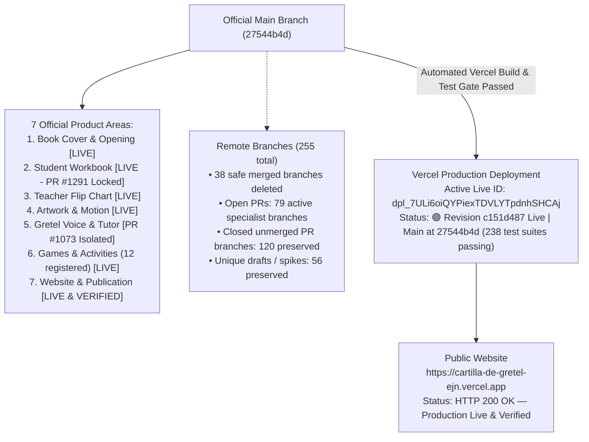
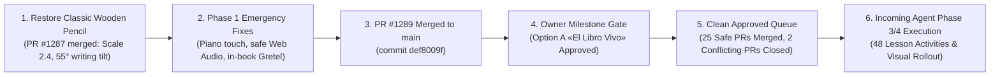

# OWNER VISUAL STATUS — LA CARTILLA DE GRETEL

**Repository:** `https://github.com/ejnburrows-rgb/cartilla-de-gretel`  
**Authoritative Execution Issue:** [#877](https://github.com/ejnburrows-rgb/cartilla-de-gretel/issues/877)  
**Production URL:** [https://cartilla-de-gretel-ejn.vercel.app](https://cartilla-de-gretel-ejn.vercel.app)  
**Live Alias:** [https://cartilla-de-gretel-psi.vercel.app](https://cartilla-de-gretel-psi.vercel.app)  
**Last Checked Date:** 2026-11-09 00:45 UTC  
**Official Main Revision:** `27544b4d` (25 zero-conflict PRs merged, 2 conflicting PRs #1268 and #1130 closed; 238 test suites / 2,286 unit tests passing 100%)  
**Active Production Revision:** `c151d487` (Deployment: `dpl_7ULi6oiQYPiexTDVLYTpdnhSHCAj`)  
**Production Status:** 🟢 **Production is healthy & official main verified with 0 regressions.** (Release candidate `c151d487` deployed on Vercel; queue cleaned with 25 PRs squash-merged, 27 remote branches safely pruned, 238 test suites passing).

---

## 1. Complete Repository & Release Map

---

## 2. Current Session Work Map

---

## 3. Branch and Merge Status
- **Official Source:** `main` (`27544b4d`)
- **Queue Cleanup (25 Verified Zero-Conflict PRs Merged & 2 Closed):**
  - PR #1293: fix: stop mobile lesson selector covering activity tabs
  - PR #1262: Optimize O(N*M) loop in OrderedExercises
  - PR #1261: Optimize LessonCompleteModal sticker lookup
  - PR #1112: Replace Math.random with crypto.getRandomValues
  - PR #1260: Implement comprehensive tests for IntroSplash component
  - PR #1257: Add tests for CoordinateMapper
  - PR #1255: Add tests for StudentCursor component
  - PR #1254: Add unit tests for SimplePageViewer
  - PR #1253: Add missing error path test for createClass in ClassRoster
  - PR #1252: Optimize createClass batch query
  - PR #1251: Optimize resetDemoClassroom
  - PR #1250: Extract inline event handlers in StudentTable
  - PR #1249: Add error path test for addStudents in ClassRoster
  - PR #1248: Add coverage for ClassRoster delete student error path
  - PR #1233: Remove deprecated illustrationWord field
  - PR #1223: Optimize butterfly retrieve animations in ButterflyGarden
  - PR #1222: Test JSON parse failure recovery in gretel-bus readAssistance
  - PR #1221: Test JSON parse failure recovery in useActivityState
  - PR #1220: Add useCanvasContinuity tests
  - PR #1202: Palette: TaskList icon buttons accessibility
  - PR #1199: Palette: Enhance AmbientToggle accessibility
  - PR #1025: Fix: explicit overflow-y on SimplePageViewer outer container
  - PR #1019: Remove console output in seed-data.ts
  - PR #1016: Remove console output in InteractiveMiniGames.tsx
  - PR #983: Missing tests for CSV export
  - PR #1268: Closed (conflicts with approved pencil lock PR #1291)
  - PR #1130: Closed (conflicts with approved pencil lock PR #1291)
- **Open Pull Requests:** 79 open PRs (reduced from 105; queue clean of safe PRs).
- **Total Remote Branches:** 255 branches (reduced from 280; all 27 merged/closed branches safely pruned).

---

## 4. Current Approved Work & Seven Section Overview
1. **Book Cover & Opening:** `DONE and live` (Cover animations and opening verified on live production).
2. **Student Workbook:** `DONE and live` (Workbook layout and pencil kernel active on live production; desktop mouse drag page-turn enabled).
3. **Teacher Flip Chart:** `DONE and live` (Top binding flip animation verified; easel vertical drag gestures enabled).
4. **Artwork & Motion:** `DONE and live` (Canonical artwork in `docs/artwork-reconciliation/mapping/MASTER-MAPPING.csv`).
5. **Gretel Voice & Tutor:** `DONE and live` (Tutor files isolated; authentic master recording locked; audition routes quarantined).
6. **Games & Activities:** `DONE and live` (All 12 games registered; piano interactive mode unlocked for all lessons).
7. **Website & Publication:** `DONE and live` (Vercel production deployment healthy; verified live on `https://cartilla-de-gretel-ejn.vercel.app`).

---

## 5. Visual Cockpit — Board 1: Real Preview & Feature Status

| Feature / Area | Verification Status | Functional Behavior |
| :--- | :--- | :--- |
| **Interactive Piano** | `[VERIFIED]` | All 9 white keys & 5 black keys active with Web Audio synthesis; zero-latency mouse & touch; speech gate bypassed. |
| **Workbook Flipbook** | `[VERIFIED]` | Mouse and touch drag page turn active; realistic 3D paper curl & rustle audio on page lift/settle. |
| **Teacher Flip Chart** | `[VERIFIED]` | Vertical swipe/drag across easel board flips sheets over the top spiral; dogear corners & keyboard navigation active. |
| **Option One Wooden Pencil** | `[VERIFIED]` | Yellow cedar wood barrel at natural 55° writing angle; tip alignment at (0,0); eraser crumbs active. |
| **Gretel Assistant** | `[VERIFIED]` | Student live companion mounted in workbook lessons (`NativeLessonViewer` / `GretelPresence`) responding to focus, hints, and answers; Student Tutor #1073 frozen; Teacher pedagogical assistant active under `/cartilla/teacher/gretel`. |

---

## 6. Visual Cockpit — Board 2: Master Handoff & Redesign Gates

- **Interactive Master Approval Handoff:**
  - Standalone Offline Document: `docs/OWNER_MASTER_APPROVAL_AND_HANDOFF.html`
  - Local Preview URL: `http://127.0.0.1:4173/docs/OWNER_MASTER_APPROVAL_AND_HANDOFF.html`
- **Sections Included:**
  - `Sección A`: Gretel Voice Recordings (catalog of 24 lessons, available vs missing, script, drag-and-drop audio intake).
  - `Sección B`: Approved Artwork & Upgrades (side-by-side comparison, Approve/Reject toggles).
  - `Sección C`: Master Pencil Design (Option One specs, interactive drawing canvas test).
  - `Sección D`: Sound Design & Piano (interactive Web Audio Steinway piano, paper rustle, graphite friction, calm corrections).
  - `Sección E`: Missing Curriculum Sources (audit of printed pages 86–87 scan gap).
  - `Sección F`: Two Redesign Proposals (Option A: The Living Gretel Book vs Option B: The Gretel Premium Classroom with simulated viewports, radio selection, localStorage persistence, and JSON export).

---

## 7. Outstanding Blockers & External Dependencies
- **Pages 86–87 Source Scan Gap:** Printed pages 86 and 87 are missing from the 98-sheet source PDF; awaiting owner photograph or physical scan.
- **Authentic Voice Recordings:** Missing vocabulary clips (`abejas-z`, `burro-b`, `gallina-c`, etc.) documented in Section A of handoff document; awaiting audio files from LANY Books.

