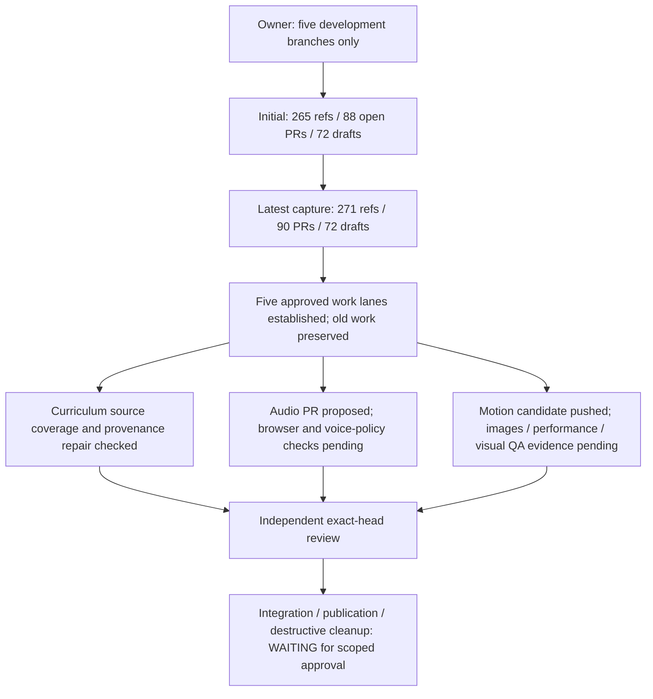
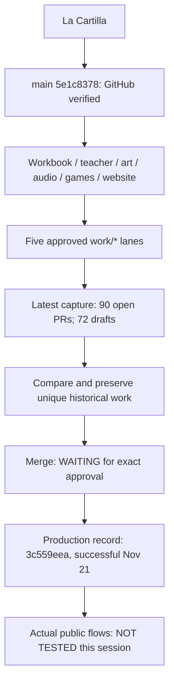
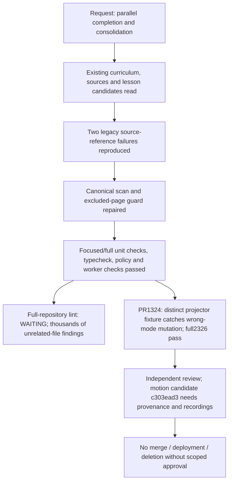
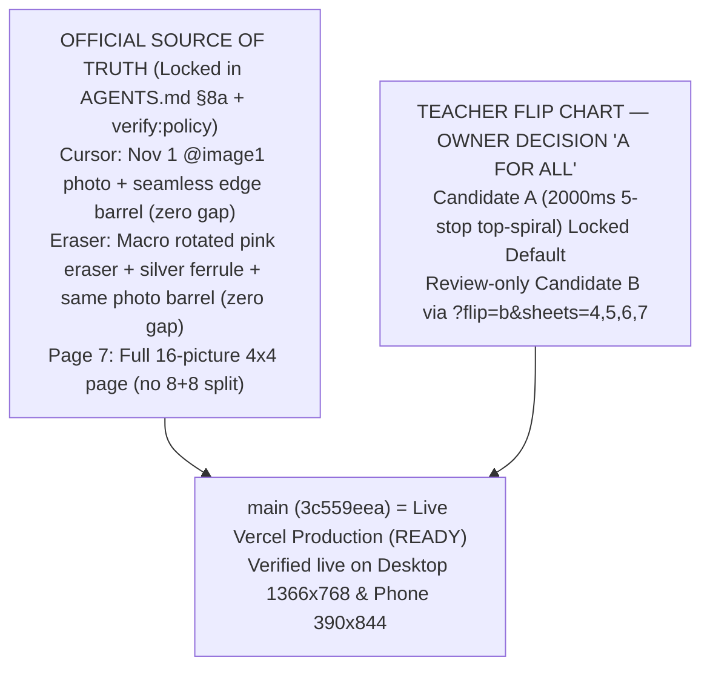

# OWNER VISUAL STATUS: LA CARTILLA DE GRETEL

Shared current report: https://github.com/ejnburrows-rgb/cartilla-de-gretel/issues/877#issuecomment-7199730025

<!-- cartilla-parallel-report-2026-11-26 -->
## LA CARTILLA: parallel completion report

Last verified: 2026-11-26. Owner scope: [coordination thread](https://app.slack.com/archives/C0CM2CMH68K/p1795715194468199). This is the single consolidated lane report; historical approvals and proof are preserved, not reinterpreted as current authorization.

**OVERALL: NOT TESTED** for the complete client demonstration. Source inspection and the first bounded repair are evidenced below. Nothing merged, deployed or deleted.

### Shared report

| Agent | Assignment | Branch | Progress | Defects | PR | Evidence | Blocker |
| --- | --- | --- | --- | --- | --- | --- | --- |
| Viktor | Coordination + curriculum | work/curriculum | DONE but not live: bounded source-reader provenance repair and complete source coverage report; overall curriculum runtime NOT TESTED | Wrong legacy image provenance; excluded p87 leaked image references; both reproduced before repair | [#1324](https://github.com/ejnburrows-rgb/cartilla-de-gretel/pull/1324) | 24 lessons / 88 available pages / 62 teacher sheets inventoried; 115 focused tests; full unit suite 2326 pass + 2 expected failures; typecheck, scoped lint, worker and policy checks pass | Independent final-head review; full physical-source and runtime acceptance outstanding |
| Devin | Audio, speech, demo navigation and interactions | work/audio-interactions | NOT TESTED: proposed implementation unit-tested by lane; browser acceptance outstanding | Demo progression isolation proposed; recorded instruction recovery has unresolved approval/provenance conflict | [#1325](https://github.com/ejnburrows-rgb/cartilla-de-gretel/pull/1325), inspected head 3cdaad6c | [Lane receipt](https://github.com/ejnburrows-rgb/cartilla-de-gretel/issues/877#issuecomment-7199844638); reported 2333 tests/typecheck/policy; coordinator read PR and recovery document | Browser proof and voice-policy resolution; global Muy bien remains unbound pending approval |
| hoplite, images thread | All Workbook / teacher / game artwork | work/images | NOT TESTED: source inventory rechecked; broad rendered audit underway per lane | 25 quality + 124 provenance flags retained as review flags, not all confirmed visual defects; two stale unused audit rows noted | Existing #1171 / #943 / #1209 / #1166 / #1168 reviewed by lane; no new image PR confirmed | [Images receipt](https://github.com/ejnburrows-rgb/cartilla-de-gretel/issues/877#issuecomment-7199774563) | Exact rendered evidence and authentic-source approvals; delivery sizing handed to performance |
| hoplite, assets thread | Living illustrations, games and motion | work/assets-motion | NOT TESTED: candidate code pushed; visual/full-round acceptance outstanding | Cow paint-order fix, Chano recovery and three motion rebuilds present in source; lane reports 24 baseline browser failures | No PR found at verification; [candidate c303ead3](https://github.com/ejnburrows-rgb/cartilla-de-gretel/commit/c303ead3ec23eaefe1c213e212cec07abc972a54) | [Motion receipt](https://github.com/ejnburrows-rgb/cartilla-de-gretel/issues/877#issuecomment-7200277591); coordinator compared all 33 changed paths against main | Chano provenance, elephant motion-off intent, exact test evidence and complete-round recordings pending |
| Computer | Performance, layout and stability | work/performance | NOT TESTED: inspection acknowledged | Repository-wide lint fails (8058 errors / 59 warnings); GitHub reports dependency alerts, exploitability not assessed | Existing performance proposals retained | Slack receipt; coordinator full-lint output; GitHub push alert summary | Full health findings/browser evidence pending; cross-lane source changes require writer handoff |
| Instinct | Independent visual/interaction QA | None, read-only | NOT TESTED: read-only inspection acknowledged | Findings must distinguish observed failures from untested behavior | None | Slack receipt: testing private review site; cannot record browser video | Exact revision, screenshots and complete coverage receipt pending; video evidence must come from another authorized lane |
| CodeRabbit | Independent integration and cleanup review | None, read-only | WAITING for material exact-head review receipt | Check fixes, overlap, security and incomplete claims | #1324 / #1325 and every later proposal | Review requested in Slack; PR review checks are not assumed approvals | No final-head independent approval receipt yet |
| Gitar | Exhaustive branch/draft disposition comparison | None, read-only | WAITING for exhaustive actual-comparison receipt | Every current ref and PR must be classified with evidence, destination and rationale | All 90 captured open PRs, including all 72 drafts | Exhaustive metadata CSVs retained; no substantive dispositions invented | Full commit/asset/test comparisons and independent CodeRabbit cleanup review pending |

### Source coverage and recovery

- All 24 lessons have native representation; all 88 available Workbook leaves have populated layouts and repository scans. Every one of the 62 Flip Chart sheets has a source image; sheets 3–62 have digital text, while 1–2 are frontmatter. [Detailed audit with every lesson/page/sheet and 25 inspected PR heads](https://github.com/ejnburrows-rgb/cartilla-de-gretel/blob/work/curriculum/docs/consolidation/CURRICULUM-SOURCE-AUDIT-2026-11-26.md).
- Registry coverage and fixture agreement do not certify physical-source fidelity or rendered activity correctness. Teacher guide originals remain partly missing. No invented answer keys or content.
- Existing lesson drafts remain preserved. They overlap shared renderers, routes and interactions and must only contribute a demonstrated missing delta. #1210's caption reversal conflicts with the approved singular ojo lock; do not recover that hunk. #1022 carries useful old geometry/interaction candidates, not missing lesson registrations.
- The narrow repair touches only workbook-source.ts and its focused coverage test. It chooses canonical printed-page scan references and returns no image metadata for excluded 86–87. The helper has no located mounted learner consumer. No claim of a current visible lesson fix or UI change. Existing six legacy text flags are preserved, not treated as newly verified Workbook transcription.

### Writer reservations and sequencing

- Viktor: docs/OWNER-VISUAL-STATUS.md, docs/consolidation/, src/lib/workbook-source.ts, src/lib/__tests__/native-workbook-coverage.test.tsx. No shared renderer, route, artwork, audio or Tutor edit.
- Devin: interaction/demo/audio changes listed in #1325. These do not overlap the two curriculum source files. Exact-file review is required before further pushes.
- Images owns image evidence/approved source pixels. Motion owns game/living behavior. Computer owns art-delivery.ts and delivery-output recovery from #1171; images supplies comparisons. Do not independently port the same delivery patch twice. Shared living tests require a handoff to the motion writer.
- Recover approved source mappings first; then consumers and shared interaction behavior; then complete assembled curriculum/game QA and performance regression checks. Independent review must reference the exact proposed head. No blanket approval or fixed merge order is inferred.

### Seven product areas

| Area | Current session status | Next check / dependency |
| --- | --- | --- |
| Book Cover & Opening | NOT TESTED | Existing main preserved; current opening/browser acceptance |
| Student Workbook | NOT TESTED overall; source-reader repair DONE but not live | 24 lessons / 88 available pages source-covered; full interactions, source fidelity and demo evidence pending; 85→88 preserved |
| Teacher Flip Chart | NOT TESTED | 62 source sheets inventoried; verify content/rendered classroom behavior; preserve Candidate A and approved whole-sheet exceptions |
| Artwork & Motion | NOT TESTED | Three rebuilt motion candidates in c303ead3; images confirms Chano provenance and elephant motion-off intent before any registry change; recordings pending |
| Gretel Voice & Tutor | WAITING for audio approval/provenance resolution | #1325 recovered-master document names WhatsApp MP3s and pending approval; current AGENTS allows newly wired approved-original audio only. Preserve files; provide exact later approval or leave wiring silent. Tutor #1073/#1322/#1323 retains separate approval boundaries |
| Games & Activities | NOT TESTED | Cow paint-order repair and Chano recovery in c303ead3; no draft PR yet; baseline failures and complete-round QA pending; Butterfly Garden preserved |
| Website & Publication | WAITING for separately authorized release | Main 5e1c8378 differs from latest recorded production 3c559eea only in owner-status documentation. Actual served revision and complete demonstration not reverified here |

### Complete repository and release map

Main is one documentation-only commit ahead of the latest successful GitHub production record. This is not proof of a missing app release or current domain alignment.

### This session's work map

### Repository inventory and new arrivals

- [Initial snapshot](https://github.com/ejnburrows-rgb/cartilla-de-gretel/tree/work/curriculum/docs/consolidation): 265 original branches, then five approved refs = 270 captured rows; 88 initial PRs / 72 drafts. Both original CSVs retained.
- Refreshed exhaustive metadata: branch-current.csv contains 271 refs; open-pr-current.csv contains 90 PRs, all 72 drafts. Includes new #1324, #1325 and backup/local-main-workbook-polish-20261126 at 03f09d21. Backup creator/preservation purpose requested; keep it intact. No sixth implementation lane approved. Snapshots record heads at capture time, not a claim of a timeless latest count.
- KEEP only identifies main, owner-approved lanes and current lane proposals. Other rows remain BLOCKED until actual commit/change/asset/test/dependency comparison. These metadata rows are not Gitar's completed substantive dispositions and do not authorize archive/delete/merge.

### What can be used / ready but not live / next actions / decisions

- This session proves source metadata, the bounded API repair and automated checks, not premium client-demo readiness. Historical live proof remains dated.
- Next: independent #1324/#1325 review and voice-policy resolution; collect full browser QA and image/motion/performance evidence; complete Gitar's exhaustive actual-comparison inventory and independent review. Emilio is not asked to coordinate the agents.
- Merges, destructive cleanup, publication and new art/voice approvals remain separately gated. Pages 86–87 are permanently excluded. No paid service, Supabase change, student-data use, TTS, new artwork or Tutor rebuild.

### Proof / last verified

- Main: [5e1c8378](https://github.com/ejnburrows-rgb/cartilla-de-gretel/commit/5e1c8378d15ca6aa1120683149e9e722084aa93d). [Recorded production comparison](https://github.com/ejnburrows-rgb/cartilla-de-gretel/compare/3c559eea6813b882ce51590ff112dfc99a26fec5...5e1c8378d15ca6aa1120683149e9e722084aa93d): one documentation file only.
- Two new regression tests failed before repair and pass after. Focused five files: 112 baseline / 115 after. Full unit suite: 244 files, 2326 passed + 2 expected failures. Typecheck, scoped ESLint, verify:worker and all 95 policy tests pass; asset verifier: 588 checks / no errors, with artwork warnings retained for images lane.
- Repository-wide lint: 8117 findings = 8058 errors + 59 warnings. The two changed TypeScript files pass scoped lint; no blind repo-wide formatting applied. Baseline scoped test had one existing formatting error, corrected within that already edited test file. App production build and browser flows not run for this latent API-only change.
- GitHub reported 75 dependency alerts: 1 critical / 40 high / 24 moderate / 10 low. Alert counts are not exploitability findings; Computer/Gitar asked to reconcile paths and exposure.

Complete captured branch map: 271 exact references

- `activity/chano-rebuild-20261019`: BLOCKED: preservation/content comparison pending, no deletion recommendation; `87ba23cc`
- `activity/completar-palabras`: BLOCKED: preservation/content comparison pending, no deletion recommendation; `22a179df`
- `activity/cow-game`: BLOCKED: preservation/content comparison pending, no deletion recommendation; `0f88b8f5`
- `activity/cow-game-18247010529815853258`: BLOCKED: preservation/content comparison pending, no deletion recommendation; `92553687`
- `activity/cow-wip-20261019`: BLOCKED: preservation/content comparison pending, no deletion recommendation; `5a035b53`
- `activity/lectura-de-palabras`: BLOCKED: preservation/content comparison pending, no deletion recommendation; `7030e13e`
- `activity/letter-picker`: BLOCKED: preservation/content comparison pending, no deletion recommendation; `6428ccd5`
- `activity/palabras-por-minuto`: BLOCKED: preservation/content comparison pending, no deletion recommendation; `97f8dd8b`
- `activity/palabras-por-minuto-11657455097900780082`: BLOCKED: preservation/content comparison pending, no deletion recommendation; `a41c7fd4`
- `activity/rima`: BLOCKED: preservation/content comparison pending, no deletion recommendation; `4c9eb455`
- `approval-pack-issue-1047-9061935140164812217`: BLOCKED: preservation/content comparison pending, no deletion recommendation; `a08e65c0`
- `art-board-repair-4`: BLOCKED: preservation/content comparison pending, no deletion recommendation; `5381f531`
- `art-inventory-live`: BLOCKED: preservation/content comparison pending, no deletion recommendation; `3ed9b22a`
- `art-inventory-page`: BLOCKED: preservation/content comparison pending, no deletion recommendation; `b8457a32`
- `artwork-optimization-batch-d-10885364352039601684`: BLOCKED: preservation/content comparison pending, no deletion recommendation; `84ef8ce7`
- `artwork/flipchart-approved-seven-20261020`: BLOCKED: preservation/content comparison pending, no deletion recommendation; `0245228f`
- `artwork/lesson3-approved-five`: BLOCKED: preservation/content comparison pending, no deletion recommendation; `1e53e9dd`
- `asignado-error-20261025`: BLOCKED: preservation/content comparison pending, no deletion recommendation; `db6cf9e1`
- `audio/owner-instructions-20261019`: BLOCKED: preservation/content comparison pending, no deletion recommendation; `5364b587`
- `audio/owner-instructions-20261019-15155392506160733243`: BLOCKED: preservation/content comparison pending, no deletion recommendation; `deb326fc`
- `audit/picture-slot-manifest`: BLOCKED: preservation/content comparison pending, no deletion recommendation; `ae26ec3e`
- `backup/local-main-workbook-polish-20261126`: BLOCKED: preservation/content comparison pending, no deletion recommendation; `03f09d21`
- `bolt-memoize-cartilla-drawings-1554907485128515753`: BLOCKED: preservation/content comparison pending, no deletion recommendation; `d66d3b18`
- `bolt-memoize-cartilla-svgs-12548474222664525219`: BLOCKED: preservation/content comparison pending, no deletion recommendation; `824ea75c`
- `bolt-performance-audio-multiple-choice-9425995739704249950`: BLOCKED: preservation/content comparison pending, no deletion recommendation; `84ee7007`
- `bolt-performance-improvement-17643219387104126685`: BLOCKED: preservation/content comparison pending, no deletion recommendation; `b21a0bf9`
- `chore-art-board-7570696409652978848`: BLOCKED: preservation/content comparison pending, no deletion recommendation; `b4e0caff`
- `chore/approval-pack-20261020-3539923526613815335`: BLOCKED: preservation/content comparison pending, no deletion recommendation; `e0a4017b`
- `chore/art-audit-regen-20261023`: BLOCKED: preservation/content comparison pending, no deletion recommendation; `9c366b48`
- `chore/proofs-completar-palabras-2619655779682505490`: BLOCKED: preservation/content comparison pending, no deletion recommendation; `627b734c`
- `chore/regenerate-delivery-art-20261017`: BLOCKED: preservation/content comparison pending, no deletion recommendation; `29878827`
- `chore/screenshot-all-lessons-14098848796302342076`: BLOCKED: preservation/content comparison pending, no deletion recommendation; `37b4758c`
- `ci/pr-lightweight-verification-20261101`: BLOCKED: preservation/content comparison pending, no deletion recommendation; `c2dadf94`
- `cleanup/remove-dead-workbook-components`: BLOCKED: preservation/content comparison pending, no deletion recommendation; `ff8d7315`
- `code-health-remove-illustrationword-6678577113224792752`: BLOCKED: preservation/content comparison pending, no deletion recommendation; `79790c9d`
- `code-health/remove-unused-import-check-15160267718005428107`: BLOCKED: preservation/content comparison pending, no deletion recommendation; `d0efbb0e`
- `codex/mariposas-mm-prototype-20261018`: BLOCKED: preservation/content comparison pending, no deletion recommendation; `231c45b8`
- `continuation/1247-review`: BLOCKED: preservation/content comparison pending, no deletion recommendation; `34f899b7`
- `continuation/1247-source-recovery`: BLOCKED: preservation/content comparison pending, no deletion recommendation; `51d2eb8d`
- `continuation/1247-test-repairs`: BLOCKED: preservation/content comparison pending, no deletion recommendation; `69325f0d`
- `controller/jobs/d258e76a-4875-4178-b06f-0c0bf03e48c4-8404474860463475856`: BLOCKED: preservation/content comparison pending, no deletion recommendation; `1627114b`
- `controls/execution-gate-20261019`: BLOCKED: preservation/content comparison pending, no deletion recommendation; `725a5a4a`
- `devin/1795540156-demo-handoff-20261124`: BLOCKED: preservation/content comparison pending, no deletion recommendation; `11fef427`
- `docs/20261022-integration-recovery`: BLOCKED: preservation/content comparison pending, no deletion recommendation; `053a167d`
- `docs/branch-rules-20261109`: BLOCKED: preservation/content comparison pending, no deletion recommendation; `28831181`
- `docs/chano-proof-pack-20261021`: BLOCKED: preservation/content comparison pending, no deletion recommendation; `03cb133a`
- `docs/marking-rule-20261019`: BLOCKED: preservation/content comparison pending, no deletion recommendation; `b7e77bbe`
- `docs/owner-artwork-single-source-20261022`: BLOCKED: preservation/content comparison pending, no deletion recommendation; `4b1ae3e7`
- `docs/owner-communication-rules-20261019`: BLOCKED: preservation/content comparison pending, no deletion recommendation; `38969c3e`
- `docs/owner-in-chat-visual-explorer-20261104`: BLOCKED: preservation/content comparison pending, no deletion recommendation; `1d54c996`
- `docs/two-map-standard-main`: BLOCKED: preservation/content comparison pending, no deletion recommendation; `d766a7d8`
- `draft/lane-b-workbook-lessons-8-18`: BLOCKED: preservation/content comparison pending, no deletion recommendation; `fed42a78`
- `draft/lane-c-lessons-19-24`: BLOCKED: preservation/content comparison pending, no deletion recommendation; `bad11f7f`
- `draft/one-book-marking-feel`: BLOCKED: preservation/content comparison pending, no deletion recommendation; `73576fda`
- `empty-branch-no-changes-3809743601414912744`: BLOCKED: preservation/content comparison pending, no deletion recommendation; `473b7e87`
- `evidence/artwork-coverage-20261014`: BLOCKED: preservation/content comparison pending, no deletion recommendation; `54a21ee0`
- `feat/art-board-owner-replacement-intake-20261031`: BLOCKED: preservation/content comparison pending, no deletion recommendation; `d6025bc3`
- `feat/flipchart-living-book-finish`: BLOCKED: preservation/content comparison pending, no deletion recommendation; `b0a1e3f6`
- `feat/games-realism-overhaul`: BLOCKED: preservation/content comparison pending, no deletion recommendation; `8d333a74`
- `feat/generic-mini-games`: BLOCKED: preservation/content comparison pending, no deletion recommendation; `16a197bd`
- `feat/gretel-resumable-cloned-voice-20261014`: BLOCKED: preservation/content comparison pending, no deletion recommendation; `237920f7`
- `feat/gretel-tutor-l1-3`: BLOCKED: preservation/content comparison pending, no deletion recommendation; `12e9adf5`
- `feat/palabras-parejas-pencil-game`: BLOCKED: preservation/content comparison pending, no deletion recommendation; `eb9fcd78`
- `feat/workbook-card-living-motion`: BLOCKED: preservation/content comparison pending, no deletion recommendation; `a40a6f66`
- `feature/ash-pencil-marking-9614802336538650232`: BLOCKED: preservation/content comparison pending, no deletion recommendation; `fea63535`
- `feature/issue-1035-welcome-video-7305563812994230697`: BLOCKED: preservation/content comparison pending, no deletion recommendation; `d4b70c1e`
- `feature/payaso-chano-carnival-20261018`: BLOCKED: preservation/content comparison pending, no deletion recommendation; `13d525b4`
- `feature/payaso-chano-carnival-web-game-20261018`: BLOCKED: preservation/content comparison pending, no deletion recommendation; `2a479367`
- `fix-871-872-7318880132108269741`: BLOCKED: preservation/content comparison pending, no deletion recommendation; `cfda0fc6`
- `fix-991-4215791666087499065`: BLOCKED: preservation/content comparison pending, no deletion recommendation; `7f12907d`
- `fix-console-error-officialworkbookpage-12555708987254256699`: BLOCKED: preservation/content comparison pending, no deletion recommendation; `bc8884e6`
- `fix-cow-game-lean-16082532411393598020`: BLOCKED: preservation/content comparison pending, no deletion recommendation; `92623c5d`
- `fix-cow-mouth-card-20261024`: BLOCKED: preservation/content comparison pending, no deletion recommendation; `b487aa5c`
- `fix-flipchart-turn-and-wire-37-pictures-12753578012614389808`: BLOCKED: preservation/content comparison pending, no deletion recommendation; `4a0cbe24`
- `fix-student-session-tests-88203299015634`: BLOCKED: preservation/content comparison pending, no deletion recommendation; `8a1b5fc4`
- `fix-teacher-crm-shell-save-error-7559252086311291039`: BLOCKED: preservation/content comparison pending, no deletion recommendation; `ae282a40`
- `fix-teacher-test-debt-4790278902171163137`: BLOCKED: preservation/content comparison pending, no deletion recommendation; `a53ed4bb`
- `fix-unused-useeffect-8831633729390263123`: BLOCKED: preservation/content comparison pending, no deletion recommendation; `53c07878`
- `fix-workbook-page-turn-desync-1138-16785535596755229948`: BLOCKED: preservation/content comparison pending, no deletion recommendation; `238784c0`
- `fix-workbook-page-turn-desync-2720709663285410452`: BLOCKED: preservation/content comparison pending, no deletion recommendation; `4d4f2087`
- `fix/airplane-asset-provenance`: BLOCKED: preservation/content comparison pending, no deletion recommendation; `51b2de01`
- `fix/arbol-faithful-derivative-20261022`: BLOCKED: preservation/content comparison pending, no deletion recommendation; `297031e7`
- `fix/art-audit-regen`: BLOCKED: preservation/content comparison pending, no deletion recommendation; `e7fad79b`
- `fix/canonical-artwork-authority-20261025`: BLOCKED: preservation/content comparison pending, no deletion recommendation; `e54d620e`
- `fix/cow-restart-cancel-pending-round-20261023`: BLOCKED: preservation/content comparison pending, no deletion recommendation; `4820bd2b`
- `fix/current-art-test-snapshot-sync-20261023`: BLOCKED: preservation/content comparison pending, no deletion recommendation; `862ad9db`
- `fix/cutoffs-l11-l12-l16`: BLOCKED: preservation/content comparison pending, no deletion recommendation; `70348c20`
- `fix/diamond-phone-lessons-17-20-3497466308479212378`: BLOCKED: preservation/content comparison pending, no deletion recommendation; `32495121`
- `fix/e2e-lcp-safety-and-traces-20261101`: BLOCKED: preservation/content comparison pending, no deletion recommendation; `37f7c7e8`
- `fix/fit-l1-l6`: BLOCKED: preservation/content comparison pending, no deletion recommendation; `d45f937b`
- `fix/fit-l8-l10-l14`: BLOCKED: preservation/content comparison pending, no deletion recommendation; `dfbea7fb`
- `fix/flipchart-focus-aware-keys-20261015`: BLOCKED: preservation/content comparison pending, no deletion recommendation; `467c872c`
- `fix/game-shell-rescue-14192818795883780064`: BLOCKED: preservation/content comparison pending, no deletion recommendation; `4681f541`
- `fix/issue-988-989-990-diamond-inward-520135429275310444`: BLOCKED: preservation/content comparison pending, no deletion recommendation; `67a15b98`
- `fix/keyboard-rewards-pipeline-20261010`: BLOCKED: preservation/content comparison pending, no deletion recommendation; `329683dd`
- `fix/landscape-shared`: BLOCKED: preservation/content comparison pending, no deletion recommendation; `b678c23f`
- `fix/lesson-3-vocal-a-proof-20261016`: BLOCKED: preservation/content comparison pending, no deletion recommendation; `57533f2d`
- `fix/lesson23-p85-phone-overflow-987-6451529366738365361`: BLOCKED: preservation/content comparison pending, no deletion recommendation; `2c0860b6`
- `fix/oveja-stale-guard-20261022-5450269019429767951`: BLOCKED: preservation/content comparison pending, no deletion recommendation; `5f3c4e51`
- `fix/page-seven-caption-fidelity`: BLOCKED: preservation/content comparison pending, no deletion recommendation; `f4cc2c4a`
- `fix/page24-syllable-completion-gate-20261109`: BLOCKED: preservation/content comparison pending, no deletion recommendation; `1a849c7e`
- `fix/payaso-chano-verified-followup-20261018`: BLOCKED: preservation/content comparison pending, no deletion recommendation; `45c6379c`
- `fix/production-art-audit-regen`: BLOCKED: preservation/content comparison pending, no deletion recommendation; `89f5d84d`
- `fix/remove-mariposas-live-registration`: BLOCKED: preservation/content comparison pending, no deletion recommendation; `4a3b6196`
- `fix/remove-unused-playWrongBuzz-7053316289168893159`: BLOCKED: preservation/content comparison pending, no deletion recommendation; `288e3d06`
- `fix/seroval-security-20261101`: BLOCKED: preservation/content comparison pending, no deletion recommendation; `c64efb3c`
- `fix/shared-landscape-844x390-20261018`: BLOCKED: preservation/content comparison pending, no deletion recommendation; `f7e19800`
- `fix/silent-picture-audio-failures`: BLOCKED: preservation/content comparison pending, no deletion recommendation; `e56f0a44`
- `fix/teacher-crm-student-consolidated`: BLOCKED: preservation/content comparison pending, no deletion recommendation; `af73cc9e`
- `fix/tutor-continuation-rule-20261029`: BLOCKED: preservation/content comparison pending, no deletion recommendation; `a767b3e8`
- `fix/unused-import-cinemanarrativedrawer-4604672354116594366`: BLOCKED: preservation/content comparison pending, no deletion recommendation; `cd47ffa9`
- `fix/workbook-connector-drawing-space`: BLOCKED: preservation/content comparison pending, no deletion recommendation; `5da7e927`
- `frontier-check-20261023`: BLOCKED: preservation/content comparison pending, no deletion recommendation; `060ed58d`
- `game/chano-scene`: BLOCKED: preservation/content comparison pending, no deletion recommendation; `10409fe8`
- `game/chano-scene-16399726599125817738`: BLOCKED: preservation/content comparison pending, no deletion recommendation; `da35efcd`
- `game/chano-scene-17875816284526073266`: BLOCKED: preservation/content comparison pending, no deletion recommendation; `cf6d0cb8`
- `game/chano-scene-2427511210327751668`: BLOCKED: preservation/content comparison pending, no deletion recommendation; `925ed11c`
- `game/chano-scene-9446293887144111614`: BLOCKED: preservation/content comparison pending, no deletion recommendation; `a6470e10`
- `game/chano-scene-juggling-16811216930405402616`: BLOCKED: preservation/content comparison pending, no deletion recommendation; `70d64964`
- `game/mariposas-fullscreen-scene`: BLOCKED: preservation/content comparison pending, no deletion recommendation; `6add8567`
- `games-author-template-verify`: BLOCKED: preservation/content comparison pending, no deletion recommendation; `f41be5c8`
- `import/lovable-bubble-organ-20261030`: BLOCKED: preservation/content comparison pending, no deletion recommendation; `d4bd70c4`
- `instinct/cream-all-lessons-20261019`: BLOCKED: preservation/content comparison pending, no deletion recommendation; `9aaca48c`
- `instinct/job-board-20261019`: BLOCKED: preservation/content comparison pending, no deletion recommendation; `753e5630`
- `instinct/rima-scene-20261019`: BLOCKED: preservation/content comparison pending, no deletion recommendation; `fdbdb232`
- `instinct/wave1-20261019`: BLOCKED: preservation/content comparison pending, no deletion recommendation; `889eb8c4`
- `jules-10937107692939251673-3b15676f`: BLOCKED: preservation/content comparison pending, no deletion recommendation; `8872cbfb`
- `jules-11052285982503720401-048387d0`: BLOCKED: preservation/content comparison pending, no deletion recommendation; `0a2b5770`
- `jules-11874299200599553645-8ee4205d`: BLOCKED: preservation/content comparison pending, no deletion recommendation; `e6fa9015`
- `jules-1275602888818406371-617a156f`: BLOCKED: preservation/content comparison pending, no deletion recommendation; `a6399690`
- `jules-13699223239101851335-0efdec33`: BLOCKED: preservation/content comparison pending, no deletion recommendation; `4b9f8788`
- `jules-1423541094767325541-117935ca`: BLOCKED: preservation/content comparison pending, no deletion recommendation; `08f5dd0a`
- `jules-1517843779007712447-6b84b75e`: BLOCKED: preservation/content comparison pending, no deletion recommendation; `6b49404c`
- `jules-15206535600738043919-43d5a913`: BLOCKED: preservation/content comparison pending, no deletion recommendation; `1e2bada9`
- `jules-17338434147384551620-a9907333`: BLOCKED: preservation/content comparison pending, no deletion recommendation; `2a19f061`
- `jules-2549739456209738351-fde48e41`: BLOCKED: preservation/content comparison pending, no deletion recommendation; `c3a801d2`
- `jules-4841332487619244204-b64ab120`: BLOCKED: preservation/content comparison pending, no deletion recommendation; `53dae356`
- `jules-5656770027037775722-ddcc791f`: BLOCKED: preservation/content comparison pending, no deletion recommendation; `dfbc3cf1`
- `jules-7049793572056880761-11799e44`: BLOCKED: preservation/content comparison pending, no deletion recommendation; `959b2c26`
- `jules-7483093215117529689-1faaabff`: BLOCKED: preservation/content comparison pending, no deletion recommendation; `1824c3bd`
- `jules-8032766179509994640-76600f65`: BLOCKED: preservation/content comparison pending, no deletion recommendation; `a9542521`
- `jules-9858490964964928859-89a60369`: BLOCKED: preservation/content comparison pending, no deletion recommendation; `1e92eff7`
- `jules-lane-1-lesson-3-combine-222380543456646405`: BLOCKED: preservation/content comparison pending, no deletion recommendation; `0203b080`
- `jules-route-health-sweep-11626026226717544025-13219304021638505007`: BLOCKED: preservation/content comparison pending, no deletion recommendation; `2e3e0a57`
- `jules/cow-game-nocut-13353135867314472258`: BLOCKED: preservation/content comparison pending, no deletion recommendation; `37c1f035`
- `jules/fix-issue-990-49148494207121750`: BLOCKED: preservation/content comparison pending, no deletion recommendation; `b0643477`
- `jules/l16-diamond-proofs-20261020`: BLOCKED: preservation/content comparison pending, no deletion recommendation; `3361e0ce`
- `jules/l17-diamond-port-20261020`: BLOCKED: preservation/content comparison pending, no deletion recommendation; `9e1e650c`
- `jules/workbook-navigation-investigation-17936492558897187064`: BLOCKED: preservation/content comparison pending, no deletion recommendation; `b412de4b`
- `kill-robot-voice-20261018`: BLOCKED: preservation/content comparison pending, no deletion recommendation; `3a9a518a`
- `lane-7-narration-wiring-20261018`: BLOCKED: preservation/content comparison pending, no deletion recommendation; `471eaa96`
- `lane-7/lesson-narration-player-5760229778479782012`: BLOCKED: preservation/content comparison pending, no deletion recommendation; `d479b95c`
- `lane-8-silent-pictures-20261017`: BLOCKED: preservation/content comparison pending, no deletion recommendation; `c1d9bc8c`
- `lane-8/piano-hablador`: BLOCKED: preservation/content comparison pending, no deletion recommendation; `5c4cd360`
- `lane-9-7984685098851494986`: BLOCKED: preservation/content comparison pending, no deletion recommendation; `2c3179ba`
- `lane-907-marking-doc-20261017`: BLOCKED: preservation/content comparison pending, no deletion recommendation; `7419912a`
- `lane/j14-student-bugs-20261023-2793417054701129627`: BLOCKED: preservation/content comparison pending, no deletion recommendation; `84e178db`
- `lane/j6-lesson3-archetype-20261023-16670984364862698664`: BLOCKED: preservation/content comparison pending, no deletion recommendation; `76d249d9`
- `lesson-14-wide-20261018`: BLOCKED: preservation/content comparison pending, no deletion recommendation; `975e90c9`
- `lessons/13-21-polish`: BLOCKED: preservation/content comparison pending, no deletion recommendation; `f209d76e`
- `lessons/15-19-22`: BLOCKED: preservation/content comparison pending, no deletion recommendation; `4a29efd1`
- `lessons/24-finish`: BLOCKED: preservation/content comparison pending, no deletion recommendation; `964a439a`
- `main`: canonical main, KEEP; `5e1c8378`
- `motion/d-estrella-unicornio`: BLOCKED: preservation/content comparison pending, no deletion recommendation; `8107c83c`
- `motion/l1-lane`: BLOCKED: preservation/content comparison pending, no deletion recommendation; `caecf185`
- `motion/l12-lane`: BLOCKED: preservation/content comparison pending, no deletion recommendation; `5f2795a8`
- `motion/l3-lane-a-vocal-a`: BLOCKED: preservation/content comparison pending, no deletion recommendation; `19d1ffad`
- `motion/l3-lane-b-vocal-o`: BLOCKED: preservation/content comparison pending, no deletion recommendation; `7228e407`
- `motion/l3-lane-c-elefante-iman`: BLOCKED: preservation/content comparison pending, no deletion recommendation; `40cea41c`
- `motion/l3-lane-rest`: BLOCKED: preservation/content comparison pending, no deletion recommendation; `809e5cd0`
- `motion/l4-lane`: BLOCKED: preservation/content comparison pending, no deletion recommendation; `ede84e25`
- `motion/l4-lane-8427355322964240127`: BLOCKED: preservation/content comparison pending, no deletion recommendation; `3d99b843`
- `motion/l9-lane`: BLOCKED: preservation/content comparison pending, no deletion recommendation; `adf51074`
- `motion/original-art-integration`: BLOCKED: preservation/content comparison pending, no deletion recommendation; `4e5318ef`
- `motion/rigid-originals-review`: BLOCKED: preservation/content comparison pending, no deletion recommendation; `7419c229`
- `muse/lesson-1-wide-20261018`: BLOCKED: preservation/content comparison pending, no deletion recommendation; `649020e9`
- `muse/lesson-10-wide-20261018`: BLOCKED: preservation/content comparison pending, no deletion recommendation; `d7fcc2bc`
- `muse/lesson-11-wide-20261018`: BLOCKED: preservation/content comparison pending, no deletion recommendation; `532e796c`
- `muse/lesson-12-wide-20261018`: BLOCKED: preservation/content comparison pending, no deletion recommendation; `c31eb1de`
- `muse/lesson-13-wide-20261018`: BLOCKED: preservation/content comparison pending, no deletion recommendation; `56755bb1`
- `muse/lesson-15-wide-20261018`: BLOCKED: preservation/content comparison pending, no deletion recommendation; `995c8383`
- `muse/lesson-16-wide-20261018`: BLOCKED: preservation/content comparison pending, no deletion recommendation; `c31e9fca`
- `muse/lesson-17-wide-20261018`: BLOCKED: preservation/content comparison pending, no deletion recommendation; `77239bdb`
- `muse/lesson-18-wide-20261018`: BLOCKED: preservation/content comparison pending, no deletion recommendation; `a0553862`
- `muse/lesson-19-wide-20261018`: BLOCKED: preservation/content comparison pending, no deletion recommendation; `a9b00f7d`
- `muse/lesson-2-wide-20261018`: BLOCKED: preservation/content comparison pending, no deletion recommendation; `a6efd31d`
- `muse/lesson-20-wide-20261018`: BLOCKED: preservation/content comparison pending, no deletion recommendation; `70af52ec`
- `muse/lesson-22-wide-20261018`: BLOCKED: preservation/content comparison pending, no deletion recommendation; `6fb3da8c`
- `muse/lesson-23-wide-20261018`: BLOCKED: preservation/content comparison pending, no deletion recommendation; `c70067b7`
- `muse/lesson-23-wide-20261018-1285022184792102783`: BLOCKED: preservation/content comparison pending, no deletion recommendation; `4151136a`
- `muse/lesson-24-phonefit-906-20261018`: BLOCKED: preservation/content comparison pending, no deletion recommendation; `ecc79cff`
- `muse/lesson-4-wide-20261018`: BLOCKED: preservation/content comparison pending, no deletion recommendation; `ea2a28bc`
- `muse/lesson-5-wide-20261018`: BLOCKED: preservation/content comparison pending, no deletion recommendation; `f6c08f35`
- `muse/lesson-6-wide-20261018`: BLOCKED: preservation/content comparison pending, no deletion recommendation; `e41315ed`
- `muse/lesson-7-wide-20261018`: BLOCKED: preservation/content comparison pending, no deletion recommendation; `c403a0e0`
- `muse/lesson-8-wide-20261018`: BLOCKED: preservation/content comparison pending, no deletion recommendation; `26465840`
- `muse/lesson-9-wide-20261018`: BLOCKED: preservation/content comparison pending, no deletion recommendation; `f24db653`
- `optimize-pencilconnector-usememo-4373553605638722711`: BLOCKED: preservation/content comparison pending, no deletion recommendation; `8dddd08a`
- `owner-approved-art-2026-10-13`: BLOCKED: preservation/content comparison pending, no deletion recommendation; `ce689b45`
- `owner-refs/20261019`: BLOCKED: preservation/content comparison pending, no deletion recommendation; `30dcbf61`
- `palabras-minuto-scene-mockup`: BLOCKED: preservation/content comparison pending, no deletion recommendation; `681e8db7`
- `palette-add-aria-labels-teacher-crm-4986591068699995326`: BLOCKED: preservation/content comparison pending, no deletion recommendation; `b066d2f6`
- `palette-ux-improvement-aria-label-student-table-14691290425896954333`: BLOCKED: preservation/content comparison pending, no deletion recommendation; `0f369213`
- `perf-optimize-catalog-lookup-14430398800763446712`: BLOCKED: preservation/content comparison pending, no deletion recommendation; `2c9ac1d6`
- `perf-optimize-identical-panels-3-17329093555446895783`: BLOCKED: preservation/content comparison pending, no deletion recommendation; `c3b2e777`
- `perf/bolt-svg-memo-9657023661306970366`: BLOCKED: preservation/content comparison pending, no deletion recommendation; `3ef48360`
- `perf/pencil-connector-targets-map-8456917166198423599`: BLOCKED: preservation/content comparison pending, no deletion recommendation; `a98d7f86`
- `perf/teacher-crm-lesson-title-optimization-9326228577634488353`: BLOCKED: preservation/content comparison pending, no deletion recommendation; `a9b345be`
- `proof/demo-2026-10-30`: BLOCKED: preservation/content comparison pending, no deletion recommendation; `7baa5f1d`
- `recover-batch-d-4111911948674152905`: BLOCKED: preservation/content comparison pending, no deletion recommendation; `85e9384e`
- `recovery/initial-restore-28dcc6d1aebc-20261023`: BLOCKED: preservation/content comparison pending, no deletion recommendation; `28dcc6d1`
- `recovery/initial-restore-bb958b513b5b-20261023`: BLOCKED: preservation/content comparison pending, no deletion recommendation; `bb958b51`
- `rescue-chano-proof-1046-4937915492600183092`: BLOCKED: preservation/content comparison pending, no deletion recommendation; `6e5baa9b`
- `retarget-1182-main-hb2105-17669066341744211388`: BLOCKED: preservation/content comparison pending, no deletion recommendation; `a459fb0c`
- `retarget/student-bugs-1157-20261024`: BLOCKED: preservation/content comparison pending, no deletion recommendation; `2521a07d`
- `revert/pr-944-chano-20261018`: BLOCKED: preservation/content comparison pending, no deletion recommendation; `08240984`
- `review/lesson-cream-reconcile-20261023`: BLOCKED: preservation/content comparison pending, no deletion recommendation; `ca36c733`
- `review/lesson-middle-proof-20261023`: BLOCKED: preservation/content comparison pending, no deletion recommendation; `1eb716ee`
- `review/lesson13-21-existing-reconcile-20261023`: BLOCKED: preservation/content comparison pending, no deletion recommendation; `a29f193d`
- `review/lesson23-existing-reconcile-20261023`: BLOCKED: preservation/content comparison pending, no deletion recommendation; `e23129ef`
- `review/lesson24-existing-reconcile-20261023`: BLOCKED: preservation/content comparison pending, no deletion recommendation; `c4b99381`
- `review/owner-visual-artwork-inventory-20261014`: BLOCKED: preservation/content comparison pending, no deletion recommendation; `ca9e771a`
- `security-hardening-9621522486306465010`: BLOCKED: preservation/content comparison pending, no deletion recommendation; `47d76a85`
- `shared/landscape-844x390-fix-20261018`: BLOCKED: preservation/content comparison pending, no deletion recommendation; `6a79bd5a`
- `swarm/lesson-20-wide-20261018`: BLOCKED: preservation/content comparison pending, no deletion recommendation; `8af5eadf`
- `swarm/lesson-21-wide-20261018`: BLOCKED: preservation/content comparison pending, no deletion recommendation; `a741a40c`
- `swarm/lesson-24-20261016`: BLOCKED: preservation/content comparison pending, no deletion recommendation; `0b4c500d`
- `swarm/lesson-24-wide-20261018`: BLOCKED: preservation/content comparison pending, no deletion recommendation; `7f7b7d63`
- `swarm/lesson-4-wide-20261018`: BLOCKED: preservation/content comparison pending, no deletion recommendation; `0afe96ee`
- `swarm/track-h-video-slot`: BLOCKED: preservation/content comparison pending, no deletion recommendation; `cb064001`
- `swarm/wb-syllable-recognition`: BLOCKED: preservation/content comparison pending, no deletion recommendation; `658671e4`
- `swarm/wb-viewport-a11y`: BLOCKED: preservation/content comparison pending, no deletion recommendation; `0282529d`
- `teacher-publish-surgical-20261025`: BLOCKED: preservation/content comparison pending, no deletion recommendation; `be3c9d39`
- `teacher/metodos-lectura-20261018`: BLOCKED: preservation/content comparison pending, no deletion recommendation; `4d6cded2`
- `tembo/tutor-dialogue-atlas`: BLOCKED: preservation/content comparison pending, no deletion recommendation; `6b3933b6`
- `tembo/tutor-lesson-sources`: BLOCKED: preservation/content comparison pending, no deletion recommendation; `feae79d7`
- `tembo/tutor-private-intake`: BLOCKED: preservation/content comparison pending, no deletion recommendation; `84f3a937`
- `test-use-idle-callback-2909133618559058829`: BLOCKED: preservation/content comparison pending, no deletion recommendation; `6a09fa79`
- `test-use-install-prompt-17996289134560944949`: BLOCKED: preservation/content comparison pending, no deletion recommendation; `de5eb479`
- `test-usePrefersReducedData-14886858556649185926`: BLOCKED: preservation/content comparison pending, no deletion recommendation; `164b90f0`
- `test/csv-export-coverage-20261018`: BLOCKED: preservation/content comparison pending, no deletion recommendation; `e8707b5f`
- `test/e2e-contract-repairs`: BLOCKED: preservation/content comparison pending, no deletion recommendation; `31b3f8a1`
- `test/intro-splash-coverage-5910386834210651247`: BLOCKED: preservation/content comparison pending, no deletion recommendation; `dab6a252`
- `test/useIdleCallback-5246638543812982644`: BLOCKED: preservation/content comparison pending, no deletion recommendation; `fd97eb8b`
- `tests/use-prefers-reduced-data-7467721207963361358`: BLOCKED: preservation/content comparison pending, no deletion recommendation; `7bfc7759`
- `tmp/l21-bin-test`: BLOCKED: preservation/content comparison pending, no deletion recommendation; `c95c541e`
- `verify-merge-queue-20261026-8172618744504956494`: BLOCKED: preservation/content comparison pending, no deletion recommendation; `9cd7bf04`
- `verify/art-served-20261022`: BLOCKED: preservation/content comparison pending, no deletion recommendation; `8bd0c1a8`
- `verify/cowgame-proof-1081`: BLOCKED: preservation/content comparison pending, no deletion recommendation; `7ccbffb5`
- `verify/pre-final-baseline-hb0305-8432968757821635112`: BLOCKED: preservation/content comparison pending, no deletion recommendation; `b6c4a02d`
- `verify/teacher-routes-20261022-retry`: BLOCKED: preservation/content comparison pending, no deletion recommendation; `fc86481b`
- `verify/teacher-routes-20261022-retry-11188047359894174848`: BLOCKED: preservation/content comparison pending, no deletion recommendation; `684b77e9`
- `verify/wordmatch-proof-1077`: BLOCKED: preservation/content comparison pending, no deletion recommendation; `47191626`
- `verify/workbook-fit-1063-proofs`: BLOCKED: preservation/content comparison pending, no deletion recommendation; `8aa7e82c`
- `voice/lesson-3-owner-only`: BLOCKED: preservation/content comparison pending, no deletion recommendation; `e9aa8f05`
- `wave1/completar-clean`: BLOCKED: preservation/content comparison pending, no deletion recommendation; `0c21983d`
- `wave1/cutoff-l11-l12-l16`: BLOCKED: preservation/content comparison pending, no deletion recommendation; `dd2e3561`
- `wave1/diamond-l8-l10-l14`: BLOCKED: preservation/content comparison pending, no deletion recommendation; `4681b5cf`
- `wave1/lesson16-clean`: BLOCKED: preservation/content comparison pending, no deletion recommendation; `4356c0ae`
- `wave1/letter-picker-clean`: BLOCKED: preservation/content comparison pending, no deletion recommendation; `e19b4468`
- `work/assets-motion`: owner-approved development lane, KEEP; `5e1c8378`
- `work/audio-interactions`: owner-approved development lane, KEEP; `3cdaad6c`
- `work/curriculum`: owner-approved development lane, KEEP; `b966d886`
- `work/images`: owner-approved development lane, KEEP; `5e1c8378`
- `work/performance`: owner-approved development lane, KEEP; `5e1c8378`
- `workbook/pages-A-20261019`: BLOCKED: preservation/content comparison pending, no deletion recommendation; `f6a609c4`
- `workbook/pages-B-20261019`: BLOCKED: preservation/content comparison pending, no deletion recommendation; `2ac141fa`
- `workbook/pages-C-20261019`: BLOCKED: preservation/content comparison pending, no deletion recommendation; `258f6dd7`
- `ws2-recovery/p1-11-whitespace-password`: BLOCKED: preservation/content comparison pending, no deletion recommendation; `0cc93c0b`
- `ws2b-recovery-1614-supabase-kit`: BLOCKED: preservation/content comparison pending, no deletion recommendation; `0cc93c0b`
- `ws2b-recovery-7816-pdf-thumbnails`: BLOCKED: preservation/content comparison pending, no deletion recommendation; `f06643f8`

Previous dated board: historical evidence, not a current-session live claim

# OWNER VISUAL STATUS — LA CARTILLA DE GRETEL

**Repository:** `https://github.com/ejnburrows-rgb/cartilla-de-gretel`  
**Authoritative Execution Issue:** [#877](https://github.com/ejnburrows-rgb/cartilla-de-gretel/issues/877)  
**Official Pencil Cursor Spec:** [PENCIL-CURSOR-SPEC.md](../PENCIL-CURSOR-SPEC.md) (Approved 2026-11-18, locked 2026-11-21)  
**Production URL (Live):** [https://cartilla-de-gretel-psi.vercel.app](https://cartilla-de-gretel-psi.vercel.app)  
**Production Alias:** [https://cartilla-de-gretel-ejn.vercel.app](https://cartilla-de-gretel-ejn.vercel.app)  
**Last Checked Date:** 2026-11-21  
**Canonical Main Branch:** `main` (`3c559eea` — PRs `#1316`, `#1317`, `#1318`, `#1319`)  
**Live Vercel Production:** `dpl_2mPdaWjZvBsypz61U6KCk5gej8Uh` (`READY`, `main` `3c559eea`, all 244/244 Vitest test files passed; `vercel.json` keeps `git.deploymentEnabled: false`).  
**Ledger Note:** `docs/COMPLETION_LEDGER.csv` does not exist on `main`; this document and `public/review/owner-decisions-locked-b.json` are the active status records.

---

## 1. Complete Repository & Release Map

---

## 2. Official Pencil, Eraser & Layout Standard (Permanent Lock — Never Revert)

- **Cursor / Writing Pencil (`74ccee59` / `9b379ad2`):** Exact owner-selected photographic sharpened wooden pencil (`public/cartilla/images/ui/owner-pencil-tip.svg` + `OwnerPhotoPencilSvg.tsx`, `600×497`, transparent background, sharp graphite point at exact `(0, 0)` hotspot) with seamless photographic yellow barrel (`op-barrel-pat`, `overflow="visible"`) extending continuously past all Desktop (`1366×768`), Phone (`390×844`), and Projector (`1920×1080`) edges — zero gap.
- **Rotated Macro Eraser End (`OwnerPhotoEraserSvg`):** Same zoomed-in `600×497` macro close-up scale (`252×209` desktop / `168×139` mobile) and `45°` down-right orientation rotated onto **just the pink rubber eraser dome + brushed silver metallic ferrule** at exact `(0, 0)` hotspot, joined seamlessly to the same photographic yellow hexagonal barrel (`OWNER_PENCIL_BARREL_TILE_DATA_URI`, `overflow="visible"`) extending off the page/viewport edges with zero gap during wrong-answer rubbing (`3.5 s`, `12` pink crumbs) and manual canvas erasing. Small/skinny full pencils, `owner-eraser.svg`, `pencil-cursor.svg`, `HdSchoolEraser.tsx`, and `PinkEraserBlock` are permanently deleted and blocked by `pnpm verify:policy`.
- **Full Workbook Page 7:** All 16 pictures (4×4 grid) render together on one page with zero `8+8` split buttons (`pnpm verify:policy` enforces this).
- **Locked Option A Styles (Lessons 1–24):** Workbook `curl=a` corner lift (no specular highlight) and Teacher Flip Chart Candidate A (`2000 ms` top-bound spiral flip) are the sole production defaults.

---

## 3. Seven Product Areas Status

1. **Book Cover & Opening:** `DONE and live` (Verified on production `3c559eea`).
2. **Student Workbook (90 pages, Lessons 1–24):** `DONE and live` (Live on `3c559eea`: full 16-picture Page 7, locked `@image1` photo writing pencil + macro rotated pink eraser, Option A `curl=a` default, Desktop/Tablet/Mobile/Projector layout clearance, `page-turn-soft.mp3` + mute stop + rapid-tap audio fix; pages `86–87` remain permanently `SOURCE_BLOCKED`).
3. **Teacher Flip Chart (62 HD sheets):** `DONE and live` (Live on `3c559eea`: Candidate A `2000 ms` 5-stop top-spiral turn locked as production default; review-only Candidate B via `?flip=b&sheets=4,5,6,7` with per-sheet lesson labels).
4. **Artwork & Motion:** `WAITING` (90-page `/revision#art` circled audit showing replacement candidates alongside current art is `DONE and live`; waiting on owner's Nov 19 Windows PC artwork folder + rebuilding 3 stale `*-alive.svg` animations: `wb-p1/abeja`, `p006-elefante`, `vocal-a/abeja`; 3 Page 16 crops `pez`/`traje`/`arco` pending layout wiring).
5. **Gretel Voice & Tutor:** `WAITING` (`AUDIO_POLICY.allowTts: false`; Tutor `#1073` untouched; waiting on 59 human voice clips + 24 lesson narrations + 1 Gretel welcome MP4).
6. **Games & Activities (12 games):** `DONE and live` (11/12 live and working on desktop and phone; `Mariposas` untouched; `completar-palabras` stays `WAITING` on owner answer keys).
7. **Website & Publication:** `DONE and live` (`main` `3c559eea` = live Vercel `dpl_2mPdaWjZvBsypz61U6KCk5gej8Uh`, verified live on Desktop `1366×768` and Phone `390×844` with 0 errors and 0 horizontal overflow).

---

## 4. Next Milestones (Authoritative Queue on [#877](https://github.com/ejnburrows-rgb/cartilla-de-gretel/issues/877))

1. **Rebuild 3 Stale Living-Motion Files:** Re-check coordinates and rebuild `wb-p1/abeja.svg`, `p006-elefante.png`, and `vocal-a/abeja.webp` via `scripts/living-motion/` and present on `/revision`.
2. **Integrate Owner Nov 19 PC Artwork Folder & Page 16 Crops (`pez`, `traje`, `arco`):** Place all replacement candidates on `/revision#art` for owner A/B approval before going live.
3. **Incorporate Owner Human Voice & Gretel Welcome Video Drops:** 59 human voice MP3s + 24 lesson narrations + 1 Gretel welcome MP4 loop (zero TTS).

### Motion dependency checkpoint: 2026-11-26

Coordinator compared main 5e1c8378 to work/assets-motion c303ead3: two commits, 33 changed paths. The source contains the cow stacking-order repair, Chano route recovery, three rebuilt motion files, and an emptied stale-motion index. This is source evidence, not independent visual acceptance. No open PR was returned for that branch at this check.

- Motion reserves CowGame.tsx, games/chano/, the game route juego.$gameId.tsx, scripts/living-motion/, the three rebuilt motion outputs, stale-motion-art.json, current-art-precedence.test.ts and the new cow browser test. GameShell.tsx is unchanged. Current PR1325 file list does not overlap this motion diff.
- Images retains flipchart-native-assets.json and approved-pixel/provenance decisions. Coordinator confirmed p006-elefante still has motionDisabled=true on work/images. Images and motion must establish whether that restriction is intentional before any change; do not bulk-enable sheet 4.
- Images must verify recovered Chano scene artwork against the approved originals. Rebuilt motion and an empty stale list alone are not visual acceptance. Requested current-still comparisons and rendered motion recordings.
- Lane reports 24 identical browser failures on baseline and candidate, including three Piano microphone tests. Requested exact test names/output and audio-lane coordination; not independently rerun. Keep other failures explicitly unresolved, not assumed obsolete tests.
- Lane reports board game missing. The universal claim across every branch is not coordinator-verified; Gitar's actual-content inventory must locate any historical candidate. No new educational game invented.
- Existing owner decisions for Rima, Palabras, other game candidates and source audio remain gates. All historical refs are retained. No merge, deployment, paid service, new voice or destructive cleanup authorized.

### CodeRabbit mode-distinction regression proof: 2026-11-26

Review6078849732 correctly identified that enhanced/projection used the same fixture path. Added distinct remasteredPathV2 metadata and independent literal expectations for source/enhanced/projection, plus the returned V2-field assertion. No artwork file or runtime resolver change.

Mutation proof: temporarily forced projection through enhanced mode. Old fixture passed (exit0); strengthened fixture failed on the wrong image path (exit1); restored the exact resolver and the strengthened fixture passed (exit0). The deliberate mutation is not committed.

Current checks: focused file10 pass; full244 files,2326 pass plus2 expected failures; typecheck, scoped ESLint, policy95 and snapshot-integrity271 branch heads/25 curriculum PR heads pass. Full lint remains8117 findings (8058 errors/59 warnings), identical to the prior run. No unrelated cleanup applied. Independent newest-head review remains pending. No merge or deployment.
