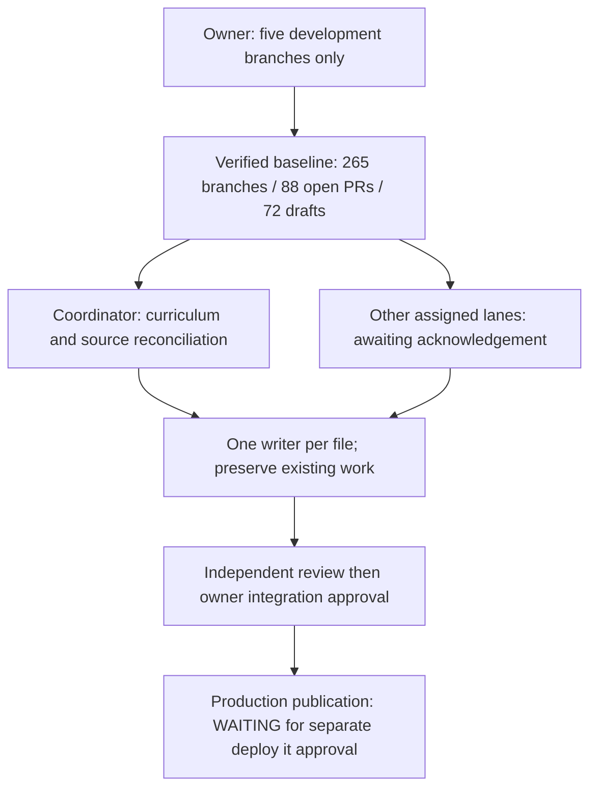
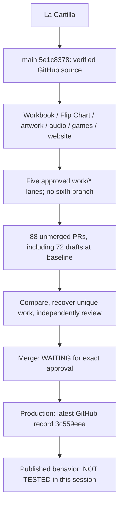
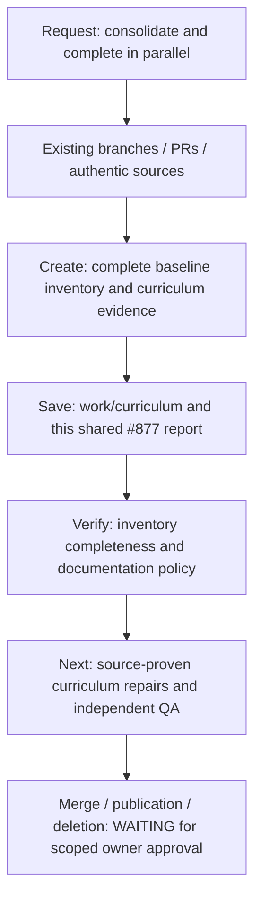
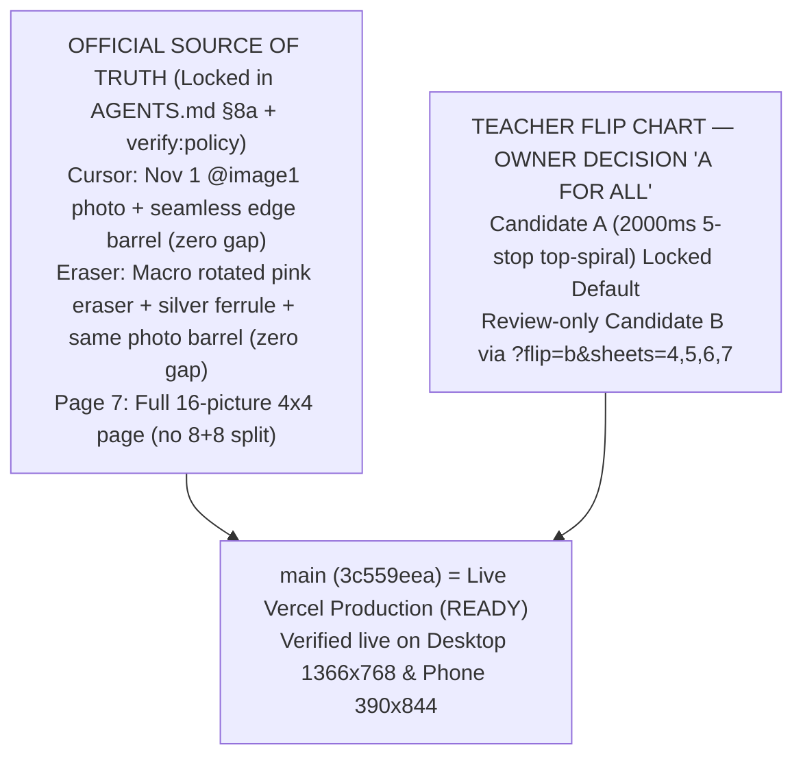

<!-- cartilla-parallel-report-2026-11-26 -->
# OWNER VISUAL STATUS: LA CARTILLA DE GRETEL

Live shared report: https://github.com/ejnburrows-rgb/cartilla-de-gretel/issues/877#issuecomment-7199730025

## Parallel completion report

Source check: 2026-11-26. This report supersedes historical assignment tables, not original proof or approval records. Owner direction: [Slack coordination thread](https://app.slack.com/archives/C0CM2CMH68K/p1795715194468199).

**OVERALL: NOT TESTED** for the complete client demonstration. Current-source inspections have started; no product fix, merge, deployment or destructive cleanup is claimed.

### Shared lane report

| Agent | Assignment | Branch | Progress | Defects | PR | Evidence | Blocker |
| --- | --- | --- | --- | --- | --- | --- | --- |
| Viktor | Coordination + all 24 lessons / 88 available Workbook pages / every Flip Chart sheet | work/curriculum | NOT TESTED: source inspection underway; baseline checked | No fresh runtime defect certified yet | One baseline PR on work/curriculum; link to be added after push | main 5e1c8378; baseline policy 95/95; docs check 0 errors | Physical-source and runtime coverage not yet reconciled |
| Devin | Audio, demo unlock, interaction kernel | work/audio-interactions | WAITING: acknowledgement and file reservations | Pending source/runtime evidence | Reuse #1321 / #1058; no current implementation PR confirmed | Owner assignment; coordinator handoff posted | Current execution/session unconfirmed |
| hoplite, images thread | Workbook / Flip Chart / game artwork | work/images | WAITING: acknowledgement and file reservations | Reconcile 25 quality + 124 provenance flags, not 149 confirmed visual defects | Reuse corrected #1321 inventory | Owner assignment; coordinator handoff posted | Current execution/session unconfirmed |
| hoplite, assets thread | Living artwork, games, missing references | work/assets-motion | WAITING: separate execution receipt | Three stale motion assets reported; cow defect requires reproduction | Existing Chano/Cow candidates to reconcile | Owner assignment; coordinator handoff posted | Current execution/session unconfirmed |
| Computer | Performance, layouts, routes, stability | work/performance | WAITING: acknowledgement and file reservations | No fresh performance defect certified yet | Existing performance PRs to compare | Owner assignment; coordinator handoff posted | Current execution/session unconfirmed |
| Instinct | Independent visual and interaction QA | None, read-only | WAITING: acknowledgement | Separate observed defects from untested paths | None | Owner assignment; coordinator handoff posted | No exact-revision QA receipt yet |
| CodeRabbit | Independent code/integration and cleanup review | None, read-only | WAITING: acknowledgement | Review exact proposed heads and evidence | Every proposed integration | Owner assignment; coordinator handoff posted | No exact-head review requested until changes ready |
| Gitar | Exhaustive branch and draft disposition inventory | None, read-only | WAITING: acknowledgement | 265 baseline branches / 88 open PRs / 72 drafts must all be covered | All open/draft PRs | Owner assignment; complete captured baseline retained | Content comparisons and independent cleanup review pending |

### File ownership and dependencies

- Viktor initially reserves only docs/OWNER-VISUAL-STATUS.md and docs/consolidation/ for the baseline evidence. No product shared file is reserved or changed yet. Curriculum file reservations follow source inspection.
- Each implementation lane must post exact file reservations before edits. A shared file has one writer. Performance routes cross-lane changes to that writer; images owns artwork bytes; assets/motion coordinates artwork dependencies.
- Read-only QA and code review create no branch. Systems forcing a sixth development branch must stop before implementation and report the constraint to Viktor.
- Recovery first: compare current main against existing PR heads and original assets before selecting changes. No age/name-only deletion recommendations. Preserve every unique original.
- Integration order is dependency-driven, not a blanket merge queue: approved source/art mappings before consuming lesson/game changes; shared navigation/audio kernel before assembled curriculum QA; performance cross-lane fixes after writer handoff; independent exact-head review and assembled demonstration before owner-approved integration/publication. No merge is authorized by this report.

### Seven product areas

| Area | Status in this session | Existing work / next check |
| --- | --- | --- |
| Book Cover & Opening | NOT TESTED | Existing main preserved; verify opening on current source |
| Student Workbook | NOT TESTED | Verify 24 lessons and 88 available pages; pages 86–87 permanently excluded; preserve 85→88 navigation, Option A and normal student progression |
| Teacher Flip Chart | NOT TESTED | Enumerate every current sheet against source; preserve Candidate A |
| Artwork & Motion | NOT TESTED | Reconcile corrected #1321 flags, original sources and three stale assets; no new art |
| Gretel Voice & Tutor | WAITING | Audio lane receipt and authentic recording/transcript matches; Tutor retains separate approval boundaries |
| Games & Activities | NOT TESTED | Recover existing candidates; preserve Butterfly Garden; verify complete rounds independently |
| Website & Publication | WAITING | Latest GitHub production record 3c559eea; main 5e1c8378 differs only in owner-status documentation. Actual served revision and complete flows not checked in this session. No release authorization |

### Repository and release map

Main is one documentation-only commit ahead of the latest recorded production revision. This is not proof of a missing production application change or current domain alignment.

### This session's work map

### What I can use / ready but not live / decisions

- This session certifies repository metadata and documentation checks, not interactive product readiness.
- Preserve approved Option A / Candidate A, authentic artwork/audio, all unique branches/assets, separate Tutor holds, and disabled automatic deployment. No Supabase change or student data use.
- Next three actions: reconcile exact curriculum/source coverage; obtain lane receipts and resolve file collisions; incorporate Gitar's actual-comparison dispositions and independent review.
- No decision needed for inspections already authorized. Merges, publication, destructive cleanup and new artwork/voice approvals remain separately gated.

### Proof / last verified

- GitHub main: [5e1c8378](https://github.com/ejnburrows-rgb/cartilla-de-gretel/commit/5e1c8378d15ca6aa1120683149e9e722084aa93d).
- [Latest production deployment record](https://api.github.com/repos/ejnburrows-rgb/cartilla-de-gretel/deployments/7964470967): success at 3c559eea on 2026-11-21; queried 2026-11-26. This is provider-record evidence, not a live browser recheck.
- [Main/recorded-production comparison](https://github.com/ejnburrows-rgb/cartilla-de-gretel/compare/3c559eea6813b882ce51590ff112dfc99a26fec5...5e1c8378d15ca6aa1120683149e9e722084aa93d): only docs/OWNER-VISUAL-STATUS.md changed.
- Baseline policy: 95 passed / 0 failed; documentation check: 461 documents / 0 errors. Application tests and live interaction not run for this metadata-only baseline.
- Complete captured inventories: [270 branch rows](consolidation/branch-baseline.csv), including the five newly established approved refs, and [88 open PR rows](consolidation/open-pr-baseline.csv), including every one of the 72 drafts. Its pending rows are not deletion or integration recommendations. Gitar owns evidence-based final dispositions; CodeRabbit independently checks them.

Complete branch map: all 270 captured references

Main and approved work branches are KEEP. All other references remain BLOCKED for evidence-based classification, not presumed obsolete. Purposes are unverified until content comparison.

- `activity/chano-rebuild-20261019`: blocked/unverified existing work; `87ba23cc`
- `activity/completar-palabras`: blocked/unverified existing work; `22a179df` ; [#973](https://github.com/ejnburrows-rgb/cartilla-de-gretel/pull/973)
- `activity/cow-game`: blocked/unverified existing work; `0f88b8f5`
- `activity/cow-game-18247010529815853258`: blocked/unverified existing work; `92553687`
- `activity/cow-wip-20261019`: blocked/unverified existing work; `5a035b53`
- `activity/lectura-de-palabras`: blocked/unverified existing work; `7030e13e`
- `activity/letter-picker`: blocked/unverified existing work; `6428ccd5` ; [#970](https://github.com/ejnburrows-rgb/cartilla-de-gretel/pull/970)
- `activity/palabras-por-minuto`: blocked/unverified existing work; `97f8dd8b`
- `activity/palabras-por-minuto-11657455097900780082`: blocked/unverified existing work; `a41c7fd4`
- `activity/rima`: blocked/unverified existing work; `4c9eb455`
- `approval-pack-issue-1047-9061935140164812217`: blocked/unverified existing work; `a08e65c0`
- `art-board-repair-4`: blocked/unverified existing work; `5381f531`
- `art-inventory-live`: blocked/unverified existing work; `3ed9b22a`
- `art-inventory-page`: blocked/unverified existing work; `b8457a32`
- `artwork-optimization-batch-d-10885364352039601684`: blocked/unverified existing work; `84ef8ce7`
- `artwork/flipchart-approved-seven-20261020`: blocked/unverified existing work; `0245228f`
- `artwork/lesson3-approved-five`: blocked/unverified existing work; `1e53e9dd`
- `asignado-error-20261025`: blocked/unverified existing work; `db6cf9e1`
- `audio/owner-instructions-20261019`: blocked/unverified existing work; `5364b587`
- `audio/owner-instructions-20261019-15155392506160733243`: blocked/unverified existing work; `deb326fc` ; [#1058](https://github.com/ejnburrows-rgb/cartilla-de-gretel/pull/1058)
- `audit/picture-slot-manifest`: blocked/unverified existing work; `ae26ec3e` ; [#1068](https://github.com/ejnburrows-rgb/cartilla-de-gretel/pull/1068)
- `bolt-memoize-cartilla-drawings-1554907485128515753`: blocked/unverified existing work; `d66d3b18` ; [#1304](https://github.com/ejnburrows-rgb/cartilla-de-gretel/pull/1304)
- `bolt-memoize-cartilla-svgs-12548474222664525219`: blocked/unverified existing work; `824ea75c` ; [#1176](https://github.com/ejnburrows-rgb/cartilla-de-gretel/pull/1176)
- `bolt-performance-audio-multiple-choice-9425995739704249950`: blocked/unverified existing work; `84ee7007`
- `bolt-performance-improvement-17643219387104126685`: blocked/unverified existing work; `b21a0bf9` ; [#1303](https://github.com/ejnburrows-rgb/cartilla-de-gretel/pull/1303)
- `chore-art-board-7570696409652978848`: blocked/unverified existing work; `b4e0caff`
- `chore/approval-pack-20261020-3539923526613815335`: blocked/unverified existing work; `e0a4017b`
- `chore/art-audit-regen-20261023`: blocked/unverified existing work; `9c366b48` ; [#1168](https://github.com/ejnburrows-rgb/cartilla-de-gretel/pull/1168)
- `chore/proofs-completar-palabras-2619655779682505490`: blocked/unverified existing work; `627b734c`
- `chore/regenerate-delivery-art-20261017`: blocked/unverified existing work; `29878827` ; [#920](https://github.com/ejnburrows-rgb/cartilla-de-gretel/pull/920)
- `chore/screenshot-all-lessons-14098848796302342076`: blocked/unverified existing work; `37b4758c`
- `ci/pr-lightweight-verification-20261101`: blocked/unverified existing work; `c2dadf94` ; [#1241](https://github.com/ejnburrows-rgb/cartilla-de-gretel/pull/1241)
- `cleanup/remove-dead-workbook-components`: blocked/unverified existing work; `ff8d7315` ; [#1211](https://github.com/ejnburrows-rgb/cartilla-de-gretel/pull/1211)
- `code-health-remove-illustrationword-6678577113224792752`: blocked/unverified existing work; `79790c9d`
- `code-health/remove-unused-import-check-15160267718005428107`: blocked/unverified existing work; `d0efbb0e`
- `codex/mariposas-mm-prototype-20261018`: blocked/unverified existing work; `231c45b8` ; [#960](https://github.com/ejnburrows-rgb/cartilla-de-gretel/pull/960)
- `continuation/1247-review`: blocked/unverified existing work; `34f899b7`
- `continuation/1247-source-recovery`: blocked/unverified existing work; `51d2eb8d`
- `continuation/1247-test-repairs`: blocked/unverified existing work; `69325f0d`
- `controller/jobs/d258e76a-4875-4178-b06f-0c0bf03e48c4-8404474860463475856`: blocked/unverified existing work; `1627114b`
- `controls/execution-gate-20261019`: blocked/unverified existing work; `725a5a4a`
- `devin/1795540156-demo-handoff-20261124`: blocked/unverified existing work; `11fef427` ; [#1321](https://github.com/ejnburrows-rgb/cartilla-de-gretel/pull/1321)
- `docs/20261022-integration-recovery`: blocked/unverified existing work; `053a167d`
- `docs/branch-rules-20261109`: blocked/unverified existing work; `28831181` ; [#1298](https://github.com/ejnburrows-rgb/cartilla-de-gretel/pull/1298)
- `docs/chano-proof-pack-20261021`: blocked/unverified existing work; `03cb133a`
- `docs/marking-rule-20261019`: blocked/unverified existing work; `b7e77bbe` ; [#1000](https://github.com/ejnburrows-rgb/cartilla-de-gretel/pull/1000)
- `docs/owner-artwork-single-source-20261022`: blocked/unverified existing work; `4b1ae3e7` ; [#1099](https://github.com/ejnburrows-rgb/cartilla-de-gretel/pull/1099)
- `docs/owner-communication-rules-20261019`: blocked/unverified existing work; `38969c3e`
- `docs/owner-in-chat-visual-explorer-20261104`: blocked/unverified existing work; `1d54c996` ; [#1282](https://github.com/ejnburrows-rgb/cartilla-de-gretel/pull/1282)
- `docs/two-map-standard-main`: blocked/unverified existing work; `d766a7d8`
- `draft/lane-b-workbook-lessons-8-18`: blocked/unverified existing work; `fed42a78` ; [#1022](https://github.com/ejnburrows-rgb/cartilla-de-gretel/pull/1022)
- `draft/lane-c-lessons-19-24`: blocked/unverified existing work; `bad11f7f`
- `draft/one-book-marking-feel`: blocked/unverified existing work; `73576fda` ; [#1070](https://github.com/ejnburrows-rgb/cartilla-de-gretel/pull/1070)
- `empty-branch-no-changes-3809743601414912744`: blocked/unverified existing work; `473b7e87`
- `evidence/artwork-coverage-20261014`: blocked/unverified existing work; `54a21ee0`
- `feat/art-board-owner-replacement-intake-20261031`: blocked/unverified existing work; `d6025bc3` ; [#1237](https://github.com/ejnburrows-rgb/cartilla-de-gretel/pull/1237)
- `feat/flipchart-living-book-finish`: blocked/unverified existing work; `b0a1e3f6` ; [#741](https://github.com/ejnburrows-rgb/cartilla-de-gretel/pull/741)
- `feat/games-realism-overhaul`: blocked/unverified existing work; `8d333a74`
- `feat/generic-mini-games`: blocked/unverified existing work; `16a197bd`
- `feat/gretel-resumable-cloned-voice-20261014`: blocked/unverified existing work; `237920f7` ; [#769](https://github.com/ejnburrows-rgb/cartilla-de-gretel/pull/769)
- `feat/gretel-tutor-l1-3`: blocked/unverified existing work; `12e9adf5` ; [#1073](https://github.com/ejnburrows-rgb/cartilla-de-gretel/pull/1073)
- `feat/palabras-parejas-pencil-game`: blocked/unverified existing work; `eb9fcd78`
- `feat/workbook-card-living-motion`: blocked/unverified existing work; `a40a6f66` ; [#764](https://github.com/ejnburrows-rgb/cartilla-de-gretel/pull/764)
- `feature/ash-pencil-marking-9614802336538650232`: blocked/unverified existing work; `fea63535`
- `feature/issue-1035-welcome-video-7305563812994230697`: blocked/unverified existing work; `d4b70c1e` ; [#1048](https://github.com/ejnburrows-rgb/cartilla-de-gretel/pull/1048)
- `feature/payaso-chano-carnival-20261018`: blocked/unverified existing work; `13d525b4`
- `feature/payaso-chano-carnival-web-game-20261018`: blocked/unverified existing work; `2a479367`
- `fix-871-872-7318880132108269741`: blocked/unverified existing work; `cfda0fc6`
- `fix-991-4215791666087499065`: blocked/unverified existing work; `7f12907d`
- `fix-console-error-officialworkbookpage-12555708987254256699`: blocked/unverified existing work; `bc8884e6`
- `fix-cow-game-lean-16082532411393598020`: blocked/unverified existing work; `92623c5d`
- `fix-cow-mouth-card-20261024`: blocked/unverified existing work; `b487aa5c`
- `fix-flipchart-turn-and-wire-37-pictures-12753578012614389808`: blocked/unverified existing work; `4a0cbe24` ; [#1156](https://github.com/ejnburrows-rgb/cartilla-de-gretel/pull/1156)
- `fix-student-session-tests-88203299015634`: blocked/unverified existing work; `8a1b5fc4`
- `fix-teacher-crm-shell-save-error-7559252086311291039`: blocked/unverified existing work; `ae282a40`
- `fix-teacher-test-debt-4790278902171163137`: blocked/unverified existing work; `a53ed4bb`
- `fix-unused-useeffect-8831633729390263123`: blocked/unverified existing work; `53c07878`
- `fix-workbook-page-turn-desync-1138-16785535596755229948`: blocked/unverified existing work; `238784c0`
- `fix-workbook-page-turn-desync-2720709663285410452`: blocked/unverified existing work; `4d4f2087`
- `fix/airplane-asset-provenance`: blocked/unverified existing work; `51b2de01` ; [#1209](https://github.com/ejnburrows-rgb/cartilla-de-gretel/pull/1209)
- `fix/arbol-faithful-derivative-20261022`: blocked/unverified existing work; `297031e7` ; [#1171](https://github.com/ejnburrows-rgb/cartilla-de-gretel/pull/1171)
- `fix/art-audit-regen`: blocked/unverified existing work; `e7fad79b`
- `fix/canonical-artwork-authority-20261025`: blocked/unverified existing work; `e54d620e` ; [#1194](https://github.com/ejnburrows-rgb/cartilla-de-gretel/pull/1194)
- `fix/cow-restart-cancel-pending-round-20261023`: blocked/unverified existing work; `4820bd2b`
- `fix/current-art-test-snapshot-sync-20261023`: blocked/unverified existing work; `862ad9db` ; [#1166](https://github.com/ejnburrows-rgb/cartilla-de-gretel/pull/1166)
- `fix/cutoffs-l11-l12-l16`: blocked/unverified existing work; `70348c20`
- `fix/diamond-phone-lessons-17-20-3497466308479212378`: blocked/unverified existing work; `32495121`
- `fix/e2e-lcp-safety-and-traces-20261101`: blocked/unverified existing work; `37f7c7e8` ; [#1242](https://github.com/ejnburrows-rgb/cartilla-de-gretel/pull/1242)
- `fix/fit-l1-l6`: blocked/unverified existing work; `d45f937b` ; [#971](https://github.com/ejnburrows-rgb/cartilla-de-gretel/pull/971)
- `fix/fit-l8-l10-l14`: blocked/unverified existing work; `dfbea7fb` ; [#977](https://github.com/ejnburrows-rgb/cartilla-de-gretel/pull/977)
- `fix/flipchart-focus-aware-keys-20261015`: blocked/unverified existing work; `467c872c` ; [#787](https://github.com/ejnburrows-rgb/cartilla-de-gretel/pull/787)
- `fix/game-shell-rescue-14192818795883780064`: blocked/unverified existing work; `4681f541`
- `fix/issue-988-989-990-diamond-inward-520135429275310444`: blocked/unverified existing work; `67a15b98`
- `fix/keyboard-rewards-pipeline-20261010`: blocked/unverified existing work; `329683dd`
- `fix/landscape-shared`: blocked/unverified existing work; `b678c23f`
- `fix/lesson-3-vocal-a-proof-20261016`: blocked/unverified existing work; `57533f2d`
- `fix/lesson23-p85-phone-overflow-987-6451529366738365361`: blocked/unverified existing work; `2c0860b6`
- `fix/oveja-stale-guard-20261022-5450269019429767951`: blocked/unverified existing work; `5f3c4e51`
- `fix/page-seven-caption-fidelity`: blocked/unverified existing work; `f4cc2c4a` ; [#1210](https://github.com/ejnburrows-rgb/cartilla-de-gretel/pull/1210)
- `fix/page24-syllable-completion-gate-20261109`: blocked/unverified existing work; `1a849c7e`
- `fix/payaso-chano-verified-followup-20261018`: blocked/unverified existing work; `45c6379c`
- `fix/production-art-audit-regen`: blocked/unverified existing work; `89f5d84d`
- `fix/remove-mariposas-live-registration`: blocked/unverified existing work; `4a3b6196`
- `fix/remove-unused-playWrongBuzz-7053316289168893159`: blocked/unverified existing work; `288e3d06`
- `fix/seroval-security-20261101`: blocked/unverified existing work; `c64efb3c` ; [#1243](https://github.com/ejnburrows-rgb/cartilla-de-gretel/pull/1243)
- `fix/shared-landscape-844x390-20261018`: blocked/unverified existing work; `f7e19800`
- `fix/silent-picture-audio-failures`: blocked/unverified existing work; `e56f0a44` ; [#1207](https://github.com/ejnburrows-rgb/cartilla-de-gretel/pull/1207)
- `fix/teacher-crm-student-consolidated`: blocked/unverified existing work; `af73cc9e`
- `fix/tutor-continuation-rule-20261029`: blocked/unverified existing work; `a767b3e8`
- `fix/unused-import-cinemanarrativedrawer-4604672354116594366`: blocked/unverified existing work; `cd47ffa9`
- `fix/workbook-connector-drawing-space`: blocked/unverified existing work; `5da7e927`
- `frontier-check-20261023`: blocked/unverified existing work; `060ed58d`
- `game/chano-scene`: blocked/unverified existing work; `10409fe8` ; [#1015](https://github.com/ejnburrows-rgb/cartilla-de-gretel/pull/1015)
- `game/chano-scene-16399726599125817738`: blocked/unverified existing work; `da35efcd`
- `game/chano-scene-17875816284526073266`: blocked/unverified existing work; `cf6d0cb8`
- `game/chano-scene-2427511210327751668`: blocked/unverified existing work; `925ed11c`
- `game/chano-scene-9446293887144111614`: blocked/unverified existing work; `a6470e10`
- `game/chano-scene-juggling-16811216930405402616`: blocked/unverified existing work; `70d64964`
- `game/mariposas-fullscreen-scene`: blocked/unverified existing work; `6add8567` ; [#1010](https://github.com/ejnburrows-rgb/cartilla-de-gretel/pull/1010)
- `games-author-template-verify`: blocked/unverified existing work; `f41be5c8` ; [#1006](https://github.com/ejnburrows-rgb/cartilla-de-gretel/pull/1006)
- `import/lovable-bubble-organ-20261030`: blocked/unverified existing work; `d4bd70c4`
- `instinct/cream-all-lessons-20261019`: blocked/unverified existing work; `9aaca48c` ; [#1005](https://github.com/ejnburrows-rgb/cartilla-de-gretel/pull/1005)
- `instinct/job-board-20261019`: blocked/unverified existing work; `753e5630`
- `instinct/rima-scene-20261019`: blocked/unverified existing work; `fdbdb232` ; [#1007](https://github.com/ejnburrows-rgb/cartilla-de-gretel/pull/1007)
- `instinct/wave1-20261019`: blocked/unverified existing work; `889eb8c4`
- `jules-10937107692939251673-3b15676f`: blocked/unverified existing work; `8872cbfb`
- `jules-11052285982503720401-048387d0`: blocked/unverified existing work; `0a2b5770`
- `jules-11874299200599553645-8ee4205d`: blocked/unverified existing work; `e6fa9015` ; [#1301](https://github.com/ejnburrows-rgb/cartilla-de-gretel/pull/1301)
- `jules-1275602888818406371-617a156f`: blocked/unverified existing work; `a6399690`
- `jules-13699223239101851335-0efdec33`: blocked/unverified existing work; `4b9f8788`
- `jules-1423541094767325541-117935ca`: blocked/unverified existing work; `08f5dd0a`
- `jules-1517843779007712447-6b84b75e`: blocked/unverified existing work; `6b49404c`
- `jules-15206535600738043919-43d5a913`: blocked/unverified existing work; `1e2bada9` ; [#1258](https://github.com/ejnburrows-rgb/cartilla-de-gretel/pull/1258)
- `jules-17338434147384551620-a9907333`: blocked/unverified existing work; `2a19f061`
- `jules-2549739456209738351-fde48e41`: blocked/unverified existing work; `c3a801d2` ; [#967](https://github.com/ejnburrows-rgb/cartilla-de-gretel/pull/967)
- `jules-4841332487619244204-b64ab120`: blocked/unverified existing work; `53dae356` ; [#1302](https://github.com/ejnburrows-rgb/cartilla-de-gretel/pull/1302)
- `jules-5656770027037775722-ddcc791f`: blocked/unverified existing work; `dfbc3cf1`
- `jules-7049793572056880761-11799e44`: blocked/unverified existing work; `959b2c26`
- `jules-7483093215117529689-1faaabff`: blocked/unverified existing work; `1824c3bd`
- `jules-8032766179509994640-76600f65`: blocked/unverified existing work; `a9542521`
- `jules-9858490964964928859-89a60369`: blocked/unverified existing work; `1e92eff7` ; [#1054](https://github.com/ejnburrows-rgb/cartilla-de-gretel/pull/1054)
- `jules-lane-1-lesson-3-combine-222380543456646405`: blocked/unverified existing work; `0203b080`
- `jules-route-health-sweep-11626026226717544025-13219304021638505007`: blocked/unverified existing work; `2e3e0a57`
- `jules/cow-game-nocut-13353135867314472258`: blocked/unverified existing work; `37c1f035` ; [#1049](https://github.com/ejnburrows-rgb/cartilla-de-gretel/pull/1049)
- `jules/fix-issue-990-49148494207121750`: blocked/unverified existing work; `b0643477`
- `jules/l16-diamond-proofs-20261020`: blocked/unverified existing work; `3361e0ce` ; [#1038](https://github.com/ejnburrows-rgb/cartilla-de-gretel/pull/1038)
- `jules/l17-diamond-port-20261020`: blocked/unverified existing work; `9e1e650c` ; [#1018](https://github.com/ejnburrows-rgb/cartilla-de-gretel/pull/1018)
- `jules/workbook-navigation-investigation-17936492558897187064`: blocked/unverified existing work; `b412de4b`
- `kill-robot-voice-20261018`: blocked/unverified existing work; `3a9a518a` ; [#941](https://github.com/ejnburrows-rgb/cartilla-de-gretel/pull/941)
- `lane-7-narration-wiring-20261018`: blocked/unverified existing work; `471eaa96` ; [#945](https://github.com/ejnburrows-rgb/cartilla-de-gretel/pull/945)
- `lane-7/lesson-narration-player-5760229778479782012`: blocked/unverified existing work; `d479b95c`
- `lane-8-silent-pictures-20261017`: blocked/unverified existing work; `c1d9bc8c`
- `lane-8/piano-hablador`: blocked/unverified existing work; `5c4cd360`
- `lane-9-7984685098851494986`: blocked/unverified existing work; `2c3179ba`
- `lane-907-marking-doc-20261017`: blocked/unverified existing work; `7419912a`
- `lane/j14-student-bugs-20261023-2793417054701129627`: blocked/unverified existing work; `84e178db`
- `lane/j6-lesson3-archetype-20261023-16670984364862698664`: blocked/unverified existing work; `76d249d9`
- `lesson-14-wide-20261018`: blocked/unverified existing work; `975e90c9` ; [#949](https://github.com/ejnburrows-rgb/cartilla-de-gretel/pull/949)
- `lessons/13-21-polish`: blocked/unverified existing work; `f209d76e` ; [#981](https://github.com/ejnburrows-rgb/cartilla-de-gretel/pull/981)
- `lessons/15-19-22`: blocked/unverified existing work; `4a29efd1` ; [#969](https://github.com/ejnburrows-rgb/cartilla-de-gretel/pull/969)
- `lessons/24-finish`: blocked/unverified existing work; `964a439a` ; [#978](https://github.com/ejnburrows-rgb/cartilla-de-gretel/pull/978)
- `main`: main; `5e1c8378`
- `motion/d-estrella-unicornio`: blocked/unverified existing work; `8107c83c` ; [#922](https://github.com/ejnburrows-rgb/cartilla-de-gretel/pull/922)
- `motion/l1-lane`: blocked/unverified existing work; `caecf185`
- `motion/l12-lane`: blocked/unverified existing work; `5f2795a8`
- `motion/l3-lane-a-vocal-a`: blocked/unverified existing work; `19d1ffad`
- `motion/l3-lane-b-vocal-o`: blocked/unverified existing work; `7228e407`
- `motion/l3-lane-c-elefante-iman`: blocked/unverified existing work; `40cea41c`
- `motion/l3-lane-rest`: blocked/unverified existing work; `809e5cd0`
- `motion/l4-lane`: blocked/unverified existing work; `ede84e25`
- `motion/l4-lane-8427355322964240127`: blocked/unverified existing work; `3d99b843`
- `motion/l9-lane`: blocked/unverified existing work; `adf51074`
- `motion/original-art-integration`: blocked/unverified existing work; `4e5318ef` ; [#921](https://github.com/ejnburrows-rgb/cartilla-de-gretel/pull/921)
- `motion/rigid-originals-review`: blocked/unverified existing work; `7419c229` ; [#1008](https://github.com/ejnburrows-rgb/cartilla-de-gretel/pull/1008)
- `muse/lesson-1-wide-20261018`: blocked/unverified existing work; `649020e9` ; [#952](https://github.com/ejnburrows-rgb/cartilla-de-gretel/pull/952)
- `muse/lesson-10-wide-20261018`: blocked/unverified existing work; `d7fcc2bc` ; [#950](https://github.com/ejnburrows-rgb/cartilla-de-gretel/pull/950)
- `muse/lesson-11-wide-20261018`: blocked/unverified existing work; `532e796c` ; [#963](https://github.com/ejnburrows-rgb/cartilla-de-gretel/pull/963)
- `muse/lesson-12-wide-20261018`: blocked/unverified existing work; `c31eb1de` ; [#964](https://github.com/ejnburrows-rgb/cartilla-de-gretel/pull/964)
- `muse/lesson-13-wide-20261018`: blocked/unverified existing work; `56755bb1`
- `muse/lesson-15-wide-20261018`: blocked/unverified existing work; `995c8383` ; [#936](https://github.com/ejnburrows-rgb/cartilla-de-gretel/pull/936)
- `muse/lesson-16-wide-20261018`: blocked/unverified existing work; `c31e9fca` ; [#937](https://github.com/ejnburrows-rgb/cartilla-de-gretel/pull/937)
- `muse/lesson-17-wide-20261018`: blocked/unverified existing work; `77239bdb` ; [#938](https://github.com/ejnburrows-rgb/cartilla-de-gretel/pull/938)
- `muse/lesson-18-wide-20261018`: blocked/unverified existing work; `a0553862` ; [#934](https://github.com/ejnburrows-rgb/cartilla-de-gretel/pull/934)
- `muse/lesson-19-wide-20261018`: blocked/unverified existing work; `a9b00f7d`
- `muse/lesson-2-wide-20261018`: blocked/unverified existing work; `a6efd31d` ; [#957](https://github.com/ejnburrows-rgb/cartilla-de-gretel/pull/957)
- `muse/lesson-20-wide-20261018`: blocked/unverified existing work; `70af52ec` ; [#933](https://github.com/ejnburrows-rgb/cartilla-de-gretel/pull/933)
- `muse/lesson-22-wide-20261018`: blocked/unverified existing work; `6fb3da8c` ; [#932](https://github.com/ejnburrows-rgb/cartilla-de-gretel/pull/932)
- `muse/lesson-23-wide-20261018`: blocked/unverified existing work; `c70067b7` ; [#939](https://github.com/ejnburrows-rgb/cartilla-de-gretel/pull/939)
- `muse/lesson-23-wide-20261018-1285022184792102783`: blocked/unverified existing work; `4151136a`
- `muse/lesson-24-phonefit-906-20261018`: blocked/unverified existing work; `ecc79cff`
- `muse/lesson-4-wide-20261018`: blocked/unverified existing work; `ea2a28bc` ; [#955](https://github.com/ejnburrows-rgb/cartilla-de-gretel/pull/955)
- `muse/lesson-5-wide-20261018`: blocked/unverified existing work; `f6c08f35` ; [#953](https://github.com/ejnburrows-rgb/cartilla-de-gretel/pull/953)
- `muse/lesson-6-wide-20261018`: blocked/unverified existing work; `e41315ed` ; [#951](https://github.com/ejnburrows-rgb/cartilla-de-gretel/pull/951)
- `muse/lesson-7-wide-20261018`: blocked/unverified existing work; `c403a0e0` ; [#954](https://github.com/ejnburrows-rgb/cartilla-de-gretel/pull/954)
- `muse/lesson-8-wide-20261018`: blocked/unverified existing work; `26465840` ; [#956](https://github.com/ejnburrows-rgb/cartilla-de-gretel/pull/956)
- `muse/lesson-9-wide-20261018`: blocked/unverified existing work; `f24db653` ; [#958](https://github.com/ejnburrows-rgb/cartilla-de-gretel/pull/958)
- `optimize-pencilconnector-usememo-4373553605638722711`: blocked/unverified existing work; `8dddd08a`
- `owner-approved-art-2026-10-13`: blocked/unverified existing work; `ce689b45`
- `owner-refs/20261019`: blocked/unverified existing work; `30dcbf61`
- `palabras-minuto-scene-mockup`: blocked/unverified existing work; `681e8db7` ; [#1009](https://github.com/ejnburrows-rgb/cartilla-de-gretel/pull/1009)
- `palette-add-aria-labels-teacher-crm-4986591068699995326`: blocked/unverified existing work; `b066d2f6`
- `palette-ux-improvement-aria-label-student-table-14691290425896954333`: blocked/unverified existing work; `0f369213`
- `perf-optimize-catalog-lookup-14430398800763446712`: blocked/unverified existing work; `2c9ac1d6` ; [#972](https://github.com/ejnburrows-rgb/cartilla-de-gretel/pull/972)
- `perf-optimize-identical-panels-3-17329093555446895783`: blocked/unverified existing work; `c3b2e777`
- `perf/bolt-svg-memo-9657023661306970366`: blocked/unverified existing work; `3ef48360` ; [#1188](https://github.com/ejnburrows-rgb/cartilla-de-gretel/pull/1188)
- `perf/pencil-connector-targets-map-8456917166198423599`: blocked/unverified existing work; `a98d7f86` ; [#1299](https://github.com/ejnburrows-rgb/cartilla-de-gretel/pull/1299)
- `perf/teacher-crm-lesson-title-optimization-9326228577634488353`: blocked/unverified existing work; `a9b345be`
- `proof/demo-2026-10-30`: blocked/unverified existing work; `7baa5f1d`
- `recover-batch-d-4111911948674152905`: blocked/unverified existing work; `85e9384e` ; [#943](https://github.com/ejnburrows-rgb/cartilla-de-gretel/pull/943)
- `recovery/initial-restore-28dcc6d1aebc-20261023`: blocked/unverified existing work; `28dcc6d1`
- `recovery/initial-restore-bb958b513b5b-20261023`: blocked/unverified existing work; `bb958b51`
- `rescue-chano-proof-1046-4937915492600183092`: blocked/unverified existing work; `6e5baa9b`
- `retarget-1182-main-hb2105-17669066341744211388`: blocked/unverified existing work; `a459fb0c`
- `retarget/student-bugs-1157-20261024`: blocked/unverified existing work; `2521a07d` ; [#1181](https://github.com/ejnburrows-rgb/cartilla-de-gretel/pull/1181)
- `revert/pr-944-chano-20261018`: blocked/unverified existing work; `08240984`
- `review/lesson-cream-reconcile-20261023`: blocked/unverified existing work; `ca36c733`
- `review/lesson-middle-proof-20261023`: blocked/unverified existing work; `1eb716ee`
- `review/lesson13-21-existing-reconcile-20261023`: blocked/unverified existing work; `a29f193d`
- `review/lesson23-existing-reconcile-20261023`: blocked/unverified existing work; `e23129ef`
- `review/lesson24-existing-reconcile-20261023`: blocked/unverified existing work; `c4b99381`
- `review/owner-visual-artwork-inventory-20261014`: blocked/unverified existing work; `ca9e771a`
- `security-hardening-9621522486306465010`: blocked/unverified existing work; `47d76a85`
- `shared/landscape-844x390-fix-20261018`: blocked/unverified existing work; `6a79bd5a`
- `swarm/lesson-20-wide-20261018`: blocked/unverified existing work; `8af5eadf`
- `swarm/lesson-21-wide-20261018`: blocked/unverified existing work; `a741a40c` ; [#927](https://github.com/ejnburrows-rgb/cartilla-de-gretel/pull/927)
- `swarm/lesson-24-20261016`: blocked/unverified existing work; `0b4c500d`
- `swarm/lesson-24-wide-20261018`: blocked/unverified existing work; `7f7b7d63`
- `swarm/lesson-4-wide-20261018`: blocked/unverified existing work; `0afe96ee`
- `swarm/track-h-video-slot`: blocked/unverified existing work; `cb064001`
- `swarm/wb-syllable-recognition`: blocked/unverified existing work; `658671e4`
- `swarm/wb-viewport-a11y`: blocked/unverified existing work; `0282529d`
- `teacher-publish-surgical-20261025`: blocked/unverified existing work; `be3c9d39`
- `teacher/metodos-lectura-20261018`: blocked/unverified existing work; `4d6cded2`
- `tembo/tutor-dialogue-atlas`: blocked/unverified existing work; `6b3933b6` ; [#1322](https://github.com/ejnburrows-rgb/cartilla-de-gretel/pull/1322)
- `tembo/tutor-lesson-sources`: blocked/unverified existing work; `feae79d7`
- `tembo/tutor-private-intake`: blocked/unverified existing work; `84f3a937` ; [#1323](https://github.com/ejnburrows-rgb/cartilla-de-gretel/pull/1323)
- `test-use-idle-callback-2909133618559058829`: blocked/unverified existing work; `6a09fa79`
- `test-use-install-prompt-17996289134560944949`: blocked/unverified existing work; `de5eb479`
- `test-usePrefersReducedData-14886858556649185926`: blocked/unverified existing work; `164b90f0`
- `test/csv-export-coverage-20261018`: blocked/unverified existing work; `e8707b5f`
- `test/e2e-contract-repairs`: blocked/unverified existing work; `31b3f8a1` ; [#1179](https://github.com/ejnburrows-rgb/cartilla-de-gretel/pull/1179)
- `test/intro-splash-coverage-5910386834210651247`: blocked/unverified existing work; `dab6a252`
- `test/useIdleCallback-5246638543812982644`: blocked/unverified existing work; `fd97eb8b`
- `tests/use-prefers-reduced-data-7467721207963361358`: blocked/unverified existing work; `7bfc7759`
- `tmp/l21-bin-test`: blocked/unverified existing work; `c95c541e`
- `verify-merge-queue-20261026-8172618744504956494`: blocked/unverified existing work; `9cd7bf04`
- `verify/art-served-20261022`: blocked/unverified existing work; `8bd0c1a8`
- `verify/cowgame-proof-1081`: blocked/unverified existing work; `7ccbffb5`
- `verify/pre-final-baseline-hb0305-8432968757821635112`: blocked/unverified existing work; `b6c4a02d`
- `verify/teacher-routes-20261022-retry`: blocked/unverified existing work; `fc86481b`
- `verify/teacher-routes-20261022-retry-11188047359894174848`: blocked/unverified existing work; `684b77e9`
- `verify/wordmatch-proof-1077`: blocked/unverified existing work; `47191626`
- `verify/workbook-fit-1063-proofs`: blocked/unverified existing work; `8aa7e82c`
- `voice/lesson-3-owner-only`: blocked/unverified existing work; `e9aa8f05`
- `wave1/completar-clean`: blocked/unverified existing work; `0c21983d`
- `wave1/cutoff-l11-l12-l16`: blocked/unverified existing work; `dd2e3561`
- `wave1/diamond-l8-l10-l14`: blocked/unverified existing work; `4681b5cf`
- `wave1/lesson16-clean`: blocked/unverified existing work; `4356c0ae`
- `wave1/letter-picker-clean`: blocked/unverified existing work; `e19b4468`
- `work/assets-motion`: approved development lane; `5e1c8378`
- `work/audio-interactions`: approved development lane; `5e1c8378`
- `work/curriculum`: approved development lane; `5e1c8378`
- `work/images`: approved development lane; `5e1c8378`
- `work/performance`: approved development lane; `5e1c8378`
- `workbook/pages-A-20261019`: blocked/unverified existing work; `f6a609c4`
- `workbook/pages-B-20261019`: blocked/unverified existing work; `2ac141fa`
- `workbook/pages-C-20261019`: blocked/unverified existing work; `258f6dd7`
- `ws2-recovery/p1-11-whitespace-password`: blocked/unverified existing work; `0cc93c0b`
- `ws2b-recovery-1614-supabase-kit`: blocked/unverified existing work; `0cc93c0b`
- `ws2b-recovery-7816-pdf-thumbnails`: blocked/unverified existing work; `f06643f8` ; [#1300](https://github.com/ejnburrows-rgb/cartilla-de-gretel/pull/1300)

Previous dated board: retained evidence, not fresh verification

# OWNER VISUAL STATUS — LA CARTILLA DE GRETEL

**Repository:** `https://github.com/ejnburrows-rgb/cartilla-de-gretel`  
**Authoritative Execution Issue:** [#877](https://github.com/ejnburrows-rgb/cartilla-de-gretel/issues/877)  
**Official Pencil Cursor Spec:** [PENCIL-CURSOR-SPEC.md](../PENCIL-CURSOR-SPEC.md) (Approved 2026-11-18, locked 2026-11-21)  
**Production URL (Live):** [https://cartilla-de-gretel-psi.vercel.app](https://cartilla-de-gretel-psi.vercel.app)  
**Production Alias:** [https://cartilla-de-gretel-ejn.vercel.app](https://cartilla-de-gretel-ejn.vercel.app)  
**Last Checked Date:** 2026-11-21  
**Canonical Main Branch:** `main` (`3c559eea` — PRs `#1316`, `#1317`, `#1318`, `#1319`)  
**Live Vercel Production:** `dpl_2mPdaWjZvBsypz61U6KCk5gej8Uh` (`READY`, `main` `3c559eea`, all 244/244 Vitest test files passed; `vercel.json` keeps `git.deploymentEnabled: false`).  
**Ledger Note:** `docs/COMPLETION_LEDGER.csv` does not exist on `main`; this document and `public/review/owner-decisions-locked-b.json` are the active status records.

---

## 1. Complete Repository & Release Map

---

## 2. Official Pencil, Eraser & Layout Standard (Permanent Lock — Never Revert)

- **Cursor / Writing Pencil (`74ccee59` / `9b379ad2`):** Exact owner-selected photographic sharpened wooden pencil (`public/cartilla/images/ui/owner-pencil-tip.svg` + `OwnerPhotoPencilSvg.tsx`, `600×497`, transparent background, sharp graphite point at exact `(0, 0)` hotspot) with seamless photographic yellow barrel (`op-barrel-pat`, `overflow="visible"`) extending continuously past all Desktop (`1366×768`), Phone (`390×844`), and Projector (`1920×1080`) edges — zero gap.
- **Rotated Macro Eraser End (`OwnerPhotoEraserSvg`):** Same zoomed-in `600×497` macro close-up scale (`252×209` desktop / `168×139` mobile) and `45°` down-right orientation rotated onto **just the pink rubber eraser dome + brushed silver metallic ferrule** at exact `(0, 0)` hotspot, joined seamlessly to the same photographic yellow hexagonal barrel (`OWNER_PENCIL_BARREL_TILE_DATA_URI`, `overflow="visible"`) extending off the page/viewport edges with zero gap during wrong-answer rubbing (`3.5 s`, `12` pink crumbs) and manual canvas erasing. Small/skinny full pencils, `owner-eraser.svg`, `pencil-cursor.svg`, `HdSchoolEraser.tsx`, and `PinkEraserBlock` are permanently deleted and blocked by `pnpm verify:policy`.
- **Full Workbook Page 7:** All 16 pictures (4×4 grid) render together on one page with zero `8+8` split buttons (`pnpm verify:policy` enforces this).
- **Locked Option A Styles (Lessons 1–24):** Workbook `curl=a` corner lift (no specular highlight) and Teacher Flip Chart Candidate A (`2000 ms` top-bound spiral flip) are the sole production defaults.

---

## 3. Seven Product Areas Status

1. **Book Cover & Opening:** `DONE and live` (Verified on production `3c559eea`).
2. **Student Workbook (90 pages, Lessons 1–24):** `DONE and live` (Live on `3c559eea`: full 16-picture Page 7, locked `@image1` photo writing pencil + macro rotated pink eraser, Option A `curl=a` default, Desktop/Tablet/Mobile/Projector layout clearance, `page-turn-soft.mp3` + mute stop + rapid-tap audio fix; pages `86–87` remain permanently `SOURCE_BLOCKED`).
3. **Teacher Flip Chart (62 HD sheets):** `DONE and live` (Live on `3c559eea`: Candidate A `2000 ms` 5-stop top-spiral turn locked as production default; review-only Candidate B via `?flip=b&sheets=4,5,6,7` with per-sheet lesson labels).
4. **Artwork & Motion:** `WAITING` (90-page `/revision#art` circled audit showing replacement candidates alongside current art is `DONE and live`; waiting on owner's Nov 19 Windows PC artwork folder + rebuilding 3 stale `*-alive.svg` animations: `wb-p1/abeja`, `p006-elefante`, `vocal-a/abeja`; 3 Page 16 crops `pez`/`traje`/`arco` pending layout wiring).
5. **Gretel Voice & Tutor:** `WAITING` (`AUDIO_POLICY.allowTts: false`; Tutor `#1073` untouched; waiting on 59 human voice clips + 24 lesson narrations + 1 Gretel welcome MP4).
6. **Games & Activities (12 games):** `DONE and live` (11/12 live and working on desktop and phone; `Mariposas` untouched; `completar-palabras` stays `WAITING` on owner answer keys).
7. **Website & Publication:** `DONE and live` (`main` `3c559eea` = live Vercel `dpl_2mPdaWjZvBsypz61U6KCk5gej8Uh`, verified live on Desktop `1366×768` and Phone `390×844` with 0 errors and 0 horizontal overflow).

---

## 4. Next Milestones (Authoritative Queue on [#877](https://github.com/ejnburrows-rgb/cartilla-de-gretel/issues/877))

1. **Rebuild 3 Stale Living-Motion Files:** Re-check coordinates and rebuild `wb-p1/abeja.svg`, `p006-elefante.png`, and `vocal-a/abeja.webp` via `scripts/living-motion/` and present on `/revision`.
2. **Integrate Owner Nov 19 PC Artwork Folder & Page 16 Crops (`pez`, `traje`, `arco`):** Place all replacement candidates on `/revision#art` for owner A/B approval before going live.
3. **Incorporate Owner Human Voice & Gretel Welcome Video Drops:** 59 human voice MP3s + 24 lesson narrations + 1 Gretel welcome MP4 loop (zero TTS).

