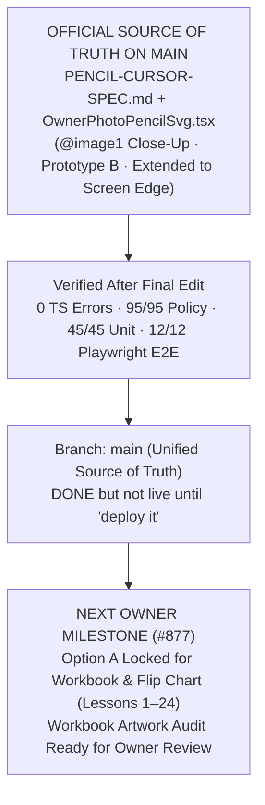

# OWNER VISUAL STATUS — LA CARTILLA DE GRETEL

**Repository:** `https://github.com/ejnburrows-rgb/cartilla-de-gretel`  
**Authoritative Execution Issue:** [#877](https://github.com/ejnburrows-rgb/cartilla-de-gretel/issues/877)  
**Official Pencil Cursor Spec:** [PENCIL-CURSOR-SPEC.md](../PENCIL-CURSOR-SPEC.md) (Approved 2026-11-18)  
**Production URL (Live Baseline):** [https://cartilla-de-gretel-psi.vercel.app](https://cartilla-de-gretel-psi.vercel.app)  
**Production Alias:** [https://cartilla-de-gretel-ejn.vercel.app](https://cartilla-de-gretel-ejn.vercel.app)  
**Last Checked Date:** 2026-11-18  
**Canonical Main Branch:** `main` (includes PR #1312 — `PENCIL-CURSOR-SPEC.md`, shared `OwnerPhotoPencilSvg.tsx`, and Top Two Revised Pencil Prototypes)  
**Deployment Gate:** Live Vercel production remains at the previous verified baseline (`e03ed1d2` / `dpl_DBYEi1HrNNCajXf6oDvrcCccWukU`) until the owner explicitly says `"deploy it"`.

---

## 1. Complete Repository & Release Map

---

## 2. Official Pencil Cursor Standard (Locked in `PENCIL-CURSOR-SPEC.md`)

- **Asset & Orientation:** Transparent `@image1` extreme close-up real sharpened wooden pencil (`600×497` head extraction, zero checkerboard, sharp graphite point at exact `(0, 0)` facing **up and to the left**, visible wood fibers, scalloped yellow barrel extending **down and to the right** at `45°`).
- **Seamless Screen-Edge Barrel:** Photographic yellow hexagonal barrel extends continuously past the bottom and right viewport boundaries on desktop (`252×209` px head) and phone (`168×139` px head) — zero mid-screen cutoff and zero gap to viewport edges.
- **Zero-Offset Lowering & Writing Mechanics:** Smooth approach lowering without showing any hand (`lift` → `0.00px`), `strokeLinecap="butt"` mask synchronized with `getTipFlight()`, velocity-modulated charcoal `#3a3a38` (`3.3–6.4px`), `400ms` hold, Forest Green (`#258351`) on correct / Crimson Red (`#c4320a`) + 12-crumb erase on wrong.
- **Shared Implementation:** Unified across both `ContractPencilCursor.tsx` and `PencilTipCursor.tsx` via `OwnerPhotoPencilSvg.tsx`.

---

## 3. Seven Product Areas Status

1. **Book Cover & Opening:** `DONE and live` (Verified on production).
2. **Student Workbook:** `DONE but not live` on `main` (Official `@image1` unclipped pencil cursor + top two Circle/X prototypes locked in `PENCIL-CURSOR-SPEC.md`; ready for owner lesson-style selection and `"deploy it"`).
3. **Teacher Flip Chart:** `DONE and live` (`Sheet 5` top-spiral flip presenter live on `/cartilla/presentar/3` and `/cartilla/teacher/flipchart?lesson=3`; next milestone: pick between Projector vs Teacher Panel lesson-style prototypes for rollout).
4. **Artwork & Motion:** `WAITING` (108/108 canonical groups intact; 27 flagged crops in `docs/review-2026-11-16/ARTWORK-ISSUES.csv`, pages 86–87 permanently `SOURCE_BLOCKED`, `0/1` Gretel welcome loop).
5. **Gretel Voice & Tutor:** `WAITING` (`AUDIO_POLICY.allowTts: false`; 59 human recordings listed in `docs/review-2026-11-16/AUDIO-MANIFEST.csv` & `docs/audio/MISSING_PICTURE_RECORDINGS.csv`).
6. **Games & Activities:** `DONE and live` (Mic-only piano & tactile games live; game audio clips `WAITING`).
7. **Website & Publication:** `DONE and live` at `e03ed1d2`; latest `main` awaits owner `"deploy it"` to update production.

---

## 4. Next Co-Agent Milestones (Authoritative Queue on [#877](https://github.com/ejnburrows-rgb/cartilla-de-gretel/issues/877))

1. **Publish Approved Pencil Cursor (when authorized):** Owner replies `"deploy it"` to ship `PENCIL-CURSOR-SPEC.md` runtime on Vercel production.
2. **Pick & Lock the Two Workbook Lesson Style Prototypes:** Present clear A/B visual preview on Lesson 3 (`pages 7–9`) covering clean canvas vs alternate layout/turn (`?curl=corner` / `/prototype/lesson-3-a` vs `/cartilla/leccion/3` warm roll) paired with the locked `PENCIL-CURSOR-SPEC.md` cursor.
3. **Pick & Lock the Two Flip Chart Lesson Style Prototypes:** Present clear A/B visual preview on Lesson 3 (`Sheet 5`) covering Projector Full-Screen (`/cartilla/presentar/3`) vs Teacher Panel Presenter (`/cartilla/teacher/flipchart?lesson=3`) + top-spiral turn options before rolling out across all 24 lessons (90 Workbook pages, 62 Flip Chart sheets per `docs/review-2026-11-17/ARCHETYPES.md`).
4. **Incorporate Owner Media Drops When Supplied:** 27 image crops, 59 human voice MP3s, 1 Gretel welcome MP4 loop.
