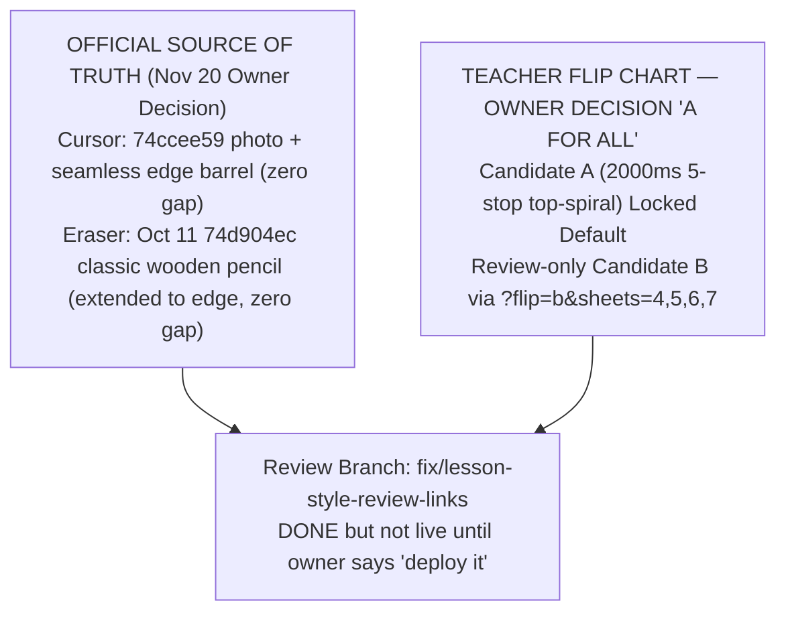

# OWNER VISUAL STATUS — LA CARTILLA DE GRETEL

**Repository:** `https://github.com/ejnburrows-rgb/cartilla-de-gretel`  
**Authoritative Execution Issue:** [#877](https://github.com/ejnburrows-rgb/cartilla-de-gretel/issues/877)  
**Official Pencil Cursor Spec:** [PENCIL-CURSOR-SPEC.md](../PENCIL-CURSOR-SPEC.md) (Approved 2026-11-18)  
**Production URL (Live Baseline):** [https://cartilla-de-gretel-psi.vercel.app](https://cartilla-de-gretel-psi.vercel.app)  
**Production Alias:** [https://cartilla-de-gretel-ejn.vercel.app](https://cartilla-de-gretel-ejn.vercel.app)  
**Last Checked Date:** 2026-11-20  
**Canonical Main Branch:** `main` (`9a61b2ba`); review branch `fix/lesson-style-review-links` (merged with `main`, not yet merged to `main` or deployed)  
**Deployment Gate:** Live Vercel production remains at the previous verified baseline (`e03ed1d2` / `dpl_DBYEi1HrNNCajXf6oDvrcCccWukU`; `vercel.json` has `git.deploymentEnabled: false`) until the owner explicitly says `"deploy it"`.
**Ledger Note:** `docs/COMPLETION_LEDGER.csv` does not exist on `main`; this document and `public/review/owner-decisions-locked-b.json` are the active status records.

---

## 1. Complete Repository & Release Map

---

## 2. Official Pencil & Eraser Standard (Locked in `PENCIL-CURSOR-SPEC.md`, Amended Nov 20)

- **Cursor / Writing Pencil (`74ccee59` / `b402cde8` + `9b379ad2` Seamless Edge Extension):** Exact owner-selected photographic sharpened wooden pencil (`owner-pencil-tip.webp`, `600×497`, transparent background, sharp graphite point at exact `(0, 0)` hotspot) with seamless photographic yellow barrel extending continuously past the viewport edges on Desktop (`1366×768`), Phone (`390×844`), and Projector (`1920×1080`) — zero gap to page/viewport edges.
- **Eraser End (`74d904ec` #692 / `b402cde8` `PencilShape`):** Classic wooden pencil with pink eraser dome and ribbed silver ferrule, oriented eraser-first (`180°` at `(0, 0)` hotspot) with continuous off-screen barrel extension (`CONTRACT_PENCIL_STRETCH = 1600`, `overflow="visible"`) during wrong-answer rubbing (`3.5 s`, `12` pink crumbs) and manual canvas erasing — zero mid-air cutoff and zero gap to page/viewport edges. The Nov 17 cartoon `owner-eraser.svg` has been deleted; standalone `PinkEraserBlock` remains retired.
- **Zero-Offset Lowering & Writing Mechanics:** Smooth approach lowering without showing any hand (`lift` → `0.00px`), `strokeLinecap="butt"` mask synchronized with `getTipFlight()`, velocity-modulated charcoal `#3a3a38` (`3.3–6.4px`), `400ms` hold, Forest Green (`#258351`) on correct / Crimson Red (`#c4320a`) + 12-crumb erase on wrong.
- **Shared Implementation:** Unified across `ContractPencilCursor.tsx`, `PencilTipCursor.tsx`, `WorkbookPencilMark.tsx`, and `PencilConnector.tsx`.

---

## 3. Seven Product Areas Status

1. **Book Cover & Opening:** `DONE and live` (Verified on production).
2. **Student Workbook:** `DONE but not live` on `fix/lesson-style-review-links` (Restored exact `74ccee59` cursor photo + Oct 11 `PencilShape` eraser; fixed rapid-tap Gretel event emission, page-turn audio overlap, landscape button/corner-curl separation, and top-bar spacing; awaits owner visual sign-off and `"deploy it"`).
3. **Teacher Flip Chart:** `DONE but not live` (`approve-a` / `"A for all"`: Candidate A `2000ms` 5-stop top-spiral turn locked as production default on `/cartilla/presentar/3` and `/cartilla/teacher/flipchart?lesson=3` with Lesson 3's single real Sheet 5; review-only Candidate B via `?flip=b&sheets=4,5,6,7`).
4. **Artwork & Motion:** `WAITING` (108/108 canonical groups intact; 27 flagged crops in `docs/review-2026-11-16/ARTWORK-ISSUES.csv`, pages 86–87 permanently `SOURCE_BLOCKED`, `0/1` Gretel welcome loop).
5. **Gretel Voice & Tutor:** `WAITING` (`AUDIO_POLICY.allowTts: false`; 59 human recordings listed in `docs/review-2026-11-16/AUDIO-MANIFEST.csv` & `docs/audio/MISSING_PICTURE_RECORDINGS.csv`).
6. **Games & Activities:** `DONE and live` (Mic-only piano & tactile games live; game audio clips `WAITING`).
7. **Website & Publication:** `DONE and live` at `e03ed1d2`; review branch awaits owner `"deploy it"` to merge and deploy.

---

## 4. Next Co-Agent Milestones (Authoritative Queue on [#877](https://github.com/ejnburrows-rgb/cartilla-de-gretel/issues/877))

1. **Publish Approved Pencil Cursor (when authorized):** Owner replies `"deploy it"` to ship `PENCIL-CURSOR-SPEC.md` runtime on Vercel production.
2. **Pick & Lock the Two Workbook Lesson Style Prototypes:** Present clear A/B visual preview on Lesson 3 (`pages 7–9`) covering clean canvas vs alternate layout/turn (`?curl=corner` / `/prototype/lesson-3-a` vs `/cartilla/leccion/3` warm roll) paired with the locked `PENCIL-CURSOR-SPEC.md` cursor.
3. **Pick & Lock the Two Flip Chart Lesson Style Prototypes:** Present clear A/B visual preview on Lesson 3 (`Sheet 5`) covering Projector Full-Screen (`/cartilla/presentar/3`) vs Teacher Panel Presenter (`/cartilla/teacher/flipchart?lesson=3`) + top-spiral turn options before rolling out across all 24 lessons (90 Workbook pages, 62 Flip Chart sheets per `docs/review-2026-11-17/ARCHETYPES.md`).
4. **Incorporate Owner Media Drops When Supplied:** 27 image crops, 59 human voice MP3s, 1 Gretel welcome MP4 loop.
