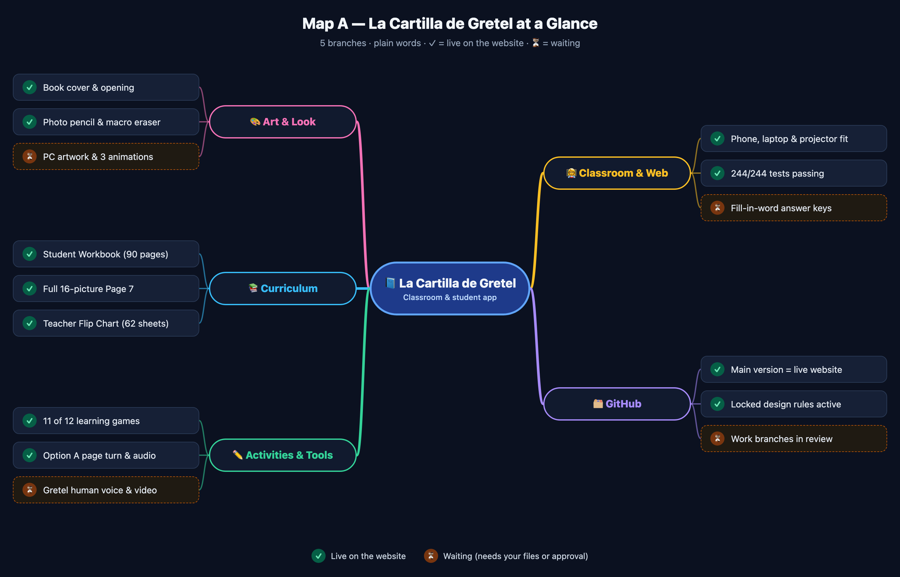
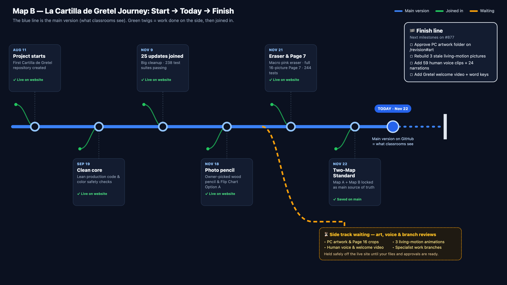
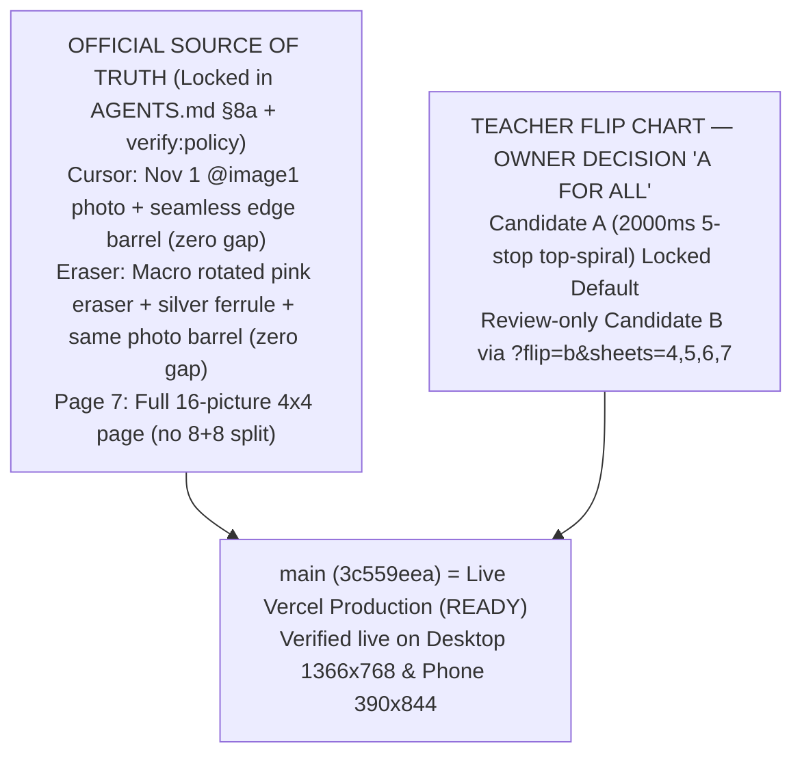

# OWNER VISUAL STATUS — LA CARTILLA DE GRETEL

**Repository:** `https://github.com/ejnburrows-rgb/cartilla-de-gretel`  
**Authoritative Execution Issue:** [#877](https://github.com/ejnburrows-rgb/cartilla-de-gretel/issues/877)  
**Official Pencil Cursor Spec:** [PENCIL-CURSOR-SPEC.md](../PENCIL-CURSOR-SPEC.md) (Approved 2026-11-18, locked 2026-11-21)  
**Production URL (Live):** [https://cartilla-de-gretel-psi.vercel.app](https://cartilla-de-gretel-psi.vercel.app)  
**Production Alias:** [https://cartilla-de-gretel-ejn.vercel.app](https://cartilla-de-gretel-ejn.vercel.app)  
**Last Checked Date:** 2026-11-22  
**Canonical Main Branch:** `main` (`3c559eea` + Two-Map Standard — PRs `#1316`, `#1317`, `#1318`, `#1319`, `#1320`)  
**Live Vercel Production:** `dpl_2mPdaWjZvBsypz61U6KCk5gej8Uh` (`READY`, `main` `3c559eea`, all 244/244 Vitest test files passed; `vercel.json` keeps `git.deploymentEnabled: false`).  
**Presentation Standard:** Approved Two-Map Standard (Map A 5-Branch Mind Map + Map B GitHub Timeline) — Zero technical jargon, zero ASCII boards.  
**Ledger Note:** `docs/COMPLETION_LEDGER.csv` does not exist on `main`; this document and `public/review/owner-decisions-locked-b.json` (updated to `lockedDefault: "A"`) are the active status records.
**Step 1 Local Readiness (`DONE but not live`):** Security dependency patches (`seroval@1.6.8`, `vite@7.3.7`, `postcss@8.5.23`, `zod@4.6.6`, `nanoid@3.3.18`, `source-map-js@1.2.2` from PR `#1243`) and `/revision` Option A cleanup (with `/review/audio-board.json`, `/review/games.json`, `/review/page-turn-timing.json` restored) are prepared locally on `swarm/step1-security-revision` — not yet merged to `main` or deployed to production.

---

## Map A — Simple Mind Map (5 Branches Maximum)

*(Phone version `390×844`: `docs/mapA_mobile.png`)*

---

## Map B — GitHub Timeline (Start → Today → Finish)

*(Phone version `390×844`: `docs/mapB_mobile.png`)*

---

## 1. Complete Repository & Release Lock Summary

---

## 2. Official Pencil, Eraser & Layout Standard (Permanent Lock — Never Revert)

- **Cursor / Writing Pencil (`74ccee59` / `9b379ad2`):** Exact owner-selected photographic sharpened wooden pencil (`public/cartilla/images/ui/owner-pencil-tip.svg` + `OwnerPhotoPencilSvg.tsx`, `600×497`, transparent background, sharp graphite point at exact `(0, 0)` hotspot) with seamless photographic yellow barrel (`op-barrel-pat`, `overflow="visible"`) extending continuously past all Desktop (`1366×768`), Phone (`390×844`), and Projector (`1920×1080`) edges — zero gap.
- **Rotated Macro Eraser End (`OwnerPhotoEraserSvg`):** Same zoomed-in `600×497` macro close-up scale (`252×209` desktop / `168×139` mobile) and `45°` down-right orientation rotated onto **just the pink rubber eraser dome + brushed silver metallic ferrule** at exact `(0, 0)` hotspot, joined seamlessly to the same photographic yellow hexagonal barrel (`OWNER_PENCIL_BARREL_TILE_DATA_URI`, `overflow="visible"`) extending off the page/viewport edges with zero gap during wrong-answer rubbing (`3.5 s`, `12` pink crumbs) and manual canvas erasing. Small/skinny full pencils, `owner-eraser.svg`, `pencil-cursor.svg`, `HdSchoolEraser.tsx`, and `PinkEraserBlock` are permanently deleted and blocked by `pnpm verify:policy`.
- **Full Workbook Page 7:** All 16 pictures (4×4 grid) render together on one page with zero `8+8` split buttons (`pnpm verify:policy` enforces this).
- **Locked Option A Styles (Lessons 1–24):** Workbook `curl=a` corner lift (no specular highlight) and Teacher Flip Chart Candidate A (`2000 ms` top-bound spiral flip) are the sole production defaults.

---

## 3. Seven Product Areas Status

1. **Book Cover & Opening:** `DONE and live` (Verified on production `3c559eea`).
2. **Student Workbook (90 pages, Lessons 1–24):** `DONE and live` (Live on `3c559eea`: full 16-picture Page 7, locked `@image1` photo writing pencil + macro rotated pink eraser, Option A `curl=a` default, Desktop/Tablet/Mobile/Projector layout clearance, `page-turn-soft.mp3` + mute stop + rapid-tap audio fix; pages `86–87` remain permanently `SOURCE_BLOCKED`).
3. **Teacher Flip Chart (62 HD sheets):** `DONE and live` (Live on `3c559eea`: Candidate A `2000 ms` 5-stop top-spiral turn locked as production default; review-only Candidate B via `?flip=b&sheets=4,5,6,7` with per-sheet lesson labels).
4. **Artwork & Motion:** `WAITING` (90-page `/revision#art` circled audit showing replacement candidates alongside current art is `DONE and live`; waiting on owner's Nov 19 Windows PC artwork folder + rebuilding 3 stale `*-alive.svg` animations: `wb-p1/abeja`, `p006-elefante`, `vocal-a/abeja`; 3 Page 16 crops `pez`/`traje`/`arco` pending layout wiring).
5. **Gretel Voice & Tutor:** `WAITING` (`AUDIO_POLICY.allowTts: false`; Tutor `#1073` untouched; waiting on 59 human voice clips + 24 lesson narrations + 1 Gretel welcome MP4).
6. **Games & Activities (12 games):** `DONE and live` (11/12 live and working on desktop and phone; `Mariposas` untouched; `completar-palabras` stays `WAITING` on owner answer keys).
7. **Website & Publication:** `DONE and live` (`main` `3c559eea` = live Vercel `dpl_2mPdaWjZvBsypz61U6KCk5gej8Uh`, verified live on Desktop `1366×768` and Phone `390×844` with 0 errors and 0 horizontal overflow).

---

## 4. Next Milestones (Authoritative Queue on [#877](https://github.com/ejnburrows-rgb/cartilla-de-gretel/issues/877))

1. **Rebuild 3 Stale Living-Motion Files:** Re-check coordinates and rebuild `wb-p1/abeja.svg`, `p006-elefante.png`, and `vocal-a/abeja.webp` via `scripts/living-motion/` and present on `/revision`.
2. **Integrate Owner Nov 19 PC Artwork Folder & Page 16 Crops (`pez`, `traje`, `arco`):** Place all replacement candidates on `/revision#art` for owner A/B approval before going live.
3. **Incorporate Owner Human Voice & Gretel Welcome Video Drops:** 59 human voice MP3s + 24 lesson narrations + 1 Gretel welcome MP4 loop (zero TTS).
