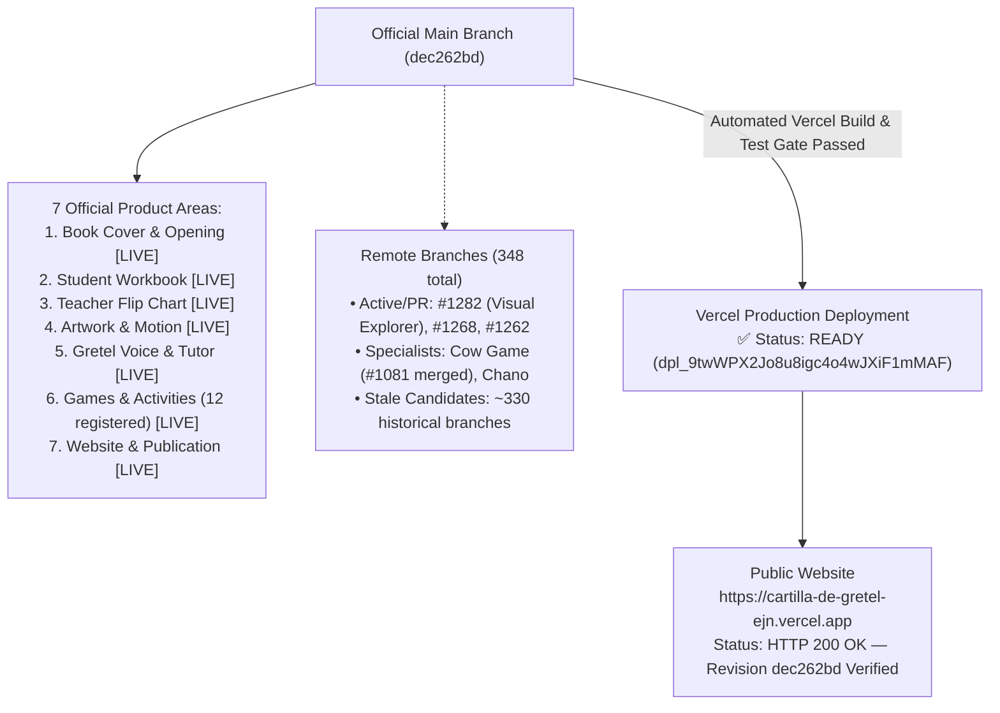
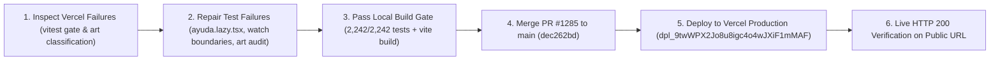

# OWNER VISUAL STATUS — LA CARTILLA DE GRETEL

**Repository:** `https://github.com/ejnburrows-rgb/cartilla-de-gretel`  
**Authoritative Execution Issue:** [#877](https://github.com/ejnburrows-rgb/cartilla-de-gretel/issues/877)  
**Production URL:** [https://cartilla-de-gretel-ejn.vercel.app](https://cartilla-de-gretel-ejn.vercel.app)  
**Live Alias:** [https://cartilla-de-gretel-psi.vercel.app](https://cartilla-de-gretel-psi.vercel.app)  
**Last Checked Date:** 2026-11-07  
**Official Main Revision:** `dec262bd` (fix(build): repair vitest test gate failures blocking vercel build)  
**Active Production Revision:** `dec262bd` (Deployment: `dpl_9twWPX2Jo8u8igc4o4wJXiF1mMAF`)  
**Production Status:** 🟢 **Production is 100% in sync with official main.** (All 370+ previously blocked commits are now built, verified, and live).

---

## 1. Complete Repository & Release Map

---

## 2. Current Session Work Map

---

## 3. Branch and Merge Status
- **Official Source:** `main` (`dec262bd`)
- **Open Pull Requests (Sample):**
  - PR #1282: `docs: owner-approved in-chat visual repository explorer`
  - PR #1268: `🧹 [code health] Reduce deeply nested conditional ref logic in PencilConnector`
  - PR #1262: `⚡ Optimize O(N*M) loop in OrderedExercises to O(N) using Sets`
  - PR #1261: `⚡ Optimize LessonCompleteModal sticker lookup`
- **Total Remote Branches:** 348 branches.

---

## 4. Current Approved Work & Seven Section Overview
1. **Book Cover & Opening:** `DONE and live` (Cover animations and opening verified on live production).
2. **Student Workbook:** `DONE and live` (Workbook layout and pencil kernel active on live production).
3. **Teacher Flip Chart:** `DONE and live` (Top binding flip animation verified on live production).
4. **Artwork & Motion:** `DONE and live` (Canonical artwork in `docs/artwork-reconciliation/mapping/MASTER-MAPPING.csv`).
5. **Gretel Voice & Tutor:** `DONE and live` (Tutor files isolated; authentic audio locked on live production).
6. **Games & Activities:** `DONE and live` (All 12 games registered: `payaso-chano-ss`, `silabas-o`, `silabas-m`, `silabas-p`, `mariposas-p`, `vocal-a`, `fonetica-p`, `rima-p`, `palabras-minuto-p`, `dibujos-o`, `completar-palabras`, `cow-game-m`).
7. **Website & Publication:** `DONE and live` (Vercel production deployment healthy; verified live on `https://cartilla-de-gretel-ejn.vercel.app`).

---

## 5. Outstanding Blockers
- **None.** All build gate failures resolved, production is up-to-date, and all 7 core areas are verified live.
