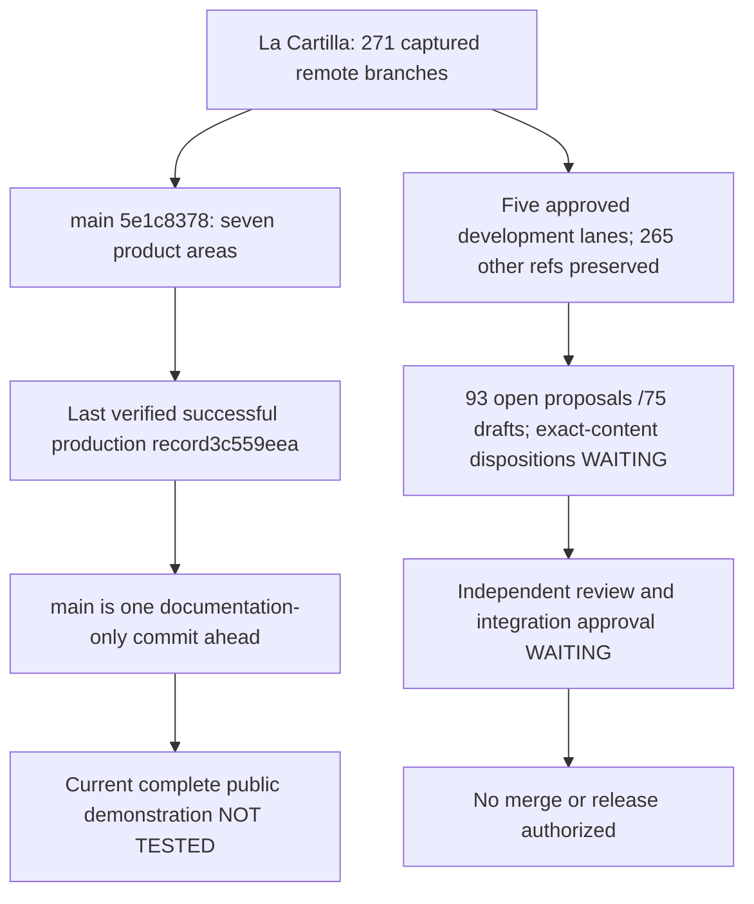
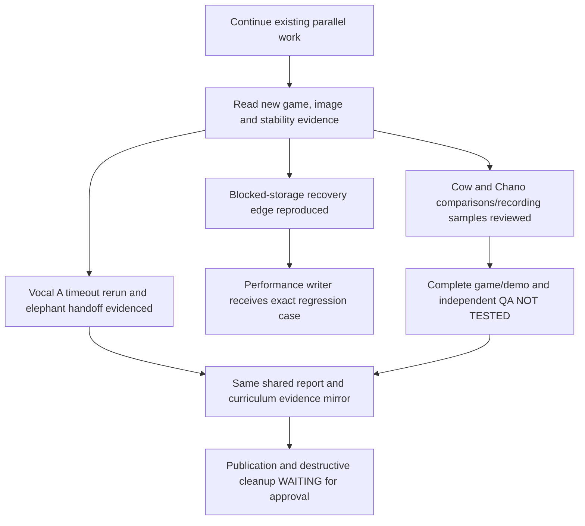

### Current evidence checkpoint: 2026-11-26, round 2

**OVERALL: NOT TESTED** for the complete client demonstration. New game/motion evidence and the first stability repair have arrived. No merge, deployment, artwork swap or deletion occurred.

Current full metadata capture: **271 remote branches, 93 open PRs, 75 drafts**. New draft #1328 is the existing Performance lane's first proposal, not an additional development lane. Main remains `5e1c8378d15ca6aa1120683149e9e722084aa93d`. Five current lane diffs have no shared changed paths; semantic and assembled-app acceptance remain separate checks. Captured identities and all open proposals are retained in [round-2 verification](https://github.com/ejnburrows-rgb/cartilla-de-gretel/blob/work/curriculum/docs/consolidation/ROUND2-VERIFICATION-2026-11-26.json). This metadata is not Gitar's still-missing substantive disposition inventory.

| Lane | Inspected head | Current result / remaining gate |
| --- | --- | --- |
| Curriculum | 8eec3ec6770893e0a92b0a9fb413f3d9471e82f1 | Existing bounded repair unchanged; this checkpoint changes documentation/evidence only |
| Audio/interactions | 4605cdaa95b774b2e7ff2c0b04b0320e1b621464 | Real-controls demo navigation, audio and interaction acceptance remain NOT TESTED |
| Images | aa0920b7a9b9ddebc9b8a0dfefee77580928ca43 | All 88 pages now represented in image sweep; seeded bookmarks are not real-controls navigation proof; candidates remain disconnected |
| Assets/motion | 1471c8280cba15e757651b94d36b8350f3314447 | New raw results, screenshots and recordings reviewed; complete game acceptance remains NOT TESTED |
| Performance | a333df7e37238e06a28d4030bb53e3278b140db5 | Missing-code/cache/retry patch exists in draft1328; storage-access edge reproduced and returned to its writer; hosted 404 behavior NOT TESTED |

#### What the new evidence establishes

- **Cow:** opened phone and ultrawide before/after comparisons. The drawing is narrower, and repeated sharp-edged wide-screen scene copies are replaced by softened sides. Raw 13-test output and ratio/input-lock measurement source are still requested; exact numerical timing and all-round success remain lane-reported, not independently rerun. Further optional speed changes are not required to complete the bounded repair.
- **Chano:** opened source, placed/repeated-word screenshots and timestamped samples from the two 14-second recordings. Samples corroborate selected balls moving onto the board, other balls remaining in the juggle and balls returning on Next. These cover only words 1–2. Current full five-word rounds, touch drag, wrong/clear/reset and reduced-motion acceptance remain NOT TESTED. A repeated syllable currently appears as chalk in the second slot; this does not establish compliance with the owner's two-ball requirement. Landscape now uses the portrait scene at full height with softened sides; matching the approved edge-to-edge reference remains WAITING for acceptance. No word replacement or new art directed.
- **Vocal A:** corrected raw rounds report phone 5/5 and desktop 4/5 with one deliberate wrong answer, both reset successfully. Opened the phone completion screenshot and desktop recording samples, including the red wrong answer and final score. The earlier timeouts were an evidence-script assertion error, now rerun, not a repaired game defect. No Vocal A code change claimed.
- **Elephant:** exact source delta removes only the `p006-elefante` hold. The revised test retains the other six holds and checks the approved still's digest against the motion manifest. Presenter phone/projector screenshots, four motion frames and raw results now exist; raw results show animated SVG normally and unchanged PNG under projector reduced motion. Narrow handoff is implemented; complete teacher-sheet acceptance remains NOT TESTED.
- **Failure reconciliation:** independently compared every name in both committed lists: 24 unique main failures, 22 unique candidate failures, no candidate-only names and exactly two removed elephant-route failures. This verifies the name sets, not identical failure causes or that all remaining failures are stale. Three microphone tests, sixteen motion-discipline checks and three garden/hub checks remain unresolved. Protected Butterfly Garden and shimmer remain unchanged.
- **Performance:** read the complete six-file proposal. Missing asset routing, HTML cache rejection, cache invalidation and guarded reload are present; automatic deployment stays disabled. Independently transpiled the exact recovery source and invoked its installed listener: a blocked `sessionStorage` property getter throws before the helper's try/catch. Requested a protected access boundary and installer-level regression test from the existing writer. PR narrative describes a phone browser run but contains no committed raw browser artifact; phone/desktop first-recovery and persistent-failure evidence plus cache regression proof are requested. Actual Vercel 404 behavior needs separately authorized publication and is NOT TESTED.
- **Images:** inspected the complete four-path delta. It adds six no-picture CSV rows for pages89–90 and adjusts the seeded-bookmark sweep; no production file or candidate binary changes. All88 available pages now have image-sweep rows. These text/writing pages still need Devin's real-controls verification. Other source and candidate-fidelity boundaries remain unchanged.

Reviewed proof publication `1471c828` separately from its recorded tested source: cow `d4f4cb8`, Chano `0b59012`, elephant `c925073`. Lane-reported checks at `c925073`: typecheck, worker, policy and unit suite (246 files / 2336 passes plus two expected failures); no coordinator full-suite rerun or new executable change in this checkpoint.

Existing-lane follow-ups: [Motion](https://github.com/ejnburrows-rgb/cartilla-de-gretel/pull/1326#issuecomment-7204269236), [Images](https://github.com/ejnburrows-rgb/cartilla-de-gretel/pull/1327#issuecomment-7204269246), [Performance](https://github.com/ejnburrows-rgb/cartilla-de-gretel/pull/1328#issuecomment-7204269208). No replacement assignment, sixth branch, new art/voice, Supabase change or paid rerun.

#### Complete repository and release map

Main and the five approved lanes are retained. Historical refs remain BLOCKED/unverified for disposition, not proven obsolete. No new approved-for-integration or delete-candidate classification is invented. Deployment7964470967 still has a successful latest status; that is not a fresh served-revision or public-flow check.

#### This session's work map

#### Seven-area current reading

| Area | Status and next dependency |
| --- | --- |
| Book Cover & Opening | NOT TESTED: full current opening path not certified |
| Student Workbook | NOT TESTED overall: all88 available pages now in image sweep; real navigation, activities and physical-source acceptance outstanding;86–87 excluded |
| Teacher Flip Chart | NOT TESTED overall: narrow elephant switch and presenter evidence reviewed; full content/interaction acceptance outstanding |
| Artwork & Motion | NOT TESTED overall: cow comparisons and elephant motion proof reviewed; artwork candidates disconnected, ten Workbook/shared provenance rows unresolved |
| Gretel Voice & Tutor | WAITING: recovered instructions remain disconnected pending permitted-source resolution; browser audio/microphone and separate Tutor acceptance outstanding |
| Games & Activities | NOT TESTED overall: Vocal A corrected round proof reviewed; Chano full five-word/touch coverage and other games' full rounds outstanding |
| Website & Publication | WAITING: proposed stability repair needs correction/proof/review, and no release is authorized; current complete public demonstration NOT TESTED |

What can be used: committed comparisons and silent recordings for review, not a certified combined client demonstration. Ready but not live: the previously tested curriculum source-reader repair; newer lane changes remain subject to their bounded evidence and outstanding acceptance above.

Next three actions: obtain exact-current-source game/demo proof; resolve the reproduced stability guard gap and inspect its regression evidence; obtain exhaustive substantive branch/draft dispositions and independent review. No owner action is requested to coordinate these technical steps. Repeated-ball and landscape presentation questions remain recorded, not silently approved; optional extra cow speed is not an owner blocker.
