# Artwork availability — current inventory

**202 baseline working groups → 201 drawing/composite groups**, covering all **330 placements**. One verified repeat (FC-009-04 / FC-011-01) is consolidated. This is 198 resolved drawing identities plus three unresolved frontmatter composites.

| Classification | Drawing groups |
|---|---:|
| OPTIMIZED VERSION EXISTS | 90 |
| OPTIMIZATION NEEDED | 108 |
| UNRESOLVED | 3 |

**115 exact oriented placement/file matches** have been individually verified. Availability belongs to the drawing; mirrored reuse, a bad runtime candidate and runtime integration are separate placement fields. Do not request a new drawing when a faithful master already exists in its group.

[Current 330-placement master](MASTER-MAPPING.md) · [Machine-readable 330 placements](MASTER-MAPPING.csv) · [Confirmed missing originals](missing-originals.md) · [Complete JSON: all placements, matches, alternatives, approval and runtime fields](availability-inventory.json) · [50 withheld-file associations](withheld-associations.md)

Production approval does not gate availability. Owner [identity guidance](https://github.com/ejnburrows-rgb/cartilla-de-gretel/issues/588#issuecomment-6144950691) accepts original/current/older references; exact production approval remains unverified. Runtime mappings are unchanged. The 14 resolved SVG hash domains are reused unchanged.

Missing means no suitable standalone whole upgrade in the relevant accessible registered sources. Color changes alone are accepted. Redraws, lost linework, cropped artwork and foreign captions/page rules fail suitability. Source PDF pages/raw original reference crops do not themselves establish an optimized standalone version.

## Illustrated drawing inventory

| Drawing and placements | Availability | Visual evidence / decision |
|---|---|---|
| **DRAW-WB-01-1 — abanico** WB-S007-OBJ03-ABANICO, WB-S013-OBJ01-ABANICO, WB-S019-OBJ04-ABANICO, FC-005-02 | **OPTIMIZED VERSION EXISTS** | 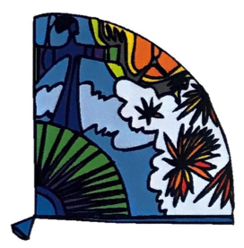 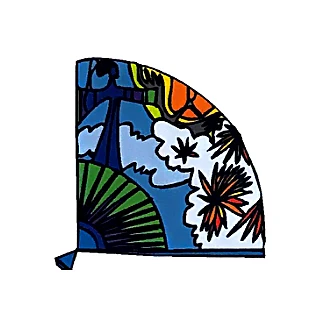 [Selected file](https://github.com/ejnburrows-rgb/cartilla-de-gretel/blob/153c7eccbec5bc1090cd130a909f0cf73630415a/public/cartilla/art/optimized/flipchart-native/p005-abanico.png) [Existing comparison](comparisons/FC-013.jpg) Whole faithful drawing visually matches source linework, pose, object count and composition; color changes alone are accepted. No visible artwork clipping in the selected file. |
| **DRAW-WB-02-1 — abeja** WB-S007-OBJ19-ABEJA, WB-S013-OBJ06-ABEJA, WB-S014-OBJ04-ABEJA, WB-S016-OBJ07-ABEJA, WB-S017-OBJ03-ABEJA, WB-S020-OBJ08-ABEJA, WB-S022-OBJ13-ABEJA | **OPTIMIZED VERSION EXISTS** | 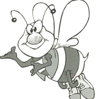 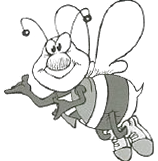 [Selected file](https://github.com/ejnburrows-rgb/cartilla-de-gretel/blob/153c7eccbec5bc1090cd130a909f0cf73630415a/public/cartilla/art/faithful/leccion-1/wb-p1/abeja.svg) [Existing comparison](comparisons/WB-019.jpg) Faithful bee SVG preserves the original face, wing geometry, fingers, stripes and shoes. Modernized bees are rejected; existing SVG proof reused. |
| **DRAW-WB-03-1 — abrigo** WB-S007-OBJ01-UNIFORME-1, WB-S017-OBJ08-CHAQUETA | **OPTIMIZATION NEEDED** | 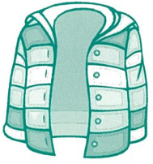  [Existing comparison](comparisons/WB-001.jpg) Faithful coat clips outer left sleeve; modernized puffer redraw changes collar, panels and buttons. |
| **DRAW-WB-04-1 — aguja** WB-S013-OBJ15-AGUJA, WB-S014-OBJ05-AGUJA, WB-S016-OBJ08-AGUJA | **OPTIMIZATION NEEDED** | 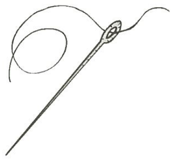 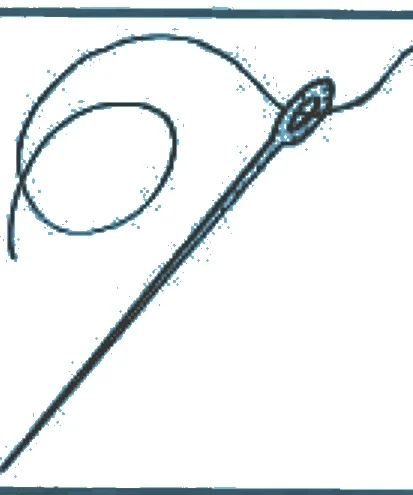 [Existing comparison](comparisons/WB-079.jpg) Needle tip clipped and table rules retained; no complete clean alternative. |
| **DRAW-WB-05-1 — ala** WB-S010-OBJ07-ALA, WB-S013-OBJ10-ALA | **OPTIMIZATION NEEDED** | 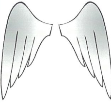 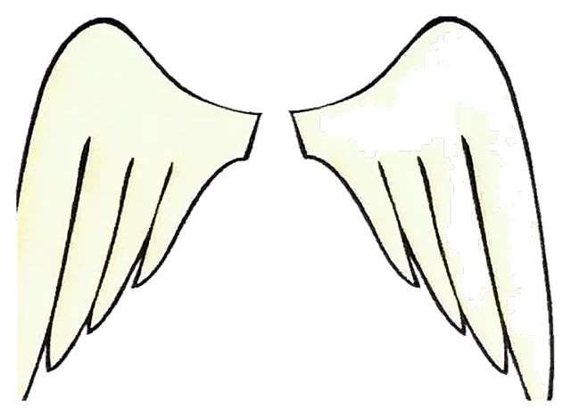 [Existing comparison](comparisons/WB-043.jpg) Faithful wings lose right-wing lines/contour; FC pair differs from this WB print variant; modernized wings redraw geometry. |
| **DRAW-WB-05-2 — ala** WB-S011-OBJ08-ALA, WB-S014-OBJ03-ALA, WB-S019-OBJ07-ALA | **OPTIMIZATION NEEDED** | 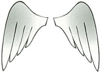  [Existing comparison](comparisons/WB-061.jpg) Faithful wings lose right-wing contour; FC proportions differ from this WB variant; modernized redraw is not exact. |
| **DRAW-WB-06-1 — arana** WB-S009-OBJ03-ARANA, WB-S010-OBJ13-ARANA, FC-005-04 | **OPTIMIZED VERSION EXISTS** | 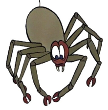 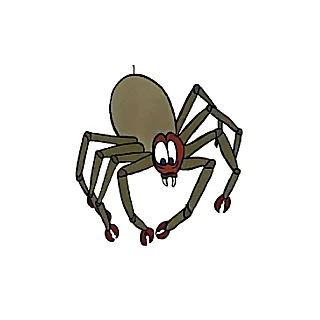 [Selected file](https://github.com/ejnburrows-rgb/cartilla-de-gretel/blob/153c7eccbec5bc1090cd130a909f0cf73630415a/public/cartilla/art/optimized/flipchart-native/p005-arana.png) [Existing comparison](comparisons/FC-013.jpg) Whole faithful drawing visually matches source linework, pose, object count and composition; color changes alone are accepted. No visible artwork clipping in the selected file. |
| **DRAW-WB-07-1 — arbol** WB-S008-OBJ05-ARBOL, WB-S013-OBJ07-ARBOL, WB-S022-OBJ09-ARBOL | **OPTIMIZATION NEEDED** | 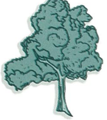 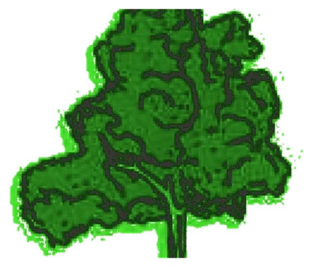 [Existing comparison](comparisons/WB-025.jpg) Faithful tree clips trunk; modernized tree redraws crown and branch pattern. |
| **DRAW-WB-08-1 — ardilla** WB-S013-OBJ12-ARDILLA | **OPTIMIZATION NEEDED** | 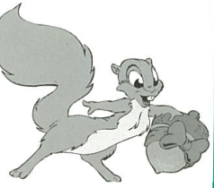 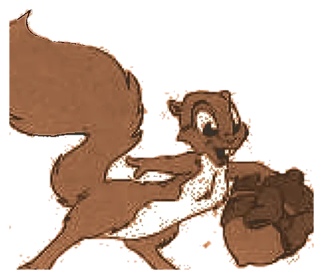 [Existing comparison](comparisons/WB-073.jpg) Only faithful squirrel clips tail/nut bounds; no complete alternative found. |
| **DRAW-WB-09-1 — aro** WB-S007-OBJ08-ARO, WB-S013-OBJ03-ARO, WB-S014-OBJ08-ARO | **OPTIMIZATION NEEDED** | 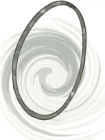 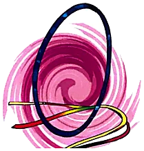 [Existing comparison](comparisons/WB-007.jpg) All located hoops add two hoops/action strokes absent from the WB single-hoop source. |
| **DRAW-WB-09-2 — aro** WB-S008-OBJ01-ARO | **OPTIMIZATION NEEDED** | 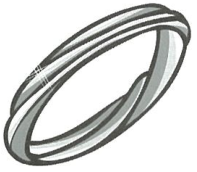  [Existing comparison](comparisons/WB-019.jpg) Located ring differs in orientation; hoop/swirl alternatives depict a different drawing. |
| **DRAW-WB-10-1 — avión** WB-S007-OBJ06-PEZ, WB-S013-OBJ14-PEZ, WB-S014-OBJ07-PEZ, WB-S019-OBJ02-PEZ, WB-S022-OBJ03-PEZ | **OPTIMIZED VERSION EXISTS** |  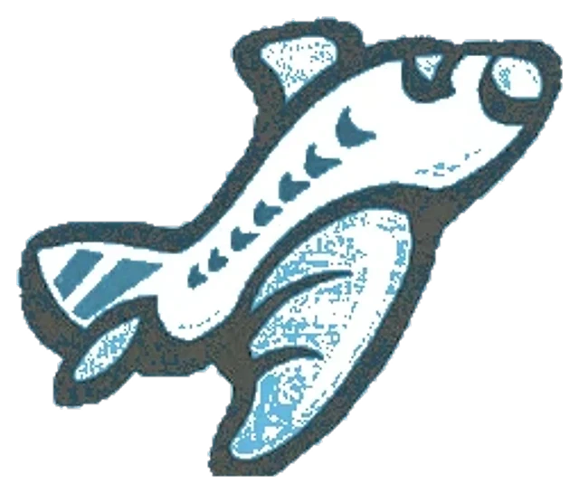 [Selected file](https://github.com/ejnburrows-rgb/cartilla-de-gretel/blob/153c7eccbec5bc1090cd130a909f0cf73630415a/public/cartilla/art/faithful/leccion-1/pez.webp) [Existing comparison](comparisons/WB-109.jpg) Whole faithful drawing visually matches source linework, pose, object count and composition; color changes alone are accepted. No visible artwork clipping in the selected file. The depiction is an **airplane (avión)**; five inherited `PEZ` filenames are misleading, not proof of fish. [Direct source image](crops/WB-S019-OBJ02-PEZ.png). |
| **DRAW-WB-11-1 — carro** WB-S008-OBJ12-CARRO | **OPTIMIZATION NEEDED** | 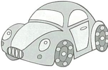 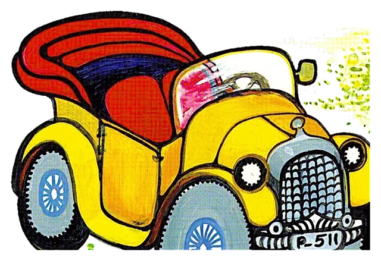 [Existing comparison](comparisons/WB-031.jpg) Faithful car is the unrelated vintage FC car; modernized compact car redraws window, lights and wheel geometry. |
| **DRAW-WB-13-1 — dulce** WB-S008-OBJ15-DULCE | **OPTIMIZATION NEEDED** | 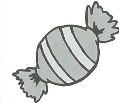 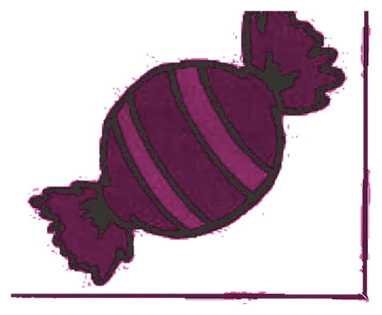 [Existing comparison](comparisons/WB-031.jpg) Faithful candy retains unrelated frame and clips wrapper; Drive candy redraw changes wrapper and stripe geometry. |
| **DRAW-WB-14-1 — elefante** WB-S007-OBJ16-ELEFANTE, WB-S013-OBJ08-ELEFANTE, WB-S016-OBJ01-ELEFANTE, WB-S017-OBJ02-ELEFANTE, WB-S022-OBJ08-ELEFANTE | **OPTIMIZATION NEEDED** | 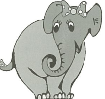 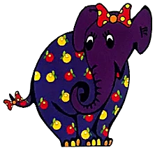 [Existing comparison](comparisons/WB-013.jpg) All faithful/FC elephants add coat spots absent from WB; Drive elephant redraw changes linework. |
| **DRAW-WB-15-1 — erizo** WB-S016-OBJ06-ERIZO, WB-S017-OBJ04-ERIZO, FC-006-06 | **OPTIMIZED VERSION EXISTS** | 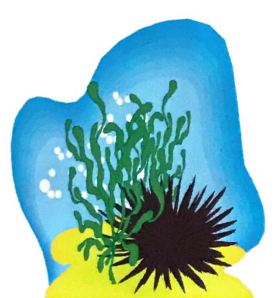 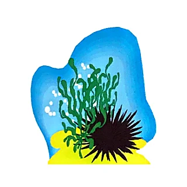 [Selected file](https://github.com/ejnburrows-rgb/cartilla-de-gretel/blob/153c7eccbec5bc1090cd130a909f0cf73630415a/public/cartilla/art/optimized/flipchart-native/p006-erizo.png) [Existing comparison](comparisons/FC-025.jpg) Whole faithful drawing visually matches source linework, pose, object count and composition; color changes alone are accepted. No visible artwork clipping in the selected file. |
| **DRAW-WB-16-1 — escalera** WB-S007-OBJ09-ESCALERA, WB-S016-OBJ05-ESCALERA, WB-S017-OBJ06-ESCALERA, FC-006-07 | **OPTIMIZED VERSION EXISTS** | 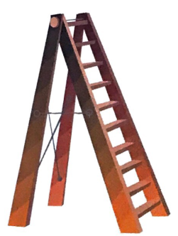 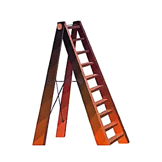 [Selected file](https://github.com/ejnburrows-rgb/cartilla-de-gretel/blob/153c7eccbec5bc1090cd130a909f0cf73630415a/public/cartilla/art/optimized/flipchart-native/p006-escalera.png) [Existing comparison](comparisons/FC-025.jpg) Whole faithful drawing visually matches source linework, pose, object count and composition; color changes alone are accepted. No visible artwork clipping in the selected file. |
| **DRAW-WB-17-1 — escoba** WB-S009-OBJ05-ESCOBA, WB-S016-OBJ09-ESCOBA | **OPTIMIZATION NEEDED** | 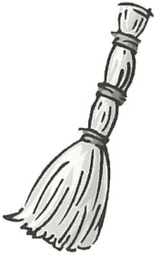 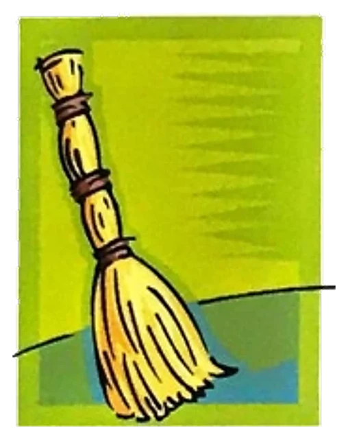 [Existing comparison](comparisons/WB-037.jpg) FC broom backdrop/action line absent from WB source; Drive broom redraw changes bound handles/bristles. |
| **DRAW-WB-18-1 — escuela** WB-S007-OBJ11-ESCUELA, WB-S016-OBJ13-ESCUELA | **OPTIMIZED VERSION EXISTS** | 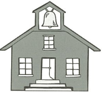 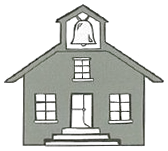 [Selected file](https://github.com/ejnburrows-rgb/cartilla-de-gretel/blob/153c7eccbec5bc1090cd130a909f0cf73630415a/public/cartilla/art/faithful/leccion-1/wb-p1/escuela.svg) [Existing comparison](comparisons/WB-007.jpg) Faithful school SVG retains source bell, roof, three windows, door, steps and wall geometry; modernized red school is a different drawing. |
| **DRAW-WB-18-2 — escuela** WB-S008-OBJ04-ESCUELA | **OPTIMIZATION NEEDED** |   [Existing comparison](comparisons/WB-019.jpg) Located FC half-timbered house is unrelated; Drive school-with-children redraw changes roof, windows and figures. |
| **DRAW-WB-19-1 — espejo** WB-S016-OBJ15-ESPEJO | **OPTIMIZATION NEEDED** | 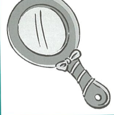 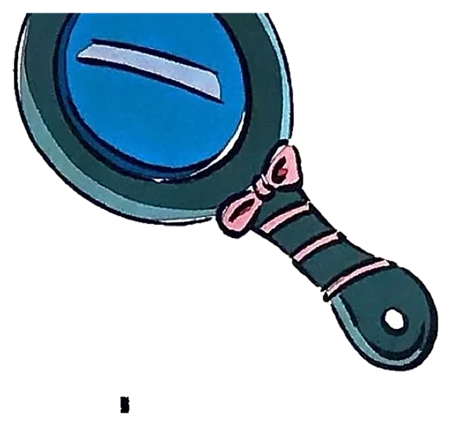 [Existing comparison](comparisons/WB-103.jpg) Faithful mirror top clipped; complete FC mirror has different reflection/glare linework and opposite orientation. |
| **DRAW-WB-20-1 — estrella** WB-S008-OBJ06-ESTRELLA, WB-S013-OBJ11-ESTRELLA, WB-S016-OBJ11-ESTRELLA, WB-S017-OBJ07-ESTRELLA, WB-S022-OBJ06-ESTRELLA, WB-S023-OBJ07-ESTRELLA, FC-006-05 | **OPTIMIZED VERSION EXISTS** |   [Selected file](https://github.com/ejnburrows-rgb/cartilla-de-gretel/blob/153c7eccbec5bc1090cd130a909f0cf73630415a/public/cartilla/art/optimized/flipchart-native/p006-estrella.png) [Existing comparison](comparisons/FC-025.jpg) Whole faithful drawing visually matches source linework, pose, object count and composition; color changes alone are accepted. No visible artwork clipping in the selected file. |
| **DRAW-WB-21-1 — globo** WB-S008-OBJ14-GLOBO | **OPTIMIZED VERSION EXISTS** | 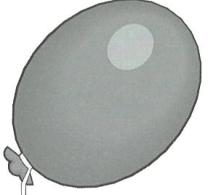 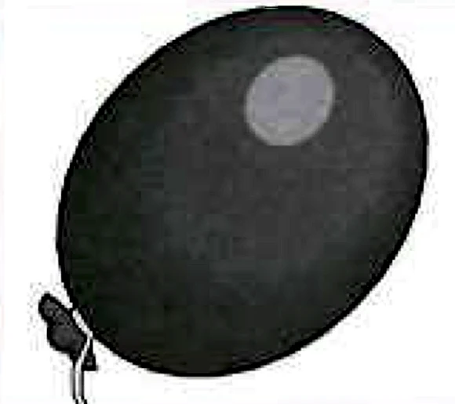 [Selected file](https://github.com/ejnburrows-rgb/cartilla-de-gretel/blob/153c7eccbec5bc1090cd130a909f0cf73630415a/public/cartilla/art/faithful/leccion-1/globo.webp) [Existing comparison](comparisons/WB-031.jpg) Whole faithful drawing visually matches source linework, pose, object count and composition; color changes alone are accepted. No visible artwork clipping in the selected file. |
| **DRAW-WB-22-1 — iglesia** WB-S009-OBJ01-IGLESIA | **OPTIMIZATION NEEDED** | 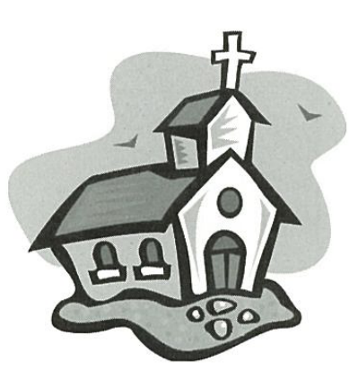  [Existing comparison](comparisons/WB-031.jpg) Only church family clips ground/pebbles and lower/right bounds. |
| **DRAW-WB-23-1 — iglu** WB-S010-OBJ02-IGLU, WB-S011-OBJ01-IGLU, WB-S014-OBJ02-IGLU, WB-S016-OBJ02-IGLU, WB-S019-OBJ01-IGLU, WB-S020-OBJ03-IGLU, FC-007-03 | **OPTIMIZED VERSION EXISTS** | 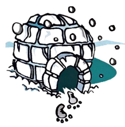 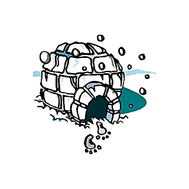 [Selected file](https://github.com/ejnburrows-rgb/cartilla-de-gretel/blob/153c7eccbec5bc1090cd130a909f0cf73630415a/public/cartilla/art/optimized/flipchart-native/p007-iglu.png) [Existing comparison](comparisons/FC-025.jpg) Whole faithful drawing visually matches source linework, pose, object count and composition; color changes alone are accepted. No visible artwork clipping in the selected file. |
| **DRAW-WB-24-1 — igual** WB-S019-OBJ14-IGUAL, WB-S020-OBJ04-IGUAL | **OPTIMIZATION NEEDED** | 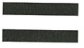 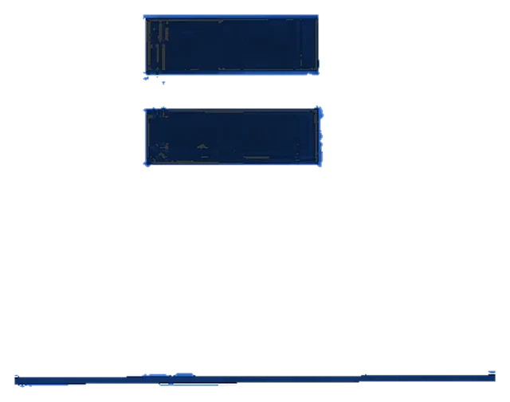 [Existing comparison](comparisons/WB-121.jpg) Only equal-sign file has unrelated table rule and changes bars into outlined panels. |
| **DRAW-WB-25-1 — iguana** WB-S019-OBJ03-IGUANA, WB-S020-OBJ07-IGUANA | **OPTIMIZATION NEEDED** | 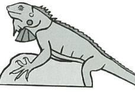 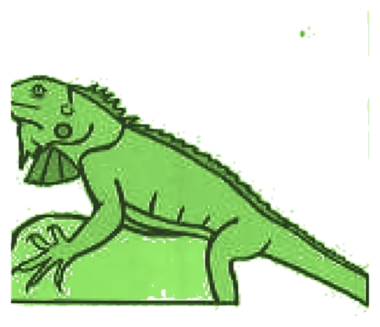 [Existing comparison](comparisons/WB-115.jpg) Only iguana file clips original head and retains unrelated page/crop artifacts. |
| **DRAW-WB-26-1 — iman** WB-S007-OBJ07-IMAN-2, WB-S013-OBJ04-IMAN, WB-S019-OBJ10-IMAN, WB-S020-OBJ01-IMAN, WB-S023-OBJ08-IMAN, WB-S007-OBJ02-IMAN-1 | **OPTIMIZATION NEEDED** | 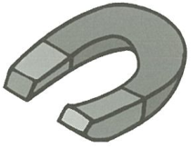  [Existing comparison](comparisons/WB-001.jpg) FC magnet adds backdrop/action marks and changes tip geometry; Drive plain magnets redraw geometry. |
| **DRAW-WB-28-1 — indio** WB-S008-OBJ08-INDIO, WB-S016-OBJ04-INDIO, WB-S019-OBJ06-INDIO, WB-S020-OBJ05-INDIO, FC-007-04 | **OPTIMIZATION NEEDED** |   [Existing comparison](comparisons/FC-031.jpg) Faithful and FC figure cut feather; Drive version redraws spear, hands and pose. |
| **DRAW-WB-29-1 — insecto** WB-S019-OBJ15-INSECTO, WB-S022-OBJ15-INSECTO, FC-007-05 | **OPTIMIZED VERSION EXISTS** | 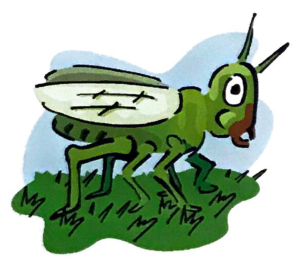 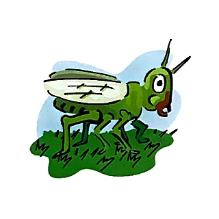 [Selected file](https://github.com/ejnburrows-rgb/cartilla-de-gretel/blob/153c7eccbec5bc1090cd130a909f0cf73630415a/public/cartilla/art/optimized/flipchart-native/p007-insecto.png) [Existing comparison](comparisons/FC-031.jpg) Whole faithful drawing visually matches source linework, pose, object count and composition; color changes alone are accepted. No visible artwork clipping in the selected file. |
| **DRAW-WB-30-1 — invierno** WB-S019-OBJ08-INVIERNO | **OPTIMIZATION NEEDED** | 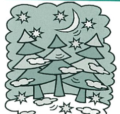 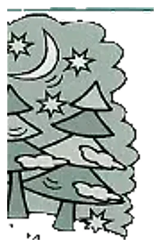 [Existing comparison](comparisons/WB-115.jpg) Only winter scene is reversed, heavily clipped and retains table rule. |
| **DRAW-WB-31-1 — isla** WB-S007-OBJ05-ISLA, WB-S019-OBJ12-ISLA, FC-007-06 | **OPTIMIZED VERSION EXISTS** |   [Selected file](https://github.com/ejnburrows-rgb/cartilla-de-gretel/blob/153c7eccbec5bc1090cd130a909f0cf73630415a/public/cartilla/art/optimized/flipchart-native/p007-isla.png) [Existing comparison](comparisons/FC-031.jpg) Whole faithful drawing visually matches source linework, pose, object count and composition; color changes alone are accepted. No visible artwork clipping in the selected file. |
| **DRAW-WB-32-1 — libro** WB-S008-OBJ03-LIBRO | **OPTIMIZED VERSION EXISTS** |   [Selected file](https://github.com/ejnburrows-rgb/cartilla-de-gretel/blob/153c7eccbec5bc1090cd130a909f0cf73630415a/public/cartilla/art/faithful/leccion-1/libro.webp) [Existing comparison](comparisons/WB-019.jpg) Whole faithful drawing visually matches source linework, pose, object count and composition; color changes alone are accepted. No visible artwork clipping in the selected file. |
| **DRAW-WB-33-1 — maiz** WB-S007-OBJ18-MAIZ, WB-S010-OBJ04-MAIZ, WB-S014-OBJ06-MAIZ, WB-S016-OBJ03-MAIZ, WB-S017-OBJ05-MAIZ | **OPTIMIZED VERSION EXISTS** |   [Selected file](https://github.com/ejnburrows-rgb/cartilla-de-gretel/blob/153c7eccbec5bc1090cd130a909f0cf73630415a/public/cartilla/art/faithful/leccion-1/wb-p1/maiz.svg) [Existing comparison](comparisons/WB-013.jpg) Existing faithful corn SVG preserves source kernels, husk outline, stem and leaf geometry; modernized candidates redraw these features. |
| **DRAW-WB-34-1 — manzana** WB-S008-OBJ02-MANZANA | **OPTIMIZATION NEEDED** |   [Existing comparison](comparisons/WB-019.jpg) Faithful apple cuts bottom; modernized apple redraw changes leaf, stem and contour. |
| **DRAW-WB-35-1 — ocho** WB-S009-OBJ02-OCHO, WB-S010-OBJ11-OCHO, FC-004-07 | **OPTIMIZED VERSION EXISTS** |   [Selected file](https://github.com/ejnburrows-rgb/cartilla-de-gretel/blob/153c7eccbec5bc1090cd130a909f0cf73630415a/public/cartilla/art/optimized/flipchart-native/p004-ocho.png) [Existing comparison](comparisons/FC-013.jpg) Whole faithful drawing visually matches source linework, pose, object count and composition; color changes alone are accepted. No visible artwork clipping in the selected file. |
| **DRAW-WB-36-1 — ojos** WB-S007-OBJ17-OJOS | **OPTIMIZED VERSION EXISTS** |   [Selected file](https://github.com/ejnburrows-rgb/cartilla-de-gretel/blob/153c7eccbec5bc1090cd130a909f0cf73630415a/public/cartilla/art/faithful/leccion-1/wb-p1/ojos.svg) [Existing comparison](comparisons/WB-013.jpg) Existing single-eye SVG retains original eyelid, iris, lash geometry and source orientation; pair-of-eyes file is a different drawing unit. |
| **DRAW-WB-36-2 — ojos** WB-S010-OBJ16-OJOS, WB-S011-OBJ03-OJOS, WB-S013-OBJ13-OJOS | **OPTIMIZATION NEEDED** |   [Existing comparison](comparisons/WB-055.jpg) Only faithful pair of eyes is rotated relative to source row; single-eye SVG and modernized eye are different drawings. |
| **DRAW-WB-37-1 — ola** WB-S010-OBJ01-OLA, WB-S011-OBJ06-OLA, WB-S019-OBJ09-OLA | **OPTIMIZATION NEEDED** |   [Existing comparison](comparisons/WB-037.jpg) Faithful wave cuts crest; modernized wave redraw changes crest and bubble shapes. |
| **DRAW-WB-38-1 — olla** WB-S007-OBJ20-OLLA, WB-S010-OBJ09-OLLA, WB-S011-OBJ05-OLLA, WB-S019-OBJ16-OLLA, FC-003-05, FC-004-02 | **OPTIMIZED VERSION EXISTS** |   [Selected file](https://github.com/ejnburrows-rgb/cartilla-de-gretel/blob/153c7eccbec5bc1090cd130a909f0cf73630415a/public/cartilla/art/optimized/flipchart-native/p004-olla.png) [Existing comparison](comparisons/FC-001.jpg) Clean complete p004 pot matches this earlier FC source; neighboring halo and caption belong only to rejected p003 proposal. |
| **DRAW-WB-39-1 — oreja** WB-S007-OBJ12-OREJA, WB-S010-OBJ08-OREJA, WB-S011-OBJ04-OREJA, FC-004-06 | **OPTIMIZED VERSION EXISTS** |   [Selected file](https://github.com/ejnburrows-rgb/cartilla-de-gretel/blob/153c7eccbec5bc1090cd130a909f0cf73630415a/public/cartilla/art/optimized/flipchart-native/p004-oreja.png) [Existing comparison](comparisons/FC-007.jpg) Whole faithful drawing visually matches source linework, pose, object count and composition; color changes alone are accepted. No visible artwork clipping in the selected file. |
| **DRAW-WB-40-1 — oruga** WB-S013-OBJ02-ORUGA | **OPTIMIZATION NEEDED** |   [Existing comparison](comparisons/WB-061.jpg) Only caterpillar file clips antenna/leaf/tail boundaries. |
| **DRAW-WB-41-1 — oso** WB-S007-OBJ04-OSO-1, WB-S008-OBJ11-OSO, WB-S010-OBJ03-OSO-1, WB-S010-OBJ14-OSO-2, WB-S011-OBJ07-OSO, WB-S013-OBJ16-OSO, WB-S014-OBJ01-OSO, WB-S017-OBJ01-OSO, WB-S019-OBJ05-OSO, WB-S020-OBJ02-OSO, WB-S022-OBJ11-OSO, WB-S023-OBJ03-OSO, FC-004-05 | **OPTIMIZED VERSION EXISTS** |   [Selected file](https://github.com/ejnburrows-rgb/cartilla-de-gretel/blob/153c7eccbec5bc1090cd130a909f0cf73630415a/public/cartilla/art/optimized/flipchart-native/p004-oso.png) [Existing comparison](comparisons/FC-007.jpg) Whole faithful drawing visually matches source linework, pose, object count and composition; color changes alone are accepted. No visible artwork clipping in the selected file. |
| **DRAW-WB-42-1 — oveja** WB-S007-OBJ15-OVEJA, WB-S010-OBJ06-OVEJA, WB-S011-OBJ02-OVEJA, WB-S013-OBJ05-OVEJA, WB-S022-OBJ02-OVEJA, FC-004-04 | **OPTIMIZED VERSION EXISTS** |   [Selected file](https://github.com/ejnburrows-rgb/cartilla-de-gretel/blob/153c7eccbec5bc1090cd130a909f0cf73630415a/public/cartilla/art/optimized/flipchart-native/p004-oveja.png) [Existing comparison](comparisons/FC-007.jpg) Whole faithful drawing visually matches source linework, pose, object count and composition; color changes alone are accepted. No visible artwork clipping in the selected file. |
| **DRAW-WB-43-1 — pajaro** WB-S008-OBJ10-PAJARO | **OPTIMIZATION NEEDED** |   [Existing comparison](comparisons/WB-025.jpg) Faithful bird omits tail/branch and retains table rule; modernized bird redraws body/branch. |
| **DRAW-WB-44-1 — pera** WB-S008-OBJ09-PERA | **OPTIMIZATION NEEDED** |   [Existing comparison](comparisons/WB-025.jpg) Faithful pear clips bottom and alters orientation; modernized pear redraws stem/leaf and contour. |
| **DRAW-WB-46-1 — taza** WB-S008-OBJ07-TAZA | **OPTIMIZATION NEEDED** |   [Existing comparison](comparisons/WB-025.jpg) Faithful cup cuts lower contour; modernized cup changes rim, handle and silhouette. |
| **DRAW-WB-47-1 — una** WB-S007-OBJ14-UNA, WB-S010-OBJ05-UNA, WB-S019-OBJ13-UNA, WB-S020-OBJ06-UNA, WB-S022-OBJ04-UNA, WB-S023-OBJ06-UNA | **OPTIMIZED VERSION EXISTS** |   [Selected file](assets/14b2ffeb6bb6c4d70421e4adeed9a59b438bb859484c3123990b2806647c1e70.webp) [Existing comparison](comparisons/WB-013.jpg) Plain faithful nail/arch file matches WB composition and full outer bounds; red square backdrop belongs to the separate FC variant. |
| **DRAW-WB-48-1 — unicornio** WB-S016-OBJ10-UNICORNIO, WB-S022-OBJ01-UNICORNIO, WB-S023-OBJ05-UNICORNIO, FC-008-05 | **OPTIMIZED VERSION EXISTS** |   [Selected file](assets/c579843cb62a2845b999e99d07cfbb21175b2119bca489b88dd884e486569314.webp) [Existing comparison](comparisons/FC-037.jpg) Existing generic cutout retains all four hooves and complete mane, horn and tail; current p008 PNG cuts rear hooves. |
| **DRAW-WB-49-1 — uniforme** WB-S007-OBJ13-UNIFORME-2, WB-S008-OBJ13-UNIFORME, WB-S010-OBJ15-UNIFORME, WB-S016-OBJ14-UNIFORME, WB-S022-OBJ07-UNIFORME-1, WB-S022-OBJ14-UNIFORME-2, WB-S023-OBJ01-UNIFORME, FC-008-06 | **OPTIMIZED VERSION EXISTS** |   [Selected file](assets/8ca784356b536d677936cf8a19047bd17fb8714bcf7068eff7bf9c5251b92f90.webp) [Existing comparison](comparisons/FC-037.jpg) Existing generic cutout preserves floating cap, jacket, action marks and complete trouser hems; clipped SVG/PNG proposals do not. |
| **DRAW-WB-50-1 — uno** WB-S007-OBJ10-UNO, WB-S009-OBJ04-UNO, WB-S010-OBJ12-UNO, WB-S013-OBJ09-UNO, WB-S016-OBJ16-UNO, WB-S019-OBJ11-UNO, WB-S022-OBJ10-UNO-1, WB-S022-OBJ16-UNO-2, WB-S023-OBJ02-UNO, FC-008-02 | **OPTIMIZED VERSION EXISTS** |   [Selected file](https://github.com/ejnburrows-rgb/cartilla-de-gretel/blob/153c7eccbec5bc1090cd130a909f0cf73630415a/public/cartilla/art/optimized/flipchart-native/p008-uno.png) [Existing comparison](comparisons/FC-031.jpg) Whole faithful drawing visually matches source linework, pose, object count and composition; color changes alone are accepted. No visible artwork clipping in the selected file. |
| **DRAW-WB-51-1 — urraca** WB-S016-OBJ12-URRACA, WB-S022-OBJ12-URRACA, FC-008-04 | **OPTIMIZED VERSION EXISTS** |   [Selected file](assets/d7392835ccaf9c2353f68d03339231ae3279be7020d41bad9a733d2ef4c19b40.webp) [Existing comparison](comparisons/FC-037.jpg) Existing generic cutout preserves entire crow crest, beak, wings, tail and both feet; current p008 PNG cuts crest. |
| **DRAW-WB-52-1 — uva** WB-S010-OBJ10-UVA, WB-S022-OBJ05-UVA, WB-S023-OBJ04-UVA | **OPTIMIZATION NEEDED** |   [Existing comparison](comparisons/WB-049.jpg) FC grapes add backdrop and differ from WB rounded cluster/linework; no whole faithful WB upgrade found. |
| **DRAW-FC-003-01 — Ilustración de la página 3** FC-003-01 | **OPTIMIZED VERSION EXISTS** |   [Selected file](https://github.com/ejnburrows-rgb/cartilla-de-gretel/blob/153c7eccbec5bc1090cd130a909f0cf73630415a/public/cartilla/art/optimized/flipchart-native/p003-scene.png) [Existing comparison](comparisons/FC-001.jpg) Whole faithful drawing visually matches source linework, pose, object count and composition; color changes alone are accepted. No visible artwork clipping in the selected file. |
| **DRAW-FC-003-02 — avión** FC-003-02 | **OPTIMIZED VERSION EXISTS** |   [Selected file](https://github.com/ejnburrows-rgb/cartilla-de-gretel/blob/153c7eccbec5bc1090cd130a909f0cf73630415a/public/cartilla/art/optimized/workbook/leccion-1/avion.svg) [Existing comparison](comparisons/FC-001.jpg) Whole faithful airplane SVG retains original airliner and action backdrop without neighboring vowel halo. |
| **DRAW-FC-003-03 — escoba** FC-003-03 | **OPTIMIZED VERSION EXISTS** |   [Selected file](https://github.com/ejnburrows-rgb/cartilla-de-gretel/blob/153c7eccbec5bc1090cd130a909f0cf73630415a/public/cartilla/art/faithful/vocal-e/escoba.webp) [Existing comparison](comparisons/FC-001.jpg) Clean faithful broom retains FC rectangular background and action line, matching the whole source without neighboring vowel halo. |
| **DRAW-FC-003-04 — imán** FC-003-04, FC-007-02 | **OPTIMIZED VERSION EXISTS** |   [Selected file](https://github.com/ejnburrows-rgb/cartilla-de-gretel/blob/153c7eccbec5bc1090cd130a909f0cf73630415a/public/cartilla/art/optimized/flipchart-native/p007-iman.png) [Existing comparison](comparisons/FC-025.jpg) Whole faithful drawing visually matches source linework, pose, object count and composition; color changes alone are accepted. No visible artwork clipping in the selected file. |
| **DRAW-FC-003-06 — uña** FC-003-06 | **OPTIMIZED VERSION EXISTS** |   [Selected file](https://github.com/ejnburrows-rgb/cartilla-de-gretel/blob/153c7eccbec5bc1090cd130a909f0cf73630415a/public/cartilla/art/optimized/workbook/leccion-1/una.svg) [Existing comparison](comparisons/FC-001.jpg) Existing nail SVG includes the complete original red square frame and nail, without foreign vowel/caption. |
| **DRAW-FC-004-01 — Ilustración de la página 4** FC-004-01 | **OPTIMIZED VERSION EXISTS** |   [Selected file](assets/7faace99bd1edad11c477a5f334e25d22360931c50bd612298822e49cc7491ef.webp) [Existing comparison](comparisons/FC-007.jpg) Whole rocking-horse/girl/ground cutout avoids orange page edge; exact source figure, horse and waves. |
| **DRAW-FC-004-03 — Oto** FC-004-03 | **OPTIMIZATION NEEDED** |   [Existing comparison](comparisons/FC-007.jpg) Only Oto PNG clips lower portrait relative to source. |
| **DRAW-FC-005-01 — Ilustración de la página 5** FC-005-01 | **OPTIMIZED VERSION EXISTS** |   [Selected file](https://github.com/ejnburrows-rgb/cartilla-de-gretel/blob/153c7eccbec5bc1090cd130a909f0cf73630415a/public/cartilla/art/optimized/flipchart-native/p005-scene.png) [Existing comparison](comparisons/FC-013.jpg) Whole faithful drawing visually matches source linework, pose, object count and composition; color changes alone are accepted. No visible artwork clipping in the selected file. |
| **DRAW-FC-005-03 — anillo** FC-005-03 | **OPTIMIZED VERSION EXISTS** |   [Selected file](https://github.com/ejnburrows-rgb/cartilla-de-gretel/blob/153c7eccbec5bc1090cd130a909f0cf73630415a/public/cartilla/art/optimized/flipchart-native/p005-anillo.png) [Existing comparison](comparisons/FC-013.jpg) Whole faithful drawing visually matches source linework, pose, object count and composition; color changes alone are accepted. No visible artwork clipping in the selected file. |
| **DRAW-FC-005-05 — ala** FC-005-05 | **OPTIMIZED VERSION EXISTS** |   [Selected file](https://github.com/ejnburrows-rgb/cartilla-de-gretel/blob/153c7eccbec5bc1090cd130a909f0cf73630415a/public/cartilla/art/optimized/flipchart-native/p005-ala.png) [Existing comparison](comparisons/FC-013.jpg) Whole faithful drawing visually matches source linework, pose, object count and composition; color changes alone are accepted. No visible artwork clipping in the selected file. |
| **DRAW-FC-005-06 — aro** FC-005-06 | **OPTIMIZED VERSION EXISTS** |   [Selected file](https://github.com/ejnburrows-rgb/cartilla-de-gretel/blob/153c7eccbec5bc1090cd130a909f0cf73630415a/public/cartilla/art/faithful/vocal-a/aro.webp) [Existing comparison](comparisons/FC-019.jpg) Whole faithful multi-hoop file retains all lower hoops and source swirl; proposed PNG cuts lower elements. |
| **DRAW-FC-005-07 — Ana** FC-005-07 | **OPTIMIZATION NEEDED** |   [Existing comparison](comparisons/FC-019.jpg) Only Ana PNG clips flower and lower source decoration; generic cutout retains caption. |
| **DRAW-FC-006-01 — Ilustración de la página 6** FC-006-01 | **OPTIMIZED VERSION EXISTS** |   [Selected file](https://github.com/ejnburrows-rgb/cartilla-de-gretel/blob/153c7eccbec5bc1090cd130a909f0cf73630415a/public/cartilla/art/optimized/flipchart-native/p006-scene.png) [Existing comparison](comparisons/FC-019.jpg) Whole faithful drawing visually matches source linework, pose, object count and composition; color changes alone are accepted. No visible artwork clipping in the selected file. |
| **DRAW-FC-006-02 — elefante** FC-006-02 | **OPTIMIZED VERSION EXISTS** |   [Selected file](https://github.com/ejnburrows-rgb/cartilla-de-gretel/blob/153c7eccbec5bc1090cd130a909f0cf73630415a/public/cartilla/art/optimized/flipchart-native/p006-elefante.png) [Existing comparison](comparisons/FC-019.jpg) Whole faithful drawing visually matches source linework, pose, object count and composition; color changes alone are accepted. No visible artwork clipping in the selected file. |
| **DRAW-FC-006-03 — espejo** FC-006-03 | **OPTIMIZED VERSION EXISTS** |   [Selected file](https://github.com/ejnburrows-rgb/cartilla-de-gretel/blob/153c7eccbec5bc1090cd130a909f0cf73630415a/public/cartilla/art/optimized/flipchart-native/p006-espejo.png) [Existing comparison](comparisons/FC-019.jpg) Whole faithful drawing visually matches source linework, pose, object count and composition; color changes alone are accepted. No visible artwork clipping in the selected file. |
| **DRAW-FC-006-04 — Ema** FC-006-04 | **OPTIMIZATION NEEDED** |   [Existing comparison](comparisons/FC-019.jpg) Only Ema PNG clips lower portrait and retains caption fragment. |
| **DRAW-FC-007-01 — Ilustración de la página 7** FC-007-01 | **OPTIMIZED VERSION EXISTS** |   [Selected file](https://github.com/ejnburrows-rgb/cartilla-de-gretel/blob/153c7eccbec5bc1090cd130a909f0cf73630415a/public/cartilla/art/optimized/flipchart-native/p007-scene.png) [Existing comparison](comparisons/FC-025.jpg) Whole faithful drawing visually matches source linework, pose, object count and composition; color changes alone are accepted. No visible artwork clipping in the selected file. |
| **DRAW-FC-007-07 — Irma** FC-007-07 | **OPTIMIZATION NEEDED** |   [Existing comparison](comparisons/FC-031.jpg) Only Irma PNG clips lower flower arrangement; generic cutout remains partly clipped. |
| **DRAW-FC-008-01 — Ilustración de la página 8** FC-008-01 | **OPTIMIZED VERSION EXISTS** |   [Selected file](assets/279a5061ef5f9d6aacfdfdd2bf1da15e9c3d33dc7dd529e2ee1277cf313a2770.webp) [Existing comparison](comparisons/FC-031.jpg) Generic whole witch cutout preserves full hat, broom, figure and ground. Gray paper texture is inherited from the original; optional background cleanup is separate from drawing fidelity. |
| **DRAW-FC-008-03 — uva** FC-008-03 | **OPTIMIZED VERSION EXISTS** |   [Selected file](assets/0bc6172bebdca66d2c3d85197ca5d889d7b98294599e63ec614d6b1ca5c073ff.webp) [Existing comparison](comparisons/FC-037.jpg) Generic original cutout preserves whole curved green backdrop and grape cluster; proposed PNG clips top backdrop. |
| **DRAW-FC-008-07 — Ulises** FC-008-07 | **OPTIMIZED VERSION EXISTS** |   [Selected file](https://github.com/ejnburrows-rgb/cartilla-de-gretel/blob/153c7eccbec5bc1090cd130a909f0cf73630415a/public/cartilla/art/optimized/flipchart-native/p008-ulises.png) [Existing comparison](comparisons/FC-037.jpg) Whole faithful drawing visually matches source linework, pose, object count and composition; color changes alone are accepted. No visible artwork clipping in the selected file. |
| **DRAW-FC-009-01 — Ilustración de la página 9** FC-009-01 | **OPTIMIZED VERSION EXISTS** |   [Selected file](https://github.com/ejnburrows-rgb/cartilla-de-gretel/blob/153c7eccbec5bc1090cd130a909f0cf73630415a/public/cartilla/art/optimized/flipchart-native/p009-scene.png) [Existing comparison](comparisons/FC-037.jpg) Whole faithful drawing visually matches source linework, pose, object count and composition; color changes alone are accepted. No visible artwork clipping in the selected file. |
| **DRAW-FC-009-02 — mamá** FC-009-02 | **OPTIMIZED VERSION EXISTS** |   [Selected file](https://github.com/ejnburrows-rgb/cartilla-de-gretel/blob/153c7eccbec5bc1090cd130a909f0cf73630415a/public/cartilla/art/faithful/leccion-7-m/mama.webp) [Existing comparison](comparisons/FC-043.jpg) Faithful mama portrait retains complete face, hair, collar and three stars without the clipped caption from the rejected candidate. |
| **DRAW-FC-009-03 — amo** FC-009-03 | **OPTIMIZATION NEEDED** |   [Existing comparison](comparisons/FC-043.jpg) Only located love-birds PNG cuts upper heart. |
| **DRAW-FC-009-04 — mima** FC-009-04, FC-011-01 | **OPTIMIZATION NEEDED** |   [Existing comparison](comparisons/FC-043.jpg) Full source confirms complete mother/child and flower border. p009 cuts head; p011 alternative cuts flowers and retains binding. Same original is reused at FC-011-01. |
| **DRAW-FC-009-05 — Meme** FC-009-05 | **OPTIMIZATION NEEDED** |   [Existing comparison](comparisons/FC-043.jpg) Only located Meme PNG cuts both lower legs/feet. |
| **DRAW-FC-009-06 — Mumi** FC-009-06 | **OPTIMIZATION NEEDED** |   [Existing comparison](comparisons/FC-043.jpg) Only Mumi PNG clips lower body and oval backing. |
| **DRAW-FC-012-01 — Ilustración de la página 12** FC-012-01 | **OPTIMIZATION NEEDED** |   [Existing comparison](comparisons/FC-049.jpg) Scene proposal clips balloon and retains foreign page marks; hero WEBP is a lower-page slice, not the full scene. |
| **DRAW-FC-012-02 — papá** FC-012-02 | **OPTIMIZATION NEEDED** |   [Existing comparison](comparisons/FC-049.jpg) Faithful father/child cuts extended arm; PNG cuts upper child; other scenes are different drawings. |
| **DRAW-FC-012-03 — pie** FC-012-03 | **OPTIMIZED VERSION EXISTS** |   [Selected file](https://github.com/ejnburrows-rgb/cartilla-de-gretel/blob/153c7eccbec5bc1090cd130a909f0cf73630415a/public/cartilla/art/optimized/flipchart-native/p012-pie.png) [Existing comparison](comparisons/FC-049.jpg) Whole faithful drawing visually matches source linework, pose, object count and composition; color changes alone are accepted. No visible artwork clipping in the selected file. |
| **DRAW-FC-012-04 — Pepe** FC-012-04 | **OPTIMIZATION NEEDED** |   [Existing comparison](comparisons/FC-049.jpg) Only Pepe PNG clips head/arm. |
| **DRAW-FC-012-05 — puma** FC-012-05 | **OPTIMIZATION NEEDED** |   [Existing comparison](comparisons/FC-049.jpg) Only puma PNG cuts rear leg/foot. |
| **DRAW-FC-012-06 — pomo** FC-012-06 | **OPTIMIZED VERSION EXISTS** |   [Selected file](https://github.com/ejnburrows-rgb/cartilla-de-gretel/blob/153c7eccbec5bc1090cd130a909f0cf73630415a/public/cartilla/art/optimized/flipchart-native/p012-pomo.png) [Existing comparison](comparisons/FC-049.jpg) Whole faithful drawing visually matches source linework, pose, object count and composition; color changes alone are accepted. No visible artwork clipping in the selected file. |
| **DRAW-FC-014-01 — Ilustración de la página 14** FC-014-01 | **OPTIMIZATION NEEDED** |   [Existing comparison](comparisons/FC-055.jpg) Whole-scene PNG cuts spoon at left; hero WEBP is a partial lower-page slice. |
| **DRAW-FC-015-01 — Ilustración de la página 15** FC-015-01 | **OPTIMIZATION NEEDED** |   [Existing comparison](comparisons/FC-055.jpg) Full authoritative page confirms entire sun hat. Proposed scene cuts hat crown; hero alternative is a partial page slice. |
| **DRAW-FC-015-02 — Sesi** FC-015-02 | **OPTIMIZED VERSION EXISTS** |   [Selected file](https://github.com/ejnburrows-rgb/cartilla-de-gretel/blob/153c7eccbec5bc1090cd130a909f0cf73630415a/public/cartilla/art/optimized/flipchart-native/p015-sesi.png) [Existing comparison](comparisons/FC-055.jpg) Whole faithful drawing visually matches source linework, pose, object count and composition; color changes alone are accepted. No visible artwork clipping in the selected file. |
| **DRAW-FC-015-03 — sopa** FC-015-03 | **OPTIMIZED VERSION EXISTS** |   [Selected file](https://github.com/ejnburrows-rgb/cartilla-de-gretel/blob/153c7eccbec5bc1090cd130a909f0cf73630415a/public/cartilla/art/optimized/flipchart-native/p015-sopa.png) [Existing comparison](comparisons/FC-055.jpg) Whole faithful drawing visually matches source linework, pose, object count and composition; color changes alone are accepted. No visible artwork clipping in the selected file. |
| **DRAW-FC-015-04 — sapo** FC-015-04 | **OPTIMIZED VERSION EXISTS** |   [Selected file](https://github.com/ejnburrows-rgb/cartilla-de-gretel/blob/153c7eccbec5bc1090cd130a909f0cf73630415a/public/cartilla/art/optimized/flipchart-native/p015-sapo.png) [Existing comparison](comparisons/FC-055.jpg) Whole faithful drawing visually matches source linework, pose, object count and composition; color changes alone are accepted. No visible artwork clipping in the selected file. |
| **DRAW-FC-015-05 — pisa** FC-015-05 | **OPTIMIZATION NEEDED** |   [Existing comparison](comparisons/FC-055.jpg) Only shoe/banana PNG omits banana peel and ground shadow. |
| **DRAW-FC-015-06 — Susi** FC-015-06 | **OPTIMIZATION NEEDED** |   [Existing comparison](comparisons/FC-061.jpg) Only Susi PNG clips kneeling legs/feet. |
| **DRAW-FC-017-01 — Ilustración de la página 17** FC-017-01 | **OPTIMIZATION NEEDED** |   [Existing comparison](comparisons/FC-061.jpg) Scene PNG omits bench/ground; hero WEBP is partial page slice. |
| **DRAW-FC-018-01 — Ilustración de la página 18** FC-018-01 | **OPTIMIZATION NEEDED** |   [Existing comparison](comparisons/FC-061.jpg) Scene PNG clips original Tarantan sound lettering; hero WEBP is a partial page slice. |
| **DRAW-FC-018-02 — tomate** FC-018-02 | **OPTIMIZED VERSION EXISTS** |   [Selected file](https://github.com/ejnburrows-rgb/cartilla-de-gretel/blob/153c7eccbec5bc1090cd130a909f0cf73630415a/public/cartilla/art/optimized/flipchart-native/p018-tomate.webp) [Existing comparison](comparisons/FC-061.jpg) Whole faithful drawing visually matches source linework, pose, object count and composition; color changes alone are accepted. No visible artwork clipping in the selected file. |
| **DRAW-FC-018-03 — tapa** FC-018-03 | **OPTIMIZED VERSION EXISTS** |   [Selected file](https://github.com/ejnburrows-rgb/cartilla-de-gretel/blob/153c7eccbec5bc1090cd130a909f0cf73630415a/public/cartilla/art/optimized/flipchart-native/p018-tapa.webp) [Existing comparison](comparisons/FC-061.jpg) Whole faithful drawing visually matches source linework, pose, object count and composition; color changes alone are accepted. No visible artwork clipping in the selected file. |
| **DRAW-FC-018-04 — topo** FC-018-04 | **OPTIMIZED VERSION EXISTS** |   [Selected file](https://github.com/ejnburrows-rgb/cartilla-de-gretel/blob/153c7eccbec5bc1090cd130a909f0cf73630415a/public/cartilla/art/optimized/flipchart-native/p018-topo.webp) [Existing comparison](comparisons/FC-061.jpg) Whole faithful mole file preserves complete soil mound, jackhammer and source figure; proposed PNG cuts mound. |
| **DRAW-FC-018-05 — tipi** FC-018-05 | **OPTIMIZATION NEEDED** |   [Existing comparison](comparisons/FC-067.jpg) Full page confirms complete wide lower tipi border. Source comparison crop and both located upgrades cut this border. |
| **DRAW-FC-018-06 — Tuto** FC-018-06 | **OPTIMIZATION NEEDED** |   [Existing comparison](comparisons/FC-067.jpg) Both wheelchair-boy candidates cut lower feet/wheels. |
| **DRAW-FC-020-01 — Ilustración de la página 20** FC-020-01 | **OPTIMIZATION NEEDED** |   [Existing comparison](comparisons/FC-067.jpg) Scene PNG clips upper chef hats; hero WEBP is partial page slice. |
| **DRAW-FC-021-01 — Ilustración de la página 21** FC-021-01 | **OPTIMIZATION NEEDED** |   [Existing comparison](comparisons/FC-067.jpg) Scene PNG clips bell hanging ring and retains foreign page marks; hero WEBP is unrelated lower slice. |
| **DRAW-FC-021-02 — Didi** FC-021-02 | **OPTIMIZED VERSION EXISTS** |   [Selected file](https://github.com/ejnburrows-rgb/cartilla-de-gretel/blob/153c7eccbec5bc1090cd130a909f0cf73630415a/public/cartilla/art/optimized/flipchart-native/p021-didi.webp) [Existing comparison](comparisons/FC-067.jpg) Whole faithful drawing visually matches source linework, pose, object count and composition; color changes alone are accepted. No visible artwork clipping in the selected file. |
| **DRAW-FC-021-03 — dados** FC-021-03 | **OPTIMIZATION NEEDED** |   [Existing comparison](comparisons/FC-067.jpg) Faithful dice retains foreign dados caption; decorative alternative redraw changes geometry and adds background. |
| **DRAW-FC-021-04 — dedo** FC-021-04 | **OPTIMIZATION NEEDED** |   [Existing comparison](comparisons/FC-073.jpg) Faithful finger retains foreign caption; PNG cuts fingertip. |
| **DRAW-FC-021-05 — doce** FC-021-05 | **OPTIMIZED VERSION EXISTS** |   [Selected file](https://github.com/ejnburrows-rgb/cartilla-de-gretel/blob/153c7eccbec5bc1090cd130a909f0cf73630415a/public/cartilla/art/optimized/flipchart-native/p021-doce.webp) [Existing comparison](comparisons/FC-073.jpg) Whole faithful drawing visually matches source linework, pose, object count and composition; color changes alone are accepted. No visible artwork clipping in the selected file. |
| **DRAW-FC-021-06 — Dunia** FC-021-06 | **OPTIMIZATION NEEDED** |   [Existing comparison](comparisons/FC-073.jpg) Faithful Dunia retains caption; PNG clips book edge. |
| **DRAW-FC-023-01 — Ilustración de la página 23** FC-023-01 | **OPTIMIZATION NEEDED** |   [Existing comparison](comparisons/FC-073.jpg) Scene PNG cuts original sun; hero WEBP is partial lower slice. |
| **DRAW-FC-024-01 — Ilustración de la página 24** FC-024-01 | **OPTIMIZATION NEEDED** |   [Existing comparison](comparisons/FC-073.jpg) Full page establishes lady plus moon composition; scene file cuts upper hair and hero file is a partial lower slice. |
| **DRAW-FC-024-02 — maleta** FC-024-02 | **OPTIMIZED VERSION EXISTS** |   [Selected file](https://github.com/ejnburrows-rgb/cartilla-de-gretel/blob/153c7eccbec5bc1090cd130a909f0cf73630415a/public/cartilla/art/optimized/flipchart-native/p024-maleta.webp) [Existing comparison](comparisons/FC-073.jpg) Whole faithful drawing visually matches source linework, pose, object count and composition; color changes alone are accepted. No visible artwork clipping in the selected file. |
| **DRAW-FC-024-03 — lata** FC-024-03 | **OPTIMIZED VERSION EXISTS** |   [Selected file](https://github.com/ejnburrows-rgb/cartilla-de-gretel/blob/153c7eccbec5bc1090cd130a909f0cf73630415a/public/cartilla/art/optimized/flipchart-native/p024-lata.webp) [Existing comparison](comparisons/FC-079.jpg) Whole faithful drawing visually matches source linework, pose, object count and composition; color changes alone are accepted. No visible artwork clipping in the selected file. |
| **DRAW-FC-024-04 — Luli** FC-024-04 | **OPTIMIZED VERSION EXISTS** |   [Selected file](https://github.com/ejnburrows-rgb/cartilla-de-gretel/blob/153c7eccbec5bc1090cd130a909f0cf73630415a/public/cartilla/art/optimized/flipchart-native/p024-luli.webp) [Existing comparison](comparisons/FC-079.jpg) Whole faithful drawing visually matches source linework, pose, object count and composition; color changes alone are accepted. No visible artwork clipping in the selected file. |
| **DRAW-FC-024-05 — loma** FC-024-05 | **OPTIMIZED VERSION EXISTS** |   [Selected file](https://github.com/ejnburrows-rgb/cartilla-de-gretel/blob/153c7eccbec5bc1090cd130a909f0cf73630415a/public/cartilla/art/optimized/flipchart-native/p024-loma.webp) [Existing comparison](comparisons/FC-079.jpg) Faithful hill/tractor file retains source sun and complete printed hill silhouette; source itself has a flat lower boundary. |
| **DRAW-FC-024-06 — Lala** FC-024-06 | **OPTIMIZED VERSION EXISTS** |   [Selected file](https://github.com/ejnburrows-rgb/cartilla-de-gretel/blob/153c7eccbec5bc1090cd130a909f0cf73630415a/public/cartilla/art/optimized/flipchart-native/p024-lala.png) [Existing comparison](comparisons/FC-079.jpg) Whole faithful drawing visually matches source linework, pose, object count and composition; color changes alone are accepted. No visible artwork clipping in the selected file. |
| **DRAW-FC-026-01 — Ilustración de la página 26** FC-026-01 | **OPTIMIZATION NEEDED** |   [Existing comparison](comparisons/FC-079.jpg) Scene PNG omits stool, legs and floral surround; hero WEBP also clips original composition. |
| **DRAW-FC-027-01 — Ilustración de la página 27** FC-027-01 | **OPTIMIZATION NEEDED** |   [Existing comparison](comparisons/FC-079.jpg) Full page confirms entire upper leaf; scene file cuts leaf tip and hero file is a partial lower slice. |
| **DRAW-FC-027-02 — nido** FC-027-02 | **OPTIMIZED VERSION EXISTS** |   [Selected file](https://github.com/ejnburrows-rgb/cartilla-de-gretel/blob/153c7eccbec5bc1090cd130a909f0cf73630415a/public/cartilla/art/optimized/flipchart-native/p027-nido.png) [Existing comparison](comparisons/FC-085.jpg) Whole faithful drawing visually matches source linework, pose, object count and composition; color changes alone are accepted. No visible artwork clipping in the selected file. |
| **DRAW-FC-027-03 — nudo** FC-027-03 | **OPTIMIZED VERSION EXISTS** |   [Selected file](https://github.com/ejnburrows-rgb/cartilla-de-gretel/blob/153c7eccbec5bc1090cd130a909f0cf73630415a/public/cartilla/art/optimized/flipchart-native/p027-nudo.png) [Existing comparison](comparisons/FC-085.jpg) Whole faithful drawing visually matches source linework, pose, object count and composition; color changes alone are accepted. No visible artwork clipping in the selected file. |
| **DRAW-FC-027-04 — mono** FC-027-04 | **OPTIMIZATION NEEDED** |   [Existing comparison](comparisons/FC-085.jpg) Faithful monkey cuts top fruit; PNG cuts raised arms/fruits; third file is a hair-bow portrait. |
| **DRAW-FC-027-05 — Napi** FC-027-05 | **OPTIMIZATION NEEDED** |   [Existing comparison](comparisons/FC-085.jpg) Only puppy PNG cuts rear haunch/foot. |
| **DRAW-FC-027-06 — tenedor** FC-027-06 | **OPTIMIZATION NEEDED** |   [Existing comparison](comparisons/FC-085.jpg) Only fork PNG cuts tine tops and handle end. |
| **DRAW-FC-029-01 — Ilustración de la página 29** FC-029-01 | **OPTIMIZATION NEEDED** |   [Existing comparison](comparisons/FC-085.jpg) Scene PNG cuts upper bow/lower ground; hero WEBP is partial slice. |
| **DRAW-FC-030-01 — Ilustración de la página 30** FC-030-01 | **OPTIMIZATION NEEDED** |   [Existing comparison](comparisons/FC-091.jpg) Scene PNG cuts original upper flowers; hero WEBP is partial slice. |
| **DRAW-FC-030-02 — piñata** FC-030-02 | **OPTIMIZATION NEEDED** |   [Existing comparison](comparisons/FC-091.jpg) Only pinata PNG clips lower man and retains caption fragment. |
| **DRAW-FC-030-03 — Ñuno** FC-030-03 | **OPTIMIZATION NEEDED** |   [Existing comparison](comparisons/FC-091.jpg) Only ostrich PNG cuts head/neck. |
| **DRAW-FC-030-04 — niñito** FC-030-04 | **OPTIMIZATION NEEDED** |   [Existing comparison](comparisons/FC-091.jpg) Only seated boy PNG cuts upper hair/head. |
| **DRAW-FC-030-05 — moño** FC-030-05 | **OPTIMIZATION NEEDED** |   [Existing comparison](comparisons/FC-091.jpg) Full-resolution PNG ends across chin/neck outlines; original full page includes complete chin contour. Other mono files depict a monkey. |
| **DRAW-FC-030-06 — Meñe** FC-030-06 | **OPTIMIZATION NEEDED** |   [Existing comparison](comparisons/FC-091.jpg) Only Mene PNG cuts cap and lower feet. |
| **DRAW-FC-032-01 — Ilustración de la página 32** FC-032-01 | **OPTIMIZATION NEEDED** |   [Existing comparison](comparisons/FC-097.jpg) Scene PNG cuts upper filigree; hero WEBP is partial slice. |
| **DRAW-FC-033-01 — Ilustración de la página 33** FC-033-01 | **OPTIMIZATION NEEDED** |   [Existing comparison](comparisons/FC-097.jpg) Scene PNG cuts original crescent moon; hero WEBP is partial slice. |
| **DRAW-FC-033-02 — Beba** FC-033-02 | **OPTIMIZED VERSION EXISTS** |   [Selected file](https://github.com/ejnburrows-rgb/cartilla-de-gretel/blob/153c7eccbec5bc1090cd130a909f0cf73630415a/public/cartilla/art/optimized/flipchart-native/p033-beba.png) [Existing comparison](comparisons/FC-097.jpg) Whole faithful drawing visually matches source linework, pose, object count and composition; color changes alone are accepted. No visible artwork clipping in the selected file. |
| **DRAW-FC-033-03 — Bubi** FC-033-03, FC-042-02 | **OPTIMIZED VERSION EXISTS** |   [Selected file](https://github.com/ejnburrows-rgb/cartilla-de-gretel/blob/153c7eccbec5bc1090cd130a909f0cf73630415a/public/cartilla/art/optimized/flipchart-native/p033-bubi.png) [Existing comparison](comparisons/FC-097.jpg) Whole faithful drawing visually matches source linework, pose, object count and composition; color changes alone are accepted. No visible artwork clipping in the selected file. |
| **DRAW-FC-033-04 — bate** FC-033-04 | **OPTIMIZATION NEEDED** |   [Existing comparison](comparisons/FC-097.jpg) Only bat PNG cuts upper bat tip. |
| **DRAW-FC-033-05 — bota** FC-033-05 | **OPTIMIZED VERSION EXISTS** |   [Selected file](https://github.com/ejnburrows-rgb/cartilla-de-gretel/blob/153c7eccbec5bc1090cd130a909f0cf73630415a/public/cartilla/art/faithful/leccion-15-b/bota.webp) [Existing comparison](comparisons/FC-097.jpg) Faithful boot file preserves complete original purple frame and curling motifs; proposed PNG cuts lower frame. |
| **DRAW-FC-033-06 — bebita** FC-033-06 | **OPTIMIZATION NEEDED** |   [Existing comparison](comparisons/FC-103.jpg) Only pram PNG cuts wheels/upper hood. |
| **DRAW-FC-035-01 — Ilustración de la página 35** FC-035-01 | **OPTIMIZATION NEEDED** |   [Existing comparison](comparisons/FC-103.jpg) Full page confirms complete baseball/flight trail and boy feet/ground. Proposed scene cuts ball/feet and retains page fragments; hero file is a partial slice. |
| **DRAW-FC-036-01 — Ilustración de la página 36** FC-036-01 | **OPTIMIZED VERSION EXISTS** |   [Selected file](https://github.com/ejnburrows-rgb/cartilla-de-gretel/blob/153c7eccbec5bc1090cd130a909f0cf73630415a/public/cartilla/art/optimized/flipchart-native/p036-scene.png) [Existing comparison](comparisons/FC-103.jpg) Whole faithful drawing visually matches source linework, pose, object count and composition; color changes alone are accepted. No visible artwork clipping in the selected file. |
| **DRAW-FC-036-02 — vaso** FC-036-02 | **OPTIMIZED VERSION EXISTS** |   [Selected file](https://github.com/ejnburrows-rgb/cartilla-de-gretel/blob/153c7eccbec5bc1090cd130a909f0cf73630415a/public/cartilla/art/optimized/flipchart-native/p036-vaso.png) [Existing comparison](comparisons/FC-103.jpg) The pale blue area above the glass is part of the authoritative original backdrop, not foreign debris; whole candidate is faithful. |
| **DRAW-FC-036-03 — vela** FC-036-03 | **OPTIMIZED VERSION EXISTS** |   [Selected file](https://github.com/ejnburrows-rgb/cartilla-de-gretel/blob/153c7eccbec5bc1090cd130a909f0cf73630415a/public/cartilla/art/optimized/flipchart-native/p036-vela.png) [Existing comparison](comparisons/FC-103.jpg) Whole faithful drawing visually matches source linework, pose, object count and composition; color changes alone are accepted. No visible artwork clipping in the selected file. |
| **DRAW-FC-036-04 — Vita** FC-036-04 | **OPTIMIZED VERSION EXISTS** |   [Selected file](https://github.com/ejnburrows-rgb/cartilla-de-gretel/blob/153c7eccbec5bc1090cd130a909f0cf73630415a/public/cartilla/art/optimized/flipchart-native/p036-vita.png) [Existing comparison](comparisons/FC-103.jpg) Whole faithful drawing visually matches source linework, pose, object count and composition; color changes alone are accepted. No visible artwork clipping in the selected file. |
| **DRAW-FC-036-05 — pavo** FC-036-05 | **OPTIMIZATION NEEDED** |   [Existing comparison](comparisons/FC-109.jpg) Only turkey PNG cuts lower ground/flower border. |
| **DRAW-FC-036-06 — Vuli** FC-036-06 | **OPTIMIZATION NEEDED** |   [Existing comparison](comparisons/FC-109.jpg) Only Vuli PNG cuts lower rabbit body. |
| **DRAW-FC-038-01 — Ilustración de la página 38** FC-038-01 | **OPTIMIZATION NEEDED** |   [Existing comparison](comparisons/FC-109.jpg) Scene PNG clips upper original scroll; hero WEBP omits scroll/boat composition. |
| **DRAW-FC-039-01 — Ilustración de la página 39** FC-039-01 | **OPTIMIZATION NEEDED** |   [Existing comparison](comparisons/FC-109.jpg) Scene PNG cuts right terminal of R and retains binding; hero WEBP is partial page slice. |
| **DRAW-FC-039-02 — rana** FC-039-02 | **OPTIMIZED VERSION EXISTS** |   [Selected file](https://github.com/ejnburrows-rgb/cartilla-de-gretel/blob/153c7eccbec5bc1090cd130a909f0cf73630415a/public/cartilla/art/optimized/flipchart-native/p039-rana.png) [Existing comparison](comparisons/FC-109.jpg) Whole faithful drawing visually matches source linework, pose, object count and composition; color changes alone are accepted. No visible artwork clipping in the selected file. |
| **DRAW-FC-039-03 — remos** FC-039-03 | **OPTIMIZED VERSION EXISTS** |   [Selected file](https://github.com/ejnburrows-rgb/cartilla-de-gretel/blob/153c7eccbec5bc1090cd130a909f0cf73630415a/public/cartilla/art/optimized/flipchart-native/p039-remos.png) [Existing comparison](comparisons/FC-109.jpg) Whole faithful drawing visually matches source linework, pose, object count and composition; color changes alone are accepted. No visible artwork clipping in the selected file. |
| **DRAW-FC-039-04 — Rita** FC-039-04 | **OPTIMIZATION NEEDED** |   [Existing comparison](comparisons/FC-115.jpg) Faithful Rita cuts collar; PNG retains caption fragment and side rule. |
| **DRAW-FC-039-05 — rosa** FC-039-05 | **OPTIMIZATION NEEDED** |   [Existing comparison](comparisons/FC-115.jpg) Both rose candidates cut original lower stem/colored backing. |
| **DRAW-FC-039-06 — rueda** FC-039-06 | **OPTIMIZATION NEEDED** |   [Existing comparison](comparisons/FC-115.jpg) Both wheel candidates cut original crank/outline. |
| **DRAW-FC-041-01 — Ilustración de la página 41** FC-041-01 | **OPTIMIZATION NEEDED** |   [Existing comparison](comparisons/FC-115.jpg) Scene PNG clips original scroll/ground; hero WEBP is partial slice. |
| **DRAW-FC-042-01 — Ilustración de la página 42** FC-042-01 | **OPTIMIZED VERSION EXISTS** |   [Selected file](https://github.com/ejnburrows-rgb/cartilla-de-gretel/blob/153c7eccbec5bc1090cd130a909f0cf73630415a/public/cartilla/art/optimized/flipchart-native/p042-scene.png) [Existing comparison](comparisons/FC-115.jpg) Whole faithful drawing visually matches source linework, pose, object count and composition; color changes alone are accepted. No visible artwork clipping in the selected file. |
| **DRAW-FC-042-03 — carrusel** FC-042-03 | **OPTIMIZED VERSION EXISTS** |   [Selected file](https://github.com/ejnburrows-rgb/cartilla-de-gretel/blob/153c7eccbec5bc1090cd130a909f0cf73630415a/public/cartilla/art/optimized/flipchart-native/p042-carrusel.png) [Existing comparison](comparisons/FC-121.jpg) Whole faithful drawing visually matches source linework, pose, object count and composition; color changes alone are accepted. No visible artwork clipping in the selected file. |
| **DRAW-FC-042-04 — torre** FC-042-04 | **OPTIMIZED VERSION EXISTS** |   [Selected file](https://github.com/ejnburrows-rgb/cartilla-de-gretel/blob/153c7eccbec5bc1090cd130a909f0cf73630415a/public/cartilla/art/faithful/leccion-18-rr/torre.webp) [Existing comparison](comparisons/FC-121.jpg) Faithful tower preserves the original roof, battlements, windows and complete shaft omitted from proposed PNG. |
| **DRAW-FC-042-05 — barril** FC-042-05 | **OPTIMIZED VERSION EXISTS** |   [Selected file](https://github.com/ejnburrows-rgb/cartilla-de-gretel/blob/153c7eccbec5bc1090cd130a909f0cf73630415a/public/cartilla/art/faithful/leccion-18-rr/barril.webp) [Existing comparison](comparisons/FC-121.jpg) Faithful barrel file retains complete lower hoop and silhouette; proposed PNG cuts bottom. |
| **DRAW-FC-042-06 — Tierra** FC-042-06 | **OPTIMIZED VERSION EXISTS** |   [Selected file](https://github.com/ejnburrows-rgb/cartilla-de-gretel/blob/153c7eccbec5bc1090cd130a909f0cf73630415a/public/cartilla/art/faithful/leccion-18-rr/tierra.webp) [Existing comparison](comparisons/FC-121.jpg) Faithful globe preserves complete circular outline and source land geometry, unlike clipped proposed PNG. |
| **DRAW-FC-044-01 — Ilustración de la página 44** FC-044-01 | **OPTIMIZATION NEEDED** |   [Existing comparison](comparisons/FC-121.jpg) Scene PNG cuts running animal head; hero WEBP is partial lower-page slice. |
| **DRAW-FC-045-01 — Ilustración de la página 45** FC-045-01 | **OPTIMIZATION NEEDED** |   [Existing comparison](comparisons/FC-121.jpg) All located whole-looking grasshopper scenes retain binding/page debris; hero file omits original scene. No clean suitable standalone upgrade found. |
| **DRAW-FC-045-02 — gaveta** FC-045-02 | **OPTIMIZED VERSION EXISTS** |   [Selected file](https://github.com/ejnburrows-rgb/cartilla-de-gretel/blob/153c7eccbec5bc1090cd130a909f0cf73630415a/public/cartilla/art/optimized/flipchart-native/p045-gaveta.png) [Existing comparison](comparisons/FC-127.jpg) Whole faithful drawing visually matches source linework, pose, object count and composition; color changes alone are accepted. No visible artwork clipping in the selected file. |
| **DRAW-FC-045-03 — gusano** FC-045-03 | **OPTIMIZED VERSION EXISTS** |   [Selected file](https://github.com/ejnburrows-rgb/cartilla-de-gretel/blob/153c7eccbec5bc1090cd130a909f0cf73630415a/public/cartilla/art/optimized/flipchart-native/p045-gusano.png) [Existing comparison](comparisons/FC-127.jpg) Whole faithful drawing visually matches source linework, pose, object count and composition; color changes alone are accepted. No visible artwork clipping in the selected file. |
| **DRAW-FC-045-04 — Goloso** FC-045-04 | **OPTIMIZATION NEEDED** |   [Existing comparison](comparisons/FC-127.jpg) Both Goloso candidates cut upper ears; generic original cutout retains caption. |
| **DRAW-FC-045-05 — gorra** FC-045-05 | **OPTIMIZED VERSION EXISTS** |   [Selected file](https://github.com/ejnburrows-rgb/cartilla-de-gretel/blob/153c7eccbec5bc1090cd130a909f0cf73630415a/public/cartilla/art/optimized/flipchart-native/p045-gorra.png) [Existing comparison](comparisons/FC-127.jpg) Whole faithful drawing visually matches source linework, pose, object count and composition; color changes alone are accepted. No visible artwork clipping in the selected file. |
| **DRAW-FC-045-06 — mago** FC-045-06 | **OPTIMIZATION NEEDED** |   [Existing comparison](comparisons/FC-127.jpg) Both magician candidates cut original hat bottom. |
| **DRAW-FC-047-01 — Ilustración de la página 47** FC-047-01 | **OPTIMIZATION NEEDED** |   [Existing comparison](comparisons/FC-127.jpg) Scene PNG cuts lower cat; hero WEBP is partial slice; generic Gg files are different vocabulary units. |
| **DRAW-FC-048-01 — Ilustración de la página 48** FC-048-01 | **OPTIMIZATION NEEDED** |   [Existing comparison](comparisons/FC-133.jpg) Scene PNG cuts bee head/upper wing; hero WEBP is partial slice. |
| **DRAW-FC-048-02 — foto** FC-048-02 | **OPTIMIZED VERSION EXISTS** |   [Selected file](https://github.com/ejnburrows-rgb/cartilla-de-gretel/blob/153c7eccbec5bc1090cd130a909f0cf73630415a/public/cartilla/art/optimized/flipchart-native/p048-foto.png) [Existing comparison](comparisons/FC-133.jpg) Whole faithful drawing visually matches source linework, pose, object count and composition; color changes alone are accepted. No visible artwork clipping in the selected file. |
| **DRAW-FC-048-03 — fideos** FC-048-03 | **OPTIMIZED VERSION EXISTS** |   [Selected file](https://github.com/ejnburrows-rgb/cartilla-de-gretel/blob/153c7eccbec5bc1090cd130a909f0cf73630415a/public/cartilla/art/optimized/flipchart-native/p048-fideos.png) [Existing comparison](comparisons/FC-133.jpg) Whole faithful drawing visually matches source linework, pose, object count and composition; color changes alone are accepted. No visible artwork clipping in the selected file. |
| **DRAW-FC-048-04 — familia** FC-048-04 | **OPTIMIZATION NEEDED** |   [Existing comparison](comparisons/FC-133.jpg) Faithful family cuts head/legs; PNG clips parents heads and retains caption fragment. |
| **DRAW-FC-048-05 — Felo** FC-048-05 | **OPTIMIZATION NEEDED** |   [Existing comparison](comparisons/FC-133.jpg) Both Felo tractor candidates clip wheels/edges. |
| **DRAW-FC-048-06 — funda** FC-048-06 | **OPTIMIZATION NEEDED** |   [Existing comparison](comparisons/FC-133.jpg) Both cushion candidates cut original lower outline. |
| **DRAW-FC-050-01 — Ilustración de la página 50** FC-050-01 | **OPTIMIZATION NEEDED** |   [Existing comparison](comparisons/FC-139.jpg) Scene PNG cuts upper hair/flower; hero WEBP is partial slice. |
| **DRAW-FC-051-01 — Ilustración de la página 51** FC-051-01 | **OPTIMIZATION NEEDED** |   [Existing comparison](comparisons/FC-139.jpg) All located giraffe scenes retain binding and/or crop original bounds; hero is a partial slice. No suitable clean whole upgrade found. |
| **DRAW-FC-051-02 — jicotea** FC-051-02 | **OPTIMIZED VERSION EXISTS** |   [Selected file](https://github.com/ejnburrows-rgb/cartilla-de-gretel/blob/153c7eccbec5bc1090cd130a909f0cf73630415a/public/cartilla/art/optimized/flipchart-native/p051-jicotea.png) [Existing comparison](comparisons/FC-139.jpg) Whole faithful drawing visually matches source linework, pose, object count and composition; color changes alone are accepted. No visible artwork clipping in the selected file. |
| **DRAW-FC-051-03 — jugo** FC-051-03 | **OPTIMIZED VERSION EXISTS** |   [Selected file](https://github.com/ejnburrows-rgb/cartilla-de-gretel/blob/153c7eccbec5bc1090cd130a909f0cf73630415a/public/cartilla/art/optimized/flipchart-native/p051-jugo.png) [Existing comparison](comparisons/FC-139.jpg) Whole faithful drawing visually matches source linework, pose, object count and composition; color changes alone are accepted. No visible artwork clipping in the selected file. |
| **DRAW-FC-051-04 — Jesús** FC-051-04 | **OPTIMIZATION NEEDED** |   [Existing comparison](comparisons/FC-139.jpg) Faithful Jesus clips hair/pencil; PNG cuts head; generic cutout retains caption. |
| **DRAW-FC-051-05 — ajo** FC-051-05 | **OPTIMIZED VERSION EXISTS** |   [Selected file](https://github.com/ejnburrows-rgb/cartilla-de-gretel/blob/153c7eccbec5bc1090cd130a909f0cf73630415a/public/cartilla/art/optimized/flipchart-native/p051-ajo.png) [Existing comparison](comparisons/FC-139.jpg) Whole faithful drawing visually matches source linework, pose, object count and composition; color changes alone are accepted. No visible artwork clipping in the selected file. |
| **DRAW-FC-051-06 — jarra** FC-051-06 | **OPTIMIZATION NEEDED** |   [Existing comparison](comparisons/FC-145.jpg) Both jug candidates clip base; generic cutout retains caption. |
| **DRAW-FC-053-01 — Ilustración de la página 53** FC-053-01 | **OPTIMIZATION NEEDED** |   [Existing comparison](comparisons/FC-145.jpg) Located wash scene retains binding/page fragments and incomplete upper bee boundary; hero is a partial slice. Generic Ji units are different drawings. |
| **DRAW-FC-054-01 — Ilustración de la página 54** FC-054-01 | **OPTIMIZATION NEEDED** |   [Existing comparison](comparisons/FC-145.jpg) Scene PNG cuts hen wing and retains page rule/foreign fragments; hero WEBP is partial slice. |
| **DRAW-FC-054-02 — cuna** FC-054-02 | **OPTIMIZED VERSION EXISTS** |   [Selected file](https://github.com/ejnburrows-rgb/cartilla-de-gretel/blob/153c7eccbec5bc1090cd130a909f0cf73630415a/public/cartilla/art/optimized/flipchart-native/p054-cuna.png) [Existing comparison](comparisons/FC-145.jpg) Whole faithful drawing visually matches source linework, pose, object count and composition; color changes alone are accepted. No visible artwork clipping in the selected file. |
| **DRAW-FC-054-03 — conejo** FC-054-03 | **OPTIMIZATION NEEDED** |   [Existing comparison](comparisons/FC-145.jpg) Faithful rabbit clips lower foot; PNG clips ears. |
| **DRAW-FC-054-04 — casa** FC-054-04 | **OPTIMIZATION NEEDED** |   [Existing comparison](comparisons/FC-145.jpg) Faithful house cuts tree side; PNG cuts tree top; Drive scene is a different school/house drawing. |
| **DRAW-FC-054-05 — cubo** FC-054-05 | **OPTIMIZATION NEEDED** |   [Existing comparison](comparisons/FC-151.jpg) Both bucket candidates clip original base. |
| **DRAW-FC-054-06 — Catalina** FC-054-06 | **OPTIMIZATION NEEDED** |   [Existing comparison](comparisons/FC-151.jpg) Both Catalina candidates clip lower feet. |
| **DRAW-FC-056-01 — Ilustración de la página 56** FC-056-01 | **OPTIMIZED VERSION EXISTS** |   [Selected file](https://github.com/ejnburrows-rgb/cartilla-de-gretel/blob/153c7eccbec5bc1090cd130a909f0cf73630415a/public/cartilla/art/optimized/flipchart-native/p056-caramelos.webp) [Existing comparison](comparisons/FC-151.jpg) Actual authoritative page confirms scene has a rectangular printed top/right/bottom boundary. Existing p056-caramelos.webp includes woman, tree, sweets and both complete children; do not reject intentional source boundary as missing artwork. |
| **DRAW-FC-057-01 — Ilustración de la página 57** FC-057-01 | **OPTIMIZATION NEEDED** |   [Existing comparison](comparisons/FC-151.jpg) Scene PNG cuts boy head and retains binding; hero WEBP is partial slice. |
| **DRAW-FC-057-02 — yate** FC-057-02 | **OPTIMIZED VERSION EXISTS** |   [Selected file](https://github.com/ejnburrows-rgb/cartilla-de-gretel/blob/153c7eccbec5bc1090cd130a909f0cf73630415a/public/cartilla/art/optimized/flipchart-native/p057-yate.png) [Existing comparison](comparisons/FC-151.jpg) Whole faithful drawing visually matches source linework, pose, object count and composition; color changes alone are accepted. No visible artwork clipping in the selected file. |
| **DRAW-FC-057-03 — yema** FC-057-03 | **OPTIMIZED VERSION EXISTS** |   [Selected file](https://github.com/ejnburrows-rgb/cartilla-de-gretel/blob/153c7eccbec5bc1090cd130a909f0cf73630415a/public/cartilla/art/optimized/flipchart-native/p057-yema.png) [Existing comparison](comparisons/FC-151.jpg) Whole faithful drawing visually matches source linework, pose, object count and composition; color changes alone are accepted. No visible artwork clipping in the selected file. |
| **DRAW-FC-057-04 — Yayita** FC-057-04 | **OPTIMIZED VERSION EXISTS** |   [Selected file](https://github.com/ejnburrows-rgb/cartilla-de-gretel/blob/153c7eccbec5bc1090cd130a909f0cf73630415a/public/cartilla/art/optimized/flipchart-native/p057-yayita.png) [Existing comparison](comparisons/FC-157.jpg) Full-resolution proposed PNG preserves all eight blue lobes; apparent thumbnail flattening was not clipping. Exact whole source linework retained. |
| **DRAW-FC-057-05 — mayúscula** FC-057-05 | **OPTIMIZATION NEEDED** |   [Existing comparison](comparisons/FC-157.jpg) Faithful uppercase-Y clips lower child; PNG cuts upper Y. |
| **DRAW-FC-057-06 — yoyo** FC-057-06 | **OPTIMIZATION NEEDED** |   [Existing comparison](comparisons/FC-157.jpg) Faithful yoyo omits full original string; PNG cuts string; third alternative is a different whole scene. |
| **DRAW-FC-059-01 — Ilustración de la página 59** FC-059-01 | **OPTIMIZATION NEEDED** |   [Existing comparison](comparisons/FC-157.jpg) Scene PNG cuts sail top and lower boy/rope; hero WEBP is partial slice. |
| **DRAW-FC-060-01 — Ilustración de la página 60** FC-060-01 | **OPTIMIZATION NEEDED** |   [Existing comparison](comparisons/FC-157.jpg) Whole-scene PNG cuts right bee; generic cutouts also cut composition and retain binding. |
| **DRAW-FC-060-02 — zapato** FC-060-02 | **OPTIMIZED VERSION EXISTS** |   [Selected file](https://github.com/ejnburrows-rgb/cartilla-de-gretel/blob/153c7eccbec5bc1090cd130a909f0cf73630415a/public/cartilla/art/optimized/flipchart-native/p060-zapato.png) [Existing comparison](comparisons/FC-157.jpg) Whole faithful drawing visually matches source linework, pose, object count and composition; color changes alone are accepted. No visible artwork clipping in the selected file. |
| **DRAW-FC-060-03 — zig-zag** FC-060-03 | **OPTIMIZATION NEEDED** |   [Existing comparison](comparisons/FC-163.jpg) Only zig-zag PNG retains foreign caption; generic cutout also retains caption. |
| **DRAW-FC-060-04 — zorro** FC-060-04 | **OPTIMIZATION NEEDED** |   [Existing comparison](comparisons/FC-163.jpg) Faithful fox clips upper ears/edge; PNG clips head; generic cutout retains caption. |
| **DRAW-FC-060-05 — zepelín** FC-060-05 | **OPTIMIZATION NEEDED** |   [Existing comparison](comparisons/FC-163.jpg) Both zeppelin candidates cut original blue backdrop boundary. |
| **DRAW-FC-060-06 — Zulema** FC-060-06 | **OPTIMIZED VERSION EXISTS** |   [Selected file](assets/fcce97f499d3565db15082b2e708efb81317779bdbadb1b56664aece4218306e.webp) [Existing comparison](comparisons/FC-163.jpg) Existing generic cutout retains complete girl including shovel and both feet; current p060 PNG cuts lower body. |
| **DRAW-FC-062-01 — Ilustración de la página 62** FC-062-01 | **OPTIMIZATION NEEDED** |   [Existing comparison](comparisons/FC-163.jpg) Scene PNG clips carriage wheels; hero WEBP is partial slice; generic source detection is an annotated whole page. |
| **COMPOSITE-FC-FRONT-001 — Cover/title illustration composite** FC-FRONT-001 | **UNRESOLVED** |  [Existing comparison](pages/FC-001.jpg) Composite drawing boundaries unresolved. |
| **COMPOSITE-WB-FRONT-001 — Cover/title illustration composite** WB-FRONT-001 | **UNRESOLVED** |  [Existing comparison](pages/WB-001.jpg) Composite drawing boundaries unresolved. |
| **COMPOSITE-WB-FRONT-003 — Cover/title illustration composite** WB-FRONT-003 | **UNRESOLVED** |  [Existing comparison](pages/WB-003.jpg) Composite drawing boundaries unresolved. |
