# Artwork availability — actionable inventory

Current availability supersedes the historical approval-gated NEEDS REVIEW totals. Production approval and runtime integration are independent fields; neither blocks availability.

| Classification | Working drawing groups | Exact placement coverage |
|---|---:|---:|
| OPTIMIZED VERSION EXISTS | 67 | 86 |
| OPTIMIZATION NEEDED | 2 | 4 |
| UNRESOLVED | 133 | 240 |

Group EXISTS identifies a faithful version of that original drawing; it does **not** certify every mirrored/repeated placement. Placement counts measure the exact orientation/completeness checked. The existing 202-group model is reused, including three unresolved frontmatter composites.

[Confirmed missing originals — begin optimization here](missing-originals.md) · [Machine-readable inventory](availability-inventory.json) · [50 withheld files and association blocker](withheld-associations.md)

Color changes alone are permitted. Redrawn geometry, changed object count, added backdrop, clipped linework, foreign captions and page rules are not accepted as a suitable whole illustration. Existing whole-page/background files and raw original crops are references, not evidence that a standalone optimized drawing exists.

Owner identity guidance: [#588 comment](https://github.com/ejnburrows-rgb/cartilla-de-gretel/issues/588#issuecomment-6144950691). Exact candidate production approval remains unverified; existing runtime pointers are preserved without claiming runtime verification. The 14 SVG domain resolutions are reused unchanged.

## Working drawing inventory

| Drawing / repeats | Availability | Visual evidence and next action |
|---|---|---|
| **DRAW-WB-01-1 — abanico** WB-S007-OBJ03-ABANICO, WB-S013-OBJ01-ABANICO, WB-S019-OBJ04-ABANICO, FC-005-02 | **OPTIMIZED VERSION EXISTS** {'OPTIMIZED VERSION EXISTS': 2, 'UNRESOLVED': 2} |  [Selected file](https://github.com/ejnburrows-rgb/cartilla-de-gretel/blob/153c7eccbec5bc1090cd130a909f0cf73630415a/public/cartilla/art/optimized/flipchart-native/p005-abanico.png) ·  [Comparison](comparisons/FC-013.jpg) Whole faithful drawing visually matches source linework, pose, object count and composition; color changes alone are accepted. No visible artwork clipping in the selected file. |
| **DRAW-WB-02-1 — abeja** WB-S007-OBJ19-ABEJA, WB-S013-OBJ06-ABEJA, WB-S014-OBJ04-ABEJA, WB-S016-OBJ07-ABEJA, WB-S017-OBJ03-ABEJA, WB-S020-OBJ08-ABEJA, WB-S022-OBJ13-ABEJA | **OPTIMIZED VERSION EXISTS** {'OPTIMIZED VERSION EXISTS': 1, 'UNRESOLVED': 6} |  [Selected file](https://github.com/ejnburrows-rgb/cartilla-de-gretel/blob/153c7eccbec5bc1090cd130a909f0cf73630415a/public/cartilla/art/faithful/leccion-1/wb-p1/abeja.svg) ·  [Comparison](comparisons/WB-019.jpg) Faithful bee SVG preserves the original face, wing geometry, fingers, stripes and shoes. Modernized bees are rejected; existing SVG proof reused. |
| **DRAW-WB-03-1 — abrigo** WB-S007-OBJ01-UNIFORME-1, WB-S017-OBJ08-CHAQUETA | **UNRESOLVED** {'UNRESOLVED': 2} |   [Comparison](comparisons/WB-001.jpg) Resolve candidate completeness/orientation and remaining alternatives; possible missing only. REJECT: coat redraw changes panels, button positions, collar and sleeve geometry. |
| **DRAW-WB-04-1 — aguja** WB-S013-OBJ15-AGUJA, WB-S014-OBJ05-AGUJA, WB-S016-OBJ08-AGUJA | **OPTIMIZATION NEEDED** {'OPTIMIZATION NEEDED': 3} | 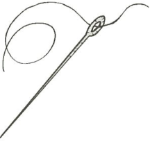  [Comparison](comparisons/WB-079.jpg) Only located needle family clips needle tip and retains table rules; no suitable whole standalone upgrade in relevant accessible families. |
| **DRAW-WB-05-1 — ala** WB-S010-OBJ07-ALA, WB-S013-OBJ10-ALA | **UNRESOLVED** {'UNRESOLVED': 2} |   [Comparison](comparisons/WB-043.jpg) Resolve candidate completeness/orientation and remaining alternatives; possible missing only. REJECT: right wing damaged by transparency removal; linework missing. |
| **DRAW-WB-05-2 — ala** WB-S011-OBJ08-ALA, WB-S014-OBJ03-ALA, WB-S019-OBJ07-ALA | **UNRESOLVED** {'UNRESOLVED': 3} |   [Comparison](comparisons/WB-061.jpg) Resolve candidate completeness/orientation and remaining alternatives; possible missing only. REJECT: right wing damaged by transparency removal; linework missing. |
| **DRAW-WB-06-1 — arana** WB-S009-OBJ03-ARANA, WB-S010-OBJ13-ARANA, FC-005-04 | **OPTIMIZED VERSION EXISTS** {'OPTIMIZED VERSION EXISTS': 1, 'UNRESOLVED': 2} |  [Selected file](https://github.com/ejnburrows-rgb/cartilla-de-gretel/blob/153c7eccbec5bc1090cd130a909f0cf73630415a/public/cartilla/art/optimized/flipchart-native/p005-arana.png) ·  [Comparison](comparisons/FC-013.jpg) Whole faithful drawing visually matches source linework, pose, object count and composition; color changes alone are accepted. No visible artwork clipping in the selected file. |
| **DRAW-WB-07-1 — arbol** WB-S008-OBJ05-ARBOL, WB-S013-OBJ07-ARBOL, WB-S022-OBJ09-ARBOL | **UNRESOLVED** {'UNRESOLVED': 3} |   [Comparison](comparisons/WB-025.jpg) Resolve candidate completeness/orientation and remaining alternatives; possible missing only. REVIEW: tree broadly corresponds; trunk/edge bounds and color provenance unresolved. |
| **DRAW-WB-08-1 — ardilla** WB-S013-OBJ12-ARDILLA | **UNRESOLVED** {'UNRESOLVED': 1} |   [Comparison](comparisons/WB-073.jpg) Resolve candidate completeness/orientation and remaining alternatives; possible missing only. REJECT: squirrel tail/nut bounds incomplete. |
| **DRAW-WB-09-1 — aro** WB-S007-OBJ08-ARO, WB-S013-OBJ03-ARO, WB-S014-OBJ08-ARO | **UNRESOLVED** {'UNRESOLVED': 3} |   [Comparison](comparisons/WB-007.jpg) Resolve candidate completeness/orientation and remaining alternatives; possible missing only. REJECT: extra hoops and action strokes absent from the single-hoop WB source. |
| **DRAW-WB-09-2 — aro** WB-S008-OBJ01-ARO | **UNRESOLVED** {'UNRESOLVED': 1} |   [Comparison](comparisons/WB-019.jpg) Resolve candidate completeness/orientation and remaining alternatives; possible missing only. REJECT: ring orientation/reflection differs from WB source; crop also incomplete. |
| **DRAW-WB-10-1 — avión** WB-S007-OBJ06-PEZ, WB-S013-OBJ14-PEZ, WB-S014-OBJ07-PEZ, WB-S019-OBJ02-PEZ, WB-S022-OBJ03-PEZ | **OPTIMIZED VERSION EXISTS** {'UNRESOLVED': 3, 'OPTIMIZED VERSION EXISTS': 2} |  [Selected file](https://github.com/ejnburrows-rgb/cartilla-de-gretel/blob/153c7eccbec5bc1090cd130a909f0cf73630415a/public/cartilla/art/faithful/leccion-1/pez.webp) ·  [Comparison](comparisons/WB-109.jpg) Whole faithful drawing visually matches source linework, pose, object count and composition; color changes alone are accepted. No visible artwork clipping in the selected file. |
| **DRAW-WB-11-1 — carro** WB-S008-OBJ12-CARRO | **UNRESOLVED** {'UNRESOLVED': 1} |   [Comparison](comparisons/WB-031.jpg) Resolve candidate completeness/orientation and remaining alternatives; possible missing only. REJECT: compact car replaced with vintage open-top car. |
| **DRAW-WB-13-1 — dulce** WB-S008-OBJ15-DULCE | **UNRESOLVED** {'UNRESOLVED': 1} |   [Comparison](comparisons/WB-031.jpg) Resolve candidate completeness/orientation and remaining alternatives; possible missing only. REJECT: unrelated colored frame retained around candy. |
| **DRAW-WB-14-1 — elefante** WB-S007-OBJ16-ELEFANTE, WB-S013-OBJ08-ELEFANTE, WB-S016-OBJ01-ELEFANTE, WB-S017-OBJ02-ELEFANTE, WB-S022-OBJ08-ELEFANTE | **UNRESOLVED** {'UNRESOLVED': 5} |   [Comparison](comparisons/WB-013.jpg) Resolve candidate completeness/orientation and remaining alternatives; possible missing only. REJECT: spotted elephant coat adds objects/marks absent from WB source. |
| **DRAW-WB-15-1 — erizo** WB-S016-OBJ06-ERIZO, WB-S017-OBJ04-ERIZO, FC-006-06 | **OPTIMIZED VERSION EXISTS** {'OPTIMIZED VERSION EXISTS': 1, 'UNRESOLVED': 2} |  [Selected file](https://github.com/ejnburrows-rgb/cartilla-de-gretel/blob/153c7eccbec5bc1090cd130a909f0cf73630415a/public/cartilla/art/optimized/flipchart-native/p006-erizo.png) ·  [Comparison](comparisons/FC-025.jpg) Whole faithful drawing visually matches source linework, pose, object count and composition; color changes alone are accepted. No visible artwork clipping in the selected file. |
| **DRAW-WB-16-1 — escalera** WB-S007-OBJ09-ESCALERA, WB-S016-OBJ05-ESCALERA, WB-S017-OBJ06-ESCALERA, FC-006-07 | **OPTIMIZED VERSION EXISTS** {'OPTIMIZED VERSION EXISTS': 2, 'UNRESOLVED': 2} |  [Selected file](https://github.com/ejnburrows-rgb/cartilla-de-gretel/blob/153c7eccbec5bc1090cd130a909f0cf73630415a/public/cartilla/art/optimized/flipchart-native/p006-escalera.png) ·  [Comparison](comparisons/FC-025.jpg) Whole faithful drawing visually matches source linework, pose, object count and composition; color changes alone are accepted. No visible artwork clipping in the selected file. |
| **DRAW-WB-17-1 — escoba** WB-S009-OBJ05-ESCOBA, WB-S016-OBJ09-ESCOBA | **UNRESOLVED** {'UNRESOLVED': 2} |   [Comparison](comparisons/WB-037.jpg) Resolve candidate completeness/orientation and remaining alternatives; possible missing only. REJECT: broom gains rectangle/action backdrop absent from WB. |
| **DRAW-WB-18-1 — escuela** WB-S007-OBJ11-ESCUELA, WB-S016-OBJ13-ESCUELA | **OPTIMIZED VERSION EXISTS** {'OPTIMIZED VERSION EXISTS': 1, 'UNRESOLVED': 1} |  [Selected file](https://github.com/ejnburrows-rgb/cartilla-de-gretel/blob/153c7eccbec5bc1090cd130a909f0cf73630415a/public/cartilla/art/faithful/leccion-1/wb-p1/escuela.svg) ·  [Comparison](comparisons/WB-007.jpg) Faithful school SVG retains source bell, roof, three windows, door, steps and wall geometry; modernized red school is a different drawing. |
| **DRAW-WB-18-2 — escuela** WB-S008-OBJ04-ESCUELA | **UNRESOLVED** {'UNRESOLVED': 1} |   [Comparison](comparisons/WB-019.jpg) Resolve candidate completeness/orientation and remaining alternatives; possible missing only. REJECT: school/house-with-children source replaced with unrelated half-timbered house. |
| **DRAW-WB-19-1 — espejo** WB-S016-OBJ15-ESPEJO | **UNRESOLVED** {'UNRESOLVED': 1} |   [Comparison](comparisons/WB-103.jpg) Resolve candidate completeness/orientation and remaining alternatives; possible missing only. REJECT: mirror reflected and top rim clipped. |
| **DRAW-WB-20-1 — estrella** WB-S008-OBJ06-ESTRELLA, WB-S013-OBJ11-ESTRELLA, WB-S016-OBJ11-ESTRELLA, WB-S017-OBJ07-ESTRELLA, WB-S022-OBJ06-ESTRELLA, WB-S023-OBJ07-ESTRELLA, FC-006-05 | **OPTIMIZED VERSION EXISTS** {'OPTIMIZED VERSION EXISTS': 6, 'UNRESOLVED': 1} |  [Selected file](https://github.com/ejnburrows-rgb/cartilla-de-gretel/blob/153c7eccbec5bc1090cd130a909f0cf73630415a/public/cartilla/art/optimized/flipchart-native/p006-estrella.png) ·  [Comparison](comparisons/FC-025.jpg) Whole faithful drawing visually matches source linework, pose, object count and composition; color changes alone are accepted. No visible artwork clipping in the selected file. |
| **DRAW-WB-21-1 — globo** WB-S008-OBJ14-GLOBO | **OPTIMIZED VERSION EXISTS** {'OPTIMIZED VERSION EXISTS': 1} |  [Selected file](https://github.com/ejnburrows-rgb/cartilla-de-gretel/blob/153c7eccbec5bc1090cd130a909f0cf73630415a/public/cartilla/art/faithful/leccion-1/globo.webp) ·  [Comparison](comparisons/WB-031.jpg) Whole faithful drawing visually matches source linework, pose, object count and composition; color changes alone are accepted. No visible artwork clipping in the selected file. |
| **DRAW-WB-22-1 — iglesia** WB-S009-OBJ01-IGLESIA | **OPTIMIZATION NEEDED** {'OPTIMIZATION NEEDED': 1} |   [Comparison](comparisons/WB-031.jpg) Only located church family cuts the original ground/pebbles and lower/right drawing bounds; no suitable whole standalone upgrade in relevant accessible families. |
| **DRAW-WB-23-1 — iglu** WB-S010-OBJ02-IGLU, WB-S011-OBJ01-IGLU, WB-S014-OBJ02-IGLU, WB-S016-OBJ02-IGLU, WB-S019-OBJ01-IGLU, WB-S020-OBJ03-IGLU, FC-007-03 | **OPTIMIZED VERSION EXISTS** {'OPTIMIZED VERSION EXISTS': 1, 'UNRESOLVED': 6} |  [Selected file](https://github.com/ejnburrows-rgb/cartilla-de-gretel/blob/153c7eccbec5bc1090cd130a909f0cf73630415a/public/cartilla/art/optimized/flipchart-native/p007-iglu.png) ·  [Comparison](comparisons/FC-025.jpg) Whole faithful drawing visually matches source linework, pose, object count and composition; color changes alone are accepted. No visible artwork clipping in the selected file. |
| **DRAW-WB-24-1 — igual** WB-S019-OBJ14-IGUAL, WB-S020-OBJ04-IGUAL | **UNRESOLVED** {'UNRESOLVED': 2} |   [Comparison](comparisons/WB-121.jpg) Resolve candidate completeness/orientation and remaining alternatives; possible missing only. REJECT: equal-sign bars redrawn as outlined blue panels plus unrelated bottom line. |
| **DRAW-WB-25-1 — iguana** WB-S019-OBJ03-IGUANA, WB-S020-OBJ07-IGUANA | **UNRESOLVED** {'UNRESOLVED': 2} |   [Comparison](comparisons/WB-115.jpg) Resolve candidate completeness/orientation and remaining alternatives; possible missing only. REJECT: iguana crop includes unrelated edges/lines. |
| **DRAW-WB-26-1 — iman** WB-S007-OBJ07-IMAN-2, WB-S013-OBJ04-IMAN, WB-S019-OBJ10-IMAN, WB-S020-OBJ01-IMAN, WB-S023-OBJ08-IMAN, WB-S007-OBJ02-IMAN-1 | **UNRESOLVED** {'UNRESOLVED': 6} |   [Comparison](comparisons/WB-001.jpg) Resolve candidate completeness/orientation and remaining alternatives; possible missing only. REJECT: plain magnet replaced with different geometry plus oval/action marks. |
| **DRAW-WB-28-1 — indio** WB-S008-OBJ08-INDIO, WB-S016-OBJ04-INDIO, WB-S019-OBJ06-INDIO, WB-S020-OBJ05-INDIO, FC-007-04 | **UNRESOLVED** {'UNRESOLVED': 5} |   [Comparison](comparisons/FC-031.jpg) Resolve candidate completeness/orientation and remaining alternatives; possible missing only. REJECT: Spear figure feather clipped. |
| **DRAW-WB-29-1 — insecto** WB-S019-OBJ15-INSECTO, WB-S022-OBJ15-INSECTO, FC-007-05 | **OPTIMIZED VERSION EXISTS** {'OPTIMIZED VERSION EXISTS': 1, 'UNRESOLVED': 2} |  [Selected file](https://github.com/ejnburrows-rgb/cartilla-de-gretel/blob/153c7eccbec5bc1090cd130a909f0cf73630415a/public/cartilla/art/optimized/flipchart-native/p007-insecto.png) ·  [Comparison](comparisons/FC-031.jpg) Whole faithful drawing visually matches source linework, pose, object count and composition; color changes alone are accepted. No visible artwork clipping in the selected file. |
| **DRAW-WB-30-1 — invierno** WB-S019-OBJ08-INVIERNO | **UNRESOLVED** {'UNRESOLVED': 1} |   [Comparison](comparisons/WB-115.jpg) Resolve candidate completeness/orientation and remaining alternatives; possible missing only. REJECT: winter scene is horizontally reversed and heavily clipped. |
| **DRAW-WB-31-1 — isla** WB-S007-OBJ05-ISLA, WB-S019-OBJ12-ISLA, FC-007-06 | **OPTIMIZED VERSION EXISTS** {'OPTIMIZED VERSION EXISTS': 3} |  [Selected file](https://github.com/ejnburrows-rgb/cartilla-de-gretel/blob/153c7eccbec5bc1090cd130a909f0cf73630415a/public/cartilla/art/optimized/flipchart-native/p007-isla.png) ·  [Comparison](comparisons/FC-031.jpg) Whole faithful drawing visually matches source linework, pose, object count and composition; color changes alone are accepted. No visible artwork clipping in the selected file. |
| **DRAW-WB-32-1 — libro** WB-S008-OBJ03-LIBRO | **OPTIMIZED VERSION EXISTS** {'OPTIMIZED VERSION EXISTS': 1} |  [Selected file](https://github.com/ejnburrows-rgb/cartilla-de-gretel/blob/153c7eccbec5bc1090cd130a909f0cf73630415a/public/cartilla/art/faithful/leccion-1/libro.webp) ·  [Comparison](comparisons/WB-019.jpg) Whole faithful drawing visually matches source linework, pose, object count and composition; color changes alone are accepted. No visible artwork clipping in the selected file. |
| **DRAW-WB-33-1 — maiz** WB-S007-OBJ18-MAIZ, WB-S010-OBJ04-MAIZ, WB-S014-OBJ06-MAIZ, WB-S016-OBJ03-MAIZ, WB-S017-OBJ05-MAIZ | **UNRESOLVED** {'UNRESOLVED': 5} |   [Comparison](comparisons/WB-013.jpg) Resolve candidate completeness/orientation and remaining alternatives; possible missing only. REJECT: corn redrawn with changed kernels and husk outline. |
| **DRAW-WB-34-1 — manzana** WB-S008-OBJ02-MANZANA | **UNRESOLVED** {'UNRESOLVED': 1} |   [Comparison](comparisons/WB-019.jpg) Resolve candidate completeness/orientation and remaining alternatives; possible missing only. REVIEW: apple corresponds broadly; poor transparency/edges and source-color provenance unresolved. |
| **DRAW-WB-35-1 — ocho** WB-S009-OBJ02-OCHO, WB-S010-OBJ11-OCHO, FC-004-07 | **OPTIMIZED VERSION EXISTS** {'OPTIMIZED VERSION EXISTS': 3} |  [Selected file](https://github.com/ejnburrows-rgb/cartilla-de-gretel/blob/153c7eccbec5bc1090cd130a909f0cf73630415a/public/cartilla/art/optimized/flipchart-native/p004-ocho.png) ·  [Comparison](comparisons/FC-013.jpg) Whole faithful drawing visually matches source linework, pose, object count and composition; color changes alone are accepted. No visible artwork clipping in the selected file. |
| **DRAW-WB-36-1 — ojos** WB-S007-OBJ17-OJOS | **UNRESOLVED** {'UNRESOLVED': 1} |   [Comparison](comparisons/WB-013.jpg) Resolve candidate completeness/orientation and remaining alternatives; possible missing only. REJECT: single eye redrawn with different eyelid/lash geometry. |
| **DRAW-WB-36-2 — ojos** WB-S010-OBJ16-OJOS, WB-S011-OBJ03-OJOS, WB-S013-OBJ13-OJOS | **UNRESOLVED** {'UNRESOLVED': 3} |   [Comparison](comparisons/WB-055.jpg) Resolve candidate completeness/orientation and remaining alternatives; possible missing only. REJECT: pair of eyes rotated relative to source row; per-placement orientation must be preserved. |
| **DRAW-WB-37-1 — ola** WB-S010-OBJ01-OLA, WB-S011-OBJ06-OLA, WB-S019-OBJ09-OLA | **UNRESOLVED** {'UNRESOLVED': 3} |   [Comparison](comparisons/WB-037.jpg) Resolve candidate completeness/orientation and remaining alternatives; possible missing only. REVIEW: wave corresponds; edge completeness and source-colors unresolved. |
| **DRAW-WB-38-1 — olla** WB-S007-OBJ20-OLLA, WB-S010-OBJ09-OLLA, WB-S011-OBJ05-OLLA, WB-S019-OBJ16-OLLA, FC-003-05, FC-004-02 | **OPTIMIZED VERSION EXISTS** {'UNRESOLVED': 4, 'OPTIMIZED VERSION EXISTS': 2} | 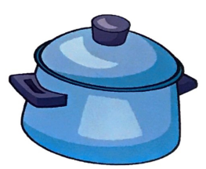 [Selected file](https://github.com/ejnburrows-rgb/cartilla-de-gretel/blob/153c7eccbec5bc1090cd130a909f0cf73630415a/public/cartilla/art/optimized/flipchart-native/p004-olla.png) ·  [Comparison](comparisons/FC-007.jpg) Whole faithful drawing visually matches source linework, pose, object count and composition; color changes alone are accepted. No visible artwork clipping in the selected file. |
| **DRAW-WB-39-1 — oreja** WB-S007-OBJ12-OREJA, WB-S010-OBJ08-OREJA, WB-S011-OBJ04-OREJA, FC-004-06 | **OPTIMIZED VERSION EXISTS** {'OPTIMIZED VERSION EXISTS': 2, 'UNRESOLVED': 2} |  [Selected file](https://github.com/ejnburrows-rgb/cartilla-de-gretel/blob/153c7eccbec5bc1090cd130a909f0cf73630415a/public/cartilla/art/optimized/flipchart-native/p004-oreja.png) ·  [Comparison](comparisons/FC-007.jpg) Whole faithful drawing visually matches source linework, pose, object count and composition; color changes alone are accepted. No visible artwork clipping in the selected file. |
| **DRAW-WB-40-1 — oruga** WB-S013-OBJ02-ORUGA | **UNRESOLVED** {'UNRESOLVED': 1} |   [Comparison](comparisons/WB-061.jpg) Resolve candidate completeness/orientation and remaining alternatives; possible missing only. REJECT: caterpillar tail/antenna/leaf boundaries clipped. |
| **DRAW-WB-41-1 — oso** WB-S007-OBJ04-OSO-1, WB-S008-OBJ11-OSO, WB-S010-OBJ03-OSO-1, WB-S010-OBJ14-OSO-2, WB-S011-OBJ07-OSO, WB-S013-OBJ16-OSO, WB-S014-OBJ01-OSO, WB-S017-OBJ01-OSO, WB-S019-OBJ05-OSO, WB-S020-OBJ02-OSO, WB-S022-OBJ11-OSO, WB-S023-OBJ03-OSO, FC-004-05 | **OPTIMIZED VERSION EXISTS** {'OPTIMIZED VERSION EXISTS': 1, 'UNRESOLVED': 12} |  [Selected file](https://github.com/ejnburrows-rgb/cartilla-de-gretel/blob/153c7eccbec5bc1090cd130a909f0cf73630415a/public/cartilla/art/optimized/flipchart-native/p004-oso.png) ·  [Comparison](comparisons/FC-007.jpg) Whole faithful drawing visually matches source linework, pose, object count and composition; color changes alone are accepted. No visible artwork clipping in the selected file. |
| **DRAW-WB-42-1 — oveja** WB-S007-OBJ15-OVEJA, WB-S010-OBJ06-OVEJA, WB-S011-OBJ02-OVEJA, WB-S013-OBJ05-OVEJA, WB-S022-OBJ02-OVEJA, FC-004-04 | **OPTIMIZED VERSION EXISTS** {'OPTIMIZED VERSION EXISTS': 1, 'UNRESOLVED': 5} |  [Selected file](https://github.com/ejnburrows-rgb/cartilla-de-gretel/blob/153c7eccbec5bc1090cd130a909f0cf73630415a/public/cartilla/art/optimized/flipchart-native/p004-oveja.png) ·  [Comparison](comparisons/FC-007.jpg) Whole faithful drawing visually matches source linework, pose, object count and composition; color changes alone are accepted. No visible artwork clipping in the selected file. |
| **DRAW-WB-43-1 — pajaro** WB-S008-OBJ10-PAJARO | **UNRESOLVED** {'UNRESOLVED': 1} |   [Comparison](comparisons/WB-025.jpg) Resolve candidate completeness/orientation and remaining alternatives; possible missing only. REJECT: bird tail/branch omitted; unrelated horizontal line included. |
| **DRAW-WB-44-1 — pera** WB-S008-OBJ09-PERA | **UNRESOLVED** {'UNRESOLVED': 1} |   [Comparison](comparisons/WB-025.jpg) Resolve candidate completeness/orientation and remaining alternatives; possible missing only. REJECT: pear bottom/side cropped and source image orientation differs. |
| **DRAW-WB-46-1 — taza** WB-S008-OBJ07-TAZA | **UNRESOLVED** {'UNRESOLVED': 1} |   [Comparison](comparisons/WB-025.jpg) Resolve candidate completeness/orientation and remaining alternatives; possible missing only. REVIEW: cup broadly corresponds; incomplete crop and contour quality unresolved. |
| **DRAW-WB-47-1 — una** WB-S007-OBJ14-UNA, WB-S010-OBJ05-UNA, WB-S019-OBJ13-UNA, WB-S020-OBJ06-UNA, WB-S022-OBJ04-UNA, WB-S023-OBJ06-UNA | **OPTIMIZED VERSION EXISTS** {'UNRESOLVED': 1, 'OPTIMIZED VERSION EXISTS': 5} | 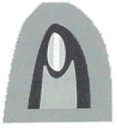 [Selected file](https://github.com/ejnburrows-rgb/cartilla-de-gretel/blob/153c7eccbec5bc1090cd130a909f0cf73630415a/public/cartilla/art/faithful/leccion-1/arco.webp) · 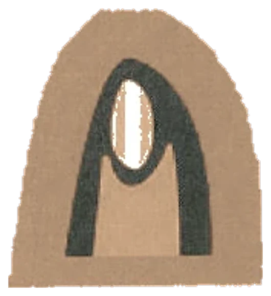 [Comparison](comparisons/WB-043.jpg) Whole faithful drawing visually matches source linework, pose, object count and composition; color changes alone are accepted. No visible artwork clipping in the selected file. |
| **DRAW-WB-48-1 — unicornio** WB-S016-OBJ10-UNICORNIO, WB-S022-OBJ01-UNICORNIO, WB-S023-OBJ05-UNICORNIO, FC-008-05 | **UNRESOLVED** {'UNRESOLVED': 4} |   [Comparison](comparisons/FC-037.jpg) Resolve candidate completeness/orientation and remaining alternatives; possible missing only. REVIEW: same underlying drawing visible in source/candidate pair; full usable quality, crop completeness and exact approval provenance not yet certified. |
| **DRAW-WB-49-1 — uniforme** WB-S007-OBJ13-UNIFORME-2, WB-S008-OBJ13-UNIFORME, WB-S010-OBJ15-UNIFORME, WB-S016-OBJ14-UNIFORME, WB-S022-OBJ07-UNIFORME-1, WB-S022-OBJ14-UNIFORME-2, WB-S023-OBJ01-UNIFORME, FC-008-06 | **UNRESOLVED** {'UNRESOLVED': 8} |   [Comparison](comparisons/FC-037.jpg) Resolve candidate completeness/orientation and remaining alternatives; possible missing only. REJECT: Uniform trousers clipped. |
| **DRAW-WB-50-1 — uno** WB-S007-OBJ10-UNO, WB-S009-OBJ04-UNO, WB-S010-OBJ12-UNO, WB-S013-OBJ09-UNO, WB-S016-OBJ16-UNO, WB-S019-OBJ11-UNO, WB-S022-OBJ10-UNO-1, WB-S022-OBJ16-UNO-2, WB-S023-OBJ02-UNO, FC-008-02 | **OPTIMIZED VERSION EXISTS** {'OPTIMIZED VERSION EXISTS': 1, 'UNRESOLVED': 9} |  [Selected file](https://github.com/ejnburrows-rgb/cartilla-de-gretel/blob/153c7eccbec5bc1090cd130a909f0cf73630415a/public/cartilla/art/optimized/flipchart-native/p008-uno.png) ·  [Comparison](comparisons/FC-031.jpg) Whole faithful drawing visually matches source linework, pose, object count and composition; color changes alone are accepted. No visible artwork clipping in the selected file. |
| **DRAW-WB-51-1 — urraca** WB-S016-OBJ12-URRACA, WB-S022-OBJ12-URRACA, FC-008-04 | **UNRESOLVED** {'UNRESOLVED': 3} |   [Comparison](comparisons/FC-037.jpg) Resolve candidate completeness/orientation and remaining alternatives; possible missing only. REVIEW: same underlying drawing visible in source/candidate pair; full usable quality, crop completeness and exact approval provenance not yet certified. |
| **DRAW-WB-52-1 — uva** WB-S010-OBJ10-UVA, WB-S022-OBJ05-UVA, WB-S023-OBJ04-UVA | **UNRESOLVED** {'UNRESOLVED': 3} |   [Comparison](comparisons/WB-049.jpg) Resolve candidate completeness/orientation and remaining alternatives; possible missing only. REJECT: grape cluster partly clipped and gains FC backdrop absent from WB. |
| **DRAW-FC-003-01 — Ilustración de la página 3** FC-003-01 | **OPTIMIZED VERSION EXISTS** {'OPTIMIZED VERSION EXISTS': 1} |  [Selected file](https://github.com/ejnburrows-rgb/cartilla-de-gretel/blob/153c7eccbec5bc1090cd130a909f0cf73630415a/public/cartilla/art/optimized/flipchart-native/p003-scene.png) ·  [Comparison](comparisons/FC-001.jpg) Whole faithful drawing visually matches source linework, pose, object count and composition; color changes alone are accepted. No visible artwork clipping in the selected file. |
| **DRAW-FC-003-02 — avión** FC-003-02 | **UNRESOLVED** {'UNRESOLVED': 1} |   [Comparison](comparisons/FC-001.jpg) Resolve candidate completeness/orientation and remaining alternatives; possible missing only. REVIEW: same underlying drawing visible in source/candidate pair; full usable quality, crop completeness and exact approval provenance not yet certified. |
| **DRAW-FC-003-03 — escoba** FC-003-03 | **UNRESOLVED** {'UNRESOLVED': 1} |   [Comparison](comparisons/FC-001.jpg) Resolve candidate completeness/orientation and remaining alternatives; possible missing only. REJECT: Neighboring vowel halo retained above broom. |
| **DRAW-FC-003-04 — imán** FC-003-04, FC-007-02 | **OPTIMIZED VERSION EXISTS** {'UNRESOLVED': 1, 'OPTIMIZED VERSION EXISTS': 1} |  [Selected file](https://github.com/ejnburrows-rgb/cartilla-de-gretel/blob/153c7eccbec5bc1090cd130a909f0cf73630415a/public/cartilla/art/optimized/flipchart-native/p007-iman.png) ·  [Comparison](comparisons/FC-025.jpg) Whole faithful drawing visually matches source linework, pose, object count and composition; color changes alone are accepted. No visible artwork clipping in the selected file. |
| **DRAW-FC-003-06 — uña** FC-003-06 | **UNRESOLVED** {'UNRESOLVED': 1} |   [Comparison](comparisons/FC-001.jpg) Resolve candidate completeness/orientation and remaining alternatives; possible missing only. REJECT: Neighboring vowel halo and una caption retained. |
| **DRAW-FC-004-01 — Ilustración de la página 4** FC-004-01 | **UNRESOLVED** {'UNRESOLVED': 1} |   [Comparison](comparisons/FC-007.jpg) Resolve candidate completeness/orientation and remaining alternatives; possible missing only. REVIEW: same underlying drawing visible in source/candidate pair; full usable quality, crop completeness and exact approval provenance not yet certified. |
| **DRAW-FC-004-03 — Oto** FC-004-03 | **UNRESOLVED** {'UNRESOLVED': 1} |   [Comparison](comparisons/FC-007.jpg) Resolve candidate completeness/orientation and remaining alternatives; possible missing only. REJECT: Oto lower torso clipped. |
| **DRAW-FC-005-01 — Ilustración de la página 5** FC-005-01 | **OPTIMIZED VERSION EXISTS** {'OPTIMIZED VERSION EXISTS': 1} |  [Selected file](https://github.com/ejnburrows-rgb/cartilla-de-gretel/blob/153c7eccbec5bc1090cd130a909f0cf73630415a/public/cartilla/art/optimized/flipchart-native/p005-scene.png) ·  [Comparison](comparisons/FC-013.jpg) Whole faithful drawing visually matches source linework, pose, object count and composition; color changes alone are accepted. No visible artwork clipping in the selected file. |
| **DRAW-FC-005-03 — anillo** FC-005-03 | **OPTIMIZED VERSION EXISTS** {'OPTIMIZED VERSION EXISTS': 1} |  [Selected file](https://github.com/ejnburrows-rgb/cartilla-de-gretel/blob/153c7eccbec5bc1090cd130a909f0cf73630415a/public/cartilla/art/optimized/flipchart-native/p005-anillo.png) ·  [Comparison](comparisons/FC-013.jpg) Whole faithful drawing visually matches source linework, pose, object count and composition; color changes alone are accepted. No visible artwork clipping in the selected file. |
| **DRAW-FC-005-05 — ala** FC-005-05 | **OPTIMIZED VERSION EXISTS** {'OPTIMIZED VERSION EXISTS': 1} |  [Selected file](https://github.com/ejnburrows-rgb/cartilla-de-gretel/blob/153c7eccbec5bc1090cd130a909f0cf73630415a/public/cartilla/art/optimized/flipchart-native/p005-ala.png) ·  [Comparison](comparisons/FC-013.jpg) Whole faithful drawing visually matches source linework, pose, object count and composition; color changes alone are accepted. No visible artwork clipping in the selected file. |
| **DRAW-FC-005-06 — aro** FC-005-06 | **UNRESOLVED** {'UNRESOLVED': 1} |   [Comparison](comparisons/FC-019.jpg) Resolve candidate completeness/orientation and remaining alternatives; possible missing only. REVIEW: same underlying drawing visible in source/candidate pair; full usable quality, crop completeness and exact approval provenance not yet certified. |
| **DRAW-FC-005-07 — Ana** FC-005-07 | **UNRESOLVED** {'UNRESOLVED': 1} |   [Comparison](comparisons/FC-019.jpg) Resolve candidate completeness/orientation and remaining alternatives; possible missing only. REJECT: Ana portrait/flower bounds clipped. |
| **DRAW-FC-006-01 — Ilustración de la página 6** FC-006-01 | **OPTIMIZED VERSION EXISTS** {'OPTIMIZED VERSION EXISTS': 1} |  [Selected file](https://github.com/ejnburrows-rgb/cartilla-de-gretel/blob/153c7eccbec5bc1090cd130a909f0cf73630415a/public/cartilla/art/optimized/flipchart-native/p006-scene.png) ·  [Comparison](comparisons/FC-019.jpg) Whole faithful drawing visually matches source linework, pose, object count and composition; color changes alone are accepted. No visible artwork clipping in the selected file. |
| **DRAW-FC-006-02 — elefante** FC-006-02 | **OPTIMIZED VERSION EXISTS** {'OPTIMIZED VERSION EXISTS': 1} |  [Selected file](https://github.com/ejnburrows-rgb/cartilla-de-gretel/blob/153c7eccbec5bc1090cd130a909f0cf73630415a/public/cartilla/art/optimized/flipchart-native/p006-elefante.png) ·  [Comparison](comparisons/FC-019.jpg) Whole faithful drawing visually matches source linework, pose, object count and composition; color changes alone are accepted. No visible artwork clipping in the selected file. |
| **DRAW-FC-006-03 — espejo** FC-006-03 | **OPTIMIZED VERSION EXISTS** {'OPTIMIZED VERSION EXISTS': 1} |  [Selected file](https://github.com/ejnburrows-rgb/cartilla-de-gretel/blob/153c7eccbec5bc1090cd130a909f0cf73630415a/public/cartilla/art/optimized/flipchart-native/p006-espejo.png) ·  [Comparison](comparisons/FC-019.jpg) Whole faithful drawing visually matches source linework, pose, object count and composition; color changes alone are accepted. No visible artwork clipping in the selected file. |
| **DRAW-FC-006-04 — Ema** FC-006-04 | **UNRESOLVED** {'UNRESOLVED': 1} |   [Comparison](comparisons/FC-019.jpg) Resolve candidate completeness/orientation and remaining alternatives; possible missing only. REJECT: Ema torso clipped. |
| **DRAW-FC-007-01 — Ilustración de la página 7** FC-007-01 | **OPTIMIZED VERSION EXISTS** {'OPTIMIZED VERSION EXISTS': 1} |  [Selected file](https://github.com/ejnburrows-rgb/cartilla-de-gretel/blob/153c7eccbec5bc1090cd130a909f0cf73630415a/public/cartilla/art/optimized/flipchart-native/p007-scene.png) ·  [Comparison](comparisons/FC-025.jpg) Whole faithful drawing visually matches source linework, pose, object count and composition; color changes alone are accepted. No visible artwork clipping in the selected file. |
| **DRAW-FC-007-07 — Irma** FC-007-07 | **UNRESOLVED** {'UNRESOLVED': 1} |   [Comparison](comparisons/FC-031.jpg) Resolve candidate completeness/orientation and remaining alternatives; possible missing only. REJECT: Irma flower arrangement clipped. |
| **DRAW-FC-008-01 — Ilustración de la página 8** FC-008-01 | **UNRESOLVED** {'UNRESOLVED': 1} |   [Comparison](comparisons/FC-031.jpg) Resolve candidate completeness/orientation and remaining alternatives; possible missing only. REVIEW: same underlying drawing visible in source/candidate pair; full usable quality, crop completeness and exact approval provenance not yet certified. |
| **DRAW-FC-008-03 — uva** FC-008-03 | **UNRESOLVED** {'UNRESOLVED': 1} |   [Comparison](comparisons/FC-037.jpg) Resolve candidate completeness/orientation and remaining alternatives; possible missing only. REVIEW: same underlying drawing visible in source/candidate pair; full usable quality, crop completeness and exact approval provenance not yet certified. |
| **DRAW-FC-008-07 — Ulises** FC-008-07 | **OPTIMIZED VERSION EXISTS** {'OPTIMIZED VERSION EXISTS': 1} |  [Selected file](https://github.com/ejnburrows-rgb/cartilla-de-gretel/blob/153c7eccbec5bc1090cd130a909f0cf73630415a/public/cartilla/art/optimized/flipchart-native/p008-ulises.png) ·  [Comparison](comparisons/FC-037.jpg) Whole faithful drawing visually matches source linework, pose, object count and composition; color changes alone are accepted. No visible artwork clipping in the selected file. |
| **DRAW-FC-009-01 — Ilustración de la página 9** FC-009-01 | **OPTIMIZED VERSION EXISTS** {'OPTIMIZED VERSION EXISTS': 1} |  [Selected file](https://github.com/ejnburrows-rgb/cartilla-de-gretel/blob/153c7eccbec5bc1090cd130a909f0cf73630415a/public/cartilla/art/optimized/flipchart-native/p009-scene.png) ·  [Comparison](comparisons/FC-037.jpg) Whole faithful drawing visually matches source linework, pose, object count and composition; color changes alone are accepted. No visible artwork clipping in the selected file. |
| **DRAW-FC-009-02 — mamá** FC-009-02 | **UNRESOLVED** {'UNRESOLVED': 1} |   [Comparison](comparisons/FC-043.jpg) Resolve candidate completeness/orientation and remaining alternatives; possible missing only. REJECT: Mama caption fragments retained. |
| **DRAW-FC-009-03 — amo** FC-009-03 | **UNRESOLVED** {'UNRESOLVED': 1} |   [Comparison](comparisons/FC-043.jpg) Resolve candidate completeness/orientation and remaining alternatives; possible missing only. REVIEW: same underlying drawing visible in source/candidate pair; full usable quality, crop completeness and exact approval provenance not yet certified. |
| **DRAW-FC-009-04 — mima** FC-009-04 | **UNRESOLVED** {'UNRESOLVED': 1} |   [Comparison](comparisons/FC-043.jpg) Resolve candidate completeness/orientation and remaining alternatives; possible missing only. REVIEW: same underlying drawing visible in source/candidate pair; full usable quality, crop completeness and exact approval provenance not yet certified. |
| **DRAW-FC-009-05 — Meme** FC-009-05 | **UNRESOLVED** {'UNRESOLVED': 1} |   [Comparison](comparisons/FC-043.jpg) Resolve candidate completeness/orientation and remaining alternatives; possible missing only. REVIEW: same underlying drawing visible in source/candidate pair; full usable quality, crop completeness and exact approval provenance not yet certified. |
| **DRAW-FC-009-06 — Mumi** FC-009-06 | **UNRESOLVED** {'UNRESOLVED': 1} |   [Comparison](comparisons/FC-043.jpg) Resolve candidate completeness/orientation and remaining alternatives; possible missing only. REJECT: Cat lower body clipped. |
| **DRAW-FC-011-01 — Ilustración de la página 11** FC-011-01 | **UNRESOLVED** {'UNRESOLVED': 1} | 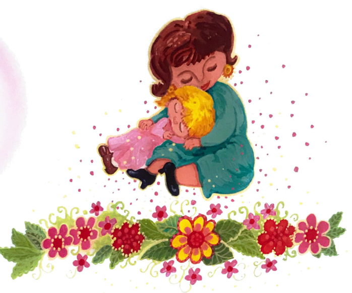  [Comparison](comparisons/FC-043.jpg) Resolve candidate completeness/orientation and remaining alternatives; possible missing only. REJECT: Mi mama scene lower flowers clipped; source binding retained. |
| **DRAW-FC-012-01 — Ilustración de la página 12** FC-012-01 | **UNRESOLVED** {'UNRESOLVED': 1} |   [Comparison](comparisons/FC-049.jpg) Resolve candidate completeness/orientation and remaining alternatives; possible missing only. REVIEW: same underlying drawing visible in source/candidate pair; full usable quality, crop completeness and exact approval provenance not yet certified. |
| **DRAW-FC-012-02 — papá** FC-012-02 | **UNRESOLVED** {'UNRESOLVED': 1} |   [Comparison](comparisons/FC-049.jpg) Resolve candidate completeness/orientation and remaining alternatives; possible missing only. REJECT: Father/child upper figure clipped. |
| **DRAW-FC-012-03 — pie** FC-012-03 | **OPTIMIZED VERSION EXISTS** {'OPTIMIZED VERSION EXISTS': 1} |  [Selected file](https://github.com/ejnburrows-rgb/cartilla-de-gretel/blob/153c7eccbec5bc1090cd130a909f0cf73630415a/public/cartilla/art/optimized/flipchart-native/p012-pie.png) ·  [Comparison](comparisons/FC-049.jpg) Whole faithful drawing visually matches source linework, pose, object count and composition; color changes alone are accepted. No visible artwork clipping in the selected file. |
| **DRAW-FC-012-04 — Pepe** FC-012-04 | **UNRESOLVED** {'UNRESOLVED': 1} |   [Comparison](comparisons/FC-049.jpg) Resolve candidate completeness/orientation and remaining alternatives; possible missing only. REJECT: Pepe head/arm clipped. |
| **DRAW-FC-012-05 — puma** FC-012-05 | **UNRESOLVED** {'UNRESOLVED': 1} |   [Comparison](comparisons/FC-049.jpg) Resolve candidate completeness/orientation and remaining alternatives; possible missing only. REVIEW: same underlying drawing visible in source/candidate pair; full usable quality, crop completeness and exact approval provenance not yet certified. |
| **DRAW-FC-012-06 — pomo** FC-012-06 | **OPTIMIZED VERSION EXISTS** {'OPTIMIZED VERSION EXISTS': 1} |  [Selected file](https://github.com/ejnburrows-rgb/cartilla-de-gretel/blob/153c7eccbec5bc1090cd130a909f0cf73630415a/public/cartilla/art/optimized/flipchart-native/p012-pomo.png) ·  [Comparison](comparisons/FC-049.jpg) Whole faithful drawing visually matches source linework, pose, object count and composition; color changes alone are accepted. No visible artwork clipping in the selected file. |
| **DRAW-FC-014-01 — Ilustración de la página 14** FC-014-01 | **UNRESOLVED** {'UNRESOLVED': 1} |   [Comparison](comparisons/FC-055.jpg) Resolve candidate completeness/orientation and remaining alternatives; possible missing only. REVIEW: same underlying drawing visible in source/candidate pair; full usable quality, crop completeness and exact approval provenance not yet certified. |
| **DRAW-FC-015-01 — Ilustración de la página 15** FC-015-01 | **UNRESOLVED** {'UNRESOLVED': 1} | 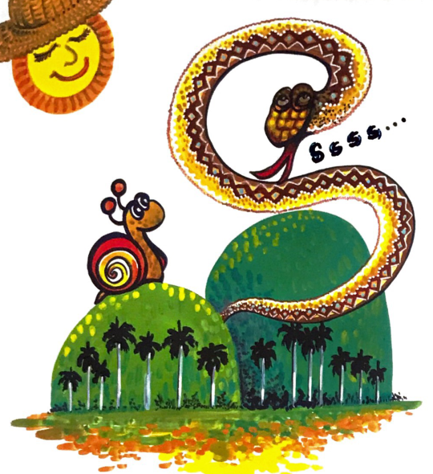  [Comparison](comparisons/FC-055.jpg) Resolve candidate completeness/orientation and remaining alternatives; possible missing only. REVIEW: same underlying drawing visible in source/candidate pair; full usable quality, crop completeness and exact approval provenance not yet certified. |
| **DRAW-FC-015-02 — Sesi** FC-015-02 | **OPTIMIZED VERSION EXISTS** {'OPTIMIZED VERSION EXISTS': 1} |  [Selected file](https://github.com/ejnburrows-rgb/cartilla-de-gretel/blob/153c7eccbec5bc1090cd130a909f0cf73630415a/public/cartilla/art/optimized/flipchart-native/p015-sesi.png) ·  [Comparison](comparisons/FC-055.jpg) Whole faithful drawing visually matches source linework, pose, object count and composition; color changes alone are accepted. No visible artwork clipping in the selected file. |
| **DRAW-FC-015-03 — sopa** FC-015-03 | **OPTIMIZED VERSION EXISTS** {'OPTIMIZED VERSION EXISTS': 1} |  [Selected file](https://github.com/ejnburrows-rgb/cartilla-de-gretel/blob/153c7eccbec5bc1090cd130a909f0cf73630415a/public/cartilla/art/optimized/flipchart-native/p015-sopa.png) ·  [Comparison](comparisons/FC-055.jpg) Whole faithful drawing visually matches source linework, pose, object count and composition; color changes alone are accepted. No visible artwork clipping in the selected file. |
| **DRAW-FC-015-04 — sapo** FC-015-04 | **OPTIMIZED VERSION EXISTS** {'OPTIMIZED VERSION EXISTS': 1} |  [Selected file](https://github.com/ejnburrows-rgb/cartilla-de-gretel/blob/153c7eccbec5bc1090cd130a909f0cf73630415a/public/cartilla/art/optimized/flipchart-native/p015-sapo.png) ·  [Comparison](comparisons/FC-055.jpg) Whole faithful drawing visually matches source linework, pose, object count and composition; color changes alone are accepted. No visible artwork clipping in the selected file. |
| **DRAW-FC-015-05 — pisa** FC-015-05 | **UNRESOLVED** {'UNRESOLVED': 1} |   [Comparison](comparisons/FC-055.jpg) Resolve candidate completeness/orientation and remaining alternatives; possible missing only. REVIEW: same underlying drawing visible in source/candidate pair; full usable quality, crop completeness and exact approval provenance not yet certified. |
| **DRAW-FC-015-06 — Susi** FC-015-06 | **UNRESOLVED** {'UNRESOLVED': 1} |   [Comparison](comparisons/FC-061.jpg) Resolve candidate completeness/orientation and remaining alternatives; possible missing only. REJECT: Susi kneeling legs/feet clipped. |
| **DRAW-FC-017-01 — Ilustración de la página 17** FC-017-01 | **UNRESOLVED** {'UNRESOLVED': 1} |   [Comparison](comparisons/FC-061.jpg) Resolve candidate completeness/orientation and remaining alternatives; possible missing only. REJECT: Bench/ground removed from Sapo Samapo scene. |
| **DRAW-FC-018-01 — Ilustración de la página 18** FC-018-01 | **UNRESOLVED** {'UNRESOLVED': 1} |   [Comparison](comparisons/FC-061.jpg) Resolve candidate completeness/orientation and remaining alternatives; possible missing only. REVIEW: same underlying drawing visible in source/candidate pair; full usable quality, crop completeness and exact approval provenance not yet certified. |
| **DRAW-FC-018-02 — tomate** FC-018-02 | **OPTIMIZED VERSION EXISTS** {'OPTIMIZED VERSION EXISTS': 1} |  [Selected file](https://github.com/ejnburrows-rgb/cartilla-de-gretel/blob/153c7eccbec5bc1090cd130a909f0cf73630415a/public/cartilla/art/optimized/flipchart-native/p018-tomate.webp) ·  [Comparison](comparisons/FC-061.jpg) Whole faithful drawing visually matches source linework, pose, object count and composition; color changes alone are accepted. No visible artwork clipping in the selected file. |
| **DRAW-FC-018-03 — tapa** FC-018-03 | **OPTIMIZED VERSION EXISTS** {'OPTIMIZED VERSION EXISTS': 1} |  [Selected file](https://github.com/ejnburrows-rgb/cartilla-de-gretel/blob/153c7eccbec5bc1090cd130a909f0cf73630415a/public/cartilla/art/optimized/flipchart-native/p018-tapa.webp) ·  [Comparison](comparisons/FC-061.jpg) Whole faithful drawing visually matches source linework, pose, object count and composition; color changes alone are accepted. No visible artwork clipping in the selected file. |
| **DRAW-FC-018-04 — topo** FC-018-04 | **UNRESOLVED** {'UNRESOLVED': 1} |   [Comparison](comparisons/FC-061.jpg) Resolve candidate completeness/orientation and remaining alternatives; possible missing only. REVIEW: same underlying drawing visible in source/candidate pair; full usable quality, crop completeness and exact approval provenance not yet certified. |
| **DRAW-FC-018-05 — tipi** FC-018-05 | **UNRESOLVED** {'UNRESOLVED': 1} | 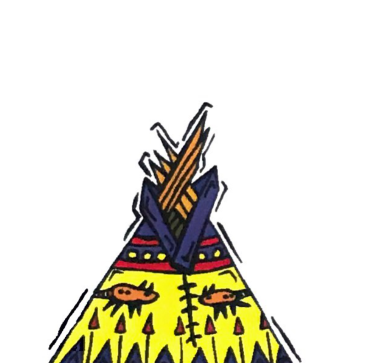  [Comparison](comparisons/FC-067.jpg) Resolve candidate completeness/orientation and remaining alternatives; possible missing only. REJECT: Tipi lower bounds clipped. |
| **DRAW-FC-018-06 — Tuto** FC-018-06 | **UNRESOLVED** {'UNRESOLVED': 1} |   [Comparison](comparisons/FC-067.jpg) Resolve candidate completeness/orientation and remaining alternatives; possible missing only. REJECT: Wheelchair lower feet/wheel bounds clipped. |
| **DRAW-FC-020-01 — Ilustración de la página 20** FC-020-01 | **UNRESOLVED** {'UNRESOLVED': 1} |   [Comparison](comparisons/FC-067.jpg) Resolve candidate completeness/orientation and remaining alternatives; possible missing only. REVIEW: same underlying drawing visible in source/candidate pair; full usable quality, crop completeness and exact approval provenance not yet certified. |
| **DRAW-FC-021-01 — Ilustración de la página 21** FC-021-01 | **UNRESOLVED** {'UNRESOLVED': 1} |   [Comparison](comparisons/FC-067.jpg) Resolve candidate completeness/orientation and remaining alternatives; possible missing only. REVIEW: same underlying drawing visible in source/candidate pair; full usable quality, crop completeness and exact approval provenance not yet certified. |
| **DRAW-FC-021-02 — Didi** FC-021-02 | **OPTIMIZED VERSION EXISTS** {'OPTIMIZED VERSION EXISTS': 1} |  [Selected file](https://github.com/ejnburrows-rgb/cartilla-de-gretel/blob/153c7eccbec5bc1090cd130a909f0cf73630415a/public/cartilla/art/optimized/flipchart-native/p021-didi.webp) ·  [Comparison](comparisons/FC-067.jpg) Whole faithful drawing visually matches source linework, pose, object count and composition; color changes alone are accepted. No visible artwork clipping in the selected file. |
| **DRAW-FC-021-03 — dados** FC-021-03 | **UNRESOLVED** {'UNRESOLVED': 1} |   [Comparison](comparisons/FC-067.jpg) Resolve candidate completeness/orientation and remaining alternatives; possible missing only. REVIEW: same underlying drawing visible in source/candidate pair; full usable quality, crop completeness and exact approval provenance not yet certified. |
| **DRAW-FC-021-04 — dedo** FC-021-04 | **UNRESOLVED** {'UNRESOLVED': 1} |   [Comparison](comparisons/FC-073.jpg) Resolve candidate completeness/orientation and remaining alternatives; possible missing only. REJECT: Dedo caption retained. |
| **DRAW-FC-021-05 — doce** FC-021-05 | **OPTIMIZED VERSION EXISTS** {'OPTIMIZED VERSION EXISTS': 1} |  [Selected file](https://github.com/ejnburrows-rgb/cartilla-de-gretel/blob/153c7eccbec5bc1090cd130a909f0cf73630415a/public/cartilla/art/optimized/flipchart-native/p021-doce.webp) ·  [Comparison](comparisons/FC-073.jpg) Whole faithful drawing visually matches source linework, pose, object count and composition; color changes alone are accepted. No visible artwork clipping in the selected file. |
| **DRAW-FC-021-06 — Dunia** FC-021-06 | **UNRESOLVED** {'UNRESOLVED': 1} |   [Comparison](comparisons/FC-073.jpg) Resolve candidate completeness/orientation and remaining alternatives; possible missing only. REJECT: Dunia caption retained. |
| **DRAW-FC-023-01 — Ilustración de la página 23** FC-023-01 | **UNRESOLVED** {'UNRESOLVED': 1} |   [Comparison](comparisons/FC-073.jpg) Resolve candidate completeness/orientation and remaining alternatives; possible missing only. REJECT: Upper sun bounds clipped. |
| **DRAW-FC-024-01 — Ilustración de la página 24** FC-024-01 | **UNRESOLVED** {'UNRESOLVED': 1} | 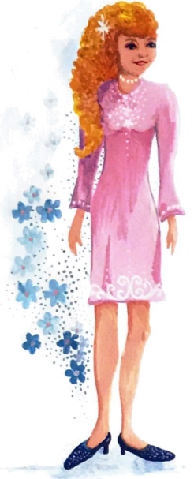  [Comparison](comparisons/FC-073.jpg) Resolve candidate completeness/orientation and remaining alternatives; possible missing only. REJECT: Luli upper head/moon area clipped. |
| **DRAW-FC-024-02 — maleta** FC-024-02 | **OPTIMIZED VERSION EXISTS** {'OPTIMIZED VERSION EXISTS': 1} |  [Selected file](https://github.com/ejnburrows-rgb/cartilla-de-gretel/blob/153c7eccbec5bc1090cd130a909f0cf73630415a/public/cartilla/art/optimized/flipchart-native/p024-maleta.webp) ·  [Comparison](comparisons/FC-073.jpg) Whole faithful drawing visually matches source linework, pose, object count and composition; color changes alone are accepted. No visible artwork clipping in the selected file. |
| **DRAW-FC-024-03 — lata** FC-024-03 | **OPTIMIZED VERSION EXISTS** {'OPTIMIZED VERSION EXISTS': 1} |  [Selected file](https://github.com/ejnburrows-rgb/cartilla-de-gretel/blob/153c7eccbec5bc1090cd130a909f0cf73630415a/public/cartilla/art/optimized/flipchart-native/p024-lata.webp) ·  [Comparison](comparisons/FC-079.jpg) Whole faithful drawing visually matches source linework, pose, object count and composition; color changes alone are accepted. No visible artwork clipping in the selected file. |
| **DRAW-FC-024-04 — Luli** FC-024-04 | **OPTIMIZED VERSION EXISTS** {'OPTIMIZED VERSION EXISTS': 1} |  [Selected file](https://github.com/ejnburrows-rgb/cartilla-de-gretel/blob/153c7eccbec5bc1090cd130a909f0cf73630415a/public/cartilla/art/optimized/flipchart-native/p024-luli.webp) ·  [Comparison](comparisons/FC-079.jpg) Whole faithful drawing visually matches source linework, pose, object count and composition; color changes alone are accepted. No visible artwork clipping in the selected file. |
| **DRAW-FC-024-05 — loma** FC-024-05 | **UNRESOLVED** {'UNRESOLVED': 1} |   [Comparison](comparisons/FC-079.jpg) Resolve candidate completeness/orientation and remaining alternatives; possible missing only. REVIEW: same underlying drawing visible in source/candidate pair; full usable quality, crop completeness and exact approval provenance not yet certified. |
| **DRAW-FC-024-06 — Lala** FC-024-06 | **OPTIMIZED VERSION EXISTS** {'OPTIMIZED VERSION EXISTS': 1} |  [Selected file](https://github.com/ejnburrows-rgb/cartilla-de-gretel/blob/153c7eccbec5bc1090cd130a909f0cf73630415a/public/cartilla/art/optimized/flipchart-native/p024-lala.png) ·  [Comparison](comparisons/FC-079.jpg) Whole faithful drawing visually matches source linework, pose, object count and composition; color changes alone are accepted. No visible artwork clipping in the selected file. |
| **DRAW-FC-026-01 — Ilustración de la página 26** FC-026-01 | **UNRESOLVED** {'UNRESOLVED': 1} |   [Comparison](comparisons/FC-079.jpg) Resolve candidate completeness/orientation and remaining alternatives; possible missing only. REJECT: Gretel stool/legs/flowers omitted; source composite not intact. |
| **DRAW-FC-027-01 — Ilustración de la página 27** FC-027-01 | **UNRESOLVED** {'UNRESOLVED': 1} | 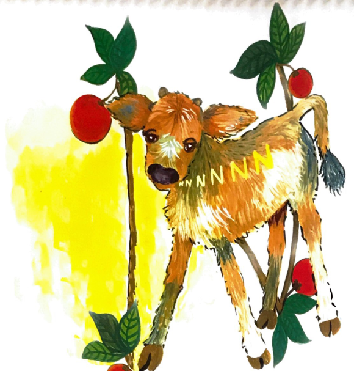  [Comparison](comparisons/FC-079.jpg) Resolve candidate completeness/orientation and remaining alternatives; possible missing only. REVIEW: same underlying drawing visible in source/candidate pair; full usable quality, crop completeness and exact approval provenance not yet certified. |
| **DRAW-FC-027-02 — nido** FC-027-02 | **OPTIMIZED VERSION EXISTS** {'OPTIMIZED VERSION EXISTS': 1} |  [Selected file](https://github.com/ejnburrows-rgb/cartilla-de-gretel/blob/153c7eccbec5bc1090cd130a909f0cf73630415a/public/cartilla/art/optimized/flipchart-native/p027-nido.png) ·  [Comparison](comparisons/FC-085.jpg) Whole faithful drawing visually matches source linework, pose, object count and composition; color changes alone are accepted. No visible artwork clipping in the selected file. |
| **DRAW-FC-027-03 — nudo** FC-027-03 | **OPTIMIZED VERSION EXISTS** {'OPTIMIZED VERSION EXISTS': 1} |  [Selected file](https://github.com/ejnburrows-rgb/cartilla-de-gretel/blob/153c7eccbec5bc1090cd130a909f0cf73630415a/public/cartilla/art/optimized/flipchart-native/p027-nudo.png) ·  [Comparison](comparisons/FC-085.jpg) Whole faithful drawing visually matches source linework, pose, object count and composition; color changes alone are accepted. No visible artwork clipping in the selected file. |
| **DRAW-FC-027-04 — mono** FC-027-04 | **UNRESOLVED** {'UNRESOLVED': 1} |   [Comparison](comparisons/FC-085.jpg) Resolve candidate completeness/orientation and remaining alternatives; possible missing only. REJECT: Monkey raised arm/fruit clipped. |
| **DRAW-FC-027-05 — Napi** FC-027-05 | **UNRESOLVED** {'UNRESOLVED': 1} |   [Comparison](comparisons/FC-085.jpg) Resolve candidate completeness/orientation and remaining alternatives; possible missing only. REVIEW: same underlying drawing visible in source/candidate pair; full usable quality, crop completeness and exact approval provenance not yet certified. |
| **DRAW-FC-027-06 — tenedor** FC-027-06 | **UNRESOLVED** {'UNRESOLVED': 1} |   [Comparison](comparisons/FC-085.jpg) Resolve candidate completeness/orientation and remaining alternatives; possible missing only. REVIEW: same underlying drawing visible in source/candidate pair; full usable quality, crop completeness and exact approval provenance not yet certified. |
| **DRAW-FC-029-01 — Ilustración de la página 29** FC-029-01 | **UNRESOLVED** {'UNRESOLVED': 1} |   [Comparison](comparisons/FC-085.jpg) Resolve candidate completeness/orientation and remaining alternatives; possible missing only. REJECT: Washing scene lower body/ground clipped. |
| **DRAW-FC-030-01 — Ilustración de la página 30** FC-030-01 | **UNRESOLVED** {'UNRESOLVED': 1} |   [Comparison](comparisons/FC-091.jpg) Resolve candidate completeness/orientation and remaining alternatives; possible missing only. REJECT: Girl floral frame upper flowers clipped. |
| **DRAW-FC-030-02 — piñata** FC-030-02 | **UNRESOLVED** {'UNRESOLVED': 1} |   [Comparison](comparisons/FC-091.jpg) Resolve candidate completeness/orientation and remaining alternatives; possible missing only. REJECT: Pinata/man lower bounds clipped. |
| **DRAW-FC-030-03 — Ñuno** FC-030-03 | **UNRESOLVED** {'UNRESOLVED': 1} |   [Comparison](comparisons/FC-091.jpg) Resolve candidate completeness/orientation and remaining alternatives; possible missing only. REJECT: Ostrich head/neck clipped. |
| **DRAW-FC-030-04 — niñito** FC-030-04 | **UNRESOLVED** {'UNRESOLVED': 1} |   [Comparison](comparisons/FC-091.jpg) Resolve candidate completeness/orientation and remaining alternatives; possible missing only. REVIEW: same underlying drawing visible in source/candidate pair; full usable quality, crop completeness and exact approval provenance not yet certified. |
| **DRAW-FC-030-05 — moño** FC-030-05 | **UNRESOLVED** {'UNRESOLVED': 1} | 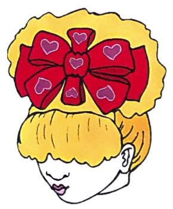  [Comparison](comparisons/FC-091.jpg) Resolve candidate completeness/orientation and remaining alternatives; possible missing only. REJECT: Hair-bow source face/hair lower bounds clipped. |
| **DRAW-FC-030-06 — Meñe** FC-030-06 | **UNRESOLVED** {'UNRESOLVED': 1} |   [Comparison](comparisons/FC-091.jpg) Resolve candidate completeness/orientation and remaining alternatives; possible missing only. REJECT: Mene lower legs clipped. |
| **DRAW-FC-032-01 — Ilustración de la página 32** FC-032-01 | **UNRESOLVED** {'UNRESOLVED': 1} |   [Comparison](comparisons/FC-097.jpg) Resolve candidate completeness/orientation and remaining alternatives; possible missing only. REJECT: Sleeping-girl scene upper filigree clipped. |
| **DRAW-FC-033-01 — Ilustración de la página 33** FC-033-01 | **UNRESOLVED** {'UNRESOLVED': 1} |   [Comparison](comparisons/FC-097.jpg) Resolve candidate completeness/orientation and remaining alternatives; possible missing only. REJECT: Calf scene moon clipped. |
| **DRAW-FC-033-02 — Beba** FC-033-02 | **OPTIMIZED VERSION EXISTS** {'OPTIMIZED VERSION EXISTS': 1} |  [Selected file](https://github.com/ejnburrows-rgb/cartilla-de-gretel/blob/153c7eccbec5bc1090cd130a909f0cf73630415a/public/cartilla/art/optimized/flipchart-native/p033-beba.png) ·  [Comparison](comparisons/FC-097.jpg) Whole faithful drawing visually matches source linework, pose, object count and composition; color changes alone are accepted. No visible artwork clipping in the selected file. |
| **DRAW-FC-033-03 — Bubi** FC-033-03, FC-042-02 | **OPTIMIZED VERSION EXISTS** {'OPTIMIZED VERSION EXISTS': 2} |  [Selected file](https://github.com/ejnburrows-rgb/cartilla-de-gretel/blob/153c7eccbec5bc1090cd130a909f0cf73630415a/public/cartilla/art/optimized/flipchart-native/p033-bubi.png) ·  [Comparison](comparisons/FC-097.jpg) Whole faithful drawing visually matches source linework, pose, object count and composition; color changes alone are accepted. No visible artwork clipping in the selected file. |
| **DRAW-FC-033-04 — bate** FC-033-04 | **UNRESOLVED** {'UNRESOLVED': 1} |   [Comparison](comparisons/FC-097.jpg) Resolve candidate completeness/orientation and remaining alternatives; possible missing only. REVIEW: same underlying drawing visible in source/candidate pair; full usable quality, crop completeness and exact approval provenance not yet certified. |
| **DRAW-FC-033-05 — bota** FC-033-05 | **UNRESOLVED** {'UNRESOLVED': 1} |   [Comparison](comparisons/FC-097.jpg) Resolve candidate completeness/orientation and remaining alternatives; possible missing only. REVIEW: same underlying drawing visible in source/candidate pair; full usable quality, crop completeness and exact approval provenance not yet certified. |
| **DRAW-FC-033-06 — bebita** FC-033-06 | **UNRESOLVED** {'UNRESOLVED': 1} |   [Comparison](comparisons/FC-103.jpg) Resolve candidate completeness/orientation and remaining alternatives; possible missing only. REJECT: Pram wheels clipped. |
| **DRAW-FC-035-01 — Ilustración de la página 35** FC-035-01 | **UNRESOLVED** {'UNRESOLVED': 1} | 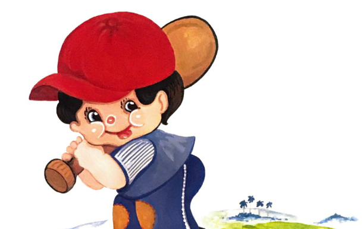  [Comparison](comparisons/FC-103.jpg) Resolve candidate completeness/orientation and remaining alternatives; possible missing only. REVIEW: same underlying drawing visible in source/candidate pair; full usable quality, crop completeness and exact approval provenance not yet certified. |
| **DRAW-FC-036-01 — Ilustración de la página 36** FC-036-01 | **OPTIMIZED VERSION EXISTS** {'OPTIMIZED VERSION EXISTS': 1} |  [Selected file](https://github.com/ejnburrows-rgb/cartilla-de-gretel/blob/153c7eccbec5bc1090cd130a909f0cf73630415a/public/cartilla/art/optimized/flipchart-native/p036-scene.png) ·  [Comparison](comparisons/FC-103.jpg) Whole faithful drawing visually matches source linework, pose, object count and composition; color changes alone are accepted. No visible artwork clipping in the selected file. |
| **DRAW-FC-036-02 — vaso** FC-036-02 | **UNRESOLVED** {'UNRESOLVED': 1} |   [Comparison](comparisons/FC-103.jpg) Resolve candidate completeness/orientation and remaining alternatives; possible missing only. REVIEW: same underlying drawing visible in source/candidate pair; full usable quality, crop completeness and exact approval provenance not yet certified. |
| **DRAW-FC-036-03 — vela** FC-036-03 | **OPTIMIZED VERSION EXISTS** {'OPTIMIZED VERSION EXISTS': 1} |  [Selected file](https://github.com/ejnburrows-rgb/cartilla-de-gretel/blob/153c7eccbec5bc1090cd130a909f0cf73630415a/public/cartilla/art/optimized/flipchart-native/p036-vela.png) ·  [Comparison](comparisons/FC-103.jpg) Whole faithful drawing visually matches source linework, pose, object count and composition; color changes alone are accepted. No visible artwork clipping in the selected file. |
| **DRAW-FC-036-04 — Vita** FC-036-04 | **OPTIMIZED VERSION EXISTS** {'OPTIMIZED VERSION EXISTS': 1} |  [Selected file](https://github.com/ejnburrows-rgb/cartilla-de-gretel/blob/153c7eccbec5bc1090cd130a909f0cf73630415a/public/cartilla/art/optimized/flipchart-native/p036-vita.png) ·  [Comparison](comparisons/FC-103.jpg) Whole faithful drawing visually matches source linework, pose, object count and composition; color changes alone are accepted. No visible artwork clipping in the selected file. |
| **DRAW-FC-036-05 — pavo** FC-036-05 | **UNRESOLVED** {'UNRESOLVED': 1} |   [Comparison](comparisons/FC-109.jpg) Resolve candidate completeness/orientation and remaining alternatives; possible missing only. REVIEW: same underlying drawing visible in source/candidate pair; full usable quality, crop completeness and exact approval provenance not yet certified. |
| **DRAW-FC-036-06 — Vuli** FC-036-06 | **UNRESOLVED** {'UNRESOLVED': 1} |   [Comparison](comparisons/FC-109.jpg) Resolve candidate completeness/orientation and remaining alternatives; possible missing only. REJECT: Rabbit lower body clipped. |
| **DRAW-FC-038-01 — Ilustración de la página 38** FC-038-01 | **UNRESOLVED** {'UNRESOLVED': 1} |   [Comparison](comparisons/FC-109.jpg) Resolve candidate completeness/orientation and remaining alternatives; possible missing only. REVIEW: same underlying drawing visible in source/candidate pair; full usable quality, crop completeness and exact approval provenance not yet certified. |
| **DRAW-FC-039-01 — Ilustración de la página 39** FC-039-01 | **UNRESOLVED** {'UNRESOLVED': 1} |   [Comparison](comparisons/FC-109.jpg) Resolve candidate completeness/orientation and remaining alternatives; possible missing only. REVIEW: same underlying drawing visible in source/candidate pair; full usable quality, crop completeness and exact approval provenance not yet certified. |
| **DRAW-FC-039-02 — rana** FC-039-02 | **OPTIMIZED VERSION EXISTS** {'OPTIMIZED VERSION EXISTS': 1} |  [Selected file](https://github.com/ejnburrows-rgb/cartilla-de-gretel/blob/153c7eccbec5bc1090cd130a909f0cf73630415a/public/cartilla/art/optimized/flipchart-native/p039-rana.png) ·  [Comparison](comparisons/FC-109.jpg) Whole faithful drawing visually matches source linework, pose, object count and composition; color changes alone are accepted. No visible artwork clipping in the selected file. |
| **DRAW-FC-039-03 — remos** FC-039-03 | **OPTIMIZED VERSION EXISTS** {'OPTIMIZED VERSION EXISTS': 1} |  [Selected file](https://github.com/ejnburrows-rgb/cartilla-de-gretel/blob/153c7eccbec5bc1090cd130a909f0cf73630415a/public/cartilla/art/optimized/flipchart-native/p039-remos.png) ·  [Comparison](comparisons/FC-109.jpg) Whole faithful drawing visually matches source linework, pose, object count and composition; color changes alone are accepted. No visible artwork clipping in the selected file. |
| **DRAW-FC-039-04 — Rita** FC-039-04 | **UNRESOLVED** {'UNRESOLVED': 1} |   [Comparison](comparisons/FC-115.jpg) Resolve candidate completeness/orientation and remaining alternatives; possible missing only. REJECT: Rita neck/caption remnants at lower edge. |
| **DRAW-FC-039-05 — rosa** FC-039-05 | **UNRESOLVED** {'UNRESOLVED': 1} |   [Comparison](comparisons/FC-115.jpg) Resolve candidate completeness/orientation and remaining alternatives; possible missing only. REVIEW: same underlying drawing visible in source/candidate pair; full usable quality, crop completeness and exact approval provenance not yet certified. |
| **DRAW-FC-039-06 — rueda** FC-039-06 | **UNRESOLVED** {'UNRESOLVED': 1} |   [Comparison](comparisons/FC-115.jpg) Resolve candidate completeness/orientation and remaining alternatives; possible missing only. REVIEW: same underlying drawing visible in source/candidate pair; full usable quality, crop completeness and exact approval provenance not yet certified. |
| **DRAW-FC-041-01 — Ilustración de la página 41** FC-041-01 | **UNRESOLVED** {'UNRESOLVED': 1} |   [Comparison](comparisons/FC-115.jpg) Resolve candidate completeness/orientation and remaining alternatives; possible missing only. REJECT: Mouse/rose scene lower right clipped. |
| **DRAW-FC-042-01 — Ilustración de la página 42** FC-042-01 | **OPTIMIZED VERSION EXISTS** {'OPTIMIZED VERSION EXISTS': 1} |  [Selected file](https://github.com/ejnburrows-rgb/cartilla-de-gretel/blob/153c7eccbec5bc1090cd130a909f0cf73630415a/public/cartilla/art/optimized/flipchart-native/p042-scene.png) ·  [Comparison](comparisons/FC-115.jpg) Whole faithful drawing visually matches source linework, pose, object count and composition; color changes alone are accepted. No visible artwork clipping in the selected file. |
| **DRAW-FC-042-03 — carrusel** FC-042-03 | **OPTIMIZED VERSION EXISTS** {'OPTIMIZED VERSION EXISTS': 1} |  [Selected file](https://github.com/ejnburrows-rgb/cartilla-de-gretel/blob/153c7eccbec5bc1090cd130a909f0cf73630415a/public/cartilla/art/optimized/flipchart-native/p042-carrusel.png) ·  [Comparison](comparisons/FC-121.jpg) Whole faithful drawing visually matches source linework, pose, object count and composition; color changes alone are accepted. No visible artwork clipping in the selected file. |
| **DRAW-FC-042-04 — torre** FC-042-04 | **UNRESOLVED** {'UNRESOLVED': 1} |   [Comparison](comparisons/FC-121.jpg) Resolve candidate completeness/orientation and remaining alternatives; possible missing only. REJECT: Tower roof omitted. |
| **DRAW-FC-042-05 — barril** FC-042-05 | **UNRESOLVED** {'UNRESOLVED': 1} |   [Comparison](comparisons/FC-121.jpg) Resolve candidate completeness/orientation and remaining alternatives; possible missing only. REVIEW: same underlying drawing visible in source/candidate pair; full usable quality, crop completeness and exact approval provenance not yet certified. |
| **DRAW-FC-042-06 — Tierra** FC-042-06 | **UNRESOLVED** {'UNRESOLVED': 1} |   [Comparison](comparisons/FC-121.jpg) Resolve candidate completeness/orientation and remaining alternatives; possible missing only. REJECT: Globe lower hemisphere clipped. |
| **DRAW-FC-044-01 — Ilustración de la página 44** FC-044-01 | **UNRESOLVED** {'UNRESOLVED': 1} |   [Comparison](comparisons/FC-121.jpg) Resolve candidate completeness/orientation and remaining alternatives; possible missing only. REVIEW: same underlying drawing visible in source/candidate pair; full usable quality, crop completeness and exact approval provenance not yet certified. |
| **DRAW-FC-045-01 — Ilustración de la página 45** FC-045-01 | **UNRESOLVED** {'UNRESOLVED': 1} |   [Comparison](comparisons/FC-121.jpg) Resolve candidate completeness/orientation and remaining alternatives; possible missing only. REVIEW: same underlying drawing visible in source/candidate pair; full usable quality, crop completeness and exact approval provenance not yet certified. |
| **DRAW-FC-045-02 — gaveta** FC-045-02 | **OPTIMIZED VERSION EXISTS** {'OPTIMIZED VERSION EXISTS': 1} |  [Selected file](https://github.com/ejnburrows-rgb/cartilla-de-gretel/blob/153c7eccbec5bc1090cd130a909f0cf73630415a/public/cartilla/art/optimized/flipchart-native/p045-gaveta.png) ·  [Comparison](comparisons/FC-127.jpg) Whole faithful drawing visually matches source linework, pose, object count and composition; color changes alone are accepted. No visible artwork clipping in the selected file. |
| **DRAW-FC-045-03 — gusano** FC-045-03 | **OPTIMIZED VERSION EXISTS** {'OPTIMIZED VERSION EXISTS': 1} |  [Selected file](https://github.com/ejnburrows-rgb/cartilla-de-gretel/blob/153c7eccbec5bc1090cd130a909f0cf73630415a/public/cartilla/art/optimized/flipchart-native/p045-gusano.png) ·  [Comparison](comparisons/FC-127.jpg) Whole faithful drawing visually matches source linework, pose, object count and composition; color changes alone are accepted. No visible artwork clipping in the selected file. |
| **DRAW-FC-045-04 — Goloso** FC-045-04 | **UNRESOLVED** {'UNRESOLVED': 1} |   [Comparison](comparisons/FC-127.jpg) Resolve candidate completeness/orientation and remaining alternatives; possible missing only. REJECT: Cat ears/top clipped. |
| **DRAW-FC-045-05 — gorra** FC-045-05 | **OPTIMIZED VERSION EXISTS** {'OPTIMIZED VERSION EXISTS': 1} |  [Selected file](https://github.com/ejnburrows-rgb/cartilla-de-gretel/blob/153c7eccbec5bc1090cd130a909f0cf73630415a/public/cartilla/art/optimized/flipchart-native/p045-gorra.png) ·  [Comparison](comparisons/FC-127.jpg) Whole faithful drawing visually matches source linework, pose, object count and composition; color changes alone are accepted. No visible artwork clipping in the selected file. |
| **DRAW-FC-045-06 — mago** FC-045-06 | **UNRESOLVED** {'UNRESOLVED': 1} |   [Comparison](comparisons/FC-127.jpg) Resolve candidate completeness/orientation and remaining alternatives; possible missing only. REVIEW: same underlying drawing visible in source/candidate pair; full usable quality, crop completeness and exact approval provenance not yet certified. |
| **DRAW-FC-047-01 — Ilustración de la página 47** FC-047-01 | **UNRESOLVED** {'UNRESOLVED': 1} |   [Comparison](comparisons/FC-127.jpg) Resolve candidate completeness/orientation and remaining alternatives; possible missing only. REJECT: Cat scene lower body clipped. |
| **DRAW-FC-048-01 — Ilustración de la página 48** FC-048-01 | **UNRESOLVED** {'UNRESOLVED': 1} |   [Comparison](comparisons/FC-133.jpg) Resolve candidate completeness/orientation and remaining alternatives; possible missing only. REVIEW: same underlying drawing visible in source/candidate pair; full usable quality, crop completeness and exact approval provenance not yet certified. |
| **DRAW-FC-048-02 — foto** FC-048-02 | **OPTIMIZED VERSION EXISTS** {'OPTIMIZED VERSION EXISTS': 1} |  [Selected file](https://github.com/ejnburrows-rgb/cartilla-de-gretel/blob/153c7eccbec5bc1090cd130a909f0cf73630415a/public/cartilla/art/optimized/flipchart-native/p048-foto.png) ·  [Comparison](comparisons/FC-133.jpg) Whole faithful drawing visually matches source linework, pose, object count and composition; color changes alone are accepted. No visible artwork clipping in the selected file. |
| **DRAW-FC-048-03 — fideos** FC-048-03 | **OPTIMIZED VERSION EXISTS** {'OPTIMIZED VERSION EXISTS': 1} |  [Selected file](https://github.com/ejnburrows-rgb/cartilla-de-gretel/blob/153c7eccbec5bc1090cd130a909f0cf73630415a/public/cartilla/art/optimized/flipchart-native/p048-fideos.png) ·  [Comparison](comparisons/FC-133.jpg) Whole faithful drawing visually matches source linework, pose, object count and composition; color changes alone are accepted. No visible artwork clipping in the selected file. |
| **DRAW-FC-048-04 — familia** FC-048-04 | **UNRESOLVED** {'UNRESOLVED': 1} |   [Comparison](comparisons/FC-133.jpg) Resolve candidate completeness/orientation and remaining alternatives; possible missing only. REJECT: Family adults heads clipped. |
| **DRAW-FC-048-05 — Felo** FC-048-05 | **UNRESOLVED** {'UNRESOLVED': 1} |   [Comparison](comparisons/FC-133.jpg) Resolve candidate completeness/orientation and remaining alternatives; possible missing only. REJECT: Tractor lower wheel clipped. |
| **DRAW-FC-048-06 — funda** FC-048-06 | **UNRESOLVED** {'UNRESOLVED': 1} |   [Comparison](comparisons/FC-133.jpg) Resolve candidate completeness/orientation and remaining alternatives; possible missing only. REVIEW: same underlying drawing visible in source/candidate pair; full usable quality, crop completeness and exact approval provenance not yet certified. |
| **DRAW-FC-050-01 — Ilustración de la página 50** FC-050-01 | **UNRESOLVED** {'UNRESOLVED': 1} |   [Comparison](comparisons/FC-139.jpg) Resolve candidate completeness/orientation and remaining alternatives; possible missing only. REVIEW: same underlying drawing visible in source/candidate pair; full usable quality, crop completeness and exact approval provenance not yet certified. |
| **DRAW-FC-051-01 — Ilustración de la página 51** FC-051-01 | **UNRESOLVED** {'UNRESOLVED': 1} |   [Comparison](comparisons/FC-139.jpg) Resolve candidate completeness/orientation and remaining alternatives; possible missing only. REVIEW: same underlying drawing visible in source/candidate pair; full usable quality, crop completeness and exact approval provenance not yet certified. |
| **DRAW-FC-051-02 — jicotea** FC-051-02 | **OPTIMIZED VERSION EXISTS** {'OPTIMIZED VERSION EXISTS': 1} |  [Selected file](https://github.com/ejnburrows-rgb/cartilla-de-gretel/blob/153c7eccbec5bc1090cd130a909f0cf73630415a/public/cartilla/art/optimized/flipchart-native/p051-jicotea.png) ·  [Comparison](comparisons/FC-139.jpg) Whole faithful drawing visually matches source linework, pose, object count and composition; color changes alone are accepted. No visible artwork clipping in the selected file. |
| **DRAW-FC-051-03 — jugo** FC-051-03 | **OPTIMIZED VERSION EXISTS** {'OPTIMIZED VERSION EXISTS': 1} |  [Selected file](https://github.com/ejnburrows-rgb/cartilla-de-gretel/blob/153c7eccbec5bc1090cd130a909f0cf73630415a/public/cartilla/art/optimized/flipchart-native/p051-jugo.png) ·  [Comparison](comparisons/FC-139.jpg) Whole faithful drawing visually matches source linework, pose, object count and composition; color changes alone are accepted. No visible artwork clipping in the selected file. |
| **DRAW-FC-051-04 — Jesús** FC-051-04 | **UNRESOLVED** {'UNRESOLVED': 1} |   [Comparison](comparisons/FC-139.jpg) Resolve candidate completeness/orientation and remaining alternatives; possible missing only. REJECT: Jesus head clipped. |
| **DRAW-FC-051-05 — ajo** FC-051-05 | **OPTIMIZED VERSION EXISTS** {'OPTIMIZED VERSION EXISTS': 1} |  [Selected file](https://github.com/ejnburrows-rgb/cartilla-de-gretel/blob/153c7eccbec5bc1090cd130a909f0cf73630415a/public/cartilla/art/optimized/flipchart-native/p051-ajo.png) ·  [Comparison](comparisons/FC-139.jpg) Whole faithful drawing visually matches source linework, pose, object count and composition; color changes alone are accepted. No visible artwork clipping in the selected file. |
| **DRAW-FC-051-06 — jarra** FC-051-06 | **UNRESOLVED** {'UNRESOLVED': 1} |   [Comparison](comparisons/FC-145.jpg) Resolve candidate completeness/orientation and remaining alternatives; possible missing only. REJECT: Jug base clipped. |
| **DRAW-FC-053-01 — Ilustración de la página 53** FC-053-01 | **UNRESOLVED** {'UNRESOLVED': 1} |   [Comparison](comparisons/FC-145.jpg) Resolve candidate completeness/orientation and remaining alternatives; possible missing only. REVIEW: same underlying drawing visible in source/candidate pair; full usable quality, crop completeness and exact approval provenance not yet certified. |
| **DRAW-FC-054-01 — Ilustración de la página 54** FC-054-01 | **UNRESOLVED** {'UNRESOLVED': 1} |   [Comparison](comparisons/FC-145.jpg) Resolve candidate completeness/orientation and remaining alternatives; possible missing only. REVIEW: same underlying drawing visible in source/candidate pair; full usable quality, crop completeness and exact approval provenance not yet certified. |
| **DRAW-FC-054-02 — cuna** FC-054-02 | **OPTIMIZED VERSION EXISTS** {'OPTIMIZED VERSION EXISTS': 1} |  [Selected file](https://github.com/ejnburrows-rgb/cartilla-de-gretel/blob/153c7eccbec5bc1090cd130a909f0cf73630415a/public/cartilla/art/optimized/flipchart-native/p054-cuna.png) ·  [Comparison](comparisons/FC-145.jpg) Whole faithful drawing visually matches source linework, pose, object count and composition; color changes alone are accepted. No visible artwork clipping in the selected file. |
| **DRAW-FC-054-03 — conejo** FC-054-03 | **UNRESOLVED** {'UNRESOLVED': 1} |   [Comparison](comparisons/FC-145.jpg) Resolve candidate completeness/orientation and remaining alternatives; possible missing only. REJECT: Rabbit ears clipped. |
| **DRAW-FC-054-04 — casa** FC-054-04 | **UNRESOLVED** {'UNRESOLVED': 1} |   [Comparison](comparisons/FC-145.jpg) Resolve candidate completeness/orientation and remaining alternatives; possible missing only. REVIEW: same underlying drawing visible in source/candidate pair; full usable quality, crop completeness and exact approval provenance not yet certified. |
| **DRAW-FC-054-05 — cubo** FC-054-05 | **UNRESOLVED** {'UNRESOLVED': 1} |   [Comparison](comparisons/FC-151.jpg) Resolve candidate completeness/orientation and remaining alternatives; possible missing only. REJECT: Bucket base clipped. |
| **DRAW-FC-054-06 — Catalina** FC-054-06 | **UNRESOLVED** {'UNRESOLVED': 1} |   [Comparison](comparisons/FC-151.jpg) Resolve candidate completeness/orientation and remaining alternatives; possible missing only. REJECT: Chicken feet clipped. |
| **DRAW-FC-056-01 — Ilustración de la página 56** FC-056-01 | **UNRESOLVED** {'UNRESOLVED': 1} |   [Comparison](comparisons/FC-151.jpg) Resolve candidate completeness/orientation and remaining alternatives; possible missing only. REVIEW: same underlying drawing visible in source/candidate pair; full usable quality, crop completeness and exact approval provenance not yet certified. |
| **DRAW-FC-057-01 — Ilustración de la página 57** FC-057-01 | **UNRESOLVED** {'UNRESOLVED': 1} |   [Comparison](comparisons/FC-151.jpg) Resolve candidate completeness/orientation and remaining alternatives; possible missing only. REVIEW: same underlying drawing visible in source/candidate pair; full usable quality, crop completeness and exact approval provenance not yet certified. |
| **DRAW-FC-057-02 — yate** FC-057-02 | **OPTIMIZED VERSION EXISTS** {'OPTIMIZED VERSION EXISTS': 1} |  [Selected file](https://github.com/ejnburrows-rgb/cartilla-de-gretel/blob/153c7eccbec5bc1090cd130a909f0cf73630415a/public/cartilla/art/optimized/flipchart-native/p057-yate.png) ·  [Comparison](comparisons/FC-151.jpg) Whole faithful drawing visually matches source linework, pose, object count and composition; color changes alone are accepted. No visible artwork clipping in the selected file. |
| **DRAW-FC-057-03 — yema** FC-057-03 | **OPTIMIZED VERSION EXISTS** {'OPTIMIZED VERSION EXISTS': 1} |  [Selected file](https://github.com/ejnburrows-rgb/cartilla-de-gretel/blob/153c7eccbec5bc1090cd130a909f0cf73630415a/public/cartilla/art/optimized/flipchart-native/p057-yema.png) ·  [Comparison](comparisons/FC-151.jpg) Whole faithful drawing visually matches source linework, pose, object count and composition; color changes alone are accepted. No visible artwork clipping in the selected file. |
| **DRAW-FC-057-04 — Yayita** FC-057-04 | **UNRESOLVED** {'UNRESOLVED': 1} |   [Comparison](comparisons/FC-157.jpg) Resolve candidate completeness/orientation and remaining alternatives; possible missing only. REVIEW: same underlying drawing visible in source/candidate pair; full usable quality, crop completeness and exact approval provenance not yet certified. |
| **DRAW-FC-057-05 — mayúscula** FC-057-05 | **UNRESOLVED** {'UNRESOLVED': 1} |   [Comparison](comparisons/FC-157.jpg) Resolve candidate completeness/orientation and remaining alternatives; possible missing only. REJECT: Yellow Y upper portion clipped. |
| **DRAW-FC-057-06 — yoyo** FC-057-06 | **UNRESOLVED** {'UNRESOLVED': 1} |   [Comparison](comparisons/FC-157.jpg) Resolve candidate completeness/orientation and remaining alternatives; possible missing only. REVIEW: same underlying drawing visible in source/candidate pair; full usable quality, crop completeness and exact approval provenance not yet certified. |
| **DRAW-FC-059-01 — Ilustración de la página 59** FC-059-01 | **UNRESOLVED** {'UNRESOLVED': 1} |   [Comparison](comparisons/FC-157.jpg) Resolve candidate completeness/orientation and remaining alternatives; possible missing only. REJECT: Kite top clipped. |
| **DRAW-FC-060-01 — Ilustración de la página 60** FC-060-01 | **UNRESOLVED** {'UNRESOLVED': 1} |   [Comparison](comparisons/FC-157.jpg) Resolve candidate completeness/orientation and remaining alternatives; possible missing only. REVIEW: same underlying drawing visible in source/candidate pair; full usable quality, crop completeness and exact approval provenance not yet certified. |
| **DRAW-FC-060-02 — zapato** FC-060-02 | **OPTIMIZED VERSION EXISTS** {'OPTIMIZED VERSION EXISTS': 1} |  [Selected file](https://github.com/ejnburrows-rgb/cartilla-de-gretel/blob/153c7eccbec5bc1090cd130a909f0cf73630415a/public/cartilla/art/optimized/flipchart-native/p060-zapato.png) ·  [Comparison](comparisons/FC-157.jpg) Whole faithful drawing visually matches source linework, pose, object count and composition; color changes alone are accepted. No visible artwork clipping in the selected file. |
| **DRAW-FC-060-03 — zig-zag** FC-060-03 | **UNRESOLVED** {'UNRESOLVED': 1} |   [Comparison](comparisons/FC-163.jpg) Resolve candidate completeness/orientation and remaining alternatives; possible missing only. REJECT: Zig-zag caption retained. |
| **DRAW-FC-060-04 — zorro** FC-060-04 | **UNRESOLVED** {'UNRESOLVED': 1} |   [Comparison](comparisons/FC-163.jpg) Resolve candidate completeness/orientation and remaining alternatives; possible missing only. REJECT: Fox head clipped. |
| **DRAW-FC-060-05 — zepelín** FC-060-05 | **UNRESOLVED** {'UNRESOLVED': 1} |   [Comparison](comparisons/FC-163.jpg) Resolve candidate completeness/orientation and remaining alternatives; possible missing only. REVIEW: same underlying drawing visible in source/candidate pair; full usable quality, crop completeness and exact approval provenance not yet certified. |
| **DRAW-FC-060-06 — Zulema** FC-060-06 | **UNRESOLVED** {'UNRESOLVED': 1} |   [Comparison](comparisons/FC-163.jpg) Resolve candidate completeness/orientation and remaining alternatives; possible missing only. REVIEW: same underlying drawing visible in source/candidate pair; full usable quality, crop completeness and exact approval provenance not yet certified. |
| **DRAW-FC-062-01 — Ilustración de la página 62** FC-062-01 | **UNRESOLVED** {'UNRESOLVED': 1} | 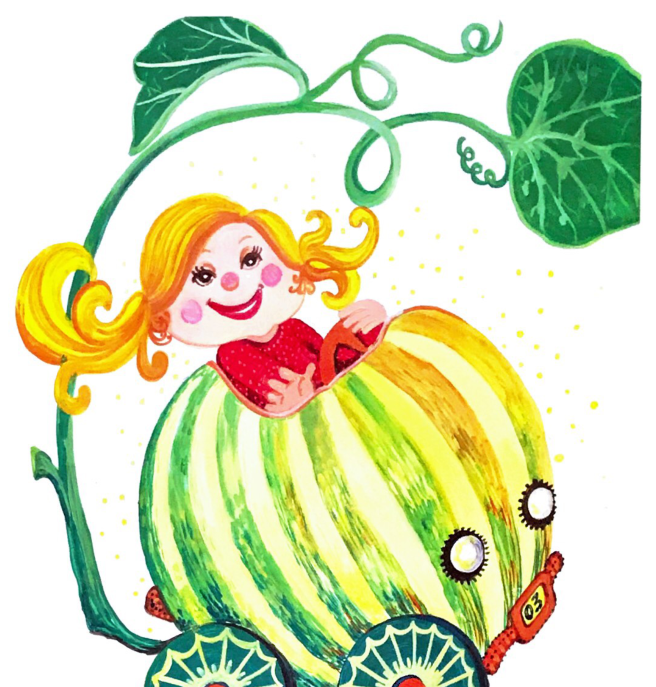  [Comparison](comparisons/FC-163.jpg) Resolve candidate completeness/orientation and remaining alternatives; possible missing only. REJECT: Pumpkin carriage lower wheels clipped. |
| **COMPOSITE-FC-FRONT-001 — Cover/title illustration composite** FC-FRONT-001 | **UNRESOLVED** {'UNRESOLVED': 1} |   [Comparison](pages/FC-001.jpg) Resolve candidate completeness/orientation and remaining alternatives; possible missing only. COMPOSITE REVIEW: separate drawing boundaries and approved corresponding components remain unresolved. |
| **COMPOSITE-WB-FRONT-001 — Cover/title illustration composite** WB-FRONT-001 | **UNRESOLVED** {'UNRESOLVED': 1} |   [Comparison](pages/WB-001.jpg) Resolve candidate completeness/orientation and remaining alternatives; possible missing only. COMPOSITE REVIEW: separate drawing boundaries and approved corresponding components remain unresolved. |
| **COMPOSITE-WB-FRONT-003 — Cover/title illustration composite** WB-FRONT-003 | **UNRESOLVED** {'UNRESOLVED': 1} |   [Comparison](pages/WB-003.jpg) Resolve candidate completeness/orientation and remaining alternatives; possible missing only. COMPOSITE REVIEW: separate drawing boundaries and approved corresponding components remain unresolved. |
