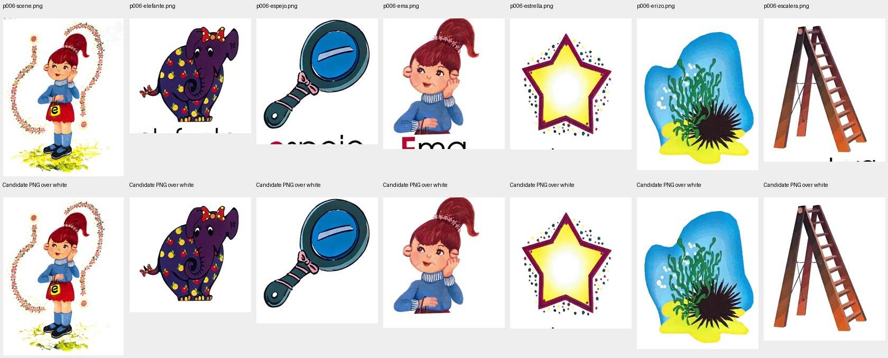

# Lesson 4: reconstructed seven-asset source chain

Owner: Codex source_recovery. Candidate: `d613b78ba553c3c5786afdf7d589305a3080f1cf`; the seven PNGs were introduced by `ab06a8b9f2506306f3d1fe59a83c146e8889f15e`. Evidence only; no production file changed.

**DONE but not live:** all seven candidate PNGs have a reproducible original-PDF source chain. At every pixel with alpha greater than zero, their RGB matches the reconstructed JPEG crop exactly: **zero differing visible RGB pixels in 7/7 assets**. This is not exact RGB equality to the original PDF: the prior extraction passed through a lossy JPEG quality-95 intermediate. That distinction must remain in provenance metadata.

## Source and recovered recipe

- Original `La Cartilla de Gretel Flip Chart.pdf`, SHA256 `d7fb3dff4e63caf3443226e57a9ef700f8974acd4ad8f08f44e2792e13cc4930`.
- PDF page 6 (zero-based index 5), sole embedded JPEG, xref 19: **2144 × 2936**, SHA256 `c8c69b76e05f381cdbc5d26247152f7b8e58356d7ae0c106381c625541b1826f`.
- Existing local worker record `.agents/teamwork/explorer_survey_r2/crop_master.py` supplies the seven rectangles below. It opens the extracted scan with Pillow, crops at native size, then saves `master_*.jpg` with `quality=95`. The recovered `master_ema.jpg` was reproduced byte for byte before the complete seven-asset replay.
- Existing worker handoff `.agents/teamwork/worker_m8/handoff.md` describes perimeter background flood-fill and Gaussian edge smoothing, sigma 0.6, followed by white RGB for zero-alpha pixels. That historical description is not a replayable alpha implementation; this new evidence certifies the visible RGB derivation, records alpha counts, and separately shows the resulting isolation.

| Asset | Native source rectangle, left/top/right/bottom | PNG dimensions |
|---|---|---|
| scene | 100, 100, 1050, 1350 | 950 × 1250 |
| elefante | 80, 1380, 650, 1920 | 570 × 540 |
| espejo | 780, 1380, 1300, 1920 | 520 × 540 |
| ema | 1550, 1380, 2050, 1920 | 500 × 540 |
| estrella | 80, 2100, 680, 2750 | 600 × 650 |
| erizo | 780, 2100, 1300, 2750 | 520 × 650 |
| escalera | 1500, 2100, 2050, 2750 | 550 × 650 |



The comparison shows the original scene, objects, lettering and Ema vignette. The output alpha isolates the drawings from the paper and adjacent printed vocabulary labels. No additional drawing was inserted into a visible PNG pixel: each visible RGB triple is accounted for by the mechanically reproduced source crop/JPEG step. This does not certify every alpha edge or constitute owner visual acceptance.

## Reproduction and limits

[Executable replay](lesson4-source-provenance.py) reads PNGs from the exact Git commit, rather than trusting a modified working copy. Supply the original PDF and a checkout containing that commit:

```text
python lesson4-source-provenance.py --pdf ORIGINAL.pdf --repo CHECKOUT --head d613b78ba553c3c5786afdf7d589305a3080f1cf --output result.json
```

Execution: exit **0**; `allSevenVisibleRgbChainsMatch:true`. [Raw results](lesson4-source-provenance.json) record source/intermediate/output SHA256, rectangles, alpha counts and RGB differences. The initial direct-source comparison failed all seven; the recovered JPEG step explains those differences. Mean absolute RGB difference at opaque pixels versus the original crop is **1.17–1.79 channel levels**, with per-asset maxima **15–33**. Therefore `originalRgbPreservedExactly:false` is deliberate and must not be replaced by a blanket exact-pixels claim.

**WAITING:** independent assessment of the disclosed JPEG derivative and alpha isolation against source-fidelity policy. **NOT TESTED by this artifact:** WEBP derivative pixels, runtime placement, restored-scene motion, physical devices or projector enlargement. Existing exact-version runtime proof remains separate; this source check does not rerun or replace it.
