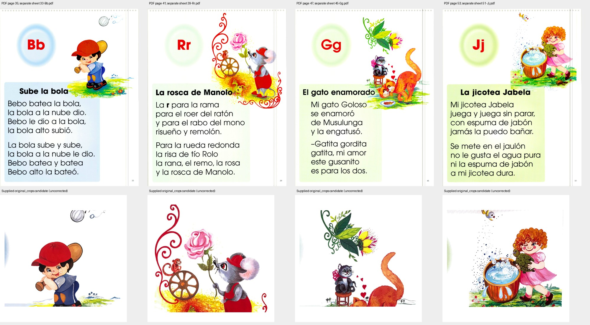
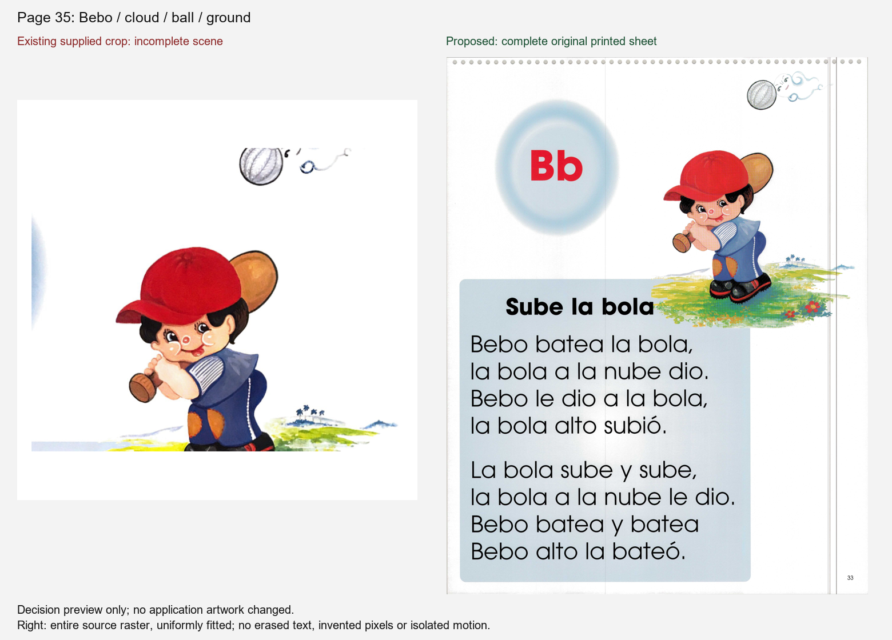
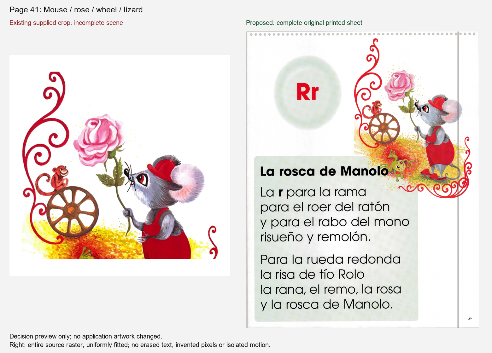
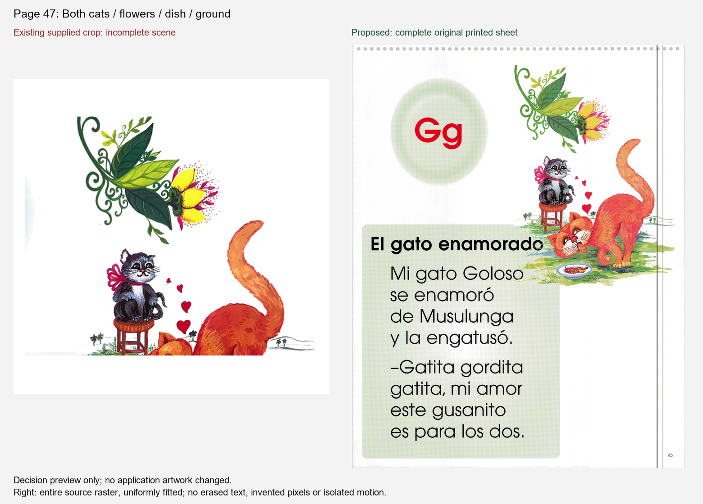
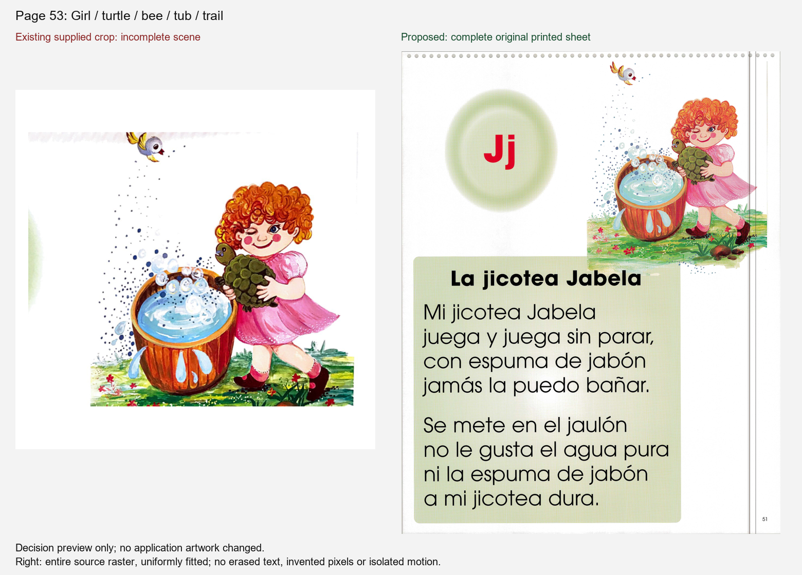

# Four unresolved Flip Chart scenes — bounded source recovery

Owner: Codex source_recovery. Baseline: `d613b78ba553c3c5786afdf7d589305a3080f1cf`, existing PR #1247. **WAITING** for clean source or a source-specific placement decision. No production assets, metadata, text, audio or motion changed.

This extends the existing [completion checkpoint](../COMPLETION-CHECK.md); its full original PDF, archive-hero and rendered-page findings are reused. It does not restart the 62-page audit. The full PDF hash remains `d7fb3dff4e63caf3443226e57a9ef700f8974acd4ad8f08f44e2792e13cc4930`.

## Additional sources actually examined

- Supplied Downloads archive `flipchart_all_separate_images_remastered.zip`: inspected manifest and all four `original_crops` scene candidates. The files named `modernized` are not clean original masters and were not selected.
- Supplied `la_cartilla_de_gretel_complete_package.zip`: visually inspected all 46 PNG/JPEG entries. They are Gretel pose/cover variants, not these four scenes.
- `UNMATCHED-613-art-files.zip` and `cartilla-gretel-assets.zip`: inspected archive entry listings for page/story matches; matching hero/scanned-page paths add no verified clean scene master. The existing archive-hero comparison remains applicable; no new claim of exhaustive visual review of every anonymous file is made.
- `Documents/Cartilla_Colored_Artwork_Library_2026-10-21`: checked its README, subject index and provenance scope. Its own README calls its Library alternatives unapproved and warns of changed anatomy/composition; its named subjects do not identify these four full scenes. No substitution.
- Connected Google Drive: searched Cartilla/Gretel, Sube/Jabela and exact separate-sheet names; inspected the `La Cartilla Images` folder listing. Retrieved four original separate-sheet PDFs from the existing source folder. Each is one flattened JPEG scan with zero extractable text, not separate clean art/text layers. Exact source URLs, file SHA256, image dimensions and archive-entry hashes are in [results](source-recovery-results.json).

## Precise remaining material

| PDF page / lesson | Comparison and gap | Needed next action |
|---|---|---|
| 35 / 15 | `original_crops/p35_story_sube_la_bola_scene.png` cuts Bebo below the torso and trims the cloud/ball. Separate source `33-Bb.pdf` shows the full boy, bat and ground but the caption meets the left ground region; the whole scene is still part of a printed page. | Obtain the untouched complete Bebo/cloud-ball/ground illustration, or an explicit decision to preserve the authentic printed caption/ground relationship in this placement. Do not erase/invent grass. |
| 41 / 17 | `original_crops/p41_story_rosca_manolo_scene.png` cuts the mouse's lower body, lizard and lower flourish. Separate source `39-Rr inicial.pdf` retains the scene but the printed title crosses the yellow-ground/lizard region. | Obtain clean mouse/rose/wheel/lizard/full-flourish source, or approve a specific caption-preserving placement. No inferred hidden pixels. |
| 47 / 19 | `original_crops/p47_story_gato_enamorado_scene.png` cuts the large cat and food dish and trims ground. Separate source `45-Gg.pdf` retains both cats and dish but the title intersects the scene/ground region. | Obtain both cats, flowers, dish and full ground without overprinted caption, or approve a specific placement that retains the genuine source relationship. |
| 53 / 21 | `original_crops/p53_story_jicotea_jabela_scene.png` retains more of the lower bath/feet but clips the bee and upper dotted trail. Separate source `51-Jj.pdf` contains the scene and title/ground region together in a flattened scan. | Obtain the entire girl/turtle/bee/tub/ground illustration without overprint, or approve a source-specific caption-preserving placement. |

The separate-sheet PDFs have higher raster dimensions than the known full-PDF pages, but higher resolution alone does not remove caption overlap or establish a clean source. Their colors/compression were not certified against approved masters, and they were not installed.

## Limits and next action

**DONE but not live:** additional source locations, hashes, page mapping and visual comparisons are recorded. **WAITING:** the four clean full illustrations or the precise placement decisions above. **NOT TESTED:** any replacement in the app; no replacement was made. This bounded search does not prove that no clean owner original exists elsewhere, and it does not repeat completed motion, page-fit or runtime audits.

The integration owner should retain the existing four source holds and route only these exact missing-material/placement items to the artwork owner. No new art generation or broad screenshot recapture is justified by this finding.

## Continuation delta receipt — 2026-11-03

**WAITING**, unchanged. Reconciled source branch `cec30be6b72a6535cac64046e2517ccab43fac27` against its remote ref; the worktree was clean. The new continuation attachment contains only `Pasted text.txt`, not an image, PDF or source archive.

One new connected-location check was limited to accessible Google Drive image/PDF/ZIP files modified after this source receipt's commit time, `2026-11-03T13:19:42Z`. Provider metadata search returned **zero results**. This is a bounded delta search, not proof that no clean original exists elsewhere. No prior flattened PDF, archive candidate or full-page audit was repeated.

The four page-specific requests in **Precise remaining material** above remain the actionable handoff: complete Bebo/cloud-ball/ground (35), mouse/rose/wheel/lizard/flourish (41), both cats/flowers/dish/ground (47), and girl/turtle/bee/tub/ground (53), or an explicit source-specific placement decision preserving each genuine printed caption/ground relationship. A generic permission to proceed does not identify a clean source or settle placement.

No replacement was accepted or installed. Changed files in this delta: this evidence document only. Existing Lesson-4 provenance, static-scene holds and Workbook 86–87 restrictions remain untouched. Next action: artwork owner supplies the specific clean original or the source-preserving placement decision for each page; implementation then requires explicit file assignment and comparison/runtime proof.

## Four concrete placement decisions — 2026-11-03 continuation

The earlier vague placement request is now replaced by the four visible choices below. **Recommendation for each page:** use the complete original printed sheet as one static page surface. Its caption, story, letter halo and illustration remain together exactly as supplied. This is an owner decision preview, not an application screenshot or accepted replacement.

Exact placement: source rectangle `[0, 0, sourceWidth, sourceHeight]`, normalized `[0, 0, 1, 1]`; fit the whole raster inside the page content area with `contain`, centered, with its aspect ratio unchanged. Do not crop, isolate the art, erase the title, redraw ground, animate the entire raster, or overlay a second visible digital caption/story. The printed page border/binding marks and scan appearance remain visible. The tradeoff is a smaller illustration than a separate large-art layout. These scans' color/compression are not certified against an approved clean master; Yes accepts the specific supplied-sheet appearance shown here, not a claim that it is a clean illustration master.

| Page / story | Exact supplied source / pixel rectangle | Decision and preserved content | If No: exact alternative source needed |
|---|---|---|---|
| 35 / Sube la bola | `33-Bb.pdf`, `[0,0,3406,4345]` | Yes accepts the complete printed sheet: full Bebo, bat, cloud/ball region, feet and ground; original title/story in place. | Untouched full Bebo/bat/cloud-ball/ground illustration without printed caption, including the feet and all ground currently crossing the title region. |
| 41 / La rosca de Manolo | `39-Rr.pdf`, `[0,0,3410,4343]` | Yes accepts the complete printed sheet: mouse, rose, wheel, lizard, yellow ground and both flourishes; original title/story in place. | Untouched full scene including mouse feet, lizard and lower red flourish/ground beneath the printed title. |
| 47 / El gato enamorado | `45-Gg.pdf`, `[0,0,3408,4343]` | Yes accepts the complete printed sheet: both cats, flowers, food dish, feet and ground; original title/story in place. | Untouched full both-cat illustration including the large cat's face/feet, food dish and complete ground where the title meets the scene. |
| 53 / La jicotea Jabela | `51-Jj.pdf`, `[0,0,3406,4344]` | Yes accepts the complete printed sheet: entire bee and upper dotted trail, girl, turtle, tub, feet and ground; original title/story in place. | Untouched complete scene from bee/upper trail through all feet/tub/ground, without the printed caption. |

Left panels reuse the supplied `original_crops` candidates recorded above; they are **not claimed to be current served app screenshots**. Right panels decode each recorded PDF's single embedded source raster and uniformly scale it without trimming. Both source PDF and crop bytes match all eight existing SHA256 records. No new source location was searched. One local candidate with different bytes was rejected by the hash assertion; the already-recorded original copy was used. No source bytes, production file, caption, audio or motion behavior changed.

**DONE but not live:** four owner-viewable comparisons and exact placement choices prepared. **WAITING:** a separate Yes/No for each shown full-sheet choice; a No routes only that page to the precise alternative original above. **NOT TESTED:** production integration, source-to-app layout, physical-device readability or motion. Root can continue software repairs while these choices wait. After a Yes, assign the bounded placement change, verify actual route/readability and source identity, and retain independent review before publication.

### Read-only implementation map for a later approved choice

Inspected application baseline `226991ec775c51592be859d30bb8ee978bfcda0d`. No app files changed. The placement is feasible, but changing only `scene.src` or its crop would place a captioned full sheet behind the existing digital caption/letter/story and crop it into the small scene box.

Current path: `FlipchartHdPanel.tsx` `FlipchartFace` → `FlipchartNativeBoard.tsx:531` → `FlipchartReplicaSheet.tsx`. All four pages have replica geometry. The replica currently draws panels, medallions, digital tokens, synthetic spiral, scene and page number separately.

Smallest proposed file boundary, **after each page's owner Yes**:

- `src/data/flipchart-production-art.json`: add explicit optional full-sheet metadata only for accepted pages, recording approved image source, natural dimensions, source hash and approval reference. This existing manifest is already traversed by `scripts/verify-production-assets.mjs`; do not create a competing production inventory. Keep existing scene records historical/inactive in this mode; never fall back to an old clipped scene if the approved sheet fails to load.
- `src/lib/flipchart-replica.ts`: extend `ReplicaSheet` with the optional approved full-sheet mode from that manifest. Use the embedded raster's own aspect ratio, bypassing art bounds/template matching/clipping for this mode. Preserve existing raw-text transcription for accessible reading.
- `src/components/cartilla/FlipchartReplicaSheet.tsx`: retain `.fc-replica` and `.fc-replica__sheet` plus `data-testid="flipchart-replica-sheet"`, which the turning leaf measures. In full-sheet mode render a single static image with `object-fit:contain` and full source rectangle. Do not mount the separate visible panels, divider/crescent, medallion, tokens, spiral, old scene or synthetic page number. Preserve the source transcription as screen-reader-only text, and preserve decorative thumbnail semantics. Do not use an animated `LivingIllustration` for the whole printed sheet.
- `src/styles/flipchart-replica.css`: a narrowly scoped full-sheet modifier/image rule; retain size containment and original aspect ratio. `--sheet-h` becomes `1000 * sourceHeight / sourceWidth` for that sheet. Existing frames differ slightly from these scans; do not stretch the raster or change unrelated frame geometry to hide the difference.
- Four source image files, one only for each accepted page: suggested dedicated immutable paths `/cartilla/art/faithful/flipchart/p035-full-sheet.jpg`, `p041-full-sheet.jpg`, `p047-full-sheet.jpg`, `p053-full-sheet.jpg`. These paths do **not** exist yet. Extract the original PDF's embedded JPEG bytes directly rather than rendering/recompressing them. No art isolation or invented alpha is needed.
- Update the four existing `FC-035-01`, `FC-041-01`, `FC-047-01`, `FC-053-01` rows in `docs/artwork-reconciliation/mapping/MASTER-MAPPING.csv` as approval/integration/display evidence actually arrives. Keep approval and rendered verification distinct.

No change is needed in `FlipchartHdPanel.tsx`, its page-turn code, shared presenter CSS, routes, Tutor, Workbook or unrelated assets for this mode. The existing NativeBoard route also drives filmstrip thumbnails; verify both surfaces after implementation. Coordinate with root before touching the shared renderer/model/CSS. `FlipchartPlate.tsx` is an older separate illustration-plus-text path, not the active HdPanel path; do not silently claim it or any separate print surface has been repaired.

Existing source extraction map (all four PDFs contain one embedded JPEG at **xref 11**):

| Page | Existing local PDF | Embedded JPEG dimensions | SHA256 of original embedded JPEG bytes | Full-sheet height at width 1000 |
|---|---|---|---|---|
| 35 | `D:\Downloads\cartilla-1247-source-recovery-work\33-Bb.pdf` | 3406 × 4345 | `d42b78a8d8f14fe4562a709258a58bd5767b218443c5a0a6beb92383e4af1805` | 1275.6899588961 |
| 41 | `D:\Downloads\cartilla-1247-source-recovery-work\39-Rr.pdf` | 3410 × 4343 | `c83ac3f90721e4e92f817895bb7461bcf4e01c535e52c6c21be917651e914952` | 1273.6070381232 |
| 47 | `C:\Users\EJN\Documents\Codex\2026-11-03\continue-la-cartilla-de-gretel-from\work\source-search\45-Gg.pdf` | 3408 × 4343 | `a45f84f08071e160228586a8befbc8ea4e3a333c8a6938323c3fe1e626389c9a` | 1274.3544600939 |
| 53 | `D:\Downloads\cartilla-1247-source-recovery-work\51-Jj.pdf` | 3406 × 4344 | `d8352af3318611db766e6fc33444bea6f09982c9c9f072d1c68171b7ac349ded` | 1275.3963593658 |

The earlier separate-sheet PDF SHA256 records still identify the containing PDFs; the table above separately identifies the JPEG bytes inside them. Source rectangle remains `[0,0,width,height]`, with no alpha/crop/template-match bounds. Existing scene crop boxes in `flipchart-native-assets.json` are respectively `[474,193,498,315]`, `[444,28,531,504]`, `[473,29,506,532]`, `[481,28,504,562]`; these are **not** full-sheet coordinates and must not be applied to the new image.

Affected verification after implementation: add focused renderer checks that exactly one visible approved sheet and no duplicate caption/medallion/spiral/old scene mount for accepted pages; keep the transcription accessible and the whole source visible at all target sizes. Existing `flipchart-native-coverage.test.ts` explicitly describes every instructional plate as scan-free; a later owner-approved full-sheet mode requires an exact four-page source/approval assertion alongside the unchanged scan-free requirements for all other plates, rather than pretending the old test proves the new raster surface. Reuse existing reading-order, static-art and page-turn evidence only where unchanged. Source-byte identity, loading/error behavior, actual-route screenshots/readability and required independent review remain to be checked on the implemented commit. No build, browser run, image regeneration, replacement install or approval occurred while preparing this map.
