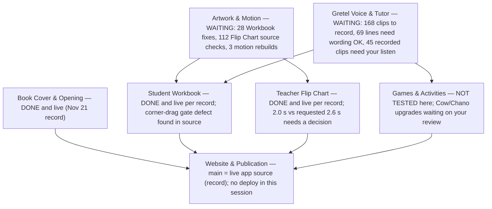

# La Cartilla de Gretel — demo handoff, executive status (2026-11-24)

Source of truth: [#877](https://github.com/ejnburrows-rgb/cartilla-de-gretel/issues/877). Checked: GitHub `main` `5e1c8378` (= app source of the recorded live revision `3c559eea` + one docs-only change, #1320). **This session reviewed source code and GitHub records only.** No browser, device or audio test was run, so nothing here is newly “live-verified”. Live status quoted below comes from the Nov 21 #877 checkpoint.

## What was checked: the Nov 14 handoff (`09fdd24`)
- **Not merged.** PR [#1306](https://github.com/ejnburrows-rgb/cartilla-de-gretel/pull/1306) was closed without merging. GitHub compare shows `09fdd24` diverged from main (13 ahead / 35 behind). The branch `docs/page-flip-eraser-handoff-20261114` **no longer exists** (it was deleted, even though the Nov 18 note said to keep it). Its 10 handoff files can still be reached through the PR’s commits. This package carries forward what they contain (audio CSVs, image queue, page-flip contract).
- Newer work since Nov 14, all merged: #1305, #1307–#1320 (pencil/eraser lock, Option A defaults, full 16-picture p.7, Cow/Chano upgrades **then reverted for your review** in #1315).

## Status by bucket
| Bucket | Items |
|---|---|
| **Done (merged; live per Nov 21 record)** | Locked photo pencil + macro eraser (#1316/#1317); Workbook curl A default; Flip Chart Candidate A 2.0 s; full 16-picture p.7 (#1318); page-turn rustle + mute; 4 approved Flip Chart full sheets (#1247); 161 picture-word recordings; TTS disabled (`allowTts:false`, silent fallback) |
| **In progress / open PRs** | #1058 (40 + 5 owner instruction recordings, not merged); #1073 Tutor (draft, frozen); #769 Gretel original-voice recovery (draft); many stale Oct drafts (lessons, games). See `06-PROTOTYPES-GAMES-TUTOR-PLATFORM.md` |
| **Missing** | 168 recordings (`04-MISSING-RECORDINGS-ONLY.md`); 28 Workbook art fixes; 3 stale motion files; no Apple game exists in the source; no Payaso Chano art |
| **Blocked on owner** | Listen/approve #1058 clips; wording for 65 Tutor + 4 interface drafts; spoken names for 38 Flip Chart keys; Flip Chart 2.0 s vs 2.6 s; retry phrase choice; Cow/Chano upgrade review; Nov 19 artwork folder; provenance of 112 Flip Chart layers + 12 lesson crops |
| **Defect found (source only)** | Workbook corner **drag** can turn an unfinished page forward (`NativeLessonViewer.tsx`). Fix in `05-MOTION-INSPECTION.md`. Not changed here because code changes need your yes |

## Files in this package
1. `01-EXECUTIVE-STATUS.md`: this page
2. `02-MISSING-ARTWORK.md` / `.csv`: exact artwork list with image links
3. `03-GRETEL-MASTER-SCRIPT.md`: every recoverable Gretel line (full text)
4. `04-MISSING-RECORDINGS-ONLY.md`: recording session sheet
5. `05-MOTION-INSPECTION.md`: pencil, eraser, both page turns, timing, audio
6. `06-PROTOTYPES-GAMES-TUTOR-PLATFORM.md`: prototypes, games, Tutor, Teacher Platform
7. `07-DEMO-ACTION-PLAN.md`: five lanes; now / owner / test-later
8. `08-CONTINUATION-PROMPT.md`: short prompt for a coding + browser agent
