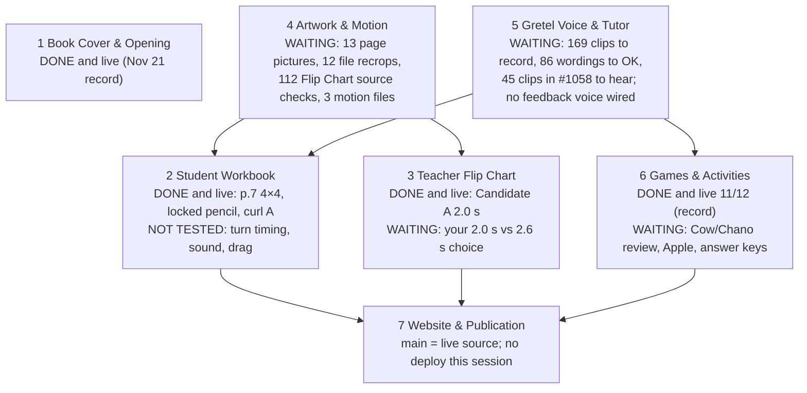

# La Cartilla de Gretel: demo handoff, executive status (2026-11-26)

Source of truth: [#877](https://github.com/ejnburrows-rgb/cartilla-de-gretel/issues/877). Checked against GitHub `main` `5e1c8378` (the live app source `3c559eea` + one docs-only change, #1320). **This session reviewed source code, files and GitHub records only.** No browser, device, audio or test run. Live status below comes from the #877 Nov 21 record.

## Nov 14 handoff (`09fdd24`)
**Not merged.** It is in closed PR #1306 (`mergedAt: null`) and is not part of `main`. The branch was deleted. Its files are carried forward through open PR **#1321** (Nov 24), which this package checks and corrects (see `00-VERIFICATION-OF-PR-1321.md`).

## Status
| Bucket | Items |
|---|---|
| **Done (merged; live per Nov 21 record)** | Locked photo pencil + macro eraser (#1316/#1317); Workbook curl A; Flip Chart Candidate A 2.0 s; full 16-picture p.7 (#1318); soft page-turn sound + mute; 4 approved Flip Chart full sheets (#1247); 161 picture-word recordings; TTS blocked (silent fallback); Maestra suplente offline route (#1295; its live check was not recorded) |
| **In progress / open, not merged** | #1321 demo handoff (docs, open); #1058 (40 + 5 owner instruction clips); #1073 Tutor (draft, frozen); #769 voice recovery (draft); Bolt/Jules perf drafts #1298–#1304 |
| **Missing** | 169 recordings; 13 Workbook page-picture fixes (A1) + 12 file recrops (A2); 3 stale motion files; Gretel feedback voice on the Workbook route (no listener mounted); Apple activity (not in source); Payaso Chano art |
| **Blocked on owner** | Whether owner-supplied clips may be wired (AGENTS §8); listening to #1058; 86 draft wordings; retry phrase; 38 Flip Chart spoken names; p.7 airplane and eyes; Flip Chart 2.0 s vs 2.6 s (§8a lock); Cow/Chano review; Apple definition; answer keys; Nov 19 art folder |
| **Defects** | **None confirmed in the turn and gate code.** #1321’s corner-drag defect is a false alarm. The confirmed problems are data and record problems: the p.7 airplane and eyes don’t match the book, the decision ledger says B, and the audit row actions would have put wrong pictures on pp. 4, 13 and 16 |

## Files
0. `00-VERIFICATION-OF-PR-1321.md`: what was confirmed and what was corrected
1. `01-EXECUTIVE-STATUS.md`: this page
2. `02-MISSING-ARTWORK.md` / `.csv`: exact artwork list with image links
3. `03-GRETEL-MASTER-SCRIPT.md`: every recoverable Gretel line, full text (§9 new)
4. `04-MISSING-RECORDINGS-ONLY.md`: recording session sheet (rows 238–255 new)
5. `05-MOTION-INSPECTION.md`: pencil, eraser, both page turns, 2.6 s, audio
6. `06-PROTOTYPES-GAMES-TUTOR-PLATFORM.md`
7. `07-DEMO-ACTION-PLAN.md`: five lanes; now / owner / test later
8. `08-CONTINUATION-PROMPT.md`
