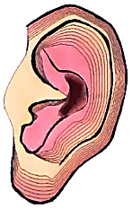
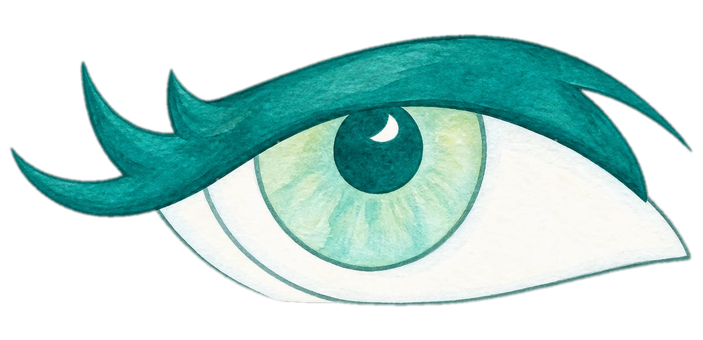
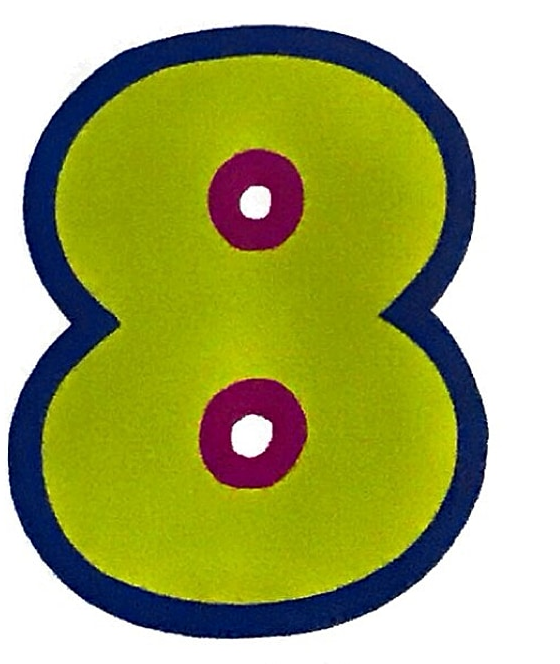
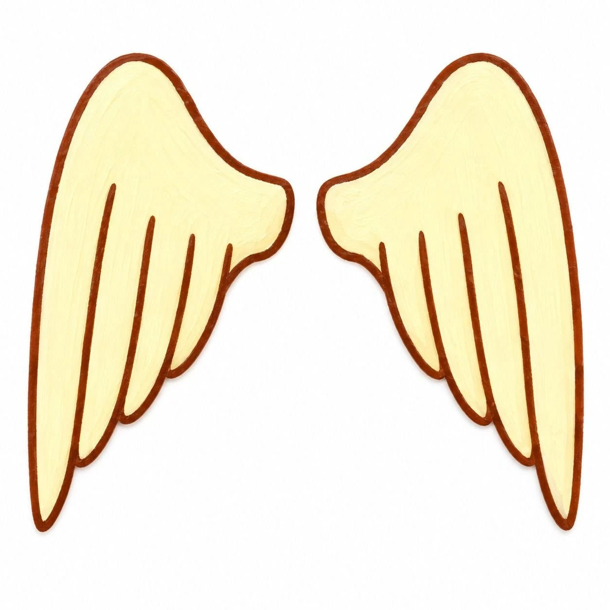
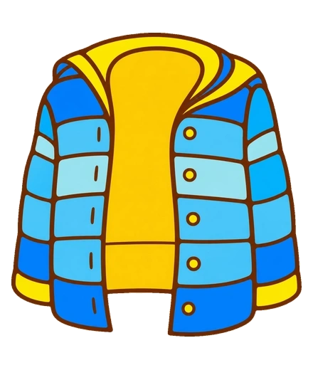
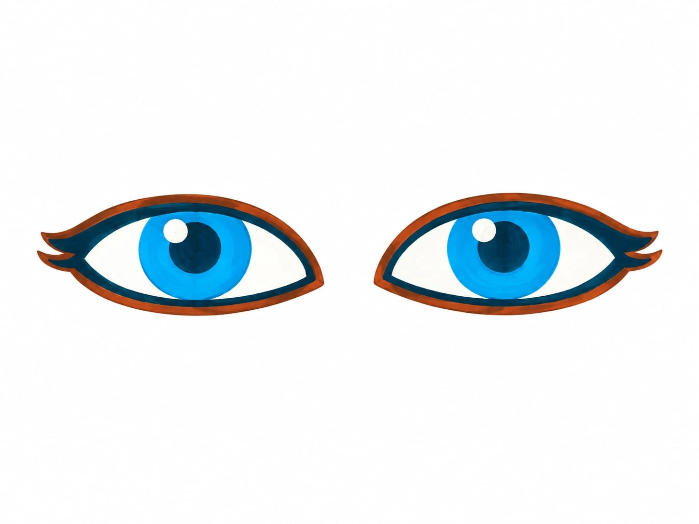

# Exact missing / unresolved artwork — Workbook + Teacher Flip Chart (corrected 2026-11-26)

Source of truth: [#877](https://github.com/ejnburrows-rgb/cartilla-de-gretel/issues/877). Built on `main` `5e1c8378`, starting from the inventory in open PR [#1321](https://github.com/ejnburrows-rgb/cartilla-de-gretel/pull/1321). I checked each Workbook row against `src/data/page-layouts.json` and the original page scans. **Source and file review only. Nothing was checked on screen.** Pages 86–87 do not exist and are left out on purpose.

**Corrections to #1321 in this file:**
1. Seven rows that #1321 marked “not wired” are actually on the page: p.3 ocho/araña, p.4 uña, p.7 abeja/alas/avión, p.11 abrigo. Their placement is filled in below.
2. **p.16 pez/traje/arco are not missing.** They are already on p.16 as avión/uniforme/uña. #1321’s action “add them to page 16” would have put duplicate or wrong pictures on the page. Do not do it.
3. **p.4 igual/invierno/arco and p.13 espejo are not on those printed pages.** Pages 4 and 13 each have 16 pictures, and all 16 are already placed. These are file-quality flags on shared picture files. #1321’s action “place it in page-layouts.json” would have added wrong pictures. Do not do it.
4. **p.7 eyes:** the page shows `approved/lesson-3/ojo.png` (one eye), not `ojos.png` as the audit says.
5. **p.7 airplane:** the screen shows the motion file `avion-alive.svg`. Changing only the still image would not change what children see.

**Required size rule** (IMAGE-QUALITY-REVIEW-QUEUE.csv / ART flags): an image needs at least **2× its on-screen width**. Transparent PNG or WebP is preferred for cut-outs. Opaque files must have a pure white background that matches the page. The exact on-screen width still has to be measured in a browser.

## A1. Real Workbook placements that need work (13)

| ID | Page | Word | Current image path | Measured px | Transparent | Placement (verified against `src/data/page-layouts.json` on main `5e1c8378`) | Problem | Approval status | Required size | Owner must supply? | Exact next action |
|---|---|---|---|---|---|---|---|---|---|---|---|
| WB-001-06 | 1 | avión | [/cartilla/art/optimized/workbook/leccion-1/avion.svg](https://github.com/ejnburrows-rgb/cartilla-de-gretel/blob/main/public/cartilla/art/optimized/workbook/leccion-1/avion.svg) | SVG (vector) | vector | 0.240, 0.347, 0.201, 0.137 | ART-FLAG-23 (below-target-resolution): Small source cropBox 3x5 flagged by art audit | WAITING: below the 2× size target | ≥2× rendered width | Yes, only if the recrop fails | Re-crop at higher resolution from `source/workbook/page-001.jpg`. If the scan itself is too small for a clean picture, ask the owner for an HD original of “avión”. Candidate already on the review board: `/cartilla/art/faithful/vocal-a/avion.webp`. |
| WB-001-09 | 1 | escalera | [/cartilla/art/optimized/workbook/leccion-1/escalera.svg](https://github.com/ejnburrows-rgb/cartilla-de-gretel/blob/main/public/cartilla/art/optimized/workbook/leccion-1/escalera.svg) | SVG (vector) | vector | 0.036, 0.489, 0.196, 0.135 | ART-FLAG-08 (edge-touching): Crop/canonical aspect drift 50% near crop boundary | WAITING: picture touches its crop edge | Same image with padding, ≥2× rendered width | No | Re-crop `/cartilla/art/optimized/workbook/leccion-1/escalera.svg` from `source/workbook/page-001.jpg` with padding so nothing is cut off. Candidate already on the review board: `/cartilla/art/faithful/vocal-e/escalera.webp`. |
| WB-001-10 | 1 | uno | [/cartilla/art/optimized/workbook/leccion-1/uno.svg](https://github.com/ejnburrows-rgb/cartilla-de-gretel/blob/main/public/cartilla/art/optimized/workbook/leccion-1/uno.svg) | SVG (vector) | vector | 0.240, 0.489, 0.201, 0.135 | ART-FLAG-22 (below-target-resolution): Small source cropBox 18x27 flagged by art audit | WAITING: below the 2× size target | ≥2× rendered width | Yes, only if the recrop fails | Re-crop at higher resolution from `source/workbook/page-001.jpg`. If the scan itself is too small for a clean picture, ask the owner for an HD original of “uno”. Candidate already on the review board: `/cartilla/art/faithful/vocal-u/uno.webp`. |
| WB-001-12 | 1 | oreja | [/cartilla/art/optimized/workbook/leccion-1/oreja.svg](https://github.com/ejnburrows-rgb/cartilla-de-gretel/blob/main/public/cartilla/art/optimized/workbook/leccion-1/oreja.svg) | SVG (vector) | vector | 0.653, 0.489, 0.201, 0.135 | ART-FLAG-21 (below-target-resolution): Small source cropBox 11x12 flagged by art audit | WAITING: below the 2× size target | ≥2× rendered width | Yes, only if the recrop fails | Re-crop at higher resolution from `source/workbook/page-001.jpg`. If the scan itself is too small for a clean picture, ask the owner for an HD original of “oreja”. Candidate already on the review board: `/cartilla/art/faithful/vocal-o/oreja.webp`. |
| WB-001-17 | 1 | ojos | [/cartilla/art/optimized/workbook/leccion-1/ojos.png](https://github.com/ejnburrows-rgb/cartilla-de-gretel/blob/main/public/cartilla/art/optimized/workbook/leccion-1/ojos.png) | 1024×1024 | yes | 0.036, 0.771, 0.196, 0.136 | ART-FLAG-02 (edge-touching): Visible content touches canonical crop edge; source recrop check | WAITING: picture touches its crop edge | Same image with padding, ≥2× rendered width | No | Re-crop `/cartilla/art/optimized/workbook/leccion-1/ojos.png` from `source/workbook/page-001.jpg` with padding so nothing is cut off. Candidate already on the review board: `/cartilla/art/faithful/leccion-1/ojos.webp`. |
| WB-003-01 | 3 | ocho | [/cartilla/art/faithful/vocal-o/ocho.webp](https://github.com/ejnburrows-rgb/cartilla-de-gretel/blob/main/public/cartilla/art/faithful/vocal-o/ocho.webp) | 727×870 | yes | p.3 `p3-pairs` picture 1 of 5 (wired) | ART-FLAG-20 (below-target-resolution): Small source cropBox 4x8 flagged by art audit | WAITING: below the 2× size target | ≥2× rendered width | Yes, only if the recrop fails | Re-crop at higher resolution from `source/workbook/page-003.jpg`. If the scan itself is too small for a clean picture, ask the owner for an HD original of “ocho”. |
| WB-003-02 | 3 | araña | [/cartilla/art/faithful/vocal-a/arana.webp](https://github.com/ejnburrows-rgb/cartilla-de-gretel/blob/main/public/cartilla/art/faithful/vocal-a/arana.webp) | 810×870 | yes | p.3 `p3-pairs` picture 2 of 5 (wired) | ART-FLAG-19 (below-target-resolution): Small source cropBox 105x9 flagged by art audit | WAITING: below the 2× size target | ≥2× rendered width | Yes, only if the recrop fails | Re-crop at higher resolution from `source/workbook/page-003.jpg`. If the scan itself is too small for a clean picture, ask the owner for an HD original of “araña”. |
| WB-004-05 | 4 | uña | [/cartilla/art/faithful/leccion-1/arco.webp](https://github.com/ejnburrows-rgb/cartilla-de-gretel/blob/main/public/cartilla/art/faithful/leccion-1/arco.webp) | 530×578 | yes | p.4 `p4-grid` 4×4, cell 5 (row 2, col 1) (wired) | ART-FLAG-26 (below-target-resolution): 530x578 canonical crop (max 265px at 2x DPR) — NOTE: `leccion-1/arco.webp` is the fingernail (uña) drawing; the file name is misleading, the picture is the right one. | WAITING: below the 2× size target | (max 265px at 2x DPR) | Yes, only if the recrop fails | Re-crop at higher resolution from `source/workbook/page-004.jpg`. If the scan itself is too small for a clean picture, ask the owner for an HD original of “uña”. |
| WB-007-06 | 7 | abeja | [/cartilla/art/approved/lesson-3/abeja.jpg](https://github.com/ejnburrows-rgb/cartilla-de-gretel/blob/main/public/cartilla/art/approved/lesson-3/abeja.jpg) | 1254×1254 | no (opaque) | p.7 `p7-grid` 4×4, cell 6 (row 2, col 2) (wired) | ART-FLAG-01 (edge-touching): Visible content touches canonical crop edge; source recrop check | WAITING: picture touches its crop edge | Same image with padding, ≥2× rendered width | No | Re-crop `/cartilla/art/approved/lesson-3/abeja.jpg` from `source/workbook/page-007.jpg` with padding so nothing is cut off. Candidate already on the review board: `/cartilla/art/faithful/vocal-a/abeja.webp`. |
| WB-007-10 | 7 | alas | [/cartilla/art/faithful/vocal-a/alas.webp](https://github.com/ejnburrows-rgb/cartilla-de-gretel/blob/main/public/cartilla/art/faithful/vocal-a/alas.webp) | 870×636 | yes | p.7 `p7-grid` 4×4, cell 10 (row 3, col 2) (wired) | ART-FLAG-18 (below-target-resolution): Small source cropBox 29x38 flagged by art audit | WAITING: below the 2× size target | ≥2× rendered width | Yes, only if the recrop fails | Re-crop at higher resolution from `source/workbook/page-007.jpg`. If the scan itself is too small for a clean picture, ask the owner for an HD original of “alas”. |
| WB-007-14 | 7 | avión | [/cartilla/art/faithful/vocal-a/avion.webp](https://github.com/ejnburrows-rgb/cartilla-de-gretel/blob/main/public/cartilla/art/faithful/vocal-a/avion.webp) | 834×870 | yes | p.7 `p7-grid` 4×4, cell 14 (row 4, col 2) (wired; on screen the motion file `vocal-a/avion-alive.svg` is shown) | ART-FLAG-15 (edge-touching): Page 7 airplane crop/source comparison flagged for owner review | SOURCE MISMATCH: different plane from the printed p.7 | ≥2× rendered width | Approve | Show `faithful/leccion-1/pez.webp` (the same fish-shaped plane drawing used on p.16 cell 3) beside the scan on `/revision#art`. If the owner approves it, change BOTH the still image and the motion file (`living-actor-registry.ts` line 188 maps `vocal-a/avion.webp` → `avion-alive.svg`), or the old plane will still be what children see. |
| WB-007-17 | 7 | ojos | [/cartilla/art/approved/lesson-3/ojo.png](https://github.com/ejnburrows-rgb/cartilla-de-gretel/blob/main/public/cartilla/art/approved/lesson-3/ojo.png) | 1254×608 | no (opaque PNG, white background) | p.7 `p7-grid` 4×4, cell 13 (row 4, col 1) (wired as caption “ojo”) | ART-FLAG-16: printed p.7 shows TWO eyes; the wired picture shows ONE eye (owner replacement installed 2026-10-22, dc20ffb0). The audit row points at `optimized/workbook/leccion-1/ojos.png`, which is not on p.7. | SOURCE MISMATCH — folder name “approved” is not proof this placement was approved (WORKBOOK-ARTWORK-COVERAGE.md) | Two-eye picture, ≥2× rendered width, transparent | Approve (or supply a two-eye picture) | Show three options side by side on `/revision#art`: current one-eye `ojo.png`, the two-eye `faithful/leccion-1/ojos.webp` (1354×754, opaque; already used on p.4 cell 16), and a new crop from `page-007.jpg`. Do not replace `ojo.png` without the owner’s yes. |
| WB-011-08 | 11 | abrigo | [/cartilla/art/faithful/leccion-1/abrigo.webp](https://github.com/ejnburrows-rgb/cartilla-de-gretel/blob/main/public/cartilla/art/faithful/leccion-1/abrigo.webp) | 440×520 | yes | p.11 `p11-match` picture 8 of 8 (wired) | ART-FLAG-24 (below-target-resolution): 440x520 canonical crop (max 220px at 2x DPR) | WAITING: below the 2× size target | (max 220px at 2x DPR) | Yes, only if the recrop fails | Re-crop at higher resolution from `source/workbook/page-011.jpg`. If the scan itself is too small for a clean picture, ask the owner for an HD original of “abrigo”. |

### Visual comparison (current picture vs printed page)
- **WB-001-06 · p.1 · avión**: current  · printed page [page-001.jpg](https://github.com/ejnburrows-rgb/cartilla-de-gretel/blob/main/public/cartilla/art/source/workbook/page-001.jpg)
- **WB-001-09 · p.1 · escalera**: current  · printed page [page-001.jpg](https://github.com/ejnburrows-rgb/cartilla-de-gretel/blob/main/public/cartilla/art/source/workbook/page-001.jpg)
- **WB-001-10 · p.1 · uno**: current  · printed page [page-001.jpg](https://github.com/ejnburrows-rgb/cartilla-de-gretel/blob/main/public/cartilla/art/source/workbook/page-001.jpg)
- **WB-001-12 · p.1 · oreja**: current  · printed page [page-001.jpg](https://github.com/ejnburrows-rgb/cartilla-de-gretel/blob/main/public/cartilla/art/source/workbook/page-001.jpg)
- **WB-001-17 · p.1 · ojos**: current  · printed page [page-001.jpg](https://github.com/ejnburrows-rgb/cartilla-de-gretel/blob/main/public/cartilla/art/source/workbook/page-001.jpg)
- **WB-003-01 · p.3 · ocho**: current  · printed page [page-003.jpg](https://github.com/ejnburrows-rgb/cartilla-de-gretel/blob/main/public/cartilla/art/source/workbook/page-003.jpg)
- **WB-003-02 · p.3 · araña**: current  · printed page [page-003.jpg](https://github.com/ejnburrows-rgb/cartilla-de-gretel/blob/main/public/cartilla/art/source/workbook/page-003.jpg)
- **WB-004-05 · p.4 · uña**: current  · printed page [page-004.jpg](https://github.com/ejnburrows-rgb/cartilla-de-gretel/blob/main/public/cartilla/art/source/workbook/page-004.jpg)
- **WB-007-06 · p.7 · abeja**: current  · printed page [page-007.jpg](https://github.com/ejnburrows-rgb/cartilla-de-gretel/blob/main/public/cartilla/art/source/workbook/page-007.jpg)
- **WB-007-10 · p.7 · alas**: current  · printed page [page-007.jpg](https://github.com/ejnburrows-rgb/cartilla-de-gretel/blob/main/public/cartilla/art/source/workbook/page-007.jpg)
- **WB-007-14 · p.7 · avión**: current  · printed page [page-007.jpg](https://github.com/ejnburrows-rgb/cartilla-de-gretel/blob/main/public/cartilla/art/source/workbook/page-007.jpg)
- **WB-007-17 · p.7 · ojos**: current  · printed page [page-007.jpg](https://github.com/ejnburrows-rgb/cartilla-de-gretel/blob/main/public/cartilla/art/source/workbook/page-007.jpg)
- **WB-011-08 · p.11 · abrigo**: current  · printed page [page-011.jpg](https://github.com/ejnburrows-rgb/cartilla-de-gretel/blob/main/public/cartilla/art/source/workbook/page-011.jpg)
- **p.7 airplane candidate** (owner approval needed):  `faithful/leccion-1/pez.webp`
- **p.7 two-eye candidate** (owner approval needed):  `faithful/leccion-1/ojos.webp`

What I saw comparing the files to the scans (not on screen): the current p.7 `avion.webp` is a different airliner and has a stray arc above it. `pez.webp` is the printed fish-shaped plane, but drawn at a diagonal, while the printed p.7 plane is level. `ojo.png` shows one eye, while the printed page shows two. `abeja.jpg` is an opaque square whose drawing runs close to its edges.

## A2. Shared picture files with quality flags; NOT missing page placements (12)

| ID | Page | Word | Current image path | Measured px | Transparent | Placement (verified against `src/data/page-layouts.json` on main `5e1c8378`) | Problem | Approval status | Required size | Owner must supply? | Exact next action |
|---|---|---|---|---|---|---|---|---|---|---|---|
| WB-004-17 | 4 | igual | [/cartilla/art/faithful/vocal-i/igual.webp](https://github.com/ejnburrows-rgb/cartilla-de-gretel/blob/main/public/cartilla/art/faithful/vocal-i/igual.webp) | 106×61 | no (opaque) | NONE — not on the printed page (p.4 has 16 pictures, all already placed; this is audit row 17, past the 16th cell) | ART-FLAG-03 (edge-touching): Visible content touches canonical crop edge; source recrop check — Not yet wired in page-layouts.json. | File-quality issue only (shared picture used by lesson activities/vocabulary) | Same image with padding, ≥2× rendered width | No | Do NOT add this picture to page 4. Recrop the shared file with padding (ART flag) from the scan where it really appears, keep the same file name, and show it on `/revision#art`. |
| WB-004-18 | 4 | invierno | [/cartilla/art/faithful/vocal-i/invierno.webp](https://github.com/ejnburrows-rgb/cartilla-de-gretel/blob/main/public/cartilla/art/faithful/vocal-i/invierno.webp) | 188×181 | no (opaque) | NONE — not on the printed page (p.4 has 16 pictures, all already placed; this is audit row 18, past the 16th cell) | ART-FLAG-04 (edge-touching): Visible content touches canonical crop edge; source recrop check — Not yet wired in page-layouts.json. | File-quality issue only (shared picture used by lesson activities/vocabulary) | Same image with padding, ≥2× rendered width | No | Do NOT add this picture to page 4. Recrop the shared file with padding (ART flag) from the scan where it really appears, keep the same file name, and show it on `/revision#art`. |
| WB-004-19 | 4 | arco | [/cartilla/art/faithful/leccion-1/arco.webp](https://github.com/ejnburrows-rgb/cartilla-de-gretel/blob/main/public/cartilla/art/faithful/leccion-1/arco.webp) | 530×578 | yes | NONE — not on the printed page (p.4 has 16 pictures, all already placed; this is audit row 19, past the 16th cell) | ART-FLAG-26 (below-target-resolution): 530x578 canonical crop (max 265px at 2x DPR) — Not yet wired in page-layouts.json. | File-quality issue only (shared picture used by lesson activities/vocabulary) | (max 265px at 2x DPR) | No | Do NOT add this picture to page 4. Recrop the shared file with padding (ART flag) from the scan where it really appears, keep the same file name, and show it on `/revision#art`. |
| WB-013-17 | 13 | espejo | [/cartilla/art/faithful/vocal-e/espejo.webp](https://github.com/ejnburrows-rgb/cartilla-de-gretel/blob/main/public/cartilla/art/faithful/vocal-e/espejo.webp) | 870×823 | yes | NONE — not on the printed page (p.13 has 16 pictures, all already placed; this is audit row 17, past the 16th cell) | ART-FLAG-09 (edge-touching): Crop/canonical aspect drift 56% near crop boundary — Not yet wired in page-layouts.json. | File-quality issue only (shared picture used by lesson activities/vocabulary) | Same image with padding, ≥2× rendered width | No | Do NOT add this picture to page 13. Recrop the shared file with padding (ART flag) from the scan where it really appears, keep the same file name, and show it on `/revision#art`. |
| WB-019-01 | 19 | mamá | [/cartilla/art/faithful/leccion-7-m/mama.webp](https://github.com/ejnburrows-rgb/cartilla-de-gretel/blob/main/public/cartilla/art/faithful/leccion-7-m/mama.webp) | 680×870 | yes | No native layout for p.19 yet (`page-layouts.json` lays out pp.1–17 only); file is used by lesson activities / vocabulary | ART-FLAG-10 (edge-touching): Crop/canonical aspect drift 46% near crop boundary — Not yet wired in page-layouts.json. | WAITING: picture touches its crop edge | Same image with padding, ≥2× rendered width | No | Recrop the shared file with padding from `source/workbook/page-019.jpg` (same file name). Do not create a new page layout just for this. |
| WB-023-01 | 23 | papá | [/cartilla/art/faithful/leccion-8-p/papa.webp](https://github.com/ejnburrows-rgb/cartilla-de-gretel/blob/main/public/cartilla/art/faithful/leccion-8-p/papa.webp) | 480×660 | no (opaque) | No native layout for p.23 yet (`page-layouts.json` lays out pp.1–17 only); file is used by lesson activities / vocabulary | ART-FLAG-05 (edge-touching): Visible content touches canonical crop edge; source recrop check — Not yet wired in page-layouts.json. | WAITING: picture touches its crop edge | Same image with padding, ≥2× rendered width | No | Recrop the shared file with padding from `source/workbook/page-023.jpg` (same file name). Do not create a new page layout just for this. |
| WB-047-01 | 47 | niño | [/cartilla/art/faithful/leccion-14-n/nino.webp](https://github.com/ejnburrows-rgb/cartilla-de-gretel/blob/main/public/cartilla/art/faithful/leccion-14-n/nino.webp) | 436×564 | yes | No native layout for p.47 yet (`page-layouts.json` lays out pp.1–17 only); file is used by lesson activities / vocabulary | ART-FLAG-06 (edge-touching): Visible content touches canonical crop edge; source recrop check — Not yet wired in page-layouts.json. | WAITING: picture touches its crop edge | Same image with padding, ≥2× rendered width | No | Recrop the shared file with padding from `source/workbook/page-047.jpg` (same file name). Do not create a new page layout just for this. |
| WB-063-01 | 63 | torre | [/cartilla/art/faithful/leccion-18-rr/torre.webp](https://github.com/ejnburrows-rgb/cartilla-de-gretel/blob/main/public/cartilla/art/faithful/leccion-18-rr/torre.webp) | 356×870 | yes | No native layout for p.63 yet (`page-layouts.json` lays out pp.1–17 only); file is used by lesson activities / vocabulary | ART-FLAG-11 (edge-touching): Crop/canonical aspect drift 72% near crop boundary — Not yet wired in page-layouts.json. | WAITING: picture touches its crop edge | Same image with padding, ≥2× rendered width | No | Recrop the shared file with padding from `source/workbook/page-063.jpg` (same file name). Do not create a new page layout just for this. |
| WB-063-02 | 63 | barril | [/cartilla/art/faithful/leccion-18-rr/barril.webp](https://github.com/ejnburrows-rgb/cartilla-de-gretel/blob/main/public/cartilla/art/faithful/leccion-18-rr/barril.webp) | 595×870 | yes | No native layout for p.63 yet (`page-layouts.json` lays out pp.1–17 only); file is used by lesson activities / vocabulary | ART-FLAG-12 (edge-touching): Crop/canonical aspect drift 53% near crop boundary — Not yet wired in page-layouts.json. | WAITING: picture touches its crop edge | Same image with padding, ≥2× rendered width | No | Recrop the shared file with padding from `source/workbook/page-063.jpg` (same file name). Do not create a new page layout just for this. |
| WB-067-01 | 67 | Catalina | [/cartilla/art/faithful/leccion-19-c/catalina.webp](https://github.com/ejnburrows-rgb/cartilla-de-gretel/blob/main/public/cartilla/art/faithful/leccion-19-c/catalina.webp) | 498×870 | yes | No native layout for p.67 yet (`page-layouts.json` lays out pp.1–17 only); file is used by lesson activities / vocabulary | ART-FLAG-14 (edge-touching): Crop/canonical aspect drift 48% near crop boundary — Not yet wired in page-layouts.json. | WAITING: picture touches its crop edge | Same image with padding, ≥2× rendered width | No | Recrop the shared file with padding from `source/workbook/page-067.jpg` (same file name). Do not create a new page layout just for this. |
| WB-079-01 | 79 | yema | [/cartilla/art/faithful/leccion-22-y/yema.webp](https://github.com/ejnburrows-rgb/cartilla-de-gretel/blob/main/public/cartilla/art/faithful/leccion-22-y/yema.webp) | 870×349 | yes | No native layout for p.79 yet (`page-layouts.json` lays out pp.1–17 only); file is used by lesson activities / vocabulary | ART-FLAG-13 (edge-touching): Crop/canonical aspect drift 47% near crop boundary — Not yet wired in page-layouts.json. | WAITING: picture touches its crop edge | Same image with padding, ≥2× rendered width | No | Recrop the shared file with padding from `source/workbook/page-079.jpg` (same file name). Do not create a new page layout just for this. |
| WB-083-01 | 83 | zorro | [/cartilla/art/faithful/leccion-23-z/zorro.webp](https://github.com/ejnburrows-rgb/cartilla-de-gretel/blob/main/public/cartilla/art/faithful/leccion-23-z/zorro.webp) | 487×540 | yes | No native layout for p.83 yet (`page-layouts.json` lays out pp.1–17 only); file is used by lesson activities / vocabulary | ART-FLAG-07 (edge-touching): Visible content touches canonical crop edge; source recrop check — Not yet wired in page-layouts.json. | WAITING: picture touches its crop edge | Same image with padding, ≥2× rendered width | No | Recrop the shared file with padding from `source/workbook/page-083.jpg` (same file name). Do not create a new page layout just for this. |

## A3. Audit false positives, already placed (3)

| ID | Page | Word | Current image path | Measured px | Transparent | Placement (verified against `src/data/page-layouts.json` on main `5e1c8378`) | Problem | Approval status | Required size | Owner must supply? | Exact next action |
|---|---|---|---|---|---|---|---|---|---|---|---|
| WB-016-17 | 16 | pez | [/cartilla/art/faithful/leccion-1/pez.webp](https://github.com/ejnburrows-rgb/cartilla-de-gretel/blob/main/public/cartilla/art/faithful/leccion-1/pez.webp) | 764×650 | yes | ALREADY PLACED on p.16 as “avión (cell 3)” | False positive: the audit matched by file name (pez/traje/arco). The printed p.16 has no fish, suit or arch picture. | Nothing missing | Use the existing crop | No | No placement change. Do NOT add these as new pictures. Close the audit row (regenerate the audit so it reads captions, not file names). |
| WB-016-18 | 16 | traje | [/cartilla/art/faithful/leccion-1/traje.webp](https://github.com/ejnburrows-rgb/cartilla-de-gretel/blob/main/public/cartilla/art/faithful/leccion-1/traje.webp) | 735×870 | yes | ALREADY PLACED on p.16 as “uniforme (cells 7 and 14)” | False positive: the audit matched by file name (pez/traje/arco). The printed p.16 has no fish, suit or arch picture. | Nothing missing | Use the existing crop | No | No placement change. Do NOT add these as new pictures. Close the audit row (regenerate the audit so it reads captions, not file names). |
| WB-016-19 | 16 | arco | [/cartilla/art/faithful/leccion-1/arco.webp](https://github.com/ejnburrows-rgb/cartilla-de-gretel/blob/main/public/cartilla/art/faithful/leccion-1/arco.webp) | 530×578 | yes | ALREADY PLACED on p.16 as “uña (cell 4)” | False positive: the audit matched by file name (pez/traje/arco). The printed p.16 has no fish, suit or arch picture. | Nothing missing | Use the existing crop | No | No placement change. Do NOT add these as new pictures. Close the audit row (regenerate the audit so it reads captions, not file names). |

## B. Workbook/lesson art files with “PENDING NO VERIFIED SOURCE” (from `docs/production-art-classification-audit.json`)

The 4 Flip Chart full sheets (p035/p041/p047/p053) are **left out on purpose**. You approved them, and they were merged in #1247 (Nov 4). The audit file still lists them as pending only because it is out of date.

| Asset path | Measured px | Transparent | Status | Owner must supply? | Exact next action |
|---|---|---|---|---|---|
| [/cartilla/art/faithful/leccion-1/manzana.webp](https://github.com/ejnburrows-rgb/cartilla-de-gretel/blob/main/public/cartilla/art/faithful/leccion-1/manzana.webp) | 870×852 | yes | PENDING NO VERIFIED SOURCE | Confirm source | Find the original source page or owner file for this crop. If it matches, mark it PASS. If no original exists, put it in the owner Nov 19 artwork-folder request. |
| [/cartilla/art/faithful/leccion-1/pera.webp](https://github.com/ejnburrows-rgb/cartilla-de-gretel/blob/main/public/cartilla/art/faithful/leccion-1/pera.webp) | 870×669 | yes | PENDING NO VERIFIED SOURCE | Confirm source | Find the original source page or owner file for this crop. If it matches, mark it PASS. If no original exists, put it in the owner Nov 19 artwork-folder request. |
| [/cartilla/art/faithful/leccion-1/taza.webp](https://github.com/ejnburrows-rgb/cartilla-de-gretel/blob/main/public/cartilla/art/faithful/leccion-1/taza.webp) | 761×527 | yes | PENDING NO VERIFIED SOURCE | Confirm source | Find the original source page or owner file for this crop. If it matches, mark it PASS. If no original exists, put it in the owner Nov 19 artwork-folder request. |
| [/cartilla/art/faithful/leccion-19-c/casa.webp](https://github.com/ejnburrows-rgb/cartilla-de-gretel/blob/main/public/cartilla/art/faithful/leccion-19-c/casa.webp) | 870×855 | yes | PENDING NO VERIFIED SOURCE | Confirm source | Find the original source page or owner file for this crop. If it matches, mark it PASS. If no original exists, put it in the owner Nov 19 artwork-folder request. |
| [/cartilla/art/faithful/leccion-22-y/yate.webp](https://github.com/ejnburrows-rgb/cartilla-de-gretel/blob/main/public/cartilla/art/faithful/leccion-22-y/yate.webp) | 870×609 | yes | PENDING NO VERIFIED SOURCE | Confirm source | Find the original source page or owner file for this crop. If it matches, mark it PASS. If no original exists, put it in the owner Nov 19 artwork-folder request. |
| [/cartilla/art/faithful/leccion-23-z/zapato.webp](https://github.com/ejnburrows-rgb/cartilla-de-gretel/blob/main/public/cartilla/art/faithful/leccion-23-z/zapato.webp) | 870×790 | yes | PENDING NO VERIFIED SOURCE | Confirm source | Find the original source page or owner file for this crop. If it matches, mark it PASS. If no original exists, put it in the owner Nov 19 artwork-folder request. |
| [/cartilla/art/faithful/leccion-7-m/mono-blink.webp](https://github.com/ejnburrows-rgb/cartilla-de-gretel/blob/main/public/cartilla/art/faithful/leccion-7-m/mono-blink.webp) | file absent | — | PENDING NO VERIFIED SOURCE | No | The file is missing from `main` and nothing in the code uses it (blink frame). Delete the stale row from the audit file; do not ask the owner for it. |
| [/cartilla/art/faithful/leccion-9-s/sapo-blink.webp](https://github.com/ejnburrows-rgb/cartilla-de-gretel/blob/main/public/cartilla/art/faithful/leccion-9-s/sapo-blink.webp) | file absent | — | PENDING NO VERIFIED SOURCE | No | The file is missing from `main` and nothing in the code uses it (blink frame). Delete the stale row from the audit file; do not ask the owner for it. |
| [/cartilla/art/faithful/vocal-a/anillo.webp](https://github.com/ejnburrows-rgb/cartilla-de-gretel/blob/main/public/cartilla/art/faithful/vocal-a/anillo.webp) | 870×718 | yes | PENDING NO VERIFIED SOURCE | Confirm source | Find the original source page or owner file for this crop. If it matches, mark it PASS. If no original exists, put it in the owner Nov 19 artwork-folder request. |
| [/cartilla/art/faithful/vocal-a/ardilla.webp](https://github.com/ejnburrows-rgb/cartilla-de-gretel/blob/main/public/cartilla/art/faithful/vocal-a/ardilla.webp) | 870×751 | yes | PENDING NO VERIFIED SOURCE | Confirm source | Find the original source page or owner file for this crop. If it matches, mark it PASS. If no original exists, put it in the owner Nov 19 artwork-folder request. |
| [/cartilla/art/faithful/vocal-e/escuela.webp](https://github.com/ejnburrows-rgb/cartilla-de-gretel/blob/main/public/cartilla/art/faithful/vocal-e/escuela.webp) | 870×870 | yes | PENDING NO VERIFIED SOURCE | Confirm source | Find the original source page or owner file for this crop. If it matches, mark it PASS. If no original exists, put it in the owner Nov 19 artwork-folder request. |
| [/cartilla/art/faithful/vocal-i/iguana.webp](https://github.com/ejnburrows-rgb/cartilla-de-gretel/blob/main/public/cartilla/art/faithful/vocal-i/iguana.webp) | 870×751 | yes | PENDING NO VERIFIED SOURCE | Confirm source | Find the original source page or owner file for this crop. If it matches, mark it PASS. If no original exists, put it in the owner Nov 19 artwork-folder request. |

## C. Teacher Flip Chart — 112 native image layers with “PENDING NO VERIFIED SOURCE”

These files **exist and display**. They are not missing. What is missing is proof of where each one came from, so each needs your OK or the original file. Original sheet scans: `public/cartilla/art/hd/flipchart/page-NNN.jpg`. Sheet placement comes from `src/data/flipchart-art-placement.json`.

| Sheet | Asset path | Measured px | Transparent | Owner must supply? | Exact next action |
|---|---|---|---|---|---|
| 3 | [p003-scene.png](https://github.com/ejnburrows-rgb/cartilla-de-gretel/blob/main/public/cartilla/art/optimized/flipchart-native/p003-scene.png) | 539×539 | yes | Confirm source | Compare with `hd/flipchart/page-003.jpg`. If it is a faithful cut-out, record the source and mark it PASS. If not, ask the owner for the original layer. |
| 3 | [p003-avion.png](https://github.com/ejnburrows-rgb/cartilla-de-gretel/blob/main/public/cartilla/art/optimized/flipchart-native/p003-avion.png) | 320×320 | no (opaque) | Confirm source | Compare with `hd/flipchart/page-003.jpg`. If it is a faithful cut-out, record the source and mark it PASS. If not, ask the owner for the original layer. |
| 3 | [p003-escoba.png](https://github.com/ejnburrows-rgb/cartilla-de-gretel/blob/main/public/cartilla/art/optimized/flipchart-native/p003-escoba.png) | 320×320 | no (opaque) | Confirm source | Compare with `hd/flipchart/page-003.jpg`. If it is a faithful cut-out, record the source and mark it PASS. If not, ask the owner for the original layer. |
| 3 | [p003-iman.png](https://github.com/ejnburrows-rgb/cartilla-de-gretel/blob/main/public/cartilla/art/optimized/flipchart-native/p003-iman.png) | 320×320 | no (opaque) | Confirm source | Compare with `hd/flipchart/page-003.jpg`. If it is a faithful cut-out, record the source and mark it PASS. If not, ask the owner for the original layer. |
| 3 | [p003-olla.png](https://github.com/ejnburrows-rgb/cartilla-de-gretel/blob/main/public/cartilla/art/optimized/flipchart-native/p003-olla.png) | 320×320 | no (opaque) | Confirm source | Compare with `hd/flipchart/page-003.jpg`. If it is a faithful cut-out, record the source and mark it PASS. If not, ask the owner for the original layer. |
| 3 | [p003-una.png](https://github.com/ejnburrows-rgb/cartilla-de-gretel/blob/main/public/cartilla/art/optimized/flipchart-native/p003-una.png) | 320×320 | no (opaque) | Confirm source | Compare with `hd/flipchart/page-003.jpg`. If it is a faithful cut-out, record the source and mark it PASS. If not, ask the owner for the original layer. |
| 4 | [p004-scene.png](https://github.com/ejnburrows-rgb/cartilla-de-gretel/blob/main/public/cartilla/art/optimized/flipchart-native/p004-scene.png) | 560×560 | no (opaque) | Confirm source | Compare with `hd/flipchart/page-004.jpg`. If it is a faithful cut-out, record the source and mark it PASS. If not, ask the owner for the original layer. |
| 4 | [p004-olla.png](https://github.com/ejnburrows-rgb/cartilla-de-gretel/blob/main/public/cartilla/art/optimized/flipchart-native/p004-olla.png) | 320×320 | no (opaque) | Confirm source | Compare with `hd/flipchart/page-004.jpg`. If it is a faithful cut-out, record the source and mark it PASS. If not, ask the owner for the original layer. |
| 4 | [p004-oto.png](https://github.com/ejnburrows-rgb/cartilla-de-gretel/blob/main/public/cartilla/art/optimized/flipchart-native/p004-oto.png) | 320×320 | yes | Confirm source | Compare with `hd/flipchart/page-004.jpg`. If it is a faithful cut-out, record the source and mark it PASS. If not, ask the owner for the original layer. |
| 4 | [p004-oveja.png](https://github.com/ejnburrows-rgb/cartilla-de-gretel/blob/main/public/cartilla/art/optimized/flipchart-native/p004-oveja.png) | 320×320 | no (opaque) | Confirm source | Compare with `hd/flipchart/page-004.jpg`. If it is a faithful cut-out, record the source and mark it PASS. If not, ask the owner for the original layer. |
| 4 | [p004-oso.png](https://github.com/ejnburrows-rgb/cartilla-de-gretel/blob/main/public/cartilla/art/optimized/flipchart-native/p004-oso.png) | 320×320 | no (opaque) | Confirm source | Compare with `hd/flipchart/page-004.jpg`. If it is a faithful cut-out, record the source and mark it PASS. If not, ask the owner for the original layer. |
| 4 | [p004-oreja.png](https://github.com/ejnburrows-rgb/cartilla-de-gretel/blob/main/public/cartilla/art/optimized/flipchart-native/p004-oreja.png) | 320×320 | no (opaque) | Confirm source | Compare with `hd/flipchart/page-004.jpg`. If it is a faithful cut-out, record the source and mark it PASS. If not, ask the owner for the original layer. |
| 4 | [p004-ocho.png](https://github.com/ejnburrows-rgb/cartilla-de-gretel/blob/main/public/cartilla/art/optimized/flipchart-native/p004-ocho.png) | 320×320 | no (opaque) | Confirm source | Compare with `hd/flipchart/page-004.jpg`. If it is a faithful cut-out, record the source and mark it PASS. If not, ask the owner for the original layer. |
| 5 | [p005-scene.png](https://github.com/ejnburrows-rgb/cartilla-de-gretel/blob/main/public/cartilla/art/optimized/flipchart-native/p005-scene.png) | 556×556 | no (opaque) | Confirm source | Compare with `hd/flipchart/page-005.jpg`. If it is a faithful cut-out, record the source and mark it PASS. If not, ask the owner for the original layer. |
| 5 | [p005-abanico.png](https://github.com/ejnburrows-rgb/cartilla-de-gretel/blob/main/public/cartilla/art/optimized/flipchart-native/p005-abanico.png) | 320×320 | no (opaque) | Confirm source | Compare with `hd/flipchart/page-005.jpg`. If it is a faithful cut-out, record the source and mark it PASS. If not, ask the owner for the original layer. |
| 5 | [p005-anillo.png](https://github.com/ejnburrows-rgb/cartilla-de-gretel/blob/main/public/cartilla/art/optimized/flipchart-native/p005-anillo.png) | 320×320 | no (opaque) | Confirm source | Compare with `hd/flipchart/page-005.jpg`. If it is a faithful cut-out, record the source and mark it PASS. If not, ask the owner for the original layer. |
| 5 | [p005-arana.png](https://github.com/ejnburrows-rgb/cartilla-de-gretel/blob/main/public/cartilla/art/optimized/flipchart-native/p005-arana.png) | 320×320 | no (opaque) | Confirm source | Compare with `hd/flipchart/page-005.jpg`. If it is a faithful cut-out, record the source and mark it PASS. If not, ask the owner for the original layer. |
| 5 | [p005-ala.png](https://github.com/ejnburrows-rgb/cartilla-de-gretel/blob/main/public/cartilla/art/optimized/flipchart-native/p005-ala.png) | 320×320 | no (opaque) | Confirm source | Compare with `hd/flipchart/page-005.jpg`. If it is a faithful cut-out, record the source and mark it PASS. If not, ask the owner for the original layer. |
| 5 | [p005-aro.png](https://github.com/ejnburrows-rgb/cartilla-de-gretel/blob/main/public/cartilla/art/optimized/flipchart-native/p005-aro.png) | 320×320 | no (opaque) | Confirm source | Compare with `hd/flipchart/page-005.jpg`. If it is a faithful cut-out, record the source and mark it PASS. If not, ask the owner for the original layer. |
| 6 | [p006-scene.png](https://github.com/ejnburrows-rgb/cartilla-de-gretel/blob/main/public/cartilla/art/optimized/flipchart-native/p006-scene.png) | 950×1250 | yes | Confirm source | Compare with `hd/flipchart/page-006.jpg`. If it is a faithful cut-out, record the source and mark it PASS. If not, ask the owner for the original layer. |
| 6 | [p006-elefante.png](https://github.com/ejnburrows-rgb/cartilla-de-gretel/blob/main/public/cartilla/art/optimized/flipchart-native/p006-elefante.png) | 570×540 | yes | Confirm source | Compare with `hd/flipchart/page-006.jpg`. If it is a faithful cut-out, record the source and mark it PASS. If not, ask the owner for the original layer. |
| 6 | [p006-espejo.png](https://github.com/ejnburrows-rgb/cartilla-de-gretel/blob/main/public/cartilla/art/optimized/flipchart-native/p006-espejo.png) | 520×540 | yes | Confirm source | Compare with `hd/flipchart/page-006.jpg`. If it is a faithful cut-out, record the source and mark it PASS. If not, ask the owner for the original layer. |
| 6 | [p006-ema.png](https://github.com/ejnburrows-rgb/cartilla-de-gretel/blob/main/public/cartilla/art/optimized/flipchart-native/p006-ema.png) | 500×540 | yes | Confirm source | Compare with `hd/flipchart/page-006.jpg`. If it is a faithful cut-out, record the source and mark it PASS. If not, ask the owner for the original layer. |
| 6 | [p006-estrella.png](https://github.com/ejnburrows-rgb/cartilla-de-gretel/blob/main/public/cartilla/art/optimized/flipchart-native/p006-estrella.png) | 600×650 | yes | Confirm source | Compare with `hd/flipchart/page-006.jpg`. If it is a faithful cut-out, record the source and mark it PASS. If not, ask the owner for the original layer. |
| 6 | [p006-erizo.png](https://github.com/ejnburrows-rgb/cartilla-de-gretel/blob/main/public/cartilla/art/optimized/flipchart-native/p006-erizo.png) | 520×650 | yes | Confirm source | Compare with `hd/flipchart/page-006.jpg`. If it is a faithful cut-out, record the source and mark it PASS. If not, ask the owner for the original layer. |
| 6 | [p006-escalera.png](https://github.com/ejnburrows-rgb/cartilla-de-gretel/blob/main/public/cartilla/art/optimized/flipchart-native/p006-escalera.png) | 550×650 | yes | Confirm source | Compare with `hd/flipchart/page-006.jpg`. If it is a faithful cut-out, record the source and mark it PASS. If not, ask the owner for the original layer. |
| 7 | [p007-scene.png](https://github.com/ejnburrows-rgb/cartilla-de-gretel/blob/main/public/cartilla/art/optimized/flipchart-native/p007-scene.png) | 560×560 | no (opaque) | Confirm source | Compare with `hd/flipchart/page-007.jpg`. If it is a faithful cut-out, record the source and mark it PASS. If not, ask the owner for the original layer. |
| 7 | [p007-iman.png](https://github.com/ejnburrows-rgb/cartilla-de-gretel/blob/main/public/cartilla/art/optimized/flipchart-native/p007-iman.png) | 320×320 | no (opaque) | Confirm source | Compare with `hd/flipchart/page-007.jpg`. If it is a faithful cut-out, record the source and mark it PASS. If not, ask the owner for the original layer. |
| 7 | [p007-iglu.png](https://github.com/ejnburrows-rgb/cartilla-de-gretel/blob/main/public/cartilla/art/optimized/flipchart-native/p007-iglu.png) | 640×640 | no (opaque) | Confirm source | Compare with `hd/flipchart/page-007.jpg`. If it is a faithful cut-out, record the source and mark it PASS. If not, ask the owner for the original layer. |
| 7 | [p007-insecto.png](https://github.com/ejnburrows-rgb/cartilla-de-gretel/blob/main/public/cartilla/art/optimized/flipchart-native/p007-insecto.png) | 320×320 | no (opaque) | Confirm source | Compare with `hd/flipchart/page-007.jpg`. If it is a faithful cut-out, record the source and mark it PASS. If not, ask the owner for the original layer. |
| 7 | [p007-isla.png](https://github.com/ejnburrows-rgb/cartilla-de-gretel/blob/main/public/cartilla/art/optimized/flipchart-native/p007-isla.png) | 320×320 | no (opaque) | Confirm source | Compare with `hd/flipchart/page-007.jpg`. If it is a faithful cut-out, record the source and mark it PASS. If not, ask the owner for the original layer. |
| 8 | [p008-scene.png](https://github.com/ejnburrows-rgb/cartilla-de-gretel/blob/main/public/cartilla/art/optimized/flipchart-native/p008-scene.png) | 480×480 | no (opaque) | Confirm source | Compare with `hd/flipchart/page-008.jpg`. If it is a faithful cut-out, record the source and mark it PASS. If not, ask the owner for the original layer. |
| 8 | [p008-uno.png](https://github.com/ejnburrows-rgb/cartilla-de-gretel/blob/main/public/cartilla/art/optimized/flipchart-native/p008-uno.png) | 320×320 | no (opaque) | Confirm source | Compare with `hd/flipchart/page-008.jpg`. If it is a faithful cut-out, record the source and mark it PASS. If not, ask the owner for the original layer. |
| 8 | [p008-uva.png](https://github.com/ejnburrows-rgb/cartilla-de-gretel/blob/main/public/cartilla/art/optimized/flipchart-native/p008-uva.png) | 320×320 | yes | Confirm source | Compare with `hd/flipchart/page-008.jpg`. If it is a faithful cut-out, record the source and mark it PASS. If not, ask the owner for the original layer. |
| 8 | [p008-urraca.png](https://github.com/ejnburrows-rgb/cartilla-de-gretel/blob/main/public/cartilla/art/optimized/flipchart-native/p008-urraca.png) | 320×320 | no (opaque) | Confirm source | Compare with `hd/flipchart/page-008.jpg`. If it is a faithful cut-out, record the source and mark it PASS. If not, ask the owner for the original layer. |
| 8 | [p008-unicornio.png](https://github.com/ejnburrows-rgb/cartilla-de-gretel/blob/main/public/cartilla/art/optimized/flipchart-native/p008-unicornio.png) | 320×320 | no (opaque) | Confirm source | Compare with `hd/flipchart/page-008.jpg`. If it is a faithful cut-out, record the source and mark it PASS. If not, ask the owner for the original layer. |
| 8 | [p008-uniforme.png](https://github.com/ejnburrows-rgb/cartilla-de-gretel/blob/main/public/cartilla/art/optimized/flipchart-native/p008-uniforme.png) | 320×320 | yes | Confirm source | Compare with `hd/flipchart/page-008.jpg`. If it is a faithful cut-out, record the source and mark it PASS. If not, ask the owner for the original layer. |
| 8 | [p008-ulises.png](https://github.com/ejnburrows-rgb/cartilla-de-gretel/blob/main/public/cartilla/art/optimized/flipchart-native/p008-ulises.png) | 320×320 | no (opaque) | Confirm source | Compare with `hd/flipchart/page-008.jpg`. If it is a faithful cut-out, record the source and mark it PASS. If not, ask the owner for the original layer. |
| 9 | [p009-scene.png](https://github.com/ejnburrows-rgb/cartilla-de-gretel/blob/main/public/cartilla/art/optimized/flipchart-native/p009-scene.png) | 530×530 | no (opaque) | Confirm source | Compare with `hd/flipchart/page-009.jpg`. If it is a faithful cut-out, record the source and mark it PASS. If not, ask the owner for the original layer. |
| 9 | [p009-mama.png](https://github.com/ejnburrows-rgb/cartilla-de-gretel/blob/main/public/cartilla/art/optimized/flipchart-native/p009-mama.png) | 344×344 | no (opaque) | Confirm source | Compare with `hd/flipchart/page-009.jpg`. If it is a faithful cut-out, record the source and mark it PASS. If not, ask the owner for the original layer. |
| 12 | [p012-scene.png](https://github.com/ejnburrows-rgb/cartilla-de-gretel/blob/main/public/cartilla/art/optimized/flipchart-native/p012-scene.png) | 560×560 | no (opaque) | Confirm source | Compare with `hd/flipchart/page-012.jpg`. If it is a faithful cut-out, record the source and mark it PASS. If not, ask the owner for the original layer. |
| 12 | [p012-papa.png](https://github.com/ejnburrows-rgb/cartilla-de-gretel/blob/main/public/cartilla/art/optimized/flipchart-native/p012-papa.png) | 320×320 | no (opaque) | Confirm source | Compare with `hd/flipchart/page-012.jpg`. If it is a faithful cut-out, record the source and mark it PASS. If not, ask the owner for the original layer. |
| 12 | [p012-pie.png](https://github.com/ejnburrows-rgb/cartilla-de-gretel/blob/main/public/cartilla/art/optimized/flipchart-native/p012-pie.png) | 320×320 | no (opaque) | Confirm source | Compare with `hd/flipchart/page-012.jpg`. If it is a faithful cut-out, record the source and mark it PASS. If not, ask the owner for the original layer. |
| 12 | [p012-pomo.png](https://github.com/ejnburrows-rgb/cartilla-de-gretel/blob/main/public/cartilla/art/optimized/flipchart-native/p012-pomo.png) | 320×320 | no (opaque) | Confirm source | Compare with `hd/flipchart/page-012.jpg`. If it is a faithful cut-out, record the source and mark it PASS. If not, ask the owner for the original layer. |
| 15 | [p015-scene.png](https://github.com/ejnburrows-rgb/cartilla-de-gretel/blob/main/public/cartilla/art/optimized/flipchart-native/p015-scene.png) | 560×560 | no (opaque) | Confirm source | Compare with `hd/flipchart/page-015.jpg`. If it is a faithful cut-out, record the source and mark it PASS. If not, ask the owner for the original layer. |
| 15 | [p015-sesi.png](https://github.com/ejnburrows-rgb/cartilla-de-gretel/blob/main/public/cartilla/art/optimized/flipchart-native/p015-sesi.png) | 342×342 | no (opaque) | Confirm source | Compare with `hd/flipchart/page-015.jpg`. If it is a faithful cut-out, record the source and mark it PASS. If not, ask the owner for the original layer. |
| 15 | [p015-sopa.png](https://github.com/ejnburrows-rgb/cartilla-de-gretel/blob/main/public/cartilla/art/optimized/flipchart-native/p015-sopa.png) | 320×320 | yes | Confirm source | Compare with `hd/flipchart/page-015.jpg`. If it is a faithful cut-out, record the source and mark it PASS. If not, ask the owner for the original layer. |
| 15 | [p015-sapo.png](https://github.com/ejnburrows-rgb/cartilla-de-gretel/blob/main/public/cartilla/art/optimized/flipchart-native/p015-sapo.png) | 320×320 | no (opaque) | Confirm source | Compare with `hd/flipchart/page-015.jpg`. If it is a faithful cut-out, record the source and mark it PASS. If not, ask the owner for the original layer. |
| 17 | [p017-scene.png](https://github.com/ejnburrows-rgb/cartilla-de-gretel/blob/main/public/cartilla/art/optimized/flipchart-native/p017-scene.png) | 645×645 | yes | Confirm source | Compare with `hd/flipchart/page-017.jpg`. If it is a faithful cut-out, record the source and mark it PASS. If not, ask the owner for the original layer. |
| 18 | [p018-scene.png](https://github.com/ejnburrows-rgb/cartilla-de-gretel/blob/main/public/cartilla/art/optimized/flipchart-native/p018-scene.png) | 558×558 | no (opaque) | Confirm source | Compare with `hd/flipchart/page-018.jpg`. If it is a faithful cut-out, record the source and mark it PASS. If not, ask the owner for the original layer. |
| 21 | [p021-scene.png](https://github.com/ejnburrows-rgb/cartilla-de-gretel/blob/main/public/cartilla/art/optimized/flipchart-native/p021-scene.png) | 559×559 | no (opaque) | Confirm source | Compare with `hd/flipchart/page-021.jpg`. If it is a faithful cut-out, record the source and mark it PASS. If not, ask the owner for the original layer. |
| 21 | [p021-didi.webp](https://github.com/ejnburrows-rgb/cartilla-de-gretel/blob/main/public/cartilla/art/optimized/flipchart-native/p021-didi.webp) | 1536×1360 | no (opaque) | Confirm source | Compare with `hd/flipchart/page-021.jpg`. If it is a faithful cut-out, record the source and mark it PASS. If not, ask the owner for the original layer. |
| 21 | [p021-dados.webp](https://github.com/ejnburrows-rgb/cartilla-de-gretel/blob/main/public/cartilla/art/optimized/flipchart-native/p021-dados.webp) | 1536×1440 | no (opaque) | Confirm source | Compare with `hd/flipchart/page-021.jpg`. If it is a faithful cut-out, record the source and mark it PASS. If not, ask the owner for the original layer. |
| 21 | [p021-dedo.webp](https://github.com/ejnburrows-rgb/cartilla-de-gretel/blob/main/public/cartilla/art/optimized/flipchart-native/p021-dedo.webp) | 1281×1536 | yes | Confirm source | Compare with `hd/flipchart/page-021.jpg`. If it is a faithful cut-out, record the source and mark it PASS. If not, ask the owner for the original layer. |
| 21 | [p021-doce.webp](https://github.com/ejnburrows-rgb/cartilla-de-gretel/blob/main/public/cartilla/art/optimized/flipchart-native/p021-doce.webp) | 1355×1536 | no (opaque) | Confirm source | Compare with `hd/flipchart/page-021.jpg`. If it is a faithful cut-out, record the source and mark it PASS. If not, ask the owner for the original layer. |
| 21 | [p021-dunia.webp](https://github.com/ejnburrows-rgb/cartilla-de-gretel/blob/main/public/cartilla/art/optimized/flipchart-native/p021-dunia.webp) | 1536×1324 | no (opaque) | Confirm source | Compare with `hd/flipchart/page-021.jpg`. If it is a faithful cut-out, record the source and mark it PASS. If not, ask the owner for the original layer. |
| 23 | [p023-scene.png](https://github.com/ejnburrows-rgb/cartilla-de-gretel/blob/main/public/cartilla/art/optimized/flipchart-native/p023-scene.png) | 621×621 | no (opaque) | Confirm source | Compare with `hd/flipchart/page-023.jpg`. If it is a faithful cut-out, record the source and mark it PASS. If not, ask the owner for the original layer. |
| 24 | [p024-scene.png](https://github.com/ejnburrows-rgb/cartilla-de-gretel/blob/main/public/cartilla/art/optimized/flipchart-native/p024-scene.png) | 549×549 | no (opaque) | Confirm source | Compare with `hd/flipchart/page-024.jpg`. If it is a faithful cut-out, record the source and mark it PASS. If not, ask the owner for the original layer. |
| 24 | [p024-lala.png](https://github.com/ejnburrows-rgb/cartilla-de-gretel/blob/main/public/cartilla/art/optimized/flipchart-native/p024-lala.png) | 550×495 | no (opaque) | Confirm source | Compare with `hd/flipchart/page-024.jpg`. If it is a faithful cut-out, record the source and mark it PASS. If not, ask the owner for the original layer. |
| 26 | [p026-scene.png](https://github.com/ejnburrows-rgb/cartilla-de-gretel/blob/main/public/cartilla/art/optimized/flipchart-native/p026-scene.png) | 1006×1457 | yes | Confirm source | Compare with `hd/flipchart/page-026.jpg`. If it is a faithful cut-out, record the source and mark it PASS. If not, ask the owner for the original layer. |
| 27 | [p027-scene.png](https://github.com/ejnburrows-rgb/cartilla-de-gretel/blob/main/public/cartilla/art/optimized/flipchart-native/p027-scene.png) | 560×560 | no (opaque) | Confirm source | Compare with `hd/flipchart/page-027.jpg`. If it is a faithful cut-out, record the source and mark it PASS. If not, ask the owner for the original layer. |
| 27 | [p027-nido.png](https://github.com/ejnburrows-rgb/cartilla-de-gretel/blob/main/public/cartilla/art/optimized/flipchart-native/p027-nido.png) | 320×320 | no (opaque) | Confirm source | Compare with `hd/flipchart/page-027.jpg`. If it is a faithful cut-out, record the source and mark it PASS. If not, ask the owner for the original layer. |
| 27 | [p027-nudo.png](https://github.com/ejnburrows-rgb/cartilla-de-gretel/blob/main/public/cartilla/art/optimized/flipchart-native/p027-nudo.png) | 320×320 | no (opaque) | Confirm source | Compare with `hd/flipchart/page-027.jpg`. If it is a faithful cut-out, record the source and mark it PASS. If not, ask the owner for the original layer. |
| 30 | [p030-scene.png](https://github.com/ejnburrows-rgb/cartilla-de-gretel/blob/main/public/cartilla/art/optimized/flipchart-native/p030-scene.png) | 545×545 | no (opaque) | Confirm source | Compare with `hd/flipchart/page-030.jpg`. If it is a faithful cut-out, record the source and mark it PASS. If not, ask the owner for the original layer. |
| 30 | [p030-mono.png](https://github.com/ejnburrows-rgb/cartilla-de-gretel/blob/main/public/cartilla/art/optimized/flipchart-native/p030-mono.png) | 320×320 | no (opaque) | Confirm source | Compare with `hd/flipchart/page-030.jpg`. If it is a faithful cut-out, record the source and mark it PASS. If not, ask the owner for the original layer. |
| 32 | [p032-scene.png](https://github.com/ejnburrows-rgb/cartilla-de-gretel/blob/main/public/cartilla/art/optimized/flipchart-native/p032-scene.png) | 1003×1389 | yes | Confirm source | Compare with `hd/flipchart/page-032.jpg`. If it is a faithful cut-out, record the source and mark it PASS. If not, ask the owner for the original layer. |
| 33 | [p033-scene.png](https://github.com/ejnburrows-rgb/cartilla-de-gretel/blob/main/public/cartilla/art/optimized/flipchart-native/p033-scene.png) | 549×549 | no (opaque) | Confirm source | Compare with `hd/flipchart/page-033.jpg`. If it is a faithful cut-out, record the source and mark it PASS. If not, ask the owner for the original layer. |
| 33 | [p033-beba.png](https://github.com/ejnburrows-rgb/cartilla-de-gretel/blob/main/public/cartilla/art/optimized/flipchart-native/p033-beba.png) | 320×320 | no (opaque) | Confirm source | Compare with `hd/flipchart/page-033.jpg`. If it is a faithful cut-out, record the source and mark it PASS. If not, ask the owner for the original layer. |
| 33 | [p033-bubi.png](https://github.com/ejnburrows-rgb/cartilla-de-gretel/blob/main/public/cartilla/art/optimized/flipchart-native/p033-bubi.png) | 320×320 | no (opaque) | Confirm source | Compare with `hd/flipchart/page-033.jpg`. If it is a faithful cut-out, record the source and mark it PASS. If not, ask the owner for the original layer. |
| 33 | [p033-bate.png](https://github.com/ejnburrows-rgb/cartilla-de-gretel/blob/main/public/cartilla/art/optimized/flipchart-native/p033-bate.png) | 320×320 | no (opaque) | Confirm source | Compare with `hd/flipchart/page-033.jpg`. If it is a faithful cut-out, record the source and mark it PASS. If not, ask the owner for the original layer. |
| 33 | [p033-bota.png](https://github.com/ejnburrows-rgb/cartilla-de-gretel/blob/main/public/cartilla/art/optimized/flipchart-native/p033-bota.png) | 320×320 | no (opaque) | Confirm source | Compare with `hd/flipchart/page-033.jpg`. If it is a faithful cut-out, record the source and mark it PASS. If not, ask the owner for the original layer. |
| 35 | [p035-scene.png](https://github.com/ejnburrows-rgb/cartilla-de-gretel/blob/main/public/cartilla/art/optimized/flipchart-native/p035-scene.png) | 666×666 | no (opaque) | Confirm source | Compare with `hd/flipchart/page-035.jpg`. If it is a faithful cut-out, record the source and mark it PASS. If not, ask the owner for the original layer. |
| 36 | [p036-scene.png](https://github.com/ejnburrows-rgb/cartilla-de-gretel/blob/main/public/cartilla/art/optimized/flipchart-native/p036-scene.png) | 526×526 | no (opaque) | Confirm source | Compare with `hd/flipchart/page-036.jpg`. If it is a faithful cut-out, record the source and mark it PASS. If not, ask the owner for the original layer. |
| 36 | [p036-vaso.png](https://github.com/ejnburrows-rgb/cartilla-de-gretel/blob/main/public/cartilla/art/optimized/flipchart-native/p036-vaso.png) | 320×320 | no (opaque) | Confirm source | Compare with `hd/flipchart/page-036.jpg`. If it is a faithful cut-out, record the source and mark it PASS. If not, ask the owner for the original layer. |
| 36 | [p036-vela.png](https://github.com/ejnburrows-rgb/cartilla-de-gretel/blob/main/public/cartilla/art/optimized/flipchart-native/p036-vela.png) | 320×320 | no (opaque) | Confirm source | Compare with `hd/flipchart/page-036.jpg`. If it is a faithful cut-out, record the source and mark it PASS. If not, ask the owner for the original layer. |
| 36 | [p036-vita.png](https://github.com/ejnburrows-rgb/cartilla-de-gretel/blob/main/public/cartilla/art/optimized/flipchart-native/p036-vita.png) | 320×320 | no (opaque) | Confirm source | Compare with `hd/flipchart/page-036.jpg`. If it is a faithful cut-out, record the source and mark it PASS. If not, ask the owner for the original layer. |
| 36 | [p036-vuli.png](https://github.com/ejnburrows-rgb/cartilla-de-gretel/blob/main/public/cartilla/art/optimized/flipchart-native/p036-vuli.png) | 330×330 | no (opaque) | Confirm source | Compare with `hd/flipchart/page-036.jpg`. If it is a faithful cut-out, record the source and mark it PASS. If not, ask the owner for the original layer. |
| 38 | [p038-scene.png](https://github.com/ejnburrows-rgb/cartilla-de-gretel/blob/main/public/cartilla/art/optimized/flipchart-native/p038-scene.png) | 1008×1458 | yes | Confirm source | Compare with `hd/flipchart/page-038.jpg`. If it is a faithful cut-out, record the source and mark it PASS. If not, ask the owner for the original layer. |
| 39 | [p039-scene.png](https://github.com/ejnburrows-rgb/cartilla-de-gretel/blob/main/public/cartilla/art/optimized/flipchart-native/p039-scene.png) | 519×519 | no (opaque) | Confirm source | Compare with `hd/flipchart/page-039.jpg`. If it is a faithful cut-out, record the source and mark it PASS. If not, ask the owner for the original layer. |
| 39 | [p039-rana.png](https://github.com/ejnburrows-rgb/cartilla-de-gretel/blob/main/public/cartilla/art/optimized/flipchart-native/p039-rana.png) | 320×320 | no (opaque) | Confirm source | Compare with `hd/flipchart/page-039.jpg`. If it is a faithful cut-out, record the source and mark it PASS. If not, ask the owner for the original layer. |
| 39 | [p039-remos.png](https://github.com/ejnburrows-rgb/cartilla-de-gretel/blob/main/public/cartilla/art/optimized/flipchart-native/p039-remos.png) | 320×320 | no (opaque) | Confirm source | Compare with `hd/flipchart/page-039.jpg`. If it is a faithful cut-out, record the source and mark it PASS. If not, ask the owner for the original layer. |
| 41 | [p041-scene.png](https://github.com/ejnburrows-rgb/cartilla-de-gretel/blob/main/public/cartilla/art/optimized/flipchart-native/p041-scene.png) | 586×586 | no (opaque) | Confirm source | Compare with `hd/flipchart/page-041.jpg`. If it is a faithful cut-out, record the source and mark it PASS. If not, ask the owner for the original layer. |
| 42 | [p042-scene.png](https://github.com/ejnburrows-rgb/cartilla-de-gretel/blob/main/public/cartilla/art/optimized/flipchart-native/p042-scene.png) | 529×529 | no (opaque) | Confirm source | Compare with `hd/flipchart/page-042.jpg`. If it is a faithful cut-out, record the source and mark it PASS. If not, ask the owner for the original layer. |
| 42 | [p042-burro.png](https://github.com/ejnburrows-rgb/cartilla-de-gretel/blob/main/public/cartilla/art/optimized/flipchart-native/p042-burro.png) | 320×320 | yes | Confirm source | Compare with `hd/flipchart/page-042.jpg`. If it is a faithful cut-out, record the source and mark it PASS. If not, ask the owner for the original layer. |
| 42 | [p042-carrusel.png](https://github.com/ejnburrows-rgb/cartilla-de-gretel/blob/main/public/cartilla/art/optimized/flipchart-native/p042-carrusel.png) | 320×320 | no (opaque) | Confirm source | Compare with `hd/flipchart/page-042.jpg`. If it is a faithful cut-out, record the source and mark it PASS. If not, ask the owner for the original layer. |
| 42 | [p042-torre.png](https://github.com/ejnburrows-rgb/cartilla-de-gretel/blob/main/public/cartilla/art/optimized/flipchart-native/p042-torre.png) | 320×320 | no (opaque) | Confirm source | Compare with `hd/flipchart/page-042.jpg`. If it is a faithful cut-out, record the source and mark it PASS. If not, ask the owner for the original layer. |
| 42 | [p042-barril.png](https://github.com/ejnburrows-rgb/cartilla-de-gretel/blob/main/public/cartilla/art/optimized/flipchart-native/p042-barril.png) | 320×320 | no (opaque) | Confirm source | Compare with `hd/flipchart/page-042.jpg`. If it is a faithful cut-out, record the source and mark it PASS. If not, ask the owner for the original layer. |
| 42 | [p042-tierra.png](https://github.com/ejnburrows-rgb/cartilla-de-gretel/blob/main/public/cartilla/art/optimized/flipchart-native/p042-tierra.png) | 320×320 | yes | Confirm source | Compare with `hd/flipchart/page-042.jpg`. If it is a faithful cut-out, record the source and mark it PASS. If not, ask the owner for the original layer. |
| 45 | [p045-scene.png](https://github.com/ejnburrows-rgb/cartilla-de-gretel/blob/main/public/cartilla/art/optimized/flipchart-native/p045-scene.png) | 557×557 | no (opaque) | Confirm source | Compare with `hd/flipchart/page-045.jpg`. If it is a faithful cut-out, record the source and mark it PASS. If not, ask the owner for the original layer. |
| 45 | [p045-gaveta.png](https://github.com/ejnburrows-rgb/cartilla-de-gretel/blob/main/public/cartilla/art/optimized/flipchart-native/p045-gaveta.png) | 321×321 | no (opaque) | Confirm source | Compare with `hd/flipchart/page-045.jpg`. If it is a faithful cut-out, record the source and mark it PASS. If not, ask the owner for the original layer. |
| 45 | [p045-gusano.png](https://github.com/ejnburrows-rgb/cartilla-de-gretel/blob/main/public/cartilla/art/optimized/flipchart-native/p045-gusano.png) | 333×333 | no (opaque) | Confirm source | Compare with `hd/flipchart/page-045.jpg`. If it is a faithful cut-out, record the source and mark it PASS. If not, ask the owner for the original layer. |
| 45 | [p045-gorra.png](https://github.com/ejnburrows-rgb/cartilla-de-gretel/blob/main/public/cartilla/art/optimized/flipchart-native/p045-gorra.png) | 320×320 | yes | Confirm source | Compare with `hd/flipchart/page-045.jpg`. If it is a faithful cut-out, record the source and mark it PASS. If not, ask the owner for the original layer. |
| 47 | [p047-scene.png](https://github.com/ejnburrows-rgb/cartilla-de-gretel/blob/main/public/cartilla/art/optimized/flipchart-native/p047-scene.png) | 667×667 | no (opaque) | Confirm source | Compare with `hd/flipchart/page-047.jpg`. If it is a faithful cut-out, record the source and mark it PASS. If not, ask the owner for the original layer. |
| 48 | [p048-foto.png](https://github.com/ejnburrows-rgb/cartilla-de-gretel/blob/main/public/cartilla/art/optimized/flipchart-native/p048-foto.png) | 320×320 | no (opaque) | Confirm source | Compare with `hd/flipchart/page-048.jpg`. If it is a faithful cut-out, record the source and mark it PASS. If not, ask the owner for the original layer. |
| 48 | [p048-fideos.png](https://github.com/ejnburrows-rgb/cartilla-de-gretel/blob/main/public/cartilla/art/optimized/flipchart-native/p048-fideos.png) | 325×325 | no (opaque) | Confirm source | Compare with `hd/flipchart/page-048.jpg`. If it is a faithful cut-out, record the source and mark it PASS. If not, ask the owner for the original layer. |
| 51 | [p051-scene.png](https://github.com/ejnburrows-rgb/cartilla-de-gretel/blob/main/public/cartilla/art/optimized/flipchart-native/p051-scene.png) | 537×537 | no (opaque) | Confirm source | Compare with `hd/flipchart/page-051.jpg`. If it is a faithful cut-out, record the source and mark it PASS. If not, ask the owner for the original layer. |
| 51 | [p051-jicotea.png](https://github.com/ejnburrows-rgb/cartilla-de-gretel/blob/main/public/cartilla/art/optimized/flipchart-native/p051-jicotea.png) | 322×322 | no (opaque) | Confirm source | Compare with `hd/flipchart/page-051.jpg`. If it is a faithful cut-out, record the source and mark it PASS. If not, ask the owner for the original layer. |
| 51 | [p051-jugo.png](https://github.com/ejnburrows-rgb/cartilla-de-gretel/blob/main/public/cartilla/art/optimized/flipchart-native/p051-jugo.png) | 320×320 | no (opaque) | Confirm source | Compare with `hd/flipchart/page-051.jpg`. If it is a faithful cut-out, record the source and mark it PASS. If not, ask the owner for the original layer. |
| 51 | [p051-ajo.png](https://github.com/ejnburrows-rgb/cartilla-de-gretel/blob/main/public/cartilla/art/optimized/flipchart-native/p051-ajo.png) | 320×320 | no (opaque) | Confirm source | Compare with `hd/flipchart/page-051.jpg`. If it is a faithful cut-out, record the source and mark it PASS. If not, ask the owner for the original layer. |
| 51 | [p051-jarra.png](https://github.com/ejnburrows-rgb/cartilla-de-gretel/blob/main/public/cartilla/art/optimized/flipchart-native/p051-jarra.png) | 320×320 | yes | Confirm source | Compare with `hd/flipchart/page-051.jpg`. If it is a faithful cut-out, record the source and mark it PASS. If not, ask the owner for the original layer. |
| 53 | [p053-scene.png](https://github.com/ejnburrows-rgb/cartilla-de-gretel/blob/main/public/cartilla/art/optimized/flipchart-native/p053-scene.png) | 671×671 | no (opaque) | Confirm source | Compare with `hd/flipchart/page-053.jpg`. If it is a faithful cut-out, record the source and mark it PASS. If not, ask the owner for the original layer. |
| 54 | [p054-cuna.png](https://github.com/ejnburrows-rgb/cartilla-de-gretel/blob/main/public/cartilla/art/optimized/flipchart-native/p054-cuna.png) | 320×320 | no (opaque) | Confirm source | Compare with `hd/flipchart/page-054.jpg`. If it is a faithful cut-out, record the source and mark it PASS. If not, ask the owner for the original layer. |
| 54 | [p054-cubo.png](https://github.com/ejnburrows-rgb/cartilla-de-gretel/blob/main/public/cartilla/art/optimized/flipchart-native/p054-cubo.png) | 320×320 | yes | Confirm source | Compare with `hd/flipchart/page-054.jpg`. If it is a faithful cut-out, record the source and mark it PASS. If not, ask the owner for the original layer. |
| 56 | [p056-caramelos.webp](https://github.com/ejnburrows-rgb/cartilla-de-gretel/blob/main/public/cartilla/art/optimized/flipchart-native/p056-caramelos.webp) | 1034×1536 | no (opaque) | Confirm source | Compare with `hd/flipchart/page-056.jpg`. If it is a faithful cut-out, record the source and mark it PASS. If not, ask the owner for the original layer. |
| 57 | [p057-scene.png](https://github.com/ejnburrows-rgb/cartilla-de-gretel/blob/main/public/cartilla/art/optimized/flipchart-native/p057-scene.png) | 560×560 | no (opaque) | Confirm source | Compare with `hd/flipchart/page-057.jpg`. If it is a faithful cut-out, record the source and mark it PASS. If not, ask the owner for the original layer. |
| 57 | [p057-yate.png](https://github.com/ejnburrows-rgb/cartilla-de-gretel/blob/main/public/cartilla/art/optimized/flipchart-native/p057-yate.png) | 338×338 | no (opaque) | Confirm source | Compare with `hd/flipchart/page-057.jpg`. If it is a faithful cut-out, record the source and mark it PASS. If not, ask the owner for the original layer. |
| 57 | [p057-yema.png](https://github.com/ejnburrows-rgb/cartilla-de-gretel/blob/main/public/cartilla/art/optimized/flipchart-native/p057-yema.png) | 333×333 | no (opaque) | Confirm source | Compare with `hd/flipchart/page-057.jpg`. If it is a faithful cut-out, record the source and mark it PASS. If not, ask the owner for the original layer. |
| 57 | [p057-yayita.png](https://github.com/ejnburrows-rgb/cartilla-de-gretel/blob/main/public/cartilla/art/optimized/flipchart-native/p057-yayita.png) | 320×320 | no (opaque) | Confirm source | Compare with `hd/flipchart/page-057.jpg`. If it is a faithful cut-out, record the source and mark it PASS. If not, ask the owner for the original layer. |
| 59 | [p059-scene.png](https://github.com/ejnburrows-rgb/cartilla-de-gretel/blob/main/public/cartilla/art/optimized/flipchart-native/p059-scene.png) | 567×567 | no (opaque) | Confirm source | Compare with `hd/flipchart/page-059.jpg`. If it is a faithful cut-out, record the source and mark it PASS. If not, ask the owner for the original layer. |
| 60 | [p060-zapato.png](https://github.com/ejnburrows-rgb/cartilla-de-gretel/blob/main/public/cartilla/art/optimized/flipchart-native/p060-zapato.png) | 320×320 | no (opaque) | Confirm source | Compare with `hd/flipchart/page-060.jpg`. If it is a faithful cut-out, record the source and mark it PASS. If not, ask the owner for the original layer. |
| 60 | [p060-zulema.png](https://github.com/ejnburrows-rgb/cartilla-de-gretel/blob/main/public/cartilla/art/optimized/flipchart-native/p060-zulema.png) | 320×320 | no (opaque) | Confirm source | Compare with `hd/flipchart/page-060.jpg`. If it is a faithful cut-out, record the source and mark it PASS. If not, ask the owner for the original layer. |
| 62 | [p062-scene.png](https://github.com/ejnburrows-rgb/cartilla-de-gretel/blob/main/public/cartilla/art/optimized/flipchart-native/p062-scene.png) | 1081×1329 | yes | Confirm source | Compare with `hd/flipchart/page-062.jpg`. If it is a faithful cut-out, record the source and mark it PASS. If not, ask the owner for the original layer. |

## D. Stale living-motion files (from `src/data/stale-motion-art.json`)

| Still image | Status | Owner must supply? | Next action |
|---|---|---|---|
| [/cartilla/art/faithful/leccion-1/wb-p1/abeja.svg](https://github.com/ejnburrows-rgb/cartilla-de-gretel/blob/main/public/cartilla/art/faithful/leccion-1/wb-p1/abeja.svg) | {"name": "abeja", "currentSha256": "4943f73101edebd566fb464d693777031ba55825d1ead20cca7b510861e1d351", "builtFromSha256": "6f759e1b8dce95df661c1c943a83e34ca6683 | No | Rebuild the matching `*-alive.svg` with `scripts/living-motion/` from the current still, then show it on `/revision` for approval. |
| [/cartilla/art/optimized/flipchart-native/p006-elefante.png](https://github.com/ejnburrows-rgb/cartilla-de-gretel/blob/main/public/cartilla/art/optimized/flipchart-native/p006-elefante.png) | {"name": "fc_p006_elefante", "currentSha256": "d0c044b079af68d6e7ca87c65a3cfa75dd9883b50e138b24be25f9777975b8fa", "builtFromSha256": "c79cd5920de38e1230df82d432 | No | Rebuild the matching `*-alive.svg` with `scripts/living-motion/` from the current still, then show it on `/revision` for approval. |
| [/cartilla/art/faithful/vocal-a/abeja.webp](https://github.com/ejnburrows-rgb/cartilla-de-gretel/blob/main/public/cartilla/art/faithful/vocal-a/abeja.webp) | {"name": "vocal-a-abeja", "currentSha256": "4bf3d73b48d4fa7fa6bb38f8d16844134386be986a6028f4bb6f0f55a9386dd1", "builtFromSha256": "1f03f92afdf3005ffffccae6aff6c | No | Rebuild the matching `*-alive.svg` with `scripts/living-motion/` from the current still, then show it on `/revision` for approval. |

## E. Not requested (already present/approved or excluded)
- p.16 pez/traje/arco: already placed (see A3).
- 148 READY Workbook placements: the files exist and are placed. Owner visual approval is still open on `/revision#art`, but nothing needs to be supplied.
- Flip Chart full sheets 35/41/47/53: owner-approved and merged (#1247).
- Workbook pp. 86–87: they do not exist. Permanent exception.
- Payaso Chano: `public/cartilla/art/payaso-chano/` has no character artwork. The game runs with a CSS chalkboard (GAMES-REVIEW.md). This is a **WAITING owner decision**: either supply Chano art or keep the no-art version. No art may be invented.
- Apple (manzana): no Apple game exists in the source. `manzana.webp` and `pera.webp` sit in `_needs-recrop` (syllable-builder-pilot.ts) and are listed in section B.

